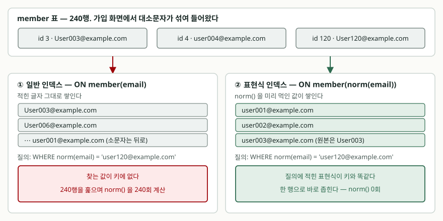

## 들어가며

회원 가입 화면에서 이메일을 받는다. 어떤 사람은 `user120@example.com` 으로 치고
어떤 사람은 휴대폰 자동 대문자 때문에 `User120@example.com` 으로 친다. 나중에
로그인 화면에서 소문자로 입력하면 `WHERE email = 'user120@example.com'` 이
아무것도 못 찾는다.

고치는 방법은 바로 떠오른다. `WHERE lower(email) = ?` 로 바꾸면 된다. 실제로
찾아진다. 그런데 회원이 몇 만 명으로 늘면 이 조회만 유독 느려진다. `email` 에
인덱스를 분명히 걸어 뒀는데도 그렇다.

인덱스가 있는데 왜 안 쓰이는지가 눈에 안 보이니, 보통은 인덱스를 하나 더 걸거나
애플리케이션에서 소문자 컬럼을 따로 만들어 관리하는 쪽으로 간다. 컬럼을 하나
늘리면 저장할 때마다 두 곳을 맞춰 줘야 하고, 한쪽이 빠지면 조용히 틀린 답이 나온다.

## 개념

**표현식 인덱스**(index on expression)는 컬럼 값이 아니라 **식의 결과**를 키로
쌓는 인덱스다. SQLite 는 3.9.0부터 지원한다.

```sql
CREATE INDEX idx_member_email_norm ON member(norm(email));
```

`member(email)` 이 아니라 `member(norm(email))` 이다. 인덱스를 만들 때 240행
전부에 `norm()` 을 한 번씩 먹여 그 결과를 정렬해 쌓아 둔다. 조회할 때는 이미
계산된 값이 거기 있으니 다시 계산할 일이 없다.

컬럼을 하나 늘려 직접 관리하는 방법과 결과는 같지만, **갱신을 DB가 맡는다**는
점이 다르다. `email` 이 바뀌면 인덱스 키도 같이 바뀐다. 애플리케이션이 잊어버릴
여지가 없다.

## 구조



> **출처**: [SQLite — Indexes On Expressions §1 How To Use Indexes On Expressions](https://www.sqlite.org/expridx.html#how_to_use_indexes_on_expressions), [SQLite — Datatypes In SQLite §7 Collating Sequences](https://www.sqlite.org/datatype3.html#collating_sequences)

## 동작 원리

일반 인덱스가 안 쓰이는 이유는 단순하다. 인덱스에는 `User003@example.com` 처럼
**적힌 그대로**가 쌓여 있는데, 질의는 `norm(email)` 의 값을 묻는다. 둘은 다른
값이므로 인덱스에서 찾을 수가 없다.

여기서 확인하기 어려운 것이 하나 있다. 실행계획에 `SCAN` 이 찍히면 표를 전부
읽었다는 뜻이지만, **행마다 함수가 실제로 불렸는지**는 실행계획에 안 나온다.
그래서 인덱스에 쓰는 함수를 파이썬 쪽에 직접 등록하고 호출될 때마다 세도록 했다.

```python
def norm(value: str) -> str:
    global norm_calls
    norm_calls += 1
    return value.strip().lower()

# 표현식 인덱스에 쓰려면 결정적 함수로 등록해야 한다
conn.create_function("norm", 1, norm, deterministic=True)
```

`member` 가 240행이므로 행마다 불리면 240회, 인덱스에서 바로 찾으면 0회다.
숫자 하나로 갈린다.

## 실습 예제

전체 소스: [`code/`](code/) · 실행 기록: [`code/output.txt`](code/output.txt)

표와 데이터는 기록 앞머리에 그대로 찍혀 있다. 찾는 값은 `user120@example.com`
이고, 실제 저장된 값은 `User120@example.com` 이다.

| 인덱스 | 질의 | `norm()` 호출 | 실행계획 |
|---|---|---:|---|
| 없음 | `email = ?` | 0회 | `SCAN member` |
| 없음 | `norm(email) = ?` | 240회 | `SCAN member` |
| `ON member(email)` | `email = ?` | 0회 | `SEARCH member USING COVERING INDEX idx_member_email (email=?)` |
| `ON member(email)` | `norm(email) = ?` | 240회 | `SCAN member USING COVERING INDEX idx_member_email` |
| `ON member(norm(email))` | `norm(email) = ?` | **0회** | `SEARCH member USING COVERING INDEX idx_member_email_norm (<expr>=?)` |
| `ON member(norm(email))` | `norm(email \|\| '') = ?` | 240회 | `SCAN member USING COVERING INDEX idx_member_email` |

실행계획 칸은 `EXPLAIN QUERY PLAN` 이 돌려준 `detail` 원문이다.

첫 줄과 세 번째 줄이 이 글의 출발점이다. `email = ?` 는 인덱스를 타지만
**결과가 빈 목록**이다. 저장된 값이 `User120@...` 이라 못 찾는다. 찾아지는 쪽은
`norm(email) = ?` 인데 그쪽이 240회를 치른다.

표현식 인덱스를 걸면 같은 질의가 `SEARCH` 로 바뀌고 호출이 0회가 된다. 그리고
`ORDER BY norm(email)` 도, `BETWEEN` 범위 조건도 이 인덱스로 처리됐다.

예상과 달랐던 것은 **`LIKE 'user1%'` 가 범위로 안 바뀌었다**는 점이다. 앞부분
일치니까 인덱스 범위 검색이 될 법한데 `SCAN` 이 찍혔다. 짐작하지 않고
`PRAGMA case_sensitive_like = ON` 으로 켜고 다시 돌렸더니 그제야
`SEARCH ... (<expr>>? AND <expr><?)` 가 됐다.

```text
QUERY PLAN
`--SEARCH member USING COVERING INDEX idx_member_email_norm (<expr>>? AND <expr><?)
```

기본값의 `LIKE` 는 대소문자를 가리지 않는데 인덱스는 대소문자를 가리는 순서로
쌓여 있다. 둘이 어긋나면 앞부분 일치를 범위로 바꿀 수 없다. 같은 조건을
`norm(email) >= 'user1' AND norm(email) < 'user2'` 로 직접 적으면 `PRAGMA` 를
건드리지 않고도 `SEARCH` 가 나온다.

## 실무에서 주의할 점

**표현식은 글자 그대로 맞아야 한다.** SQLite 는 대수 변형을 하지 않는다.
`ON score(x + y)` 를 걸어 두고 `WHERE y + x = 60` 으로 물으면 `SCAN` 이다.
`WHERE x = 60 - y` 로 이항해도 마찬가지다. 위 표의 `norm(email || '')` 도 같은
경우로, 결과는 같은데 240회를 다시 치른다. 조회하는 코드가 여러 군데면 식을
한 곳에 모아 두고 쓰는 편이 안전하다.

**애플리케이션 함수를 인덱스에 쓰면 그 함수 없이는 쓰기가 막힌다.** 파일
데이터베이스에 `norm()` 으로 인덱스를 만들어 두고, 함수를 등록하지 않은 연결로
열어 보면 이렇게 갈린다.

| 하려는 일 | 결과 |
|---|---|
| `SELECT email FROM t` | 정상 |
| `SELECT ... WHERE norm(email) = ?` | `OperationalError: no such function: norm` |
| `INSERT INTO t VALUES ('C@d.com')` | `OperationalError: unknown function: norm()` |

조회만 막히는 게 아니라 **그 표에 행을 넣는 것 자체가 막힌다.** 인덱스를
갱신하려면 함수가 있어야 하기 때문이다. 백업 복구 스크립트나 마이그레이션 도구가
이 함수를 모르면 그 자리에서 선다. `lower()` 같은 내장 함수만 쓰면 이 문제가 없다.

**이 용도라면 `COLLATE NOCASE` 가 더 간단하다.** `CREATE INDEX idx ON member(email COLLATE NOCASE)`
를 걸고 `WHERE email = ? COLLATE NOCASE` 로 물으면 함수 없이 `SEARCH` 가 나온다.
다만 `NOCASE` 가 접어 주는 범위를 확인해 둬야 한다.

| 비교 | 결과 |
|---|---|
| `'ABC' = 'abc' COLLATE NOCASE` | `True` |
| `'ÄÖÜ' = 'äöü' COLLATE NOCASE` | `False` |

**ASCII 26글자만 접는다.** 앞뒤 공백을 떼는 것 같은 다른 정규화도 못 한다.
그 이상이 필요하면 표현식 인덱스로 간다.

**못 쓰는 자리가 정해져 있다.** 비결정적 함수(`random()`), 부질의, 그리고
`CREATE TABLE` 안의 `UNIQUE` 제약에는 표현식을 못 쓴다. 셋 다 `CREATE` 시점에
에러로 막힌다. 다만 **`CREATE UNIQUE INDEX` 로는 된다.** 대소문자만 다른
이메일을 막는 유일성 제약이 여기서 나온다.

**인덱스는 늘어난 만큼 쓰기 비용이 된다.** `email` 인덱스와 `norm(email)`
인덱스를 둘 다 두면 행 하나를 넣을 때 두 곳을 갱신한다. 원문 그대로 찾는 질의가
없다면 일반 인덱스는 지우는 쪽이 맞다.

## 정리

- 표현식 인덱스는 컬럼이 아니라 **식의 결과**를 키로 쌓는다. 함수를 씌운 조회가
  인덱스를 탈 수 있게 된다.
- 같은 질의에서 함수 호출이 240회에서 0회로 줄었고, 실행계획이 `SCAN` 에서
  `SEARCH` 로 바뀌었다.
- 질의의 식이 `CREATE INDEX` 에 적은 식과 **글자 그대로** 같아야 한다.
  `y + x`, `norm(email || '')` 은 모두 빗나갔다.
- `LIKE` 앞부분 일치는 콜레이션이 어긋나면 범위로 안 바뀐다. 범위 조건으로
  직접 적으면 `SEARCH` 가 나온다.
- 애플리케이션 정의 함수를 쓰면 그 함수를 모르는 연결에서 **INSERT 까지 막힌다.**
  단순 대소문자 무시라면 `COLLATE NOCASE` 가 먼저다.

## 참고 자료

- [SQLite — Indexes On Expressions](https://www.sqlite.org/expridx.html)
- [SQLite — Datatypes In SQLite §7 Collating Sequences](https://www.sqlite.org/datatype3.html#collating_sequences)
- [SQLite — Query Planner §4 The LIKE Optimization](https://www.sqlite.org/optoverview.html#the_like_optimization)
- [SQLite — CREATE INDEX](https://www.sqlite.org/lang_createindex.html)
- [SQLite — EXPLAIN QUERY PLAN](https://www.sqlite.org/eqp.html)
