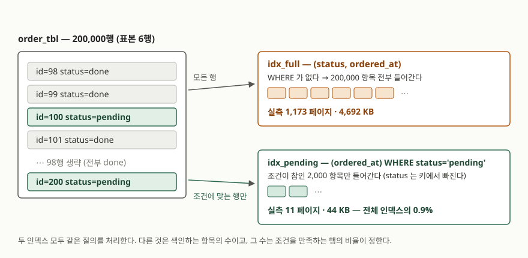

## 들어가며

주문 테이블을 두고 관리자 화면을 만든다. 첫 화면에 올라가는 것은 "아직 처리 안 된
주문" 목록이다. 주문은 20만 건 쌓였는데 미처리는 보통 2천 건 안쪽이다. 쌓인 주문의
1%만 보면 되는 화면인 셈이다.

이때 거의 모두가 하는 일은 `CREATE INDEX ... ON order_tbl(status, ordered_at)`
이다. 실제로 빨라진다. 8.74ms가 0.03ms가 된다. 보통 여기서 끝낸다.

그런데 이 인덱스는 **절대 찾지 않을 `done` 주문 19만 8천 건까지 전부 색인한다.**
그 19만 8천 개 항목은 디스크를 먹고, 주문이 들어오거나 상태가 바뀔 때마다 같이
갱신된다. 화면이 보는 것은 1%인데 비용은 100%를 낸다.

## 개념 — 인덱스에도 WHERE를 붙인다

부분 인덱스는 `CREATE INDEX` 문 끝에 `WHERE` 절을 붙인 인덱스다. SQLite 문서는
이렇게 적는다. **끝에 WHERE 절이 붙은 인덱스는 전부 부분 인덱스이고, WHERE 절이
없는 것이 보통의 전체 인덱스다.**

```sql
-- 전체 인덱스: 20만 행 전부가 들어간다
CREATE INDEX idx_full ON order_tbl(status, ordered_at);

-- 부분 인덱스: 조건이 참인 행만 들어간다
CREATE INDEX idx_pending ON order_tbl(ordered_at) WHERE status = 'pending';
```

새로운 자료구조가 아니다. 같은 B-tree인데 **넣는 행을 고르는 조건이 하나 더 붙은
것뿐이다.** 조건이 거짓인 행은 인덱스에 항목 자체가 만들어지지 않는다.

여기서 한 가지가 더 따라온다. 부분 인덱스 안에서 `status`는 **언제나 `pending`**
이므로, 키에 `status`를 넣을 이유가 없다. 그래서 색인 컬럼이 `(status, ordered_at)`
에서 `(ordered_at)`으로 하나 줄었다.

## 구조 — 무엇이 줄어드는가



> **출처**: [SQLite Partial Indexes §2 Creating Partial Indexes](https://www.sqlite.org/partialindex.html#creating_partial_indexes) · [SQLite Database File Format §2.5 Representation Of SQL Indices](https://www.sqlite.org/fileformat2.html#representation_of_sql_indices)

파일 포맷 명세는 인덱스 b-tree의 한 항목을 **색인 컬럼들의 값 뒤에 그 행의 rowid가
따라붙은 것**으로 적는다. 그러니 인덱스 크기는 대체로 `항목 수 × 항목 하나의 크기`다.

부분 인덱스는 이 곱셈의 **양쪽을 다 줄인다.** 항목 수가 20만에서 2천으로 줄고,
`status`가 키에서 빠지면서 항목 하나도 조금 짧아진다. 다만 두 몫의 크기는 전혀
다르다. 실측한 페이지를 항목 수로 나눠 보면 항목 하나는 24바이트에서 22.5바이트로
6% 줄었을 뿐이다. **줄어든 4.6MB의 거의 전부는 항목 수에서 나온다.**

## 동작 원리 — 쓸 수 있는지를 어떻게 판정하는가

부분 인덱스에는 전체 인덱스에 없는 문제가 하나 있다. 이 인덱스에는 `pending` 행밖에
없으므로, **`done` 행도 봐야 하는 질의에 쓰면 답이 틀린다.** 그래서 SQLite는 질의마다
"이 인덱스를 써도 되는가"를 먼저 판정한다.

문서가 적는 규칙은 이렇다. 인덱스의 WHERE 절을 X, 질의의 WHERE 절을 W라 할 때
**W ⇒ X 이면 그 인덱스를 쓸 수 있다.** 그리고 바로 다음 문장이 중요하다.
SQLite에는 정교한 정리 증명기가 없고, **W의 AND로 묶인 항 중 하나가 X의 항과
글자 그대로 일치하는지**만 본다. 대수를 풀지 않으므로 `b=6`과 `b=3+3`은 다른 것으로
친다.

판정 규칙이 이렇게 거칠다는 것이 그대로 함정이 된다. 같은 뜻의 조건을 조금 다르게
적으면 인덱스가 조용히 무시된다.

## 실습 예제

20만 행을 넣고 세 상태(인덱스 없음 / 전체 인덱스 / 부분 인덱스)에서 같은 질의를
각각 아홉 번 재 중앙값을 뽑았다. 난수를 쓰지 않아 몇 번을 돌려도 같은 데이터가 나온다.
전체 소스: [`code/`](code/) · 돌린 기록: [`code/output.txt`](code/output.txt)

```sql
SELECT id, customer_id, ordered_at
  FROM order_tbl
 WHERE status = 'pending'
 ORDER BY ordered_at
 LIMIT 20;
```

| | 인덱스 페이지 | 크기 | 질의 중앙값 | 실행계획 `detail` 원문 |
|---|---|---|---|---|
| 인덱스 없음 | 0 | 0 KB | 8.74 ms | `SCAN order_tbl` + `USE TEMP B-TREE FOR ORDER BY` |
| `idx_full` | 1,173 | 4,692 KB | 0.03 ms | `SEARCH order_tbl USING INDEX idx_full (status=?)` |
| `idx_pending` | 11 | 44 KB | 0.03 ms | `SCAN order_tbl USING INDEX idx_pending` |

속도는 둘이 같고 **크기만 0.9%로 줄었다.** 페이지 크기는 4,096바이트이고, 숫자는
`PRAGMA page_count`를 `VACUUM` 뒤에 재서 뺀 값이다.

실행계획을 읽을 때 `idx_pending` 쪽이 `SEARCH`가 아니라 `SCAN`인 것이 눈에 걸린다.
탐색이 아니라 훑기인데 더 느리지 않은 이유는, 훑는 대상이 표 20만 행이 아니라
**인덱스에 든 2천 항목 전부**이기 때문이다. 게다가 그 2천 개는 이미 `ordered_at`
순으로 정렬돼 있어 `ORDER BY`가 공짜가 된다. 인덱스 없는 경우에만 붙어 있는
`USE TEMP B-TREE FOR ORDER BY`가 그 차이다.

### 언제 무시되는가

같은 `idx_pending`을 두고 질의만 바꿔 실행계획을 찍었다. 아래 `detail`은 전부
`EXPLAIN QUERY PLAN` 출력 원문이다.

| 질의의 WHERE | 쓰는가 | `detail` |
|---|---|---|
| `status = 'pending'` | 쓴다 | `SCAN order_tbl USING COVERING INDEX idx_pending` |
| `status = ?` (값은 `'pending'`) | 쓴다 | `SCAN order_tbl USING COVERING INDEX idx_pending` |
| `status = 'pending' AND amount > 50000` | 쓴다 | `SCAN order_tbl USING INDEX idx_pending` |
| `status = 'pending' OR status = 'done'` | 안 쓴다 | `SCAN order_tbl` |
| `status IN ('pending')` | **안 쓴다** | `SCAN order_tbl` |
| `status = 'done'` | 안 쓴다 | `SCAN order_tbl` |
| 조건 없음 | 안 쓴다 | `SCAN order_tbl` |

`IN ('pending')` 줄이 이 글에서 가장 값나가는 한 줄이다. 값이 하나뿐인 `IN`은 사람
눈에 `=`와 같은 뜻이지만, **글자가 다르면 다른 것으로 치는** 규칙에 그대로 걸린다.
`OR`로 묶은 줄도 같다. `AND`로 조건을 더 붙이는 것은 W가 더 강해지는 쪽이라 괜찮다.

### 파라미터로 넘겨도 쓴다

위 표에서 두 번째 줄은 예상과 달랐다. 조건을 `?`로 넘기면 컴파일 시점에 값을 알 수
없으니 인덱스를 못 쓸 것이라고 봤는데, 썼다. 그래서 같은 문장에 `'done'`을 넣어 답이
틀리는지 대조했다.

```text
pending  count=   2000  plan=['SCAN order_tbl USING COVERING INDEX idx_pending']
done     count= 198000  plan=['SCAN order_tbl']
pending  count=   2000  plan=['SCAN order_tbl USING COVERING INDEX idx_pending']
```

**같은 SQL 문장인데 묶인 값에 따라 계획이 갈리고, 답은 양쪽 다 맞다.** 이것은
SQLite 3.20.0 릴리스 노트에 적힌 동작이다. 질의 계획기가 묶인 파라미터의 값을 보고
부분 인덱스를 쓸 수 있는지 판정한다. 값이 바뀌면 그 문장은 다시 계획된다.

### UNIQUE를 붙이면 — 소프트 삭제의 정석

부분 인덱스에 `UNIQUE`를 붙이면 **인덱스에 든 항목끼리만** 유일성이 걸린다.
탈퇴 회원의 행을 지우지 않고 남겨 두는 설계에서 늘 걸리던 문제가 여기서 풀린다.

```sql
CREATE UNIQUE INDEX idx_live_email
    ON member(email) WHERE deleted_at IS NULL;
```

실제로 돌린 결과다.

```text
[성공] 가입
[거부] 같은 주소로 또 가입 — 막혀야 한다
       sqlite3.IntegrityError: UNIQUE constraint failed: member.email
[성공] 1번을 탈퇴 처리 (행은 남긴다)
[성공] 같은 주소로 재가입 — 이제 통과해야 한다
[성공] 탈퇴한 행이 둘이 돼도 상관없다
```

살아 있는 회원끼리는 이메일이 겹치지 않고, 탈퇴한 행은 몇 개가 쌓여도 상관없다.
컬럼에 `UNIQUE`를 걸면 둘 중 하나를 포기해야 하는데, 부분 인덱스는 둘 다 가진다.

## 실무에서 주의할 점

- **조건을 쓰는 모양을 인덱스와 똑같이 맞춘다.** `IN ('pending')`, `OR`로 묶기,
  `UPPER(status) = 'PENDING'` 같은 변형은 전부 인덱스를 놓친다. 붙였다고 끝내지
  말고 `EXPLAIN QUERY PLAN`으로 인덱스 이름이 실제로 나오는지 확인한다.
- **선택도가 낮으면 이득이 없다.** 색인 대상이 전체의 1%라 100배가 줄었다. 절반이
  대상이면 절반밖에 안 줄고, 그 절반을 얻자고 질의마다 조건 모양을 맞추는 부담을
  진다. 대상이 한 자릿수 퍼센트일 때 쓰는 도구다.
- **조건에 쓰는 값이 바뀌면 인덱스를 다시 만들어야 한다.** `WHERE status = 'pending'`
  으로 만들어 두고 나중에 상태 이름을 `waiting`으로 바꾸면, 인덱스는 에러 없이
  **빈 채로 남는다.** 느려질 뿐 아무 경고가 없으니 상태값을 바꾸는 작업의 점검
  목록에 인덱스를 같이 적어 둔다.
- **WHERE 절에 넣을 수 없는 것이 있다.** 문서는 부분 인덱스의 WHERE 절에
  서브쿼리, 다른 표 참조, 비결정적 함수, 바인딩 파라미터를 쓸 수 없다고 적는다.
  `WHERE created_at > date('now')` 같은 것이 여기 걸린다. 색인 범위가 날마다
  달라지는 인덱스는 성립하지 않는다.

## 정리

- 부분 인덱스는 `CREATE INDEX` 끝에 `WHERE`를 붙여 **조건이 참인 행만** 색인한다.
- 1% 선택도에서 인덱스가 4,692KB에서 44KB로 줄었고, 질의 속도는 0.03ms로 같았다.
- SQLite는 질의의 WHERE가 인덱스의 WHERE를 함의하는지를 **글자가 일치하는지로만**
  본다. `IN ('pending')`처럼 뜻이 같아도 모양이 다르면 무시된다.
- 묶인 파라미터의 값은 계획기가 들여다본다. `status = ?`도 값에 따라 인덱스를 쓴다.
- `UNIQUE` 부분 인덱스는 "살아 있는 행끼리만 유일" 같은 제약을 표현한다.

## 참고 자료

- [SQLite — Partial Indexes](https://www.sqlite.org/partialindex.html) — §2 Creating Partial Indexes, §2.1 Unique Partial Indexes, §3 Queries Using Partial Indexes
- [SQLite — Database File Format §2.5 Representation Of SQL Indices](https://www.sqlite.org/fileformat2.html#representation_of_sql_indices)
- [SQLite Release 3.20.0 (2017-08-01)](https://sqlite.org/releaselog/3_20_0.html) — 묶인 파라미터 값을 보고 부분 인덱스 사용 여부를 판정한다는 항목
- [SQLite — The Query Optimizer Overview](https://www.sqlite.org/optoverview.html)
