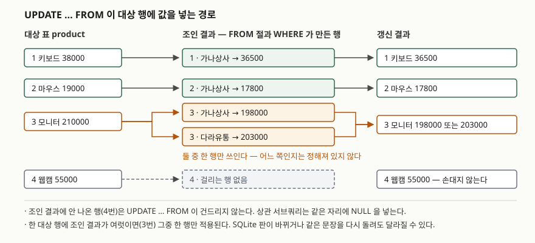

## 들어가며

재고나 단가를 엑셀로 관리하다 못 견뎌 SQLite로 옮긴 다음에도, 매달 같은 일이 돌아온다.
공급사에서 새 단가표가 날아오면 그 값을 상품 표에 반영해야 한다.
처음에는 `UPDATE product SET unit_price = 36500 WHERE product_id = 1;` 을 한 줄씩 친다.
품목이 네 개일 때는 이게 제일 빠르다.

품목이 200개가 되면 이야기가 달라진다. 200줄을 손으로 만들어야 하고, 한 줄만 번호를 잘못 적어도
엉뚱한 상품의 단가가 바뀌는데 그 줄은 에러를 내지 않는다. 조용히 성공한다.
단가표를 표로 적재해 두고 **표끼리 맞춰 한 문장으로 갱신하는 방법**이 필요해지는 지점이다.

## 상관 서브쿼리 — 가장 먼저 배우는 방법

표준 SQL에서 오래 쓰여 온 방법은 `SET` 오른쪽에 서브쿼리를 넣는 것이다.
서브쿼리 안에서 바깥 표의 컬럼(`product.product_id`)을 참조하기 때문에 **상관 서브쿼리**라고 부른다.
바깥 행 하나하나에 대해 서브쿼리가 따로 평가된다는 뜻이다.

```sql
UPDATE product
   SET unit_price = (SELECT sp.unit_price
                       FROM supplier_price sp
                      WHERE sp.product_id = product.product_id
                        AND sp.supplier_name = '가나상사');
```

문법은 깔끔한데, 이 문장에는 함정이 하나 있다. `UPDATE` 에 `WHERE` 가 없으므로
**`product` 의 모든 행이 갱신 대상**이다. 단가표에 없는 상품을 만나면 서브쿼리는 행을 못 찾고,
행을 못 찾은 스칼라 서브쿼리의 값은 `NULL` 이다. 그 `NULL` 이 그대로 단가 자리에 들어간다.

## 구조 — UPDATE … FROM 이 값을 넣는 경로

SQLite는 3.33.0(2020-08-14)부터 `UPDATE` 에 `FROM` 절을 붙일 수 있다.
대상 표와 `FROM` 절의 표를 **조인해서 나온 행**을 가지고 대상 표를 고치는 방식이다.



> **출처**: [SQLite: UPDATE — §2.2 UPDATE FROM](https://www.sqlite.org/lang_update.html#update_from)

그림의 가운데 칸이 핵심이다. 갱신은 대상 표의 행이 아니라 **조인 결과의 행**을 따라 일어난다.
조인 결과에 나오지 않은 4번 웹캠은 갱신 대상이 아니고, 조인 결과가 두 줄인 3번 모니터는
그중 한 줄만 쓰인다.

## 동작 원리 — 짝이 없을 때와 둘일 때

두 방법의 차이는 **짝이 없는 행**에서 갈린다.

- 상관 서브쿼리: 대상 표의 모든 행이 갱신된다. 짝이 없으면 `NULL` 이 들어간다
- `UPDATE … FROM`: 조인에 걸린 행만 갱신된다. 짝이 없으면 **아무 일도 일어나지 않는다**

짝이 둘 이상일 때는 `UPDATE … FROM` 쪽에 따로 규칙이 있다. SQLite 매뉴얼의 UPDATE FROM 절은
"조인 결과가 같은 대상 행에 여러 줄을 만들면 그중 한 줄만 쓰이고, 어느 줄이 선택되는지는
임의이며 판이 바뀌거나 다시 돌릴 때 달라질 수 있다"고 적는다.
**에러가 아니다.** 경고도 없다. 값 하나가 조용히 결정된다.

## 실습 예제

상품 네 개와 공급사 단가 네 줄을 두고 돌렸다. 3번 모니터는 공급사가 둘이고(짝이 둘),
4번 웹캠은 단가표에 아예 없다(짝이 없음).

```text
[product]  4행
  product_id | product_name | unit_price
  -----------+--------------+-----------
           1 | 키보드       |      38000
           2 | 마우스       |      19000
           3 | 모니터       |     210000
           4 | 웹캠         |      55000

[supplier_price]  4행
  supplier_name | product_id | unit_price
  --------------+------------+-----------
  가나상사      |          1 |      36500
  가나상사      |          2 |      17800
  가나상사      |          3 |     198000
  다라유통      |          3 |     203000
```

전체 소스는 [`code/update_from.py`](code/update_from.py)에, 돌린 기록은
[`code/output.txt`](code/output.txt)에 있다.

### 짝이 없는 행이 NULL 이 된다

위의 상관 서브쿼리를 그대로 돌린 결과다.

```text
  갱신된 행 수: 4

-- 갱신 후 product
   (1, '키보드', 36500)
   (2, '마우스', 17800)
   (3, '모니터', 198000)
   (4, '웹캠', 'NULL')
```

네 행이 전부 갱신됐고, 단가표에 없던 웹캠의 55000원이 사라졌다.
`unit_price` 에 `NOT NULL` 이 걸려 있었다면 결과가 달라진다.

```text
  sqlite3.IntegrityError: NOT NULL constraint failed: product_strict.unit_price

-- 갱신 후 product_strict — 문장 전체가 되돌려졌다
   (1, '키보드', 38000)
   (2, '마우스', 19000)
   (3, '모니터', 210000)
   (4, '웹캠', 55000)
```

제약이 사고를 막아 준 셈인데, 막는 방식이 "세 행까지 고치고 네 번째에서 멈춤"이 아니다.
한 문장은 전부 적용되거나 전부 취소되므로 성공했던 세 행의 갱신도 같이 되돌아간다.
제약이 없는 표였다면 아무 소리 없이 `NULL` 이 들어갔을 자리다.

### WHERE EXISTS 로 막기 vs UPDATE … FROM

상관 서브쿼리를 고치려면 "짝이 있는 행만 고른다"는 조건을 `WHERE` 에 한 번 더 적어야 한다.

```sql
UPDATE product
   SET unit_price = (SELECT sp.unit_price FROM supplier_price sp
                      WHERE sp.product_id = product.product_id
                        AND sp.supplier_name = '가나상사')
 WHERE EXISTS (SELECT 1 FROM supplier_price sp
                WHERE sp.product_id = product.product_id
                  AND sp.supplier_name = '가나상사');
```

같은 조건을 두 번 적는 것이 눈에 거슬린다. `UPDATE … FROM` 은 한 번만 적는다.

```sql
UPDATE product
   SET unit_price = sp.unit_price
  FROM supplier_price sp
 WHERE sp.product_id = product.product_id
   AND sp.supplier_name = '가나상사';
```

둘 다 `갱신된 행 수: 3` 이고 결과도 같다. 웹캠의 55000원은 그대로 남았다.

### 실행계획은 같지 않다

결과가 같다고 같은 일을 하는 것은 아니다. `EXPLAIN QUERY PLAN` 을 그대로 옮긴다.

```text
-- ② 상관 서브쿼리 + WHERE EXISTS
QUERY PLAN
|--SCAN product
|--CORRELATED SCALAR SUBQUERY 2
|  `--SCAN sp
`--CORRELATED SCALAR SUBQUERY 1
   `--SCAN sp
```

```text
-- ③ UPDATE … FROM
QUERY PLAN
|--SCAN sp
`--SEARCH product USING INTEGER PRIMARY KEY (rowid=?)
```

예상과 달랐던 부분이 여기다. 서브쿼리 쪽은 `CORRELATED SCALAR SUBQUERY` 가 **두 덩이** 잡힌다.
`SET` 에 쓴 것과 `WHERE EXISTS` 에 쓴 것이 같은 조건인데도 따로 평가된다.
`product` 를 훑으면서 행마다 `sp` 를 두 번 훑는 모양이다.

`UPDATE … FROM` 쪽은 **구동 표가 뒤집혔다.** 대상 표인 `product` 가 아니라 `sp` 를 훑고,
거기서 나온 `product_id` 로 `product` 를 rowid 검색한다. 옵티마이저가 조인으로 보기 때문에
고를 수 있는 선택지이고, 조건을 두 번 적는 쪽에서는 나올 수 없는 계획이다.

### 짝이 둘이면 어느 값이 들어가나

공급사를 좁히는 조건을 빼고 돌렸다.

```text
UPDATE product
   SET unit_price = sp.unit_price
  FROM supplier_price sp
 WHERE sp.product_id = product.product_id;

  갱신된 행 수: 3

-- 갱신 후 product
   (1, '키보드', 36500)
   (2, '마우스', 17800)
   (3, '모니터', 203000)
   (4, '웹캠', 55000)
```

조인 결과는 네 줄인데 `갱신된 행 수` 는 3이다. 3번 모니터가 두 줄에 걸렸지만 한 번만 갱신됐다는 뜻이다.
들어간 값은 뒤에 적재한 다라유통의 203000이었다. 같은 문장을 다섯 번 돌려 봤다.

```text
  1회차 — 3번 모니터에 들어간 값: 203000
  2회차 — 3번 모니터에 들어간 값: 203000
  3회차 — 3번 모니터에 들어간 값: 203000
  4회차 — 3번 모니터에 들어간 값: 203000
  5회차 — 3번 모니터에 들어간 값: 203000
```

**이 안정성을 믿으면 안 된다.** 매뉴얼이 "임의이며 판이 바뀌거나 다시 돌릴 때 달라질 수 있다"고
적어 둔 이상, 같은 값이 다섯 번 나온 것은 이 판 이 데이터에서 그랬다는 기록일 뿐이다.
하나를 골라야 한다면 `MIN`·`MAX` 나 집계 서브쿼리로 **직접 고르는 조건을 적는다.**

### FROM 절에 대상 표를 다시 적으면

다른 DB를 쓰던 습관으로 `FROM` 에 대상 표를 한 번 더 적는 경우가 있다.
`WHERE p.product_id = 1` 로 한 행만 고치려던 문장이다.

```text
UPDATE product
   SET unit_price = sp.unit_price
  FROM product p
       JOIN supplier_price sp ON sp.product_id = p.product_id
 WHERE p.product_id = 1;

  갱신된 행 수: 4

-- 갱신 후 product
   (1, '키보드', 36500)
   (2, '마우스', 36500)
   (3, '모니터', 36500)
   (4, '웹캠', 36500)
```

네 행 전부가 36500원이 됐다. `FROM` 의 `p` 는 대상 표와 **다른 표 취급**이고,
`WHERE` 가 걸린 쪽도 `p` 다. 대상 표 `product` 에는 아무 조건이 없으므로 전 행이 대상이 되고,
`p.product_id = 1` 로 좁혀진 한 줄의 단가가 모든 행에 들어간다.
SQLite 매뉴얼은 "셀프 조인이 의도가 아니라면 대상 표를 FROM 절에 넣지 않는다"고 적는다.

## 실무에서 주의할 점

- **`WHERE` 없는 상관 서브쿼리 갱신은 전 행 갱신이다.** 짝이 없는 행에 `NULL` 이 들어가고,
  `NOT NULL` 이 걸려 있으면 문장 전체가 취소된다. 어느 쪽이든 의도한 결과가 아니다.
  이 방식을 쓸 거면 `WHERE EXISTS` 를 같이 적는다
- **조인이 여러 행에 걸릴 수 있는지 먼저 센다.** `SELECT product_id, COUNT(*) FROM supplier_price
  GROUP BY product_id HAVING COUNT(*) > 1` 로 확인한 뒤, 걸리는 것이 있으면
  "어느 행을 쓸지"를 조건으로 적는다. 안 적으면 엔진이 임의로 고른다
- **`FROM` 절에 대상 표 이름을 적지 않는다.** 조인이 되는 게 아니라 전 행이 대상이 된다.
  셀프 조인이 정말 필요하면 반드시 다른 별칭을 준다
- **갱신 전에 같은 조건으로 `SELECT` 를 먼저 돌린다.** 몇 행이 어떤 값으로 바뀔지 눈으로 본 뒤
  실행하고, `갱신된 행 수` 가 예상과 다르면 거기서 멈춘다
- **버전을 확인한다.** `UPDATE … FROM` 은 SQLite 3.33.0(2020-08-14)부터다.
  그 이전 판에서는 문법 에러가 난다

## 다른 엔진의 문법

같은 아이디어를 다른 DB도 지원하지만, SQL 표준에 없는 구문이라 제품마다 문법이 다르다.
아래는 **SQLite 매뉴얼이 직접 비교해 적어 둔 내용**이고, 이 글에서 해당 엔진을 실행해 확인한 것은 아니다.

| 엔진 | 대상 표를 FROM 절에 | 조인을 적는 자리 |
|---|---|---|
| SQLite 3.33.0+ | 넣지 않는다 (셀프 조인만 예외, 별칭 필수) | `FROM` 절 |
| PostgreSQL | SQLite가 호환을 목표로 삼은 쪽 | `FROM` 절 |
| SQL Server | **넣어야 한다** — 대상 표 이름이 두 번 나온다 | `FROM` 절 |
| MySQL | `FROM` 절을 쓰지 않는다 | `UPDATE` 와 `SET` 사이 |

> **출처**: [SQLite: UPDATE — §2.2.1 UPDATE FROM in other SQL database engines](https://www.sqlite.org/lang_update.html#update_from_in_other_sql_database_engines)

SQL Server 문법을 SQLite에 그대로 옮기면 앞에서 본 전 행 갱신 사고가 난다. 옮겨 적을 때 가장 먼저 볼 곳이다.

## 정리

- 상관 서브쿼리로 갱신하면 짝이 없는 행에 `NULL` 이 들어간다. `WHERE EXISTS` 를 같이 적어야 막힌다
- `UPDATE … FROM` 은 조인에 걸린 행만 갱신한다. 짝이 없는 행은 손대지 않는다
- 같은 결과를 내도 실행계획이 다르다. `UPDATE … FROM` 쪽은 구동 표를 뒤집어
  `SCAN sp` + `SEARCH product (rowid=?)` 로 풀렸다
- 조인이 여러 행에 걸리면 한 행만 쓰이고 어느 행인지는 정해져 있지 않다. 직접 고르는 조건을 적는다
- `FROM` 절에 대상 표를 다시 적으면 조인이 아니라 전 행 갱신이 된다

## 참고 자료

- [SQLite: UPDATE — §2.2 UPDATE FROM](https://www.sqlite.org/lang_update.html#update_from) — 구문, 도입 버전, 여러 행이 걸릴 때의 규칙
- [SQLite: UPDATE — §2.2.1 UPDATE FROM in other SQL database engines](https://www.sqlite.org/lang_update.html#update_from_in_other_sql_database_engines) — SQL Server·MySQL과의 문법 차이
- [SQLite: EXPLAIN QUERY PLAN](https://www.sqlite.org/eqp.html) — 실행계획 출력을 읽는 법
- [SQLite Release History — 3.33.0 (2020-08-14)](https://www.sqlite.org/changes.html) — UPDATE FROM 이 들어간 판
