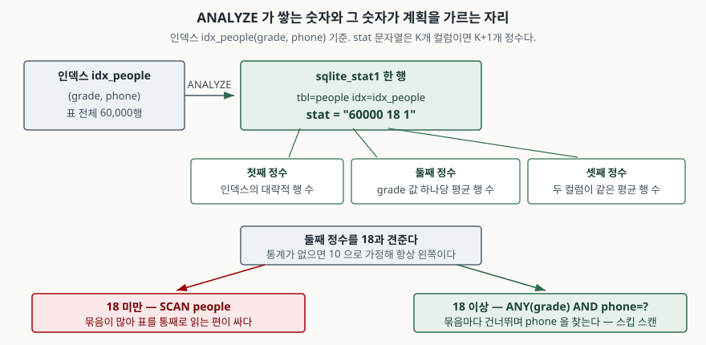

## 들어가며

개인 토이 프로젝트든 사내 도구든, SQLite 파일 하나에 데이터를 쌓다 보면 어느 날
목록 화면이 눈에 띄게 느려지는 때가 온다. 보통 가장 먼저 하는 일은 인덱스를
더 거는 것이다. 컬럼마다 인덱스를 하나씩 붙이고 다시 돌려 보는데 별로 안 빨라진다.
그래서 인덱스를 또 건다. 인덱스가 다섯 개쯤 쌓이고 나면 쓰기는 느려졌는데 읽기는
그대로인 상태가 된다.

인덱스를 걸었는데 안 쓰이는 경우가 있다. **옵티마이저가 그 인덱스를 쓰면 이득이라는
것을 모르기 때문이다.** 옵티마이저는 표를 읽어 보고 판단하지 않는다. 미리 쌓아 둔
숫자 몇 개를 보고 판단한다. 그 숫자를 만드는 명령이 `ANALYZE`다.

## 개념

`ANALYZE`는 표와 인덱스를 훑어 **통계를 `sqlite_stat1`이라는 표에 적어 두는 명령**이다.
한 번 실행하면 그 결과가 데이터베이스 파일 안에 남고, 이후의 모든 질의가 그 숫자를
참고한다. 질의할 때마다 다시 계산하지 않는다.

통계가 없으면 옵티마이저가 판단을 못 하느냐 하면 그렇지 않다. **기본값을 가정한다.**
등호 조건 하나가 걸리면 "그 값과 같은 행이 평균 10개쯤 있겠지" 하고 넘어간다.
문제는 이 가정이 실제와 크게 다를 때다. 값이 두 종류뿐인 컬럼이면 실제로는 수만 행이
같은 값을 가지는데, 옵티마이저는 10행으로 보고 계산한다.

## 구조



> **출처**: [SQLite Database File Format §2.6.4 The sqlite_stat1 table](https://www.sqlite.org/fileformat2.html#the_sqlite_stat1_table) · [Query Optimizer Overview §6 The Skip-Scan Optimization](https://www.sqlite.org/optoverview.html#the_skip_scan_optimization)

`stat` 컬럼은 공백으로 나뉜 정수 목록이다. 포맷 명세의 sqlite_stat1 항목(§2.6.4)이 정하는
규칙은 이렇다. 첫째 정수는 인덱스의 대략적인 행 수이고, N번째 정수(N>1)는 인덱스의
**앞 N-1개 컬럼 값이 같은 행의 평균 개수**다. 컬럼이 K개인 인덱스면 정수가 K+1개 나오고,
유일 인덱스면 마지막 정수가 1이다.

그러니까 `60000 18 1`은 이렇게 읽는다. 전체 60,000행, `grade` 값 하나당 평균 18행,
`(grade, phone)` 두 컬럼이 모두 같은 행은 평균 1행.

## 동작 원리

이 숫자가 실제로 계획을 가르는 자리가 있다. **스킵 스캔**이다.

`(grade, phone)` 인덱스에 `WHERE phone = ?`처럼 **선두 컬럼 없이** 조건을 주면 보통
인덱스를 못 쓴다. 인덱스가 `grade`로 먼저 정렬되어 있어서 `phone`만으로는 찾아갈
자리가 없기 때문이다. 그런데 `grade` 값이 세 종류뿐이라면 이야기가 다르다. 세 묶음을
각각 뒤지면 되므로, 사실상 인덱스를 세 번 타는 것과 같다. 이것이 스킵 스캔이다.

문제는 옵티마이저가 "grade 값이 세 종류뿐"이라는 사실을 어디서 아느냐다. 통계밖에
없다. 매뉴얼의 스킵 스캔 절(§6)은 이 점을 분명히 적는다 — 분석하지 않은 데이터베이스에서
스킵 스캔은 **절대** 쓰이지 않는다. 기본 가정값 10이 손익분기점인 18보다 작기 때문이다.

## 실습 예제

전체 소스: [`code/`](code/) · 돌린 기록: [`code/output.txt`](code/output.txt)

`people(grade, phone, name)` 30,000행에 `idx_people(grade, phone)`을 걸었다.
`grade`는 `vip`·`gold`·`basic` 세 값뿐이고 `phone`은 전부 다르다.

`ANALYZE` 전에 `WHERE phone = ?`를 돌리면 인덱스를 쓰지 못한다.

```text
QUERY PLAN
`--SCAN people
```

`ANALYZE`를 한 줄 넣고 같은 질의를 돌리면 계획이 바뀐다.

```text
  tbl    | idx        | stat
  -------+------------+-------------
  people | idx_people | 30000 10000 1

QUERY PLAN
`--SEARCH people USING INDEX idx_people (ANY(grade) AND phone=?)
```

`ANY(grade)`가 스킵 스캔의 표시다. 데이터도 인덱스도 질의도 그대로인데, 통계를
쌓았다는 것만으로 전체 스캔이 인덱스 탐색으로 바뀌었다.

### 경계는 정확히 18이다

매뉴얼이 말하는 18이 진짜 그 자리인지 확인해 봤다. 선두 컬럼의 중복 개수만 1씩
올리면서 계획을 찍은 결과다.

```text
  중복 | stat             | 계획
  -----+------------------+----------------------------------------------
    10 | 36000 10 1       | SCAN people
    15 | 36000 15 1       | SCAN people
    17 | 36000 17 1       | SCAN people
    18 | 36000 18 1       | SEARCH people USING INDEX idx_people (ANY(grade) AND phone=?)
    19 | 36000 19 1       | SEARCH people USING INDEX idx_people (ANY(grade) AND phone=?)
    25 | 36000 25 1       | SEARCH people USING INDEX idx_people (ANY(grade) AND phone=?)
```

17과 18 사이에서 정확히 갈린다. 문서의 숫자가 비유가 아니라 구현에 박힌 값이다.

### 통계는 한 번 찍은 사진이다

이어서 `grade`가 전부 다른 행 30,000개를 더 넣었다. 이제 `grade` 값은 30,003종이고
값 하나당 평균 1행이다. 스킵 스캔이 손해인 상태가 됐다. 그런데 `sqlite_stat1`은
`30000 10000 1` 그대로고, 계획도 스킵 스캔 그대로다. 다시 `ANALYZE`를 돌리면
`60000 2 1`로 갱신되고 계획이 `SCAN people`로 되돌아온다.

**통계는 `ANALYZE`를 돌린 그 순간의 사진이다.** 데이터가 바뀌어도 따라오지 않는다.

## 실무에서 주의할 점

- **`sqlite_stat1`은 평균만 담는다.** 위 예제의 마지막 상태에서 평균은 2행이지만
  `vip`·`gold`·`basic`은 각각 10,000행이다. 평균 2는 어느 등급도 설명하지 못한다.
  값별 분포를 담는 `sqlite_stat4`가 따로 있지만 `SQLITE_ENABLE_STAT4` 컴파일
  옵션이 있어야 하고, 예제를 돌린 파이썬 3.13.5 내장 빌드에는 들어 있지 않다
  (`PRAGMA compile_options`로 확인했다).
- **대량 적재 뒤에는 `ANALYZE`를 한 번 돌린다.** 빈 표에 인덱스를 만들고 데이터를
  넣은 경우가 가장 위험하다. 통계가 아예 없거나 0행 기준으로 남아 있다.
- **반대로 너무 자주 돌릴 필요는 없다.** `ANALYZE`는 인덱스를 전부 훑으므로 큰 표에서는
  비용이 든다. 데이터 양상이 크게 달라졌을 때만 돌리면 된다.
- **통계를 쌓았는데 계획이 그대로일 수 있다.** 그건 실패가 아니라 "원래 그 계획이
  맞았다"는 뜻이다. 통계는 선택지를 늘릴 뿐 더 좋은 계획을 만들어 내지는 않는다.
- **계획이 궁금하면 `EXPLAIN QUERY PLAN`을 쓴다.** 추측하지 말고 찍어 본다.
  `ANALYZE` 전후로 각각 한 번씩 돌려 비교하는 것이 가장 빠르다.

## 정리

- `ANALYZE`는 표와 인덱스를 훑어 `sqlite_stat1`에 통계를 적어 두는 명령이다.
- `stat` 문자열은 `행 수 + 앞 N개 컬럼이 같은 평균 행 수`의 나열이다. K컬럼 인덱스면 K+1개.
- 통계가 없으면 옵티마이저는 "값 하나당 10행"을 가정한다. 이 가정 때문에 스킵 스캔은
  분석하지 않은 데이터베이스에서 절대 선택되지 않는다.
- 경계는 중복 18개다. 17이면 전체 스캔, 18이면 스킵 스캔으로 갈린다.
- 통계는 갱신되지 않는 스냅샷이다. 데이터가 크게 달라졌으면 다시 돌려야 한다.

## 참고 자료

- [SQLite — ANALYZE](https://www.sqlite.org/lang_analyze.html)
- [SQLite Database File Format §2.6.4 The sqlite_stat1 table](https://www.sqlite.org/fileformat2.html#the_sqlite_stat1_table)
- [SQLite Query Optimizer Overview §6 The Skip-Scan Optimization](https://www.sqlite.org/optoverview.html#the_skip_scan_optimization)
- [SQLite — EXPLAIN QUERY PLAN](https://www.sqlite.org/eqp.html)
