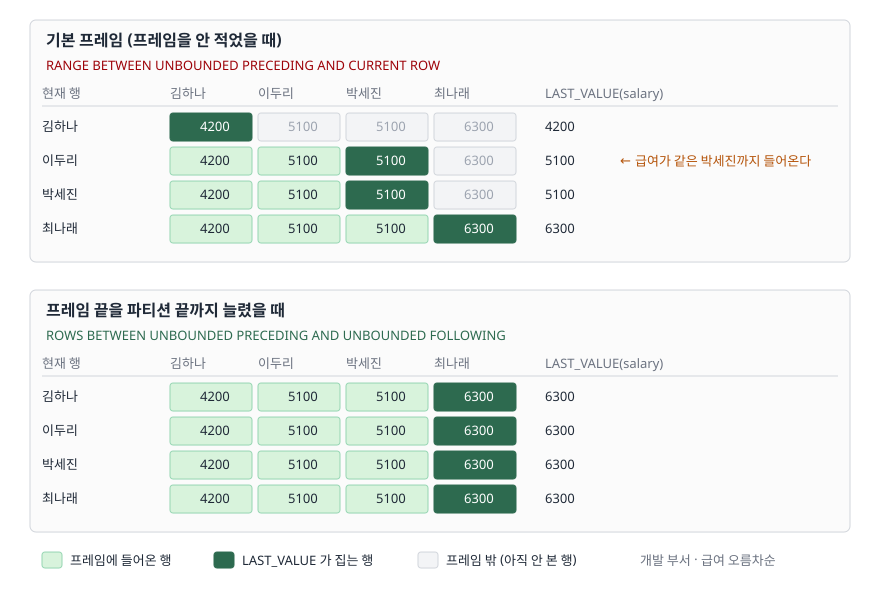

<!-- related:start -->
> **같은 기능을 다른 환경에서 다룬 글** (`window-function`)
> - [윈도우 함수 입문 — ROW_NUMBER로 그룹별 1등 뽑기](../2026-10-03-window-function-row-number-top-per-group/index.md) — SQLite 3.49.1, Python 3.13.5, Windows 11
> - [RANK와 DENSE_RANK — 동점을 어떻게 셀까](../2026-10-06-rank-dense-rank-ties/index.md) — SQLite 3.49.1, Python 3.13.5, Windows 11
> - [누적합과 이동평균 — SUM OVER의 프레임](../2026-10-06-sum-over-frame-rows-range/index.md) — SQLite 3.49.1, Python 3.13.5, Windows 11
> - [LAG와 LEAD — 앞뒤 행의 값을 같은 줄에 놓기](../2026-10-12-lag-lead-previous-next-row/index.md) — SQLite 3.49.1, Python 3.13.5, Windows 11
> - [Tibero 7 분석 함수의 윈도우 절 — ROWS와 RANGE는 어디서 갈리는가](../../tibero/2026-09-23-tibero7-window-clause/index.md) — Tibero 7
<!-- related:end -->

## 들어가며

부서별로 급여가 가장 낮은 사람과 가장 높은 사람을 한 줄에 같이 보여 달라는 요청을
받는다. 사원 목록은 이미 뽑아 뒀으니 집계 함수로 따로 뽑아 조인하는 대신, 윈도우
함수로 한 번에 붙이기로 한다. 이름이 그대로라 고민할 것도 없어 보인다 —
처음은 `FIRST_VALUE`, 끝은 `LAST_VALUE`.

```sql
FIRST_VALUE(salary) OVER (PARTITION BY dept_name ORDER BY salary)  -- 최저
LAST_VALUE(salary)  OVER (PARTITION BY dept_name ORDER BY salary)  -- 최고?
```

돌려 보면 `FIRST_VALUE` 쪽은 맞는데 `LAST_VALUE` 쪽이 이상하다. 부서 최고 급여가
나와야 할 자리에 **각 행의 자기 급여**가 그대로 들어 있다. 여기서 많은 사람이
`LAST_VALUE`를 포기하고 `MAX(salary) OVER (PARTITION BY dept_name)`로 바꾼다.
그러면 이 경우는 넘어가지만, 같은 함정이 `NTH_VALUE`에서, 이동 평균에서, 누적
구간 질의에서 계속 돌아온다. 원인 하나를 알면 전부 같은 자리다.

## 개념

윈도우 함수는 `OVER` 괄호 안의 세 가지로 자기가 볼 범위를 정한다.

| 절 | 하는 일 | 생략하면 |
|---|---|---|
| `PARTITION BY` | 행을 묶음으로 나눈다 | 전체가 한 묶음 |
| `ORDER BY` | 묶음 안에서 순서를 매긴다 | 순서 없음 (모든 행이 동등) |
| 프레임 | **순서 매긴 묶음 안에서 지금 행이 볼 구간**을 정한다 | 기본값이 들어간다 |

문제는 세 번째다. 프레임을 안 적으면 사라지는 것이 아니라 **기본값이 채워진다.**
SQLite 문서는 이렇게 적는다.

> The default frame-spec is: RANGE BETWEEN UNBOUNDED PRECEDING AND CURRENT ROW

파티션 처음부터 **현재 행까지**다. 파티션 끝까지가 아니다. `FIRST_VALUE`가 맞았던
이유도 여기에 있다 — 구간의 시작은 어느 행에서 보든 파티션의 첫 행이라 기본값으로도
의도와 맞는다. 구간의 끝은 행마다 움직이고, 그 끝이 곧 현재 행이다.

`LAST_VALUE`는 "파티션의 마지막 값"을 주는 함수가 아니라 **"내 프레임의 마지막
값"을 주는 함수**다. 이름이 가리키는 범위가 파티션이 아니라 프레임이라는 것만
바꿔 읽으면 결과가 전부 설명된다.

## 구조



> **출처**: [SQLite Window Functions §2.2 Frame Specifications](https://www.sqlite.org/windowfunctions.html#frame_specifications)

위 칸은 프레임을 안 적었을 때다. 현재 행이 아래로 내려갈수록 초록 구간이 한 칸씩
늘어나고, `LAST_VALUE`는 늘 그 구간의 오른쪽 끝을 집는다. 그래서 값이 행마다 다르다.
아래 칸은 프레임 끝을 파티션 끝까지 늘렸을 때다. 구간이 처음부터 네 칸 전부라
어느 행에서 보든 끝은 `6300` 하나다.

## 동작 원리

기본 프레임이 `ROWS`가 아니라 `RANGE`라는 점이 하나 더 있다. 두 프레임 종류는
"현재 행까지"를 다르게 센다.

- `ROWS`는 **행을 센다.** 현재 행에서 끊는다
- `RANGE`는 **정렬 키 값을 센다.** 정렬 키가 같은 행은 전부 **동등 행(peer)** 으로
  묶여 한 덩어리로 들어오거나 빠진다

도식 위 칸의 `이두리` 줄에 주석을 붙인 이유다. 급여가 5100으로 같은 `박세진`이
`RANGE` 기준으로는 동등 행이라 `이두리`의 프레임에 같이 들어온다. 그래서
`LAST_VALUE(emp_name)`을 두 종류로 각각 뽑아 보면 이 행에서만 값이 갈린다.

```text
  emp_name | salary | by_range | by_rows
  ---------+--------+----------+--------
  김하나   | 4200   | 김하나   | 김하나
  이두리   | 5100   | 박세진   | 이두리
  박세진   | 5100   | 박세진   | 박세진
  최나래   | 6300   | 최나래   | 최나래
```

`salary`를 집을 때는 두 값이 같아서 이 차이가 안 보인다. 동등 행끼리 값이 다른
컬럼을 집을 때 비로소 드러난다. 프레임 종류 자체를 더 보려면 [SUM OVER로 보는
ROWS와 RANGE](../2026-10-06-sum-over-frame-rows-range/index.md) 쪽이 자세하다.

## 실습 예제

전체 소스: [`code/window_frame.py`](code/window_frame.py) · 실행 기록:
[`code/output.txt`](code/output.txt)

7명짜리 사원 표를 메모리 SQLite에 만들고 프레임만 바꿔 가며 돌렸다.
개발 부서에는 급여가 같은 행을 일부러 둘 넣었다.

**① 프레임을 안 적으면** — `last_value`가 각 행의 자기 급여다.

```text
  emp_name | dept_name | salary | first_value | last_value
  ---------+-----------+--------+-------------+-----------
  김하나   | 개발      | 4200   | 4200        | 4200
  이두리   | 개발      | 5100   | 4200        | 5100
  박세진   | 개발      | 5100   | 4200        | 5100
  최나래   | 개발      | 6300   | 4200        | 6300
```

**② 프레임 끝을 파티션 끝까지 늘리면** — 부서 최고 급여가 나온다.

```sql
WINDOW w AS (PARTITION BY dept_name ORDER BY salary
             ROWS BETWEEN UNBOUNDED PRECEDING AND UNBOUNDED FOLLOWING)
```

```text
  emp_name | dept_name | salary | first_value | last_value
  ---------+-----------+--------+-------------+-----------
  김하나   | 개발      | 4200   | 4200        | 6300
  이두리   | 개발      | 5100   | 4200        | 6300
  박세진   | 개발      | 5100   | 4200        | 6300
  최나래   | 개발      | 6300   | 4200        | 6300
```

**③ 아예 `LAST_VALUE`를 안 쓰는 길도 있다.** 정렬을 뒤집으면 "끝"이 "처음"이 되므로
`FIRST_VALUE` 둘로 끝난다. 프레임을 적을 일이 없어 실수할 자리가 없다.

```sql
FIRST_VALUE(salary) OVER (PARTITION BY dept_name ORDER BY salary)      AS lowest,
FIRST_VALUE(salary) OVER (PARTITION BY dept_name ORDER BY salary DESC) AS highest
```

**④ 프레임을 좁히면** 두 함수가 함께 움직인다. 자기 포함 최근 3행으로 묶은 결과다.

```text
  emp_name | salary | window_first | window_last
  ---------+--------+--------------+------------
  정다윤   | 3800   | 3800         | 3800
  김하나   | 4200   | 3800         | 4200
  한소은   | 4700   | 3800         | 4700
  이두리   | 5100   | 4200         | 5100
  박세진   | 5100   | 4700         | 5100
  오미루   | 5500   | 5100         | 5500
  최나래   | 6300   | 5100         | 6300
```

여기서 `window_first`가 `4200 → 4700`로 뛰는 자리가 `ROWS`를 썼다는 증거다.
`RANGE`였다면 동등 행인 `이두리`와 `박세진`이 같은 프레임을 가졌을 것이다.

**⑤ 실행계획**은 프레임을 바꿔도 모양이 같다. 정렬한 결과를 코루틴으로 한 번
훑는 구조다.

```text
QUERY PLAN
|--CO-ROUTINE (subquery-2)
|  |--SCAN employee
|  `--USE TEMP B-TREE FOR ORDER BY
`--SCAN (subquery-2)
```

프레임을 넓힌다고 표를 다시 읽지 않는다. 비용은 `ORDER BY`를 위한 임시 B-트리
쪽에 있고, 프레임 지정은 그 위에서 창을 어디까지 볼지 정할 뿐이다.

## 실무에서 주의할 점

**① 테스트 데이터가 정렬되어 있으면 버그가 안 보인다.** 급여 오름차순으로 넣은
표에서 마지막 행만 확인하면 `LAST_VALUE`의 값이 맞다. 마지막 행에서는 프레임
끝이 곧 파티션 끝이기 때문이다. 중간 행을 꼭 같이 본다.

**② `ORDER BY`를 지우는 것으로 "고치지" 않는다.** `ORDER BY`가 없으면 모든 행이
동등 행이라 기본 프레임이 사실상 파티션 전체가 되고, `LAST_VALUE`가 우연히 맞는
값을 낸다. 하지만 순서가 없으니 그 "마지막"이 어느 행인지는 보장되지 않는다.
최대값이 필요하면 `MAX(...) OVER (PARTITION BY ...)`가 정확한 표현이다.

**③ `IGNORE NULLS`는 SQLite에 없다.** 표준 SQL과 일부 상용 DB는
`LAST_VALUE(x IGNORE NULLS)`로 NULL을 건너뛸 수 있지만, SQLite 3.49.1은 받지 않는다.

```text
  sqlite3.OperationalError: near "IGNORE": syntax error
```

마지막 비(非)NULL 값이 필요하면 프레임 안에서 `MAX`나 그룹 단위 처리로 돌아가야 한다.

**④ 프레임을 쓸 수 있는 함수와 아닌 함수가 나뉜다.** `ROW_NUMBER`·`RANK`·
`DENSE_RANK`·`LAG`·`LEAD`는 프레임을 적어도 무시한다. 프레임이 실제로 결과를
바꾸는 쪽은 집계 함수와 `FIRST_VALUE`·`LAST_VALUE`·`NTH_VALUE`다. `LAG`에
프레임을 적고 결과가 그대로라고 당황할 일이 없도록 구분해 둔다.

## 정리

- `LAST_VALUE`는 파티션의 끝이 아니라 **프레임의 끝**을 돌려준다
- 프레임을 안 적으면 `RANGE BETWEEN UNBOUNDED PRECEDING AND CURRENT ROW`가 들어가고,
  그 끝은 현재 행이다. `FIRST_VALUE`만 멀쩡해 보이는 이유도 같다
- 고치는 길은 셋이다 — 프레임 끝을 `UNBOUNDED FOLLOWING`까지 늘리거나,
  `ORDER BY`를 뒤집어 `FIRST_VALUE`로 받거나, 최대·최소면 `MAX`·`MIN`을 쓴다
- 기본 프레임은 `ROWS`가 아니라 `RANGE`라 정렬 키가 같은 동등 행이 한 덩어리로 들어온다
- 정렬된 테스트 데이터의 마지막 행만 보면 이 버그가 안 보인다. 중간 행을 확인한다

## 참고 자료

- [SQLite — Window Functions §2.2 Frame Specifications](https://www.sqlite.org/windowfunctions.html#frame_specifications)
- [SQLite — Window Functions §2.2.1 Frame Type](https://www.sqlite.org/windowfunctions.html#frame_type)
- [SQLite — Window Functions §3 Built-in Window Functions](https://www.sqlite.org/windowfunctions.html#built_in_window_functions)
