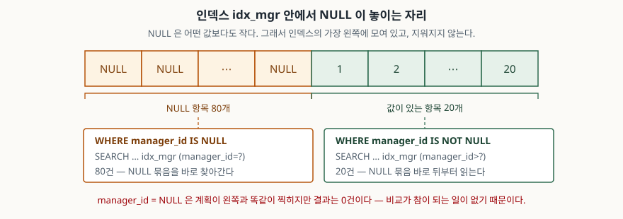

## 들어가며

사원 표에 `manager_id` 컬럼을 둔다. 상급자가 있으면 그 사원의 `id`를 넣고, 대표나
배치 전 신입처럼 아직 정해지지 않았으면 비워 둔다. 비워 둔 칸은 `NULL`이다.

얼마 지나 "상급자가 없는 사원" 화면이 필요해진다. 그런데 결과가 0건이다. 몇 번을 다시
봐도 `WHERE manager_id = NULL`에 오타가 없다. 눈으로는 표에 NULL이 가득한데 질의는
아무것도 못 찾는다.

여기서 대부분은 `IS NULL`로 고치고 넘어간다. 고치면 나오니까 그걸로 끝낸다. 그래서
같은 일이 조금 다른 모양으로 — 조건을 코드가 조립하는 자리에서, `NOT IN` 서브쿼리
안에서 — 다시 나오면 또 처음부터 더듬는다. 이 글은 고치는 법 대신 **인덱스가 NULL을
어떻게 담고 있길래 그렇게 되는지**를 본다.

> NULL이 비교·집계·`GROUP BY`·`DISTINCT`에서 각각 어떻게 세어지는지는
> [NULL이 인덱스, 집계, 비교에서 각각 다르게 동작하는 이유](../../2026-10-03-null-index-group-unique-distinct/index.md)에
> 따로 적었다. 이 글은 **인덱스를 타는 모양**만 본다.

## 개념 — NULL은 "모른다"는 표시다

`NULL`은 0도 아니고 빈 문자열도 아니다. **값이 무엇인지 모른다**는 표시다. 모르는
것끼리는 같은지 다른지도 알 수 없으므로 `NULL = NULL`의 결과는 참도 거짓도 아닌
`NULL`이다. `WHERE` 절은 조건이 **참일 때만** 행을 통과시키니, 참이 아닌 것은 전부
떨어진다. `manager_id = NULL`이 0건인 이유가 이것이다.

그래서 SQL은 비교가 아닌 판별 연산자를 따로 둔다. `IS NULL`과 `IS NOT NULL`은 결과가
늘 참이나 거짓이다. 여기까지는 널리 알려진 이야기이고, 질문은 그다음이다. 인덱스는
**키 순서로 정렬된 구조**인데 크기를 비교할 수 없는 NULL을 어디에 끼워 넣는가.

## 구조 — NULL은 인덱스의 맨 앞에 모여 있다



> **출처**: [SQLite Datatypes §4.1 Sort Order](https://www.sqlite.org/datatype3.html#sort_order) · [SQLite Database File Format §2.5 Representation Of SQL Indices](https://www.sqlite.org/fileformat2.html#representation_of_sql_indices)

정렬 순서를 정한 항목(§4.1)은 **저장 클래스가 NULL인 값은 다른 어떤 값보다도 작다**고
적는다. 다른 NULL보다도 작다고 쓰여 있다. `WHERE`에서는 비교가 성립하지 않는 NULL이
정렬에서는 자리를 갖는다 — 두 규칙이 별개라는 것이 이 글의 출발점이다. 그래서 인덱스
b-tree에서 NULL 항목은 전부 맨 왼쪽에 몰려 한 덩어리가 되고, 여기서 세 가지가
한꺼번에 따라 나온다.

- `IS NULL`은 **그 덩어리의 시작 지점을 바로 찾아가는** 등치 탐색이 된다.
- `IS NOT NULL`은 **그 덩어리 바로 다음부터 끝까지** 읽는 범위 탐색이 된다.
- 인덱스를 순서대로 읽으면 NULL이 먼저 나온다.

## 동작 원리 — 계획은 같고 답은 다르다

질의 최적화 문서의 WHERE 절 분석 항목(§2)은 인덱스를 쓸 수 있는 조건의 형태를
열거하는데, 그 목록에 `column = expression`과 나란히 `column IS NULL`이 들어 있다.
`IS NULL`은 처음부터 인덱스를 쓰도록 설계된 조건이다.

100행 중 80행이 NULL인 표에 `manager_id` 단일 인덱스를 걸고 찍은 실행계획이다.

| 조건 | 실행계획 `detail` 원문 | 건수 |
|---|---|---|
| `manager_id IS NULL` | `SEARCH employee USING COVERING INDEX idx_mgr (manager_id=?)` | 80 |
| `manager_id = NULL` | `SEARCH employee USING COVERING INDEX idx_mgr (manager_id=?)` | **0** |
| `manager_id IS NOT NULL` | `SEARCH employee USING COVERING INDEX idx_mgr (manager_id>?)` | 20 |
| `manager_id <> 3` | `SCAN employee USING COVERING INDEX idx_mgr` | 19 |
| `manager_id IS NOT 3` | `SCAN employee USING COVERING INDEX idx_mgr` | **99** |

위 두 줄이 이 글에서 가장 값나가는 자리다. **계획이 한 글자도 다르지 않다.** 둘 다
인덱스에서 `manager_id=?`로 한 지점을 찾아간다. 갈리는 곳은 그 `?` 자리의 값으로
무엇을 하느냐다. `IS NULL`은 NULL 덩어리의 시작을 찾아 거기서부터 읽고, `= NULL`은
비교를 수행해 참이 나오지 않으니 아무것도 돌려주지 않는다. **실행계획이 좋다고 답이
맞는 것은 아니다**를 이보다 짧게 보여 주는 예가 드물다.

`IS NOT NULL`이 `manager_id>?`인 것도 그림 그대로다. NULL보다 큰 것을 모으라는 뜻이고,
NULL보다 큰 것은 NULL이 아닌 모든 값이다. 둘 다 `SCAN`이 아니라 `SEARCH`다.
"NULL 조건은 인덱스를 못 탄다"는 말을 들었다면 그것은 다른 엔진의 사정이다.

아래 두 줄은 비교 연산자와 판별 연산자의 차이다. `<> 3`은 NULL 행을 전부 떨어뜨려
19건, `IS NOT 3`은 NULL을 "3이 아닌 것"으로 쳐서 99건이다. **같은 뜻으로 읽히는 두
조건의 답이 80건 차이 난다.**

## 실습 예제

전체 소스: [`code/`](code/) · 돌린 기록: [`code/output.txt`](code/output.txt)

### 정렬 자리를 뒤집어도 인덱스가 그대로 쓰인다

```sql
SELECT manager_id FROM employee ORDER BY manager_id NULLS LAST LIMIT 6;
```

| 질의 | 결과 앞 6개 | 실행계획 `detail` 원문 |
|---|---|---|
| `ORDER BY manager_id` | `None None None None None None` | `SCAN employee USING COVERING INDEX idx_mgr` |
| `ORDER BY manager_id NULLS LAST` | `1 2 3 4 5 6` | `SCAN employee USING COVERING INDEX idx_mgr` |
| `ORDER BY manager_id DESC` | `20 19 18 17 16 15` | `SCAN employee USING COVERING INDEX idx_mgr` |
| `ORDER BY manager_id DESC NULLS FIRST` | `None None None None None None` | `SCAN employee USING COVERING INDEX idx_mgr` |

예상과 달랐던 것은 **네 가지 모두 임시 b-tree 없이 인덱스만으로 처리됐다**는 점이다.
`NULLS LAST`는 인덱스에 저장된 순서와 다른 순서를 요구하니 정렬이 한 번 더 붙을
것이라고 봤는데, 계획에 `USE TEMP B-TREE FOR ORDER BY`가 끝내 나타나지 않았다. NULL
덩어리의 경계를 찾을 수 있으니 **뒤쪽을 먼저 읽고 앞쪽을 나중에 읽으면** 되고, 그건
인덱스를 두 구간으로 나눠 읽는 것일 뿐이다. `NULLS FIRST`/`NULLS LAST`는 SQLite
3.30.0 릴리스 노트에 추가된 문법이고, 이 자리에서는 정렬 비용이 붙지 않는다.

### PRIMARY KEY를 걸었는데 NULL이 들어간다

```text
UNIQUE 컬럼에 NULL 세 번 삽입 : 3 행
같은 값 두 번 삽입              : IntegrityError: UNIQUE constraint failed: member.email

PK 가 TEXT · 일반 rowid 표 : NULL 두 번 통과 (2행)
PK 가 TEXT · WITHOUT ROWID : NOT NULL constraint failed: t2.code
PK 가 TEXT · STRICT        : NOT NULL constraint failed: t3.code
PK 가 TEXT · NOT NULL 명시 : NOT NULL constraint failed: t4.code
```

첫 줄은 유일성 판정 항목(§3.6)이 적는 대로다. **UNIQUE 제약에서 NULL은 다른 모든 값과
구별되는 것으로 보며, 거기에는 다른 NULL도 포함된다.** 같지 않으니 중복이 아니고,
그래서 몇 개든 들어간다. 바로 아랫줄에서 같은 문자열이 막히는 것과 대조된다.

눈여겨볼 것은 아래 네 줄이다. 기본 키 항목(§3.5)은 표준대로면 `PRIMARY KEY`가
`NOT NULL`을 함의해야 하지만 **초기 판의 결함 때문에 그렇지 않다**고 밝히고, 고치면
기존 응용이 깨지므로 문서로 남기는 쪽을 택했다고 적는다. 같은 문단이 예외 네 가지를
드는데 위 출력의 아래 세 줄이 그중 셋이고, `INTEGER PRIMARY KEY`가 나머지 하나다.
즉 **`code TEXT PRIMARY KEY`는 키 역할을 못 한다.** 다른 DB에서 옮겨 온 스키마가
`VARCHAR` 기본 키를 쓰고 있으면 그대로 샌다.

## 실무에서 주의할 점

- **실행계획이 같다고 답이 같지 않다.** `= NULL`과 `IS NULL`은 계획이 글자 단위로
  동일하고 결과만 다르다. 계획을 확인했으니 됐다고 넘기지 말고 **건수를 같이 본다.**
  조건을 사람이 아니라 코드가 조립하는 자리에서 특히 잘 샌다. 값이 `None`인 변수를
  `=` 자리에 묶으면 에러 없이 0건이 돌아온다.
- **`NOT IN` 서브쿼리에 NULL이 섞이면 결과가 통째로 비워진다.** 같은 표로 확인했다.
  `id NOT IN (SELECT manager_id FROM employee)`는 0건이고, 서브쿼리에
  `WHERE manager_id IS NOT NULL`을 붙이면 80건이다. `NOT IN`은 모든 비교가 거짓일 때만
  참인데 NULL과의 비교는 거짓이 되지 않으므로, 목록에 NULL이 하나만 있어도 전체가
  참이 되지 못한다.
- **`PRIMARY KEY`를 걸었다고 NULL이 막히지 않는다.** `INTEGER PRIMARY KEY`가 아닌
  일반 rowid 표에서는 NULL이 여러 개 들어간다. 기존 스키마에 손을 가장 적게 대는
  쪽은 `NOT NULL`을 덧붙이는 것이다.
- **엔진을 옮기면 `IS NULL`의 계획을 다시 본다.** 단일 컬럼 B-tree에 NULL 행을 담지
  않는 엔진에서는 같은 인덱스로 같은 질의를 답할 수 없다.

## 정리

- SQLite 인덱스는 NULL을 **버리지 않고 담는다.** NULL은 어떤 값보다도 작아서 인덱스
  맨 앞에 한 덩어리로 모인다.
- 그래서 `IS NULL`은 등치 탐색(`manager_id=?`), `IS NOT NULL`은 범위 탐색
  (`manager_id>?`)으로 **둘 다 `SEARCH`다.**
- `= NULL`은 실행계획이 `IS NULL`과 완전히 같은데 결과는 0건이다. 계획만 보고
  판단하지 않는다.
- `NULLS FIRST`/`NULLS LAST`로 NULL 자리를 뒤집어도 임시 b-tree가 붙지 않았다.
- `UNIQUE` 컬럼에는 NULL이 여러 개 들어가고, 일반 rowid 표의 `PRIMARY KEY`에도 들어간다.
  막으려면 `NOT NULL`·`STRICT`·`WITHOUT ROWID` 중 하나를 쓴다.

## 참고 자료

- [SQLite — Datatypes In SQLite §4.1 Sort Order](https://www.sqlite.org/datatype3.html#sort_order)
- [SQLite — Database File Format §2.5 Representation Of SQL Indices](https://www.sqlite.org/fileformat2.html#representation_of_sql_indices)
- [SQLite — The Query Optimizer Overview §2 WHERE Clause Analysis](https://www.sqlite.org/optoverview.html#where_clause_analysis)
- [SQLite — CREATE TABLE §3.5 The PRIMARY KEY](https://www.sqlite.org/lang_createtable.html#the_primary_key) · [§3.6 UNIQUE Constraints](https://www.sqlite.org/lang_createtable.html#unique_constraints)
- [SQLite Release 3.30.0 (2019-10-04)](https://sqlite.org/releaselog/3_30_0.html) — `NULLS FIRST` / `NULLS LAST` 추가
