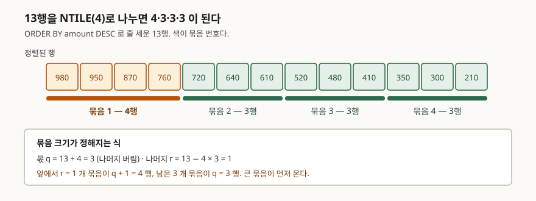

<!-- related:start -->
> **같은 기능을 다른 환경에서 다룬 글** (`window-function`)
> - [윈도우 함수 입문 — ROW_NUMBER로 그룹별 1등 뽑기](../2026-10-03-window-function-row-number-top-per-group/index.md) — SQLite 3.49.1, Python 3.13.5, Windows 11
> - [RANK와 DENSE_RANK — 동점을 어떻게 셀까](../2026-10-06-rank-dense-rank-ties/index.md) — SQLite 3.49.1, Python 3.13.5, Windows 11
> - [누적합과 이동평균 — SUM OVER의 프레임](../2026-10-06-sum-over-frame-rows-range/index.md) — SQLite 3.49.1, Python 3.13.5, Windows 11
> - [LAG와 LEAD — 앞뒤 행의 값을 같은 줄에 놓기](../2026-10-12-lag-lead-previous-next-row/index.md) — SQLite 3.49.1, Python 3.13.5, Windows 11
> - [FIRST_VALUE와 LAST_VALUE — 구간의 처음과 끝](../2026-10-16-first-value-last-value-window-frame/index.md) — SQLite 3.49.1, Python 3.13.5
> - [Tibero 7 분석 함수의 윈도우 절 — ROWS와 RANGE는 어디서 갈리는가](../../tibero/2026-09-23-tibero7-window-clause/index.md) — Tibero 7
<!-- related:end -->

## 들어가며

고객별 매출 표를 놓고 "상위 25%에게 쿠폰을 보내 달라"는 요청을 받는다. 정렬은
이미 돼 있으니 어렵지 않아 보인다. 고객이 13명이니 4로 나눠 3.25, 반올림해서 넷.

```sql
SELECT customer FROM sales ORDER BY amount DESC LIMIT 4;
```

다음 달에 고객이 17명이 되면 이 숫자를 다시 센다. 지역을 나눠 각 지역의 상위 25%를
달라고 하면 지역 수만큼 질의를 쓰거나 지역별 행 수를 미리 세야 한다. 등급을 넷이
아니라 다섯으로 바꾸자는 말이 나오면 처음부터 다시 센다. **행 수를 사람이 세는 한
요구가 바뀔 때마다 숫자를 다시 계산해야 한다.**

`NTILE`은 그 나눗셈을 대신 한다. 다만 13을 4로 나누면 나머지가 남고, **그 남는 행이
어디로 가는지**를 모르면 "상위 25%"라고 보낸 쿠폰이 실제로는 30.8%에게 간다.

## 개념

`NTILE(n)`은 정렬된 행을 **n개의 묶음으로 가능한 한 고르게 나누고**, 각 행에 자기가
속한 묶음 번호(1부터 n까지)를 붙인다. SQLite 문서는 이렇게 적는다.

> This function divides the partition into N groups as evenly as possible

이름이 비슷한 다른 윈도우 함수와 쓰임이 갈린다.

| 함수 | 돌려주는 값 | 값의 범위 |
|---|---|---|
| `ROW_NUMBER()` | 줄 세운 순서 | 1 ~ 행 수 |
| `RANK()` | 순위 (동점은 같은 값, 다음 순위를 건너뜀) | 1 ~ 행 수 |
| `NTILE(n)` | **묶음 번호** | 1 ~ n |

`ROW_NUMBER`는 "몇 번째인가"를, `NTILE`은 "어느 덩어리인가"를 답한다. 상위 25%,
사분위, 10분위, A·B·C 등급처럼 **개수가 아니라 비율로 자르는 요구**가 `NTILE`의
자리다. 그래서 `n`에는 보통 4(사분위), 5(5분위), 10(10분위)이 들어간다.

## 구조

13행을 4개로 나누면 3행씩 12행이고 한 행이 남는다. 이 한 행이 어느 묶음으로
가는지가 이 글의 전부다.



> **출처**: [SQLite Built-In Window Functions §3 — ntile(N)](https://www.sqlite.org/windowfunctions.html#built_in_window_functions)

## 동작 원리

규칙은 나눗셈 한 번으로 끝난다. 파티션의 행 수를 `N`, 묶음 수를 `n`이라 하면

- 몫 `q = N / n` (나머지 버림)
- 나머지 `r = N - n × q`

이고, **앞에서부터 `r`개의 묶음이 `q+1`행을, 남은 `n-r`개의 묶음이 `q`행을** 가져간다.
SQLite 문서가 한 줄로 못 박는 부분이 여기다.

> If necessary, larger groups occur first.

13행을 4로 나누면 `q=3`, `r=1`이다. 그래서 1번 묶음만 4행이고 나머지는 3행이다.
실제로 행 수와 묶음 수를 바꿔 가며 세어 보면 식 그대로 나온다.

```text
  13행 / NTILE(4)  q=3 r=1  ->  [(1, 4), (2, 3), (3, 3), (4, 3)]
  12행 / NTILE(4)  q=3 r=0  ->  [(1, 3), (2, 3), (3, 3), (4, 3)]
  10행 / NTILE(4)  q=2 r=2  ->  [(1, 3), (2, 3), (3, 2), (4, 2)]
   7행 / NTILE(3)  q=2 r=1  ->  [(1, 3), (2, 2), (3, 2)]
   9행 / NTILE(2)  q=4 r=1  ->  [(1, 5), (2, 4)]
   3행 / NTILE(5)  q=0 r=3  ->  [(1, 1), (2, 1), (3, 1)]
   5행 / NTILE(1)  q=5 r=0  ->  [(1, 5)]
```

마지막에서 두 번째 줄을 눈여겨본다. **3행을 5개로 나누라고 했는데 묶음이 3개만
나왔다.** `q=0`이라 앞의 `r=3`개 묶음이 1행씩 가져가고, 4·5번 묶음은 가져갈 행이
없어 아예 생기지 않는다. `NTILE(10)`으로 10분위를 뽑는 질의가 데이터가 적은
파티션에서는 7분위까지만 돌려줄 수 있다는 뜻이다. 빈 묶음이 `0`으로 나오는 것이
아니라 **행이 없으니 그 번호 자체가 결과에 없다.**

## 실습 예제

13행짜리 매출 표를 만들고 사분위를 매긴다. 전체 소스: [`code/`](code/) ·
돌린 기록: [`code/output.txt`](code/output.txt)

```python
conn.executescript("""
CREATE TABLE sales (
    customer TEXT    NOT NULL,
    region   TEXT    NOT NULL,
    amount   INTEGER NOT NULL
);
INSERT INTO sales (customer, region, amount) VALUES
  ('가온', '수도권', 980), ('나래', '수도권', 870), ('다온', '수도권', 760),
  ('라온', '수도권', 640), ('마루', '수도권', 520), ('바름', '수도권', 410),
  ('사름', '수도권', 300), ('아름', '영남', 950), ('자람', '영남', 720),
  ('차오', '영남', 610), ('카람', '영남', 480), ('타람', '영남', 350),
  ('파람', '영남', 210);
""")
```

사분위를 매긴 결과다.

```sql
SELECT customer, amount,
       NTILE(4) OVER (ORDER BY amount DESC) AS quartile
FROM sales
ORDER BY amount DESC
```

```text
  customer | amount | quartile
  ---------+--------+---------
  가온     |    980 |        1
  아름     |    950 |        1
  나래     |    870 |        1
  다온     |    760 |        1
  자람     |    720 |        2
  라온     |    640 |        2
  차오     |    610 |        2
  마루     |    520 |        3
  카람     |    480 |        3
  바름     |    410 |        3
  타람     |    350 |        4
  사름     |    300 |        4
  파람     |    210 |        4
```

1번 묶음이 4명이다. "상위 25%"를 뽑았는데 13명 중 4명이면 30.8%다. 묶음별로
세어 보면 경계가 어디서 갈렸는지도 같이 보인다.

```text
  quartile | rows_in_bucket | top | bottom
  ---------+----------------+-----+-------
         1 |              4 | 980 |    760
         2 |              3 | 720 |    610
         3 |              3 | 520 |    410
         4 |              3 | 350 |    210
```

`PARTITION BY`를 붙이면 묶음을 파티션마다 따로 센다. 수도권 7명은 3·2·2로,
영남 6명은 2·2·2로 갈린다. 같은 질의 한 줄이 지역 수와 무관하게 돈다.

```sql
SELECT region, customer, amount,
       NTILE(3) OVER (PARTITION BY region ORDER BY amount DESC) AS tier
FROM sales
```

```text
  region | customer | amount | tier
  -------+----------+--------+-----
  수도권 | 가온     |    980 |    1
  수도권 | 나래     |    870 |    1
  수도권 | 다온     |    760 |    1
  수도권 | 라온     |    640 |    2
  수도권 | 마루     |    520 |    2
  수도권 | 바름     |    410 |    3
  수도권 | 사름     |    300 |    3
  영남   | 아름     |    950 |    1
  영남   | 자람     |    720 |    1
  영남   | 차오     |    610 |    2
  영남   | 카람     |    480 |    2
  영남   | 타람     |    350 |    3
  영남   | 파람     |    210 |    3
```

## 실무에서 주의할 점

**1. 동점이 묶음을 가른다.** `RANK`는 같은 값에 같은 순위를 주지만 `NTILE`은 그러지
않는다. 묶음 크기를 맞추는 것이 먼저라 **값이 같아도 경계에서 잘린다.** 매출이
전부 500으로 같은 여섯 명을 섞어 보면 `rnk`는 전부 6인데 `half`는 1과 2로 갈린다.

```text
  customer | amount | rnk | half
  ---------+--------+-----+-----
  마루     |    520 |   5 |    1
  아름     |    500 |   6 |    1
  자람     |    500 |   6 |    1
  차오     |    500 |   6 |    2
  카람     |    500 |   6 |    2
  타람     |    500 |   6 |    2
  파람     |    500 |   6 |    2
```

같은 500원인데 자람은 상위 절반, 차오는 하위 절반이다. 둘을 가른 것은 매출이 아니라
`ORDER BY`가 동점을 어떤 순서로 늘어놓았느냐다. **등급에 따라 혜택이 달라지는
자리라면 동점을 깨는 기준을 `ORDER BY`에 명시해야 한다** — `ORDER BY amount DESC,
customer`처럼. 그래야 같은 데이터에서 같은 결과가 나온다.

**2. `ORDER BY`를 빼도 에러가 나지 않는다.** `NTILE(2) OVER ()`는 그대로 돌아간다.
다만 문서가 "arbitrary order"라고 적은 대로 어떤 순서로 묶일지 정해져 있지 않고,
옵티마이저가 스캔 방식을 바꾸면 결과가 달라질 수 있다. **분위수를 매기는데
`ORDER BY`가 없으면 거의 항상 빠뜨린 것이다.**

**3. 프레임을 적어도 무시된다.** `ROWS BETWEEN ...`을 붙여도 결과가 그대로다.
직접 돌려 비교하면 두 결과가 완전히 같다.

```text
  프레임 없음: [1, 1, 1, 1, 1, 1, 1, 2, 2, 2, 2, 2, 2]
  프레임 지정: [1, 1, 1, 1, 1, 1, 1, 2, 2, 2, 2, 2, 2]
  두 결과가 같은가: True
```

SQLite 문서는 프레임을 보는 함수를 셋만 든다.

> Most built-in window functions ignore the frame-spec, the exceptions being first_value(), last_value() and nth_value().

`SUM OVER`에서 프레임으로 누적 구간을 조절하던 습관으로 `NTILE`에 프레임을 적으면
조용히 무시된다. 에러가 안 나므로 효과가 있는 줄 알기 쉽다.

**4. `n`은 양의 정수여야 한다.** 변수에서 받은 묶음 수가 0이 되는 경우를 막아야 한다.
SQLite는 실행 중에 에러를 낸다.

```text
  NTILE(0) -> OperationalError: argument of ntile must be a positive integer
  NTILE(-1) -> OperationalError: argument of ntile must be a positive integer
```

**5. 정렬이 필요하므로 공짜가 아니다.** 실행계획에 `ORDER BY`용 임시 B-Tree가 뜬다.
정렬 컬럼에 인덱스가 없으면 파티션 전체를 정렬한다.

```text
QUERY PLAN
|--CO-ROUTINE (subquery-2)
|  |--SCAN sales
|  `--USE TEMP B-TREE FOR ORDER BY
`--SCAN (subquery-2)
```

## 정리

- `NTILE(n)`은 정렬된 행을 n개 묶음으로 나누고 각 행에 묶음 번호를 붙인다.
  순위가 아니라 **덩어리 번호**다.
- 행 수가 딱 안 나뉘면 몫 `q`와 나머지 `r`을 구해 **앞의 `r`개 묶음이 한 행씩 더**
  가져간다. 그래서 "상위 25%"가 실제로는 25%보다 클 수 있다.
- 행 수가 `n`보다 적으면 **뒤쪽 묶음 번호는 결과에 아예 나오지 않는다.**
- `NTILE`은 동점을 봐주지 않는다. 같은 값이 다른 묶음으로 갈릴 수 있으므로
  동점을 깨는 기준을 `ORDER BY`에 적는다.
- 프레임 절은 무시되고, `n`은 양의 정수여야 한다.

## 참고 자료

- [SQLite Built-In Window Functions §3 — ntile(N)](https://www.sqlite.org/windowfunctions.html#built_in_window_functions)
- [SQLite Window Functions](https://www.sqlite.org/windowfunctions.html)
