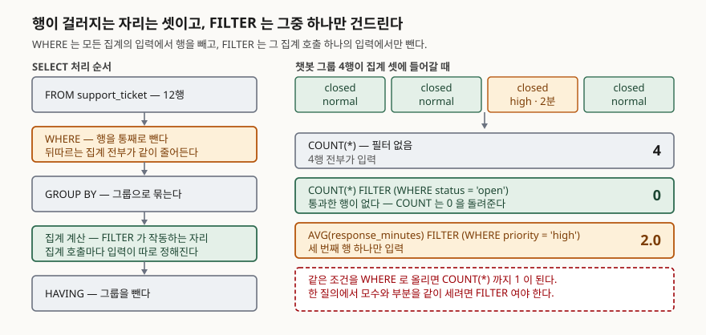

## 들어가며

운영 리포트를 만들다 보면 한 표에 모수와 부분을 같이 넣어야 할 때가 온다. 채널별로
문의가 몇 건 들어왔고 그중 몇 건이 아직 안 닫혔는지를 한 줄에 나란히 보여 달라는
요청이다. 그런데 `WHERE status = 'open'` 을 붙이는 순간 전체 건수가 같이 사라진다.
그래서 보통은 질의를 두 번 돌려 스프레드시트에서 붙인다. 채널이 넷이고 보고 싶은
상태가 셋이면 열두 번을 돌려 열두 조각을 맞추는 셈이고, 기준이 하나 바뀌면 열두 번을
다시 돌린다.

SQL에는 이 일을 한 번에 끝내는 문법이 두 가지 있다. 오래된 쪽이 `CASE WHEN` 이고,
표준이 나중에 들인 쪽이 `FILTER` 다.

## 개념

집계 함수는 보통 그룹 안의 행을 전부 받는다. 조건부 집계는 "이 집계 하나만은 일부
행만 받아라"를 적는 일이다.

`CASE WHEN` 방식은 조건을 **값으로 바꿔서** 넘긴다. `COUNT(CASE WHEN status = 'open'
THEN 1 END)` 는 조건에 맞으면 1, 아니면 NULL을 만들고, `COUNT` 가 NULL을 세지 않는
성질에 기대어 개수를 얻는다. 세는 일은 `COUNT` 가 하지만 거르는 일은 `CASE` 가 만든
NULL이 한다. 읽는 사람은 "왜 1인가", "ELSE는 왜 없는가"를 한 번 더 풀어야 한다.

`FILTER` 는 조건을 **조건 그대로** 넘긴다. `COUNT(*) FILTER (WHERE status = 'open')`
이다. SQLite 매뉴얼은 FILTER 절이 있으면 expr이 참인 행만 집계에 포함된다고 적는다.
거르는 일을 거르는 문법이 하고, 세는 함수는 세기만 한다.

SQLite는 3.30.0(2019-10-04)에서 집계 함수의 FILTER 절을 받아들였다. 이 글은 3.49.1에서
확인했다.

## 구조



> **출처**: [SQLite — SELECT, §2.3 WHERE clause filtering](https://www.sqlite.org/lang_select.html#where_clause_filtering_) · [§2.4 Generation of the set of result rows](https://www.sqlite.org/lang_select.html#generation_of_the_set_of_result_rows) · [SQLite — Aggregate Functions, FILTER clause](https://www.sqlite.org/lang_aggfunc.html#aggfilter)

## 동작 원리

행이 걸러지는 자리는 셋인데, 셋이 거르는 대상이 다르다.

| 절 | 거르는 대상 | 영향 범위 |
|---|---|---|
| `WHERE` | 행 | 그 뒤의 **모든** 집계가 같이 줄어든다 |
| `FILTER` | 행 | 그 **집계 호출 하나**의 입력만 줄어든다 |
| `HAVING` | 그룹 | 집계가 끝난 뒤 그룹 단위로 뺀다 |

모수와 부분을 한 줄에 같이 세는 일이 `WHERE` 로 안 되는 이유가 여기 있다. `WHERE` 가
행을 빼면 같은 `SELECT` 안의 `COUNT(*)` 도 그만큼 줄어드니 모수가 남지 않는다.
`FILTER` 는 집계 호출마다 입력을 따로 정하므로 한 줄 안에 모수와 여러 부분집합을
동시에 둘 수 있다.

SQLite 매뉴얼은 이 처리 순서 설명이 "순전히 설명을 위한 것이며 실제 엔진이 이 과정을
그대로 따를 의무는 없다"고 못 박는다. 결과가 그렇게 나온다는 뜻이지 엔진이 단계를
그 순서로 밟는다는 뜻은 아니다.

## 실습 예제

메모리 SQLite에 문의 티켓 12행을 넣고 돌렸다. 전체 소스는 [`code/`](code/),
돌린 기록은 [`code/output.txt`](code/output.txt)에 있다.

```
  ticket_id | channel | status | priority | response_minutes
  ----------+---------+--------+----------+-----------------
          1 | 전화    | closed | high     |                8
          2 | 전화    | closed | normal   |               42
          3 | 전화    | open   | high     |             NULL
          4 | 이메일  | closed | normal   |              180
          5 | 이메일  | closed | high     |               35
          6 | 이메일  | open   | normal   |             NULL
          7 | 챗봇    | closed | normal   |                3
          8 | 챗봇    | closed | normal   |                5
          9 | 챗봇    | closed | high     |                2
         10 | 챗봇    | closed | normal   |                7
         11 | SNS     | closed | normal   |               95
         12 | SNS     | open   | normal   |             NULL
```

챗봇에는 `open` 이 한 건도 없고, SNS에는 `high` 가 한 건도 없다. 둘 다 뒤에서 쓴다.

같은 숫자를 두 가지로 적는다.

```sql
-- CASE WHEN
SELECT channel,
       COUNT(*)                                                   AS 전체,
       COUNT(CASE WHEN status = 'open' THEN 1 END)                AS 미처리,
       COUNT(CASE WHEN status = 'closed' THEN 1 END)              AS 처리완료,
       AVG(CASE WHEN priority = 'high' THEN response_minutes END) AS 긴급평균
  FROM support_ticket GROUP BY channel ORDER BY channel;

-- FILTER
SELECT channel,
       COUNT(*)                                               AS 전체,
       COUNT(*) FILTER (WHERE status = 'open')                AS 미처리,
       COUNT(*) FILTER (WHERE status = 'closed')              AS 처리완료,
       AVG(response_minutes) FILTER (WHERE priority = 'high') AS 긴급평균
  FROM support_ticket GROUP BY channel ORDER BY channel;
```

두 질의의 결과 집합은 행 단위로 같았다.

```
  channel | 전체 | 미처리 | 처리완료 | 긴급평균
  SNS | 2 | 1 | 1 | NULL
  이메일 | 3 | 1 | 2 | 35.0
  전화 | 3 | 1 | 2 | 8.0
  챗봇 | 4 | 0 | 4 | 2.0

  두 결과가 같은가: True
```

`EXPLAIN QUERY PLAN` 의 `detail` 원문도 두 질의가 같았다. 둘 다 `SCAN support_ticket`
과 `USE TEMP B-TREE FOR GROUP BY` 두 줄이다. **FILTER는 빨라지라고 쓰는 문법이 아니라
의도가 보이라고 쓰는 문법이다.** 같은 일을 하는 다른 표기이므로 성능 차이를 기대하고
바꿀 이유는 없다.

## 실무에서 주의할 점

**ELSE를 빠뜨린 `SUM` 은 0이 아니라 NULL을 돌려준다.** `COUNT` 로 셀 때는 `ELSE` 가
없어도 되지만 `SUM` 으로 셀 때는 다르다. 조건에 맞는 행이 그룹에 하나도 없으면 더할
값이 전부 NULL이라 합계 자체가 NULL이 된다.

```
  channel | sum_case | sum_case_else | count_filter
  SNS | 1 | 1 | 1
  이메일 | 1 | 1 | 1
  전화 | 1 | 1 | 1
  챗봇 | NULL | 0 | 0
```

`open` 이 없는 챗봇에서만 갈린다. 평소 데이터로 짠 질의가 "해당 건이 0인 그룹"이
처음 생기는 날 NULL을 내보낸다. `FILTER` 쪽은 `COUNT` 가 그대로 0을 준다.

**`ELSE 0` 으로 때우면 평균이 망가진다.** 위 함정을 피하려고 `ELSE 0` 을 붙이는 습관이
있는데, `SUM` 에서는 맞고 `AVG` 에서는 틀린다. 조건에 안 맞는 행이 0이라는 값으로
평균에 끼어들기 때문이다.

```
  channel | avg_else0 | avg_else_null | avg_filter
  SNS | 0.0 | NULL | NULL
  이메일 | 11.666666666666666 | 35.0 | 35.0
  전화 | 4.0 | 8.0 | 8.0
  챗봇 | 0.5 | 2.0 | 2.0
```

이메일의 긴급 평균 응답은 35분인데 `ELSE 0` 쪽은 11.67분으로 나온다. 리포트에 그대로
실리면 아무도 못 알아챈다.

**빈 집합에서 `COUNT` 만 0이고 나머지는 NULL이다.** `FILTER` 로 바꿔도 이 성질은 그대로다.

```
  channel | cnt | sum_ | avg_ | max_
  SNS | 0 | NULL | NULL | NULL
```

`high` 가 없는 SNS에서 건수는 0이지만 합계·평균·최댓값은 NULL이다. 화면에 0으로 보여야
하면 `COALESCE` 로 감싼다. "건수가 0이니 합계도 0"은 SQL의 규칙이 아니다.

**FILTER 조건이 NULL이면 그 행은 참도 거짓도 아닌 쪽으로 빠진다.** 조건식이 참인 행만
들어가므로, 비교 대상이 NULL이라 판정이 안 되는 행은 `WHERE c` 에서도 `WHERE NOT c`
에서도 빠진다.

```
  전체 | 참 | 거짓 | 널
  12 | 4 | 5 | 3
```

`response_minutes > 10` 이 참인 행 4개와 거짓인 행 5개를 더해도 12가 안 되고, NULL인
3개를 더해야 맞는다. "나머지"를 셀 작정으로 `NOT` 을 쓰면 NULL 행만큼 조용히 빈다.

**이식성을 먼저 확인한다.** PostgreSQL 16 문서는 집계 표현식 문법에
`FILTER ( WHERE filter_clause )` 를 싣고 있다. 반면 MySQL 8.4 레퍼런스 매뉴얼의 집계
함수 문법에는 FILTER 절이 없고 `[over_clause]` 만 있다. 옮겨 다닐 코드라면 `CASE WHEN`
쪽이 안전하고, 이때는 위 네 가지 함정을 그대로 떠안는다.

덧붙이면 SQLite에서 `COUNT(DISTINCT channel) FILTER (WHERE ...)` 도, 윈도우 집계에 붙인
`COUNT(*) FILTER (...) OVER (PARTITION BY ...)` 도 그대로 돌았다. 다만 `row_number` 같은
내장 윈도우 함수에는 FILTER를 붙일 수 없다고 매뉴얼이 밝히고 있다.

## 정리

- `WHERE` 는 모든 집계의 입력에서 행을 빼고, `FILTER` 는 집계 호출 하나의 입력에서만 뺀다. 모수와 부분을 한 줄에 같이 세려면 `FILTER` 여야 한다.
- `CASE WHEN` 과 `FILTER` 는 같은 결과를 내고 실행계획도 같았다. 바꿀 이유는 속도가 아니라 가독성이다.
- `CASE WHEN` 이 틀리기 쉬운 자리는 `ELSE` 다. `SUM` 에서 빼면 NULL이 되고, `AVG` 에 `ELSE 0` 을 넣으면 평균이 내려간다.
- 빈 집합에서는 `COUNT` 만 0이고 `SUM`·`AVG`·`MAX` 는 NULL이다. 어느 문법을 쓰든 같다.
- SQLite 3.30.0 이상과 PostgreSQL은 FILTER를 쓸 수 있고, MySQL 8.4 매뉴얼에는 해당 문법이 없다.

## 참고 자료

- [SQLite — Aggregate Functions, FILTER clause](https://www.sqlite.org/lang_aggfunc.html#aggfilter)
- [SQLite — SELECT, §2.3 WHERE clause filtering](https://www.sqlite.org/lang_select.html#where_clause_filtering_)
- [SQLite — SELECT, §2.4 Generation of the set of result rows](https://www.sqlite.org/lang_select.html#generation_of_the_set_of_result_rows)
- [SQLite — Window Functions, §2.3 The FILTER Clause](https://www.sqlite.org/windowfunctions.html#the_filter_clause)
- [SQLite Release History — 3.30.0 (2019-10-04)](https://www.sqlite.org/changes.html)
- [PostgreSQL 16 — §4.2.7 Aggregate Expressions](https://www.postgresql.org/docs/16/sql-expressions.html#SYNTAX-AGGREGATES)
- [MySQL 8.4 Reference Manual — Aggregate Function Descriptions](https://dev.mysql.com/doc/refman/8.4/en/aggregate-functions.html)
