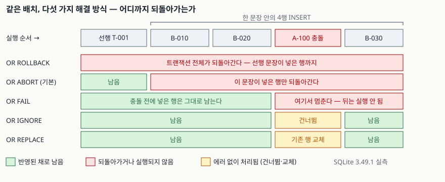

## 들어가며

거래처에서 받은 입고 파일을 재고 표에 한 번에 넣는 일을 맡았다고 하자. 500행을 `INSERT` 한 문장으로
밀어 넣었는데 `UNIQUE constraint failed`가 떨어진다. 파일 어딘가에 이미 있는 상품 코드가 하나 섞여
있었던 것이다. 여기서 보통은 파일을 열어 중복을 지우고 처음부터 다시 돌린다. 그런데 **다시 돌리기
전에 알아야 할 것이 있다.** 방금 그 실패로 앞의 몇 행은 들어갔는지, 아니면 하나도 안 들어갔는지,
그 전에 같은 트랜잭션에서 돌린 문장까지 날아갔는지를 모르면 두 번째 실행이 중복을 더 만든다.
SQLite는 이 "어디까지 되돌리는가"를 다섯 가지 중에서 고르게 한다.

## 개념

- **제약(constraint)**: 표가 지켜야 할 조건이다. `PRIMARY KEY`, `UNIQUE`, `NOT NULL`, `CHECK`,
  `FOREIGN KEY` 다섯 가지가 있다.
- **충돌(conflict)**: 넣거나 고치려는 행이 그 조건을 어기는 상태다.
- **충돌 해결 알고리즘(conflict resolution algorithm)**: 충돌이 났을 때 SQLite가 할 일이다.
  `ROLLBACK`, `ABORT`, `FAIL`, `IGNORE`, `REPLACE` 다섯 가지이고, 아무것도 안 적으면 `ABORT`다.

적는 자리는 둘이다. 표를 만들 때 제약 뒤에 `ON CONFLICT <알고리즘>`으로 적어 두면 그 제약의
기본값이 되고, 문장에 `INSERT OR IGNORE`, `UPDATE OR FAIL`처럼 적으면 그 문장에만 적용된다.
이 글은 둘 다 다룬다. 같은 `ON CONFLICT`라는 말이 **UPSERT 문법**(`INSERT ... ON CONFLICT
DO UPDATE`)에도 쓰이는데 그건 별개 기능이고, [UPSERT — INSERT ... ON CONFLICT](../2026-10-07-sqlite-upsert-on-conflict/index.md)에서 따로 다뤘다.

## 구조

다섯 가지의 차이는 결국 **되돌리는 범위**다. 아래는 트랜잭션을 열고 안전한 행 하나를 넣은 뒤,
세 번째 행이 기존 키와 겹치는 4행 `INSERT`를 던졌을 때 무엇이 남는지를 실측한 것이다.



> **출처**: [SQLite — ON CONFLICT clause](https://www.sqlite.org/lang_conflict.html) (각 알고리즘 설명 절)

## 동작 원리

범위가 좁은 것부터 넓은 것까지 **FAIL < ABORT < ROLLBACK** 순이다.

- **FAIL**은 충돌한 행에서 멈추고, **그 전에 같은 문장이 넣은 행은 그대로 둔다.** 뒤에 남은 행은
  실행되지 않는다. 그래서 4행 중 3번째가 걸리면 1·2번은 남고 4번은 안 들어간다.
- **ABORT**는 멈추는 것은 같은데 **그 문장이 한 일을 전부 되돌린다.** 1·2번도 사라진다.
  다만 같은 트랜잭션의 **이전 문장**은 건드리지 않는다. 적지 않았을 때의 기본값이다.
- **ROLLBACK**은 **트랜잭션 전체**를 되감는다. 이전 문장이 넣은 행까지 사라지고 트랜잭션이 끝난다.
  명시적 트랜잭션이 없으면 문장 하나가 곧 트랜잭션이라 `ABORT`와 결과가 같다.

나머지 둘은 되돌리는 쪽이 아니다. 에러 자체를 안 낸다.

- **IGNORE**는 충돌한 **그 행만 건너뛰고** 나머지를 계속 넣는다. 기존 행은 손대지 않는다.
- **REPLACE**는 **걸리적거리는 기존 행을 지우고** 새 행을 넣는다. `UNIQUE`·`PRIMARY KEY`에만
  이렇게 동작하고, `NOT NULL`을 만나면 그 컬럼의 기본값으로 채우며, 기본값이 없으면 `ABORT`로
  돌아간다. `CHECK`와 외래 키 위반에서도 `ABORT`처럼 동작한다.

## 실습 예제

전체 소스: [`code/`](code/) · 돌린 기록은 [`code/output.txt`](code/output.txt)에 있다.

`inventory` 표에 `A-100`이 이미 있고, 배치의 세 번째 행이 그 키를 다시 쓴다.

```sql
BEGIN;
INSERT INTO inventory (sku, qty) VALUES ('T-001', 7);   -- 선행 문장
INSERT OR FAIL INTO inventory (sku, qty, note) VALUES
    ('B-010', 1, '신규'),
    ('B-020', 2, '신규'),
    ('A-100', 99, '중복'),   -- 여기서 걸린다
    ('B-030', 3, '신규');
```

`OR` 자리만 바꿔 여섯 번 돌린 결과다.

```text
[OR ROLLBACK]
  결과        IntegrityError: UNIQUE constraint failed: inventory.sku
  트랜잭션    끝났음 (되감김)
  남은 sku    ['A-100', 'A-200']
  기존 A-100  qty=10  (원래 10, 배치가 넣으려던 값은 99)
  선행 T-001  사라짐
  앞선 B-010  사라짐
  뒤따른 B-030 사라짐

[OR ABORT]
  결과        IntegrityError: UNIQUE constraint failed: inventory.sku
  트랜잭션    열려 있음
  남은 sku    ['A-100', 'A-200', 'T-001']
  기존 A-100  qty=10  (원래 10, 배치가 넣으려던 값은 99)
  선행 T-001  남음
  앞선 B-010  사라짐
  뒤따른 B-030 사라짐

[OR FAIL]
  결과        IntegrityError: UNIQUE constraint failed: inventory.sku
  트랜잭션    열려 있음
  남은 sku    ['A-100', 'A-200', 'B-010', 'B-020', 'T-001']
  기존 A-100  qty=10  (원래 10, 배치가 넣으려던 값은 99)
  선행 T-001  남음
  앞선 B-010  남음
  뒤따른 B-030 사라짐
```

`IGNORE`와 `REPLACE`는 둘 다 에러 없이 6개 `sku`를 남긴다. 겉보기가 같아서 구분이 안 되는데,
기존 행을 보면 갈린다.

```text
[OR IGNORE]
  기존 A-100  qty=10  (원래 10, 배치가 넣으려던 값은 99)
[OR REPLACE]
  기존 A-100  qty=99  (원래 10, 배치가 넣으려던 값은 99)
```

`IGNORE`는 기존 값을 지키고, `REPLACE`는 덮는다. **"에러가 안 났다"만 보고 고르면 여기서 틀린다.**

`REPLACE`가 덮는 방식도 `UPDATE`와 다르다. 적지 않은 컬럼이 이어지지 않는다.

```text
[REPLACE 전]  rowid=2  qty=20  note='재고조사 대상'
[REPLACE 후]  rowid=3  qty=55  note='정상'
```

`note`를 문장에 적지 않았더니 기존 값 `재고조사 대상`이 남은 게 아니라 컬럼 기본값 `정상`이
들어갔다. `rowid`도 2에서 3으로 바뀌었다. 기존 행을 **지우고 새로 넣기 때문**이다.

`IGNORE`가 건너뛰는 범위도 확인해 둘 만하다. 키 중복만 건너뛰는 게 아니다.

```text
[OR IGNORE 로 4행 투입 — NULL 1행, CHECK 위반 1행 포함]  남은 행 → [(1, 10), (4, 40)]
```

마지막으로 표 정의와 문장이 다른 알고리즘을 말할 때는 **문장 쪽이 이긴다.**

```text
[표 정의 IGNORE, 문장은 그냥 INSERT]  남은 memo → '처음'
[문장에 OR REPLACE 를 적으면]        남은 memo → '문장의 OR REPLACE'
```

## 실무에서 주의할 점

- **`INSERT OR IGNORE`를 "에러 끄기"로 쓰지 않는다.** 위 출력처럼 `NOT NULL`과 `CHECK` 위반 행도
  조용히 사라진다. 500행을 넣었는데 480행만 들어가도 애플리케이션은 성공으로 본다.
  `cursor.rowcount`나 `changes()`로 들어간 행 수를 세어 기대값과 맞춰야 한다.
- **`REPLACE`는 삭제를 동반한다.** 기존 행이 사라지므로 그 행을 참조하던 자식 행이
  `ON DELETE CASCADE`로 함께 지워질 수 있다. `rowid`가 바뀌는 것도 `rowid`를 외부 키처럼 들고
  있던 코드에는 치명적이다. 값을 고치는 게 목적이면 `REPLACE`가 아니라 UPSERT의
  `ON CONFLICT ... DO UPDATE`를 쓴다.
- **`FAIL`은 재실행을 어렵게 만든다.** 일부만 들어간 상태로 끝나므로 같은 배치를 그대로 다시
  돌리면 이번엔 앞쪽에서 충돌이 난다. 재시도를 전제로 한 배치라면 `ABORT`나 `ROLLBACK`처럼
  "전부 아니면 전무"로 끝나는 쪽이 다루기 쉽다.
- **명시적 트랜잭션 없이는 `ROLLBACK`과 `ABORT`가 구별되지 않는다.** 자동 커밋 상태에서는
  문장 하나가 곧 트랜잭션이라 되감을 이전 문장이 없다. 위 예제가 `BEGIN`을 직접 적은 이유다.
- **외래 키 위반에는 다섯 가지가 적용되지 않는다.** `FAIL`·`IGNORE`·`REPLACE`를 적어도
  `ABORT`처럼 동작한다.

## 정리

- 충돌 해결 알고리즘은 다섯 가지이고, 되돌리는 범위는 `FAIL` < `ABORT` < `ROLLBACK` 순이다.
  적지 않으면 `ABORT`다.
- `IGNORE`와 `REPLACE`는 되돌리지 않는다. 전자는 충돌 행을 버리고, 후자는 기존 행을 버린다.
- `REPLACE`는 지우고 다시 넣는 것이라 `rowid`가 바뀌고, 적지 않은 컬럼에는 기존 값이 아니라
  기본값이 들어간다.
- 표 정의의 `ON CONFLICT`보다 문장의 `OR`가 우선한다.
- 외래 키 위반에서는 어느 것을 적어도 `ABORT`로 동작한다.

## 참고 자료

- [SQLite — ON CONFLICT clause](https://www.sqlite.org/lang_conflict.html)
- [SQLite — CREATE TABLE: UNIQUE constraints](https://www.sqlite.org/lang_createtable.html#uniqueconst)
- [SQLite — INSERT](https://www.sqlite.org/lang_insert.html)
- [SQLite — UPSERT](https://www.sqlite.org/lang_upsert.html)
