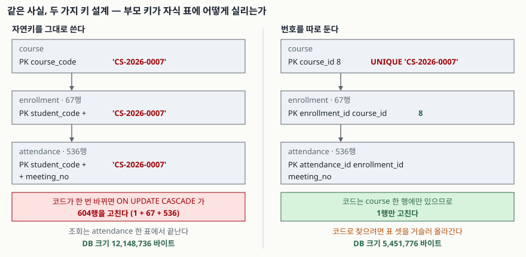

## 들어가며

수강 신청 표를 처음 만들 때는 보통 있는 값을 그대로 키로 쓴다. 학번과 강좌 코드가 이미 유일하니
둘을 묶어 기본키로 잡으면 번호를 따로 만들 일이 없다. 그러다 학사팀에서 연락이 온다. 강좌 하나가
학과를 옮겨서 코드를 `CS-2026-0007`에서 `EE-2026-0007`로 바꿔야 한다고. 여기서 보통은
`UPDATE course SET course_code = ...` 한 줄을 치고 끝낸다고 생각한다.

그런데 그 한 줄이 실제로 몇 행을 고치는지는 쳐 보기 전에는 모른다. 강좌 코드는 `course`에만 있는
것이 아니라 `enrollment`에도, `attendance`에도 복사되어 있다. 아래에서 실제로 재 보면 그 한 줄이
**604행을 고친다.** 번호를 따로 뒀다면 1행이었다.

## 개념

- **자연키(natural key)**: 업무에서 이미 쓰는 값을 그대로 키로 삼는 것이다. 학번, 사업자등록번호,
  강좌 코드, 주민등록번호 같은 것들이다.
- **복합키(composite key)**: 컬럼 하나로는 유일하지 않아 여러 컬럼을 묶어 만든 키다.
  수강 기록은 `(학번, 강좌 코드)` 둘이 있어야 한 행이 가려진다.
- **대리키(surrogate key)**: 업무와 아무 상관 없는 값을 따로 만들어 키로 쓰는 것이다. 보통
  1부터 올라가는 정수다. SQLite에서는 `INTEGER PRIMARY KEY`로 선언하면 그 컬럼이 곧 내부
  행 번호(rowid)가 되어 따로 색인이 생기지 않는다.

둘 중 하나를 고르는 문제로 보이지만, 실제로 고르는 것은 **자식 표가 부모를 무엇으로 가리킬
것인가**다. 자연키를 쓰면 자식 표마다 그 값이 통째로 복제되고, 대리키를 쓰면 숫자 하나만 실린다.

## 구조

아래는 같은 사실을 두 가지로 담았을 때 강좌 코드가 어디까지 퍼지는지를 실측값과 함께 그린 것이다.



> **출처**: [SQLite — CREATE TABLE §ROWIDs and the INTEGER PRIMARY KEY](https://www.sqlite.org/lang_createtable.html#rowid), [SQLite — Foreign Key Support §4.3 ON DELETE and ON UPDATE Actions](https://www.sqlite.org/foreignkeys.html#fk_actions)

## 동작 원리

왜 크기가 벌어지는지부터 보자. 자연키 스키마의 `attendance` 한 행은 `student_code`(7자) +
`course_code`(12자) + `meeting_no` + `attended`를 담는다. 그리고 이 세 컬럼으로 만든 기본키
색인이 **같은 값을 한 번 더** 들고 있다. 160,000행이면 19바이트짜리 문자열 두 벌이 320,000번
복제된다. 대리키 스키마는 같은 자리에 정수 둘(`enrollment_id`, `meeting_no`)만 들어간다.

갱신 범위가 갈리는 이유는 더 단순하다. 자연키 스키마에서 `course_code`는 세 표에 흩어져 있고,
`ON UPDATE CASCADE`가 그 전부를 따라다닌다. 대리키 스키마에서 `course_code`는 `course` 한
행에만 있고, 자식 표가 보는 `course_id`는 변할 일이 없다.

반대 방향의 비용도 있다. "학번 S000000의 CS-2026-0000 출석"을 꺼낼 때 자연키 스키마는 찾는
값이 `attendance`에 그대로 있어 색인 한 번으로 끝난다. 대리키 스키마는 학번으로 `student_id`를
찾고, 코드로 `course_id`를 찾고, 그 둘로 `enrollment_id`를 찾은 뒤에야 `attendance`에 닿는다.

## 실습 예제

전체 소스는 [`code/key_design.py`](code/key_design.py)에 있고, 돌린 기록은
[`code/output.txt`](code/output.txt)에 그대로 남겼다. 두 스키마에 같은 데이터
(학생 2,000 · 강좌 300 · 수강 20,000 · 출석 160,000행)를 넣고 넷을 쟀다.

```text
1. 같은 사실을 담은 두 스키마의 크기
  수강 20,000건 · 출석 160,000행 · 두 DB 의 행 수는 같다
  자연키 스키마 : 12,148,736 바이트
  대리키 스키마 :  5,451,776 바이트
  차이          :  6,696,960 바이트 (2.23배)

2. 강좌 코드 하나가 바뀔 때 고쳐지는 행 수
  대상 강좌 CS-2026-0007 -> EE-2026-0007
  이 강좌의 출석 행 수 : 536
  자연키 스키마에서 바뀐 행 : 604
  대리키 스키마에서 바뀐 행 : 1
```

조회 경로는 `EXPLAIN QUERY PLAN`에 그대로 드러난다.

```text
-- 자연키 스키마
  QUERY PLAN
  `-- SEARCH attendance USING INDEX sqlite_autoindex_attendance_1 (student_code=? AND course_code=?)

-- 대리키 스키마
  QUERY PLAN
  |-- SEARCH s USING COVERING INDEX sqlite_autoindex_student_1 (student_code=?)
  |-- SEARCH c USING COVERING INDEX sqlite_autoindex_course_1 (course_code=?)
  |-- SEARCH e USING COVERING INDEX sqlite_autoindex_enrollment_1 (student_id=? AND course_id=?)
  `-- SEARCH a USING INDEX sqlite_autoindex_attendance_1 (enrollment_id=?)
```

**여기서 예상과 달랐던 것이 있다.** 색인 탐색이 한 번에서 네 번으로 늘었는데도 한 건씩 꺼내는
조회 2,000회는 40.3 ms와 39.4 ms로 사실상 같았다. 앞의 세 단계가 전부 `COVERING INDEX`라서
표 본문을 읽지 않고 색인만으로 끝나기 때문이고, 그 정도 비용은 파이썬이 질의 하나를 부르는
비용에 묻힌다. 조인 값이 드러나려면 범위를 훑어야 한다. 강좌별 출석률을 전부 집계하면
47.1 ms 대 52.6 ms로 벌어졌다. 자연키 쪽이 2.2배 큰 표를 통째로 읽는데도 더 빨랐다.
(측정 시간은 환경에 따라 흔들린다. 실행계획은 어디서 돌려도 같다.)

마지막으로 자주 오해하는 지점이다. 대리키를 뒀다고 해서 자연키의 유일성이 저절로 지켜지지 않는다.

```text
  UNIQUE 를 뺀 표에 같은 코드를 두 번 넣으면: [(1, '예전 강좌'), (2, '물려받은 강좌')]
  코드로 강좌를 찾는 질의가 두 행을 돌려준다 — 대리키가 유일성을 대신하지 않는다
```

## 실무에서 주의할 점

- **자연키가 "안 바뀐다"는 말은 대개 "아직 안 바뀌었다"는 뜻이다.** 사업자등록번호는 법인 전환으로
  바뀌고, 강좌 코드는 학과 개편으로 바뀌고, 이메일은 사람이 바꾼다. 바뀔 가능성이 조금이라도
  있으면 자식 표에 복제하지 않는 편이 안전하다.
- **대리키를 넣었으면 자연키에는 `UNIQUE`를 반드시 같이 건다.** 위 출력이 그 이유다. `course_id`가
  유일한 것과 `course_code`가 유일한 것은 다른 이야기이고, 업무가 요구하는 쪽은 후자다.
- **`ON UPDATE CASCADE`는 `PRAGMA foreign_keys = ON` 일 때만 돈다.** SQLite는 외래키 검사가
  기본으로 꺼져 있다([SQLite — Foreign Key Support §2](https://www.sqlite.org/foreignkeys.html#fk_enable)).
  꺼진 채로 부모를 고치면 자식은 그대로 남아 어디도 가리키지 않는 행이 된다.
- **대리키가 공짜는 아니다.** 코드 값으로 조회하는 화면이 많으면 그만큼 조인이 늘고, 화면에 보일
  값이 전부 다른 표에 있어 쿼리가 길어진다. 조회가 압도적으로 많고 키가 절대 안 바뀌는 코드 표
  (국가 코드, 통화 코드)라면 자연키를 그대로 두는 편이 읽기 쉽다.
- **중간 표(`enrollment`)의 복합 `UNIQUE`는 대리키를 써도 남겨 둔다.** `UNIQUE(student_id,
  course_id)`가 없으면 같은 학생이 같은 강좌를 두 번 신청한 행이 생긴다.

## 정리

- 자연키를 자식 표로 내리면 그 값이 행마다, 그리고 색인에 한 번 더 복제된다. 같은 데이터로
  DB 크기가 2.23배 갈렸다.
- 자연키가 한 번 바뀌면 복제된 곳을 전부 따라가야 한다. 604행 대 1행이었다.
- 대리키의 비용은 조회 경로다. 원래 값으로 찾으려면 표를 거슬러 올라가야 하고, 범위를 훑는
  집계에서 그 차이가 드러난다(47.1 ms 대 52.6 ms).
- 대리키는 유일성을 대신해 주지 않는다. 자연키 컬럼에 `UNIQUE`를 따로 건다.
- 키가 절대 안 바뀌고 조회가 압도적이면 자연키, 바뀔 수 있고 자식 표가 깊으면 대리키다.

## 참고 자료

- [SQLite — CREATE TABLE §ROWIDs and the INTEGER PRIMARY KEY](https://www.sqlite.org/lang_createtable.html#rowid)
- [SQLite — Foreign Key Support §4.3 ON DELETE and ON UPDATE Actions](https://www.sqlite.org/foreignkeys.html#fk_actions)
- [SQLite — Foreign Key Support §2 Enabling Foreign Key Support](https://www.sqlite.org/foreignkeys.html#fk_enable)
- [SQLite — The WITHOUT ROWID Optimization](https://www.sqlite.org/withoutrowid.html)
