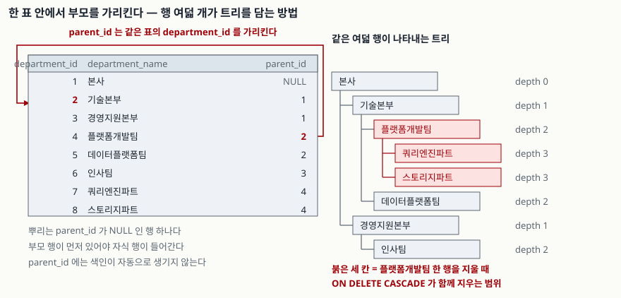

## 들어가며

회사 조직도를 DB에 넣어 달라는 요청을 받으면 처음에는 표를 층마다 만들게 된다. `division`,
`department`, `team`, `part` 이렇게 넷이면 지금 조직은 들어간다. 그러다 어느 파트 밑에 파트가
하나 더 생기면 다섯 번째 표를 만들어야 하고, 전체 부서 목록을 뽑는 쿼리는 `UNION ALL`로
네 줄에서 다섯 줄이 된다.

조직도를 출력하는 화면 하나 때문에 표 다섯 개를 조인하고, 층이 하나 늘 때마다 그 쿼리를 전부
고친다. 층이 몇 개인지 미리 알 수 없는 데이터를 층마다 표로 나눠 담았기 때문에 생기는 일이다.

## 개념

**자기참조 외래키(self-referencing foreign key)**는 외래키가 다른 표가 아니라 **자기 표를**
가리키는 것이다. 부서 표에 `parent_id` 컬럼을 두고, 그 값이 같은 표의 `department_id`를
가리키게 한다.

```sql
CREATE TABLE department (
    department_id   INTEGER PRIMARY KEY,
    department_name TEXT    NOT NULL,
    parent_id       INTEGER REFERENCES department(department_id) ON DELETE CASCADE
);
```

이렇게 담은 모양을 **인접 리스트(adjacency list)**라고 부른다. 한 행은 자기 부모가 누구인지만
알고, 할아버지가 누구인지는 모른다. 층이 몇 개든 표는 하나고, 층이 늘어도 스키마를 안 고친다.
대신 "내 밑의 전부"를 꺼내려면 표를 한 번 읽는 것으로는 안 된다.

뿌리는 `parent_id`가 `NULL`인 행이다. 외래키 제약은 `NULL`을 검사하지 않으므로
([SQLite — Foreign Key Support §1](https://www.sqlite.org/foreignkeys.html#fk_basics)) 뿌리를 위해
따로 뭘 할 필요가 없다.

## 구조



> **출처**: [SQLite — Foreign Key Support §1 Introduction to Foreign Key Constraints](https://www.sqlite.org/foreignkeys.html#fk_basics), [SQLite — Foreign Key Support §4.3 ON DELETE and ON UPDATE Actions](https://www.sqlite.org/foreignkeys.html#fk_actions)

## 동작 원리

**한 단계 아래**를 꺼내는 것은 평범한 조인이다. 같은 표에 별칭 두 개를 붙여 `child.parent_id =
parent.department_id`로 잇는다. 표가 둘이 아니라 하나뿐이라는 것만 다르다.

**끝까지 내려가는 것**은 다르다. 몇 번 더 내려가야 하는지를 쿼리를 쓰는 시점에 모르기 때문이다.
그래서 `WITH RECURSIVE`를 쓴다. 뿌리를 담은 첫 줄(앵커)을 만들고, 거기에 자식을 붙이고, 방금
붙은 행에 또 자식을 붙이기를 **더 붙을 것이 없을 때까지** 반복한다. SQLite는 이 반복을 큐로
구현한다([SQLite — WITH clause §3](https://www.sqlite.org/lang_with.html#recursive_common_table_expressions)).

여기서 두 가지가 따라온다. 첫째, **부모가 DB에 없으면 자식은 들어가지 못한다.** 외래키가
가리킬 행이 없기 때문이다. 둘째, **부모를 지우면 자식이 따라 지워진다.** `ON DELETE CASCADE`가
지워진 자식을 다시 부모로 삼은 손자까지 연쇄적으로 따라 내려간다.

## 실습 예제

전체 소스는 [`code/self_fk.py`](code/self_fk.py), 돌린 기록은
[`code/output.txt`](code/output.txt)에 있다. 부서 8행을 넣고 여섯 가지를 확인했다.

재귀 CTE로 경로와 깊이를 펴면 이렇게 나온다.

```text
2. 끝까지 내려가기 — 재귀 CTE 가 같은 표를 반복해서 다시 읽는다
  depth=0  본사
  depth=1  본사 > 경영지원본부
  depth=2  본사 > 경영지원본부 > 인사팀
  depth=1  본사 > 기술본부
  depth=2  본사 > 기술본부 > 데이터플랫폼팀
  depth=2  본사 > 기술본부 > 플랫폼개발팀
  depth=3  본사 > 기술본부 > 플랫폼개발팀 > 스토리지파트
  depth=3  본사 > 기술본부 > 플랫폼개발팀 > 쿼리엔진파트
```

입력 순서와 삭제 범위는 아래와 같다. `DELETE`가 고른 행은 하나인데 실제로는 셋이 사라진다.

```text
3. 부모보다 자식을 먼저 넣으면
  IntegrityError: FOREIGN KEY constraint failed
  같은 두 줄을 순서만 바꿔 넣으면
  들어간 행: [(10, '신설팀', 2), (11, '신설파트', 10)]

4. 부모 한 행을 지우면 — ON DELETE CASCADE 는 손자까지 따라 내려간다
  DELETE 가 직접 지목한 행: 1
  전체 행 수: 10 -> 7 (3행 사라짐)
```

**예상과 달랐던 것은 다섯 번째다.** 외래키를 걸어 뒀으니 고리가 생기는 것도 막아 줄 거라고
생각했는데, 그렇지 않다.

```text
5. 외래키는 순환을 막지 못한다
  (department_id, parent_id) = [(2, 5), (5, 2)]  <- 2 -> 5 -> 2 로 닫힌다
  외래키 제약은 통과한다. 가리키는 행이 실제로 있기 때문이다.
  같은 재귀 CTE 를 돌리면: [(2, 0), (5, 1), (10, 1), (2, 2), (11, 2), (5, 3), (10, 3), (2, 4)] ... (LIMIT 8 로 잘랐다)
  지나온 id 를 들고 다니며 거르면: [(2, 0), (5, 1), (10, 1), (11, 2)]
```

외래키가 보장하는 것은 **가리키는 행이 존재한다**는 것 하나뿐이다. `2`의 부모를 `5`로, `5`의
부모를 `2`로 두어도 두 행 모두 실재하므로 제약은 통과한다. 그리고 이 상태에서 재귀 CTE를 돌리면
끝나지 않는다. `depth=4`에 다시 `2`가 나오는 것이 그 증거다. 위 출력은 `LIMIT 8`로 자른 것이다.

막는 방법은 지나온 `department_id`를 문자열로 들고 다니며 이미 지나온 것을 거르는 것이다.
그렇게 하면 같은 데이터에서 네 행으로 끝난다.

마지막으로, 자식을 찾는 질의의 실행계획이다.

```text
6. 자식을 찾는 질의의 실행계획 — parent_id 에는 색인이 자동으로 생기지 않는다
  SCAN department
  CREATE INDEX ix_department_parent_id ON department(parent_id) 뒤
  SEARCH department USING COVERING INDEX ix_department_parent_id (parent_id=?)
```

## 실무에서 주의할 점

- **`parent_id`에 색인을 직접 만든다.** 외래키를 선언했다고 색인이 생기지 않는다. 자식 쪽
  색인은 사용자가 만들어야 하고, 없으면 자식을 찾을 때마다 표 전체를 훑는다
  ([SQLite — Foreign Key Support §3](https://www.sqlite.org/foreignkeys.html#fk_indexes)).
  재귀 CTE는 깊이마다 이 조회를 하므로 영향이 깊이만큼 곱해진다.
- **순환은 외래키가 막아 주지 않는다.** 부모를 바꾸는 화면이 있다면 "새 부모가 내 자손인가"를
  애플리케이션이나 트리거에서 직접 확인한다. 한 번 고리가 생기면 조직도 화면이 멈춘다.
- **재귀 CTE에는 종료 조건을 넣는다.** 지나온 id를 누적해 거르거나, `WHERE depth < 20` 같은
  깊이 제한을 둔다. 데이터가 깨졌을 때 쿼리가 서버를 붙잡지 않게 하는 안전장치다.
- **`ON DELETE CASCADE`는 눈에 보이는 것보다 많이 지운다.** 부서 하나를 지웠더니 그 아래가
  전부 사라지는 것이 맞는 동작인지 먼저 정한다. 보통은 `ON DELETE RESTRICT`로 막고 "하위 부서를
  먼저 옮기세요"라고 알리는 편이 안전하다.
- **`PRAGMA foreign_keys = ON`을 잊지 않는다.** SQLite는 외래키 검사가 연결마다 꺼진 채로
  시작한다([SQLite — Foreign Key Support §2](https://www.sqlite.org/foreignkeys.html#fk_enable)).
  꺼져 있으면 위의 `IntegrityError`도, `ON DELETE CASCADE`도 둘 다 동작하지 않는다.

## 정리

- 층수를 미리 알 수 없는 계층은 표를 층마다 만들지 말고 `parent_id`로 자기 표를 가리킨다.
  층이 늘어도 스키마가 그대로다.
- 뿌리는 `parent_id IS NULL`인 행이다. 외래키는 `NULL`을 검사하지 않는다.
- 한 단계는 자기 조인, 끝까지는 `WITH RECURSIVE`다.
- 외래키가 보장하는 것은 "가리키는 행이 있다"까지다. 순환은 막지 못하고, 생기면 재귀 CTE가
  끝나지 않는다. 지나온 id를 거르거나 깊이 제한을 건다.
- `parent_id` 색인은 직접 만든다. 외래키 선언으로 생기지 않는다.

## 참고 자료

- [SQLite — Foreign Key Support §1 Introduction to Foreign Key Constraints](https://www.sqlite.org/foreignkeys.html#fk_basics)
- [SQLite — Foreign Key Support §2 Enabling Foreign Key Support](https://www.sqlite.org/foreignkeys.html#fk_enable)
- [SQLite — Foreign Key Support §3 Required and Suggested Database Indexes](https://www.sqlite.org/foreignkeys.html#fk_indexes)
- [SQLite — Foreign Key Support §4.3 ON DELETE and ON UPDATE Actions](https://www.sqlite.org/foreignkeys.html#fk_actions)
- [SQLite — The WITH Clause §3 Recursive Common Table Expressions](https://www.sqlite.org/lang_with.html#recursive_common_table_expressions)
