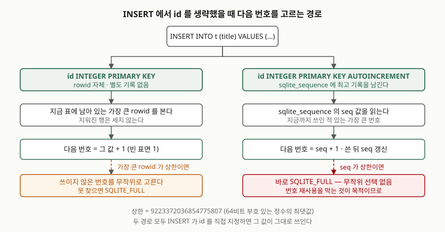

## 들어가며

주문 번호를 다루는 작은 서비스를 만든다고 하자. 표를 `id INTEGER PRIMARY KEY` 로 잡고
주문이 들어올 때마다 한 줄씩 넣는다. 테스트하면서 잘못 들어간 주문 몇 건을 지우고,
다시 주문을 넣는다. 여기까지는 아무 일도 없다.

문제는 그 사이에 주문 번호를 바깥으로 흘려보냈을 때 드러난다. 영수증에 찍었거나,
로그에 남겼거나, 다른 시스템에 "주문 4번 처리됨"이라고 알려 뒀다. 그런데 4번을 지운 뒤
새 주문을 넣었더니 그 주문이 **다시 4번**을 받는다. 영수증과 로그와 외부 시스템이 가리키는
4번은 이제 전혀 다른 주문이다. 대부분은 이 사실을 장애가 난 뒤에 안다.

SQLite에서 이 차이를 가르는 것이 `AUTOINCREMENT` 한 단어다. 무엇이 어떻게 달라지는지
두 표를 나란히 두고 같은 조작을 가해 확인했다.

## 개념

SQLite의 보통 표에는 **rowid** 라는 숨은 정수 컬럼이 하나 있다. 표의 행은 이 rowid 순서로
저장된다. 그리고 기본키를 단일 컬럼으로 잡고 선언한 타입이 정확히 `INTEGER` 이면,
그 컬럼은 새 컬럼이 아니라 **rowid 자체의 다른 이름**이 된다. 공식 문서는 이 조건을
"선언한 타입 이름이 정확히 INTEGER 일 때만"이라고 못 박는다. `INT` 나 `BIGINT` 로 적으면
rowid 가 아니라 평범한 정수 컬럼에 유일 인덱스가 붙는다.

`INSERT` 에서 이 컬럼의 값을 생략하면 SQLite가 번호를 채워 준다. 기본 규칙은
**지금 표에 남아 있는 가장 큰 rowid + 1** 이다. "남아 있는"이 핵심이다. 지워진 행은
세지 않으므로, 맨 끝 행을 지우면 그 번호가 비고 다음 삽입이 그 자리를 가져간다.

`AUTOINCREMENT` 를 붙이면 규칙이 바뀐다. 새 번호는 **그 표에 지금까지 존재한 적 있는
가장 큰 번호보다 최소 1 큰 값**이 된다. 지금 남아 있는지가 아니라 과거에 쓰인 적 있는지를
본다. 그러려면 지워진 번호까지 기억해야 하므로, SQLite는 `sqlite_sequence` 라는 내부 표에
표 이름과 최고 기록을 적어 둔다.

## 구조



> **출처**: [SQLite Autoincrement §2 Background, §3 The AUTOINCREMENT Keyword](https://www.sqlite.org/autoinc.html), [CREATE TABLE §5 ROWIDs and the INTEGER PRIMARY KEY](https://www.sqlite.org/lang_createtable.html#rowid)

## 동작 원리

두 경로가 보는 곳이 다르다. 일반 rowid 는 **표를 본다**. `AUTOINCREMENT` 는 **기록을 본다**.
그래서 표를 통째로 비워도 `sqlite_sequence` 의 숫자는 그대로 남는다.

`sqlite_sequence` 는 `AUTOINCREMENT` 컬럼을 가진 표를 만드는 순간 자동으로 생기고,
그 표에 처음 쓸 때 해당 행이 들어간다. 최고 기록을 넘기는 삽입이 있을 때마다 갱신된다.
삽입 한 번에 쓰기가 한 곳 더 생기는 셈이고, 공식 문서가 "꼭 필요하지 않으면 피하라"고
적는 이유가 여기 있다.

상한에 닿았을 때의 반응도 갈린다. 두 방식 모두 번호의 상한은 64비트 부호 있는 정수의
최댓값인 9223372036854775807 이다. 일반 rowid 표는 여기서 **쓰이지 않은 번호를 무작위로
고르기 시작하고**, 몇 번 시도해도 못 찾을 때만 `SQLITE_FULL` 로 실패한다.
`AUTOINCREMENT` 표는 무작위 선택이 없다. 번호 재사용을 막는 것이 목적이므로 바로 실패한다.

## 실습 예제

표 둘을 같은 데이터로 채우고 똑같은 조작을 가했다. 전체 소스는
[`code/autoincrement_rowid.py`](code/autoincrement_rowid.py) 에, 아래에 싣는 출력을 그대로
담은 수행 기록은 [`code/output.txt`](code/output.txt) 에 있다.

```python
CREATE TABLE plain (
    id    INTEGER PRIMARY KEY,
    title TEXT NOT NULL
);

CREATE TABLE strict_seq (
    id    INTEGER PRIMARY KEY AUTOINCREMENT,
    title TEXT NOT NULL
);
```

네 행을 넣은 직후 `sqlite_sequence` 에는 `AUTOINCREMENT` 표만 올라와 있다.

```text
  CREATE TABLE plain ( id INTEGER PRIMARY KEY, title TEXT NOT NULL )
  CREATE TABLE sqlite_sequence(name,seq)
  CREATE TABLE strict_seq ( id INTEGER PRIMARY KEY AUTOINCREMENT, title TEXT NOT NULL )

  sqlite_sequence: name='strict_seq'  seq=4
```

### 맨 끝 행을 지우고 다시 넣으면

```text
  삭제 후  plain=[1, 2, 3]  strict_seq=[1, 2, 3]
  sqlite_sequence: name='strict_seq'  seq=4
  재삽입   plain 이 받은 번호=4  strict_seq 가 받은 번호=5
  현재     plain=[1, 2, 3, 4]  strict_seq=[1, 2, 3, 5]
```

`plain` 은 비워진 4번을 되쓰고 `strict_seq` 는 4를 건너뛴다. 들어가며에서 말한
그 장면이다. 행을 지워도 `sqlite_sequence` 의 `seq` 는 4로 남아 있던 것이 보인다.

### 중간 행을 지우면

```text
  삭제 후  plain=[1, 3, 4]  strict_seq=[1, 3, 5]
  재삽입   plain 이 받은 번호=5  strict_seq 가 받은 번호=6
```

여기가 자주 오해되는 자리다. `plain` 이 2번 구멍을 메울 것 같지만 5번을 받는다.
규칙은 "빈 번호 찾기"가 아니라 "남아 있는 것 중 가장 큰 값 + 1"이기 때문이다.
**번호 재사용은 맨 끝에서만 일어난다.**

### 표를 통째로 비우면

```text
  비운 뒤  plain=[]  strict_seq=[]
  sqlite_sequence: name='strict_seq'  seq=6
  재삽입   plain 이 받은 번호=1  strict_seq 가 받은 번호=7
```

`plain` 은 1번으로 돌아가고 `strict_seq` 는 7번을 이어 간다. 표가 비었어도
`sqlite_sequence` 의 기록은 지워지지 않는다.

### 상한에 닿으면

최댓값을 직접 넣어 둔 표에 한 행을 더 넣어 봤다.

```text
  plain       성공 — 받은 번호=1787792953505057767
  strict_seq  실패 — OperationalError: database or disk is full
```

`plain` 이 받은 번호는 돌릴 때마다 달라진다. 무작위로 고른 값이기 때문이다.
이 글을 쓰며 두 번 돌렸더니 `4157017366316934714` 와 `1787792953505057767` 이 나왔다.
"디스크가 가득 찼다"는 메시지는 `SQLITE_FULL` 결과 코드를 그대로 옮긴 것이라
디스크 용량과는 관계가 없다. 번호를 더 줄 수 없다는 뜻이다.

### 번호 재사용이 어긋나게 하는 것

```text
  바깥 시스템이 적어 둔 번호: 2  ('장애 보고서')
  같은 번호로 다시 찾으면: '점심 메뉴'
```

2번을 지우고 새 행을 넣자 2번이 다른 내용을 가리킨다. 질의는 성공하고 에러도 없다.
그래서 이 종류의 문제는 조용히 번진다.

### 롤백하면 번호가 돌아오는가

글을 쓰면서 가장 예상과 달랐던 부분이다. 롤백된 삽입이 가져간 번호는 버려질 것이라고
생각했는데, 돌려 보니 그렇지 않았다.

```text
  롤백 전 seq=2
  롤백 후 seq=1
  다음 삽입이 받은 번호=2
  남은 행=[(1, '첫 글'), (2, '다음 글')]
```

`sqlite_sequence` 갱신이 트랜잭션 안에 들어 있어서 롤백과 함께 되돌아간다.
그래서 `AUTOINCREMENT` 표에 구멍이 생기는 원인은 **커밋된 삭제** 하나로 좁혀진다.

## 실무에서 주의할 점

**`AUTOINCREMENT` 가 보장하는 것은 "되쓰지 않는다" 하나뿐이고, 연속은 아니다.**
커밋된 행을 지우면 그 번호는 영영 비고 다음 번호가 그 위에서 이어진다.
감사 로그에서 번호가 이어지는지로 누락을 판단하려는 설계는 이 위에서 성립하지 않는다.

**`sqlite_sequence` 는 평범한 표라서 `UPDATE` 로 고쳐진다.** 공식 문서도 고칠 수 있다고
적으면서 동시에 "번호 생성 알고리즘이 흐트러진다"고 경고한다. 번호를 1부터 다시 시작하고
싶어 이 값을 손으로 내리면, 과거에 쓰인 번호를 다시 발급하게 되어 `AUTOINCREMENT` 를
붙인 이유가 사라진다.

**삽입마다 쓰기가 한 곳 늘어난다.** `sqlite_sequence` 갱신 비용이다. 공식 문서는
CPU·메모리·디스크·입출력 부담이 더해지므로 꼭 필요하지 않으면 피하라고 적는다.
표 안에서만 쓰이고 바깥으로 나가지 않는 번호라면 재사용돼도 아무 일이 없다.

**기본키 타입을 `INT` 로 적으면 rowid 가 아니다.** 한 글자 차이로 동작이 갈린다.

```text
  id, typeof(id), rowid, title
    (None, 'null', 1, 'a')
    (None, 'null', 2, 'b')
  INT PRIMARY KEY AUTOINCREMENT — OperationalError: AUTOINCREMENT is only allowed on an INTEGER PRIMARY KEY
```

숨은 rowid 가 따로 생기고 `id` 는 평범한 컬럼이 되어, 값을 넣지 않으면 자동으로 채워지는
대신 `NULL` 이 들어간다. 기본키에 `NULL` 이 들어간 것이 이상해 보이겠지만, SQLite는 `INTEGER PRIMARY KEY` 도,
`WITHOUT ROWID` 표도, `STRICT` 표도, `NOT NULL` 선언도 아닌 기본키 컬럼에는 `NULL` 을
허용한다. 공식 문서는 이것을 초기 버전의 결함이라고 적으면서, 고치면 기존 응용이
깨지므로 그대로 두었다고 밝힌다.
여기에 `AUTOINCREMENT` 를 붙여 고치려 들면 문법 오류로 막힌다.

## 정리

- 일반 rowid 의 다음 번호는 **표에 남아 있는** 가장 큰 값 + 1 이다. 맨 끝 행을 지우면 되쓴다
- 중간에 생긴 구멍은 메우지 않는다. 재사용은 맨 끝에서만 일어난다
- `AUTOINCREMENT` 의 다음 번호는 **지금까지 쓰인 적 있는** 가장 큰 값 + 1 이고,
  그 기록은 `sqlite_sequence` 에 남는다. 표를 비워도 지워지지 않는다
- 상한에서 일반 rowid 는 빈 번호를 무작위로 찾고, `AUTOINCREMENT` 는 바로 `SQLITE_FULL` 이다
- `sqlite_sequence` 갱신은 트랜잭션에 묶여 있어 롤백하면 번호도 돌아온다.
  구멍이 생기는 원인은 커밋된 삭제뿐이다
- 번호가 바깥으로 나가면 `AUTOINCREMENT`, 표 안에서만 쓰이면 붙이지 않는 쪽이 싸다

## 참고 자료

- [SQLite Autoincrement](https://www.sqlite.org/autoinc.html) — §1 Summary, §2 Background, §3 The AUTOINCREMENT Keyword
- [CREATE TABLE §5 ROWIDs and the INTEGER PRIMARY KEY](https://www.sqlite.org/lang_createtable.html#rowid)
- [CREATE TABLE §3.5 The PRIMARY KEY](https://www.sqlite.org/lang_createtable.html#the_primary_key) — 기본키 컬럼의 `NULL` 허용
- [SQLite Database File Format §2.6.2 The sqlite_sequence table](https://www.sqlite.org/fileformat2.html#seqtab)
- [SQLite Result and Error Codes — SQLITE_FULL](https://www.sqlite.org/rescode.html#full)
