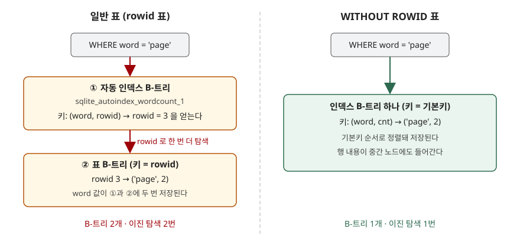

## 들어가며

단어 빈도를 세는 작은 프로그램을 만들다 보면 `word TEXT PRIMARY KEY, cnt INTEGER` 같은 표를
하나 만들게 된다. 기본키를 걸었으니 단어로 찾는 것은 빠를 거라고 생각하고 넘어간다.
그런데 SQLite에서 이 표는 실제로 **B-트리 두 개**로 저장된다. 단어 하나를 찾을 때마다 트리를
두 번 내려가고, 단어 문자열은 디스크에 두 번 들어간다. 2만 단어면 2만 개의 문자열이 한 벌 더
저장되는 셈인데, 대부분은 이 사실을 모른 채 쓴다.

## 개념

SQLite의 보통 표에는 눈에 보이지 않는 정수 컬럼 **rowid**가 하나 있다. 표는 이 rowid 순서로
저장되고, 사용자가 `PRIMARY KEY`로 지정한 컬럼은 따로 만든 **자동 인덱스**에 들어간다.
기본키가 `INTEGER PRIMARY KEY`일 때만 그 컬럼이 rowid 자체가 되어 인덱스가 따로 생기지 않는다.

`CREATE TABLE` 끝에 **`WITHOUT ROWID`**를 붙이면 숨은 rowid가 아예 없어진다. 표는 사용자가
정한 기본키 순서로 저장되고, 기본키 인덱스가 곧 표가 된다. 이렇게 행을 키 순서대로 모아 담는
것을 **클러스터드 인덱스(clustered index)**라고 부른다. 공식 문서는 이것을 새 기능이 아닌
**최적화**로 분류한다([SQLite — WITHOUT ROWID Tables §1](https://www.sqlite.org/withoutrowid.html#introduction)).
SQLite 3.8.2부터 쓸 수 있다.

```sql
CREATE TABLE wordcount (
    word TEXT PRIMARY KEY,
    cnt  INTEGER
) WITHOUT ROWID;
```

## 구조



> **출처**: [SQLite — WITHOUT ROWID Tables §1 Introduction](https://www.sqlite.org/withoutrowid.html#introduction), [SQLite Database File Format §2.4 Representation of WITHOUT ROWID Tables](https://www.sqlite.org/fileformat2.html#representation_of_without_rowid_tables)

## 동작 원리

일반 표는 **표 B-트리**에 저장된다. 이 트리의 키는 rowid이고, 행 내용은 맨 아래 잎(leaf)에만
들어간다. 기본키 인덱스는 별도의 **인덱스 B-트리**이며 `(word, rowid)`를 담는다. 그래서 단어로
찾으면 인덱스에서 rowid를 얻고, 그 rowid로 표 B-트리를 한 번 더 내려간다.

WITHOUT ROWID 표는 처음부터 **인덱스 B-트리 하나**에 저장된다. 키는 기본키 컬럼 뒤에 나머지
컬럼을 이어 붙인 레코드다([파일 포맷 문서 §2.4](https://www.sqlite.org/fileformat2.html#representation_of_without_rowid_tables)).
찾을 때 트리를 한 번만 내려가고, 단어도 한 번만 저장된다.

대가도 있다. 인덱스 B-트리는 행 내용을 중간 노드에도 담는다. 그리고 **한 페이지에 직접 담을 수
있는 크기가 표 B-트리보다 훨씬 작다.** 4096바이트 페이지에서 표 B-트리 잎은 한 칸에 4061바이트까지
담지만, 인덱스 B-트리는 1002바이트를 넘으면 나머지를 **넘침 페이지(overflow page)**로 보낸다
([파일 포맷 문서 §1.6](https://www.sqlite.org/fileformat2.html#b_tree_pages)). 이 차이가 아래
측정에서 그대로 드러난다.

## 실습 예제

전체 소스는 [`code/without_rowid.py`](code/without_rowid.py), 돌린 기록은
[`code/output.txt`](code/output.txt)에 있다. 같은 다섯 행을 두 표에 넣고 시작한다.

```text
[wordcount_norowid]  5행
  컬럼 | 타입    | 제약
  -----+---------+------------
  word | TEXT    | PK NOT NULL
  cnt  | INTEGER |

[wordcount_rowid]  5행
  컬럼 | 타입    | 제약
  -----+---------+-----
  word | TEXT    | PK
  cnt  | INTEGER |
```

`ORDER BY` 없이 읽으면 저장 순서가 그대로 보인다. 스키마에는 일반 표 쪽에만 자동 인덱스가 생겼다.

```text
1. 같은 다섯 행, 같은 SELECT * — ORDER BY 없이 읽은 순서
  일반 표        : ['sqlite', 'btree', 'page', 'index', 'rowid']
  WITHOUT ROWID : ['btree', 'index', 'page', 'rowid', 'sqlite']
  일반 표의 숨은 rowid: [(2, 'btree'), (4, 'index'), (3, 'page'), (5, 'rowid'), (1, 'sqlite')]
  WITHOUT ROWID 에서 rowid 를 읽으면: OperationalError: no such column: rowid

2. 스키마에 생긴 객체 — sqlite_schema
   ('index', 'sqlite_autoindex_wordcount_rowid_1', 'wordcount_rowid')
   ('table', 'wordcount_norowid', 'wordcount_norowid')
   ('table', 'wordcount_rowid', 'wordcount_rowid')
```

단어 하나를 찾는 실행계획이다. 아래 값은 `EXPLAIN QUERY PLAN`의 `detail` 원문이다.

```text
4. 단어 하나를 찾는 실행계획 (detail 원문)
  일반 표         : ['SEARCH wordcount USING INDEX sqlite_autoindex_wordcount_1 (word=?)']
  WITHOUT ROWID: ['SEARCH wordcount USING PRIMARY KEY (word=?)']
```

**예상과 달랐던 것은 크기다.** WITHOUT ROWID가 언제나 작을 줄 알았는데, 행이 길어지자 뒤집혔다.

```text
5. 크기 — 행 20,000개, 페이지 4096 바이트
  짧은 행 (단어 + 정수)         일반     753,664  WITHOUT     364,544  비율 0.48
  200바이트 BLOB 추가         일반   4,952,064  WITHOUT   5,201,920  비율 1.05
  2000바이트 BLOB 추가        일반  41,439,232  WITHOUT  93,736,960  비율 2.26
```

짧은 행에서는 단어를 두 번 저장하지 않는 만큼 절반 이하로 줄었다. 200바이트 행에서는 이미 5% 커졌고,
2000바이트 행에서는 2.26배가 됐다. 파일 포맷 문서의 식으로 계산해 보면 이유가 보인다.

```text
7. 한 페이지에 직접 담을 수 있는 최대 크기 X — 파일 포맷 문서의 식으로 계산
  U=4096  표 B-트리 잎 X=4061  인덱스 B-트리 X=1002  M=489
  P=2000  일반 표          페이지에 2000  넘침    0
  P=2000  WITHOUT ROWID 페이지에  489  넘침 1511
```

일반 표는 2000바이트 행을 한 페이지에 둘씩 담는다. WITHOUT ROWID 표는 489바이트만 남기고
나머지 1511바이트를 넘침 페이지로 보낸다. 넘침 페이지는 4096바이트짜리인데 1511바이트만 쓰고
남는 칸은 버려진다. 행마다 페이지가 하나씩 더 붙는 셈이다.

일반 표와 다르게 동작하는 제약도 있다.

```text
6. 일반 표와 다르게 동작하는 제약
  일반 표 기본키에 NULL 두 번: [(None, 'a'), (None, 'b')]
  WITHOUT ROWID 기본키에 NULL: IntegrityError: NOT NULL constraint failed: strict_pk.code
  AUTOINCREMENT 를 붙이면     : OperationalError: AUTOINCREMENT not allowed on WITHOUT ROWID tables
  일반 표 INTEGER PRIMARY KEY 생략: [(1, '자동 번호')]
  WITHOUT ROWID 에서 생략      : IntegrityError: NOT NULL constraint failed: ipk_norowid.item_id
```

일반 표가 기본키에 `NULL`을 두 번 받아 준 것은 초기 버그가 호환성 때문에 남은 것이고,
WITHOUT ROWID 표는 표준대로 막는다([SQLite — WITHOUT ROWID Tables §2](https://www.sqlite.org/withoutrowid.html#differences_from_ordinary_rowid_tables)).

## 실무에서 주의할 점

- **행이 길면 쓰지 않는다.** 공식 문서는 한 행의 평균 크기가 페이지의 1/20 정도보다 작을 때를
  기준으로 든다. 4096바이트 페이지면 약 200바이트다. 위 측정에서 200바이트 행이 이미 손해였다.
- **정수 기본키 하나뿐인 표에는 붙이지 않는다.** `INTEGER PRIMARY KEY`는 일반 표에서 rowid 자체라
  인덱스가 따로 생기지 않는다. 공식 문서도 이 경우는 일반 표가 더 빠르다고 적는다.
  게다가 WITHOUT ROWID에서는 값을 생략하면 자동 번호 대신 `NOT NULL` 에러가 난다.
- **문자열·복합 기본키를 가진 작은 행에 쓴다.** 단어 사전, `(user_id, tag)` 같은 연결 표,
  `(sensor_id, ts)` 같은 키-값 표가 맞는 자리다.
- **`ORDER BY`를 생략하지 않는다.** 위 출력에서 기본키 순서로 나온 것은 저장 구조 때문이지
  SQL이 보장하는 동작이 아니다. 순서가 필요하면 항상 적는다.
- **오래된 SQLite에서는 파일이 안 열린다.** 3.8.2 이전 버전은 이 표가 들어 있는 DB를
  `malformed database schema`로 거부한다.

## 정리

- `WITHOUT ROWID`는 숨은 rowid를 없애고 기본키 순서로 저장하는 최적화다.
- 일반 표의 기본키 조회는 B-트리 두 개를 거치고, WITHOUT ROWID는 하나만 거친다.
- 짧은 행에서는 크기가 절반 아래로 줄었지만, 2000바이트 행에서는 넘침 페이지 때문에 2.26배가 됐다.
- 기본키 `NULL` 금지, `AUTOINCREMENT` 금지, `INTEGER PRIMARY KEY`가 rowid가 아니라는 점이 다르다.

## 참고 자료

- [SQLite — WITHOUT ROWID Tables §1 Introduction](https://www.sqlite.org/withoutrowid.html#introduction)
- [SQLite — WITHOUT ROWID Tables §2 Differences From Ordinary Rowid Tables](https://www.sqlite.org/withoutrowid.html#differences_from_ordinary_rowid_tables)
- [SQLite — WITHOUT ROWID Tables §4 When To Use WITHOUT ROWID](https://www.sqlite.org/withoutrowid.html#when_to_use_without_rowid)
- [SQLite Database File Format §1.6 B-tree Pages](https://www.sqlite.org/fileformat2.html#b_tree_pages)
- [SQLite Database File Format §2.4 Representation of WITHOUT ROWID Tables](https://www.sqlite.org/fileformat2.html#representation_of_without_rowid_tables)
