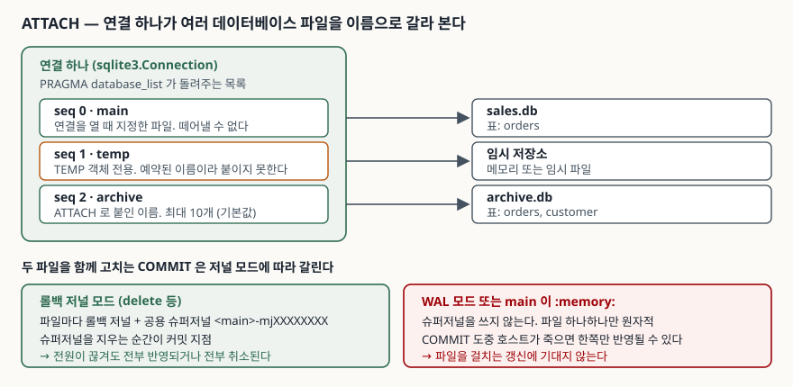

## 들어가며

가계부든 로그 수집기든, 직접 만든 도구가 SQLite 파일을 쌓기 시작하면 대개 파일이
하나로 끝나지 않는다. 지난달 것은 `2026-09.db`, 이번 달 것은 `2026-10.db`,
오래된 것은 `archive.db` 로 따로 빠져 있다. 그러다 "작년부터 지금까지 이 사람이
쓴 돈을 다 더하면 얼마냐"는 질문을 받는다.

이때 많이 택하는 방법이 파이썬으로 파일을 하나씩 열어 행을 전부 읽어 들인 다음
메모리에서 합치는 것이다. 합계만 구할 때는 괜찮지만, 조인 조건이 하나 붙는
순간 그룹핑과 정렬을 손으로 다시 짜게 된다. 다른 선택지인 "덤프해서 한 파일로
합치기"는 10만 행짜리 파일 세 개면 그 자체로 수십 초를 쓰고, 끝나면 원본과
합본이 따로 노는 상태가 된다.

SQLite 에는 파일을 옮기지 않고 한 연결에서 같이 보는 문장이 있다.

## 개념

`ATTACH DATABASE` 는 열려 있는 연결에 데이터베이스 파일을 하나 더 붙이고
**스키마 이름**을 준다. 붙인 뒤에는 `archive.orders` 처럼 `스키마.표` 로 적어
한 질의 안에서 양쪽 파일의 표를 섞어 쓴다.

```sql
ATTACH DATABASE 'archive.db' AS archive;
SELECT * FROM main.orders JOIN archive.customer USING (customer_id);
DETACH DATABASE archive;
```

복사가 아니다. 두 파일은 각자 그 자리에 남고, 연결이 양쪽을 동시에 읽고 쓸 뿐이다.
연결을 닫으면 붙인 것도 함께 풀린다.

## 구조



> **출처**: [SQLite — ATTACH DATABASE](https://www.sqlite.org/lang_attach.html), [SQLite — Atomic Commit §5 Multi-file Commit](https://www.sqlite.org/atomiccommit.html#_multi_file_commit), [SQLite — Limits §21 Maximum Number Of Attached Databases](https://www.sqlite.org/limits.html#max_attached)

## 동작 원리

붙인 결과는 `PRAGMA database_list` 로 확인한다. 예제에서 `archive.db` 를 하나
붙였더니 이렇게 나왔다.

```text
  seq=0  schema=main
  seq=2  schema=archive
```

`seq 1` 이 비어 있는 것은 그 자리가 `temp` 의 몫이기 때문이다. `main` 과 `temp`
는 예약된 이름이라 붙이지도 떼지도 못하고, 사용자가 붙인 것은 그 다음 번호부터
받는다. 이 환경에서는 `temp` 객체를 하나도 만들지 않아 목록에 줄이 나타나지
않았다.

**접두사를 생략하면 어디로 가는지**가 두 번째로 걸리는 지점이다. 양쪽 파일에
모두 `orders` 가 있을 때 접두사 없이 조회하면, 공식 문서는 "가장 나중에 붙인
것이 아니라 가장 먼저 붙인 쪽"을 고른다고 적는다. 실제로 돌려 보면 `main` 의
3행이 나온다.

```text
sql> SELECT COUNT(*) FROM orders          →  (3,)
sql> SELECT COUNT(*) FROM main.orders     →  (3,)
sql> SELECT COUNT(*) FROM archive.orders  →  (2,)
```

세 번째는 **트랜잭션이 파일을 걸친다**는 점이다. `BEGIN` 한 번으로 두 파일에
각각 INSERT 하고 `ROLLBACK` 하면 양쪽이 같이 되돌아간다.

```text
  BEGIN 뒤 INSERT 2건 (파일 하나씩)  →  (4, 3)
  ROLLBACK 수행                      →  (3, 2)
```

롤백 저널 모드에서는 이 원자성이 전원이 끊기는 상황까지 보장된다. 파일마다
롤백 저널을 두고, 그 위에 **슈퍼저널**(`<main>-mjXXXXXXXX`) 하나를 더 만들어
각 저널 머리말에 그 이름을 적어 둔다. 복구할 때는 슈퍼저널이 아직 있는 저널만
되감으므로, 슈퍼저널을 지우는 한 번의 동작이 모든 파일의 커밋 지점이 된다.

## 실습 예제

전체 소스: [`code/attach_demo.py`](code/attach_demo.py) · 돌린 기록: [`code/output.txt`](code/output.txt)

붙일 수 있는 개수에는 상한이 있다. `:memory:` 를 에러가 날 때까지 붙여 봤다.

```text
  10개까지 붙은 뒤 OperationalError: too many attached databases - max 10
  database_list 행 수 = 11
  이 상태에서 VACUUM INTO → OperationalError: too many attached databases - max 10
  mem* 를 전부 DETACH 한 뒤 행 수 = 2
```

기본 상한은 10이고, 이는 `main` 을 뺀 숫자다(`database_list` 가 11줄). 상한을
채우면 사용자가 ATTACH 를 더 못 하는 데서 그치지 않는다. `VACUUM ... INTO` 처럼
**내부적으로 한 자리를 쓰는 문장**이 같은 에러로 막힌다. 붙인 것을 떼고 나서야
복제가 됐다.

```text
  backup.db 생성, 8192 바이트
  복제본 orders 행 수 = 3
```

## 실무에서 주의할 점

**WAL 모드에서는 파일을 걸친 커밋이 원자적이지 않다.** 공식 문서는 `main` 이
`:memory:` 이거나 저널 모드가 WAL 이면 "각 파일은 그 자체로만 원자적"이고,
두 파일을 갱신하는 COMMIT 도중 호스트가 죽으면 한쪽에만 반영될 수 있다고
적는다. WAL 은 요즘 거의 기본처럼 쓰는 설정이라, 파일을 걸치는 갱신을
트랜잭션 하나로 묶어 두고 안심하기 쉬운 자리다.

**DETACH 는 트랜잭션에 속하지 않는다.** `BEGIN` 안에서 `DETACH` 를 하고
`ROLLBACK` 해도 붙인 것이 돌아오지 않았다.

```text
  BEGIN 안에서 DETACH 수행 — 에러 없음
  ROLLBACK 뒤 database_list = ['main']
```

떼어낸 뒤의 질의가 `no such table` 이 아니라 `unknown database` 로 실패하므로,
표 이름을 잘못 적은 것으로 오해하기 쉽다.

**이름이 겹치면 접두사를 생략하지 않는다.** 해소 순서가 ATTACH 순서에 달려
있으므로, 파일을 붙이는 순서가 조건에 따라 달라지는 코드에서는 같은 질의가
다른 파일을 본다. 붙인 파일을 쓰는 질의에는 전부 `스키마.표` 로 적는 편이 낫다.

**파일 경로는 문자열로 이어 붙이지 않는다.** `ATTACH DATABASE ? AS archive` 처럼
바인딩할 수 있다. 스키마 이름 쪽은 바인딩이 안 되므로, 사용자 입력을 그대로
스키마 이름으로 쓰지 않는다.

## 정리

- `ATTACH DATABASE '파일' AS 이름` 은 파일을 복사하지 않고 연결에 이름 하나를 더 준다
- `main`·`temp` 는 예약되어 있고 사용자가 붙인 것은 `seq 2` 부터 받는다
- 접두사를 생략하면 먼저 붙은 쪽이 이기므로, 이름이 겹칠 때는 전부 적는다
- 기본 상한은 `main` 을 뺀 10개이고, 꽉 차면 `VACUUM ... INTO` 도 같이 막힌다
- 롤백 저널 모드에서만 파일을 걸친 커밋이 원자적이다. WAL 에서는 파일별로만 원자적이다

## 참고 자료

- [SQLite — ATTACH DATABASE](https://www.sqlite.org/lang_attach.html)
- [SQLite — DETACH DATABASE](https://www.sqlite.org/lang_detach.html)
- [SQLite — Atomic Commit In SQLite §5 Multi-file Commit](https://www.sqlite.org/atomiccommit.html#_multi_file_commit)
- [SQLite — Implementation Limits §21 Maximum Number Of Attached Databases](https://www.sqlite.org/limits.html#max_attached)
- [SQLite — PRAGMA database_list](https://www.sqlite.org/pragma.html#pragma_database_list)
- [SQLite — VACUUM INTO](https://www.sqlite.org/lang_vacuum.html#vacuuminto)
