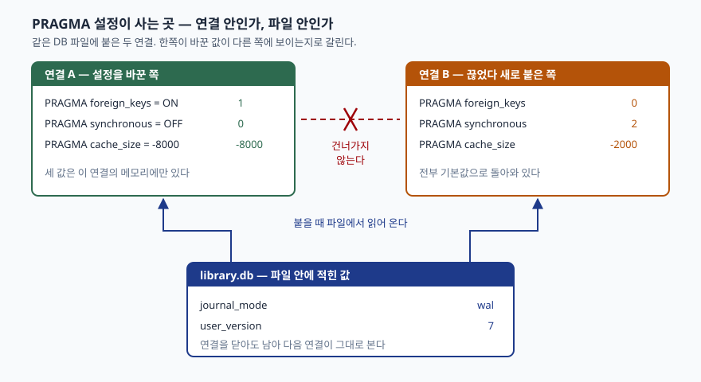

## 들어가며

SQLite 로 작은 프로그램을 만들다 보면 외래 키를 걸어 둔다. `REFERENCES author(author_id)`
라고 적어 두었으니 없는 저자 번호를 넣으면 막힐 거라고 생각하고 넘어간다. 그런데 몇 주 뒤
데이터를 들여다보면 가리키는 저자가 없는 책이 수십 행 쌓여 있다. 제약은 분명히 적혀 있는데
한 번도 동작하지 않은 것이다.

이쯤에서 보통은 `REFERENCES` 문법을 다시 찾아보거나, 스키마를 고쳐 새로 만들거나,
애플리케이션 쪽에 검사 코드를 덧붙인다. 전부 헛수고다. 스키마는 맞게 적혀 있었고
빠진 것은 연결할 때마다 켜야 하는 `PRAGMA foreign_keys = ON` 한 줄이다.
연결이 100개면 100번 켜야 한다.

## 개념

`PRAGMA` 는 SQLite 전용 명령으로, 엔진의 내부 설정을 읽거나 바꾼다. 표준 SQL 이 아니라
SQLite 가 따로 둔 문이고, 그래서 다른 DB 로 옮길 때 그대로 가지 않는다.

꼴은 두 가지다. 값을 빼면 **묻는 꼴**, `=` 뒤에 값을 주면 **바꾸는 꼴**이다.

```sql
PRAGMA foreign_keys;        -- 지금 값을 돌려준다
PRAGMA foreign_keys = ON;   -- 값을 바꾼다
```

중요한 것은 **바꾼 값이 어디에 저장되느냐**다. 여기서 두 갈래로 갈린다.
연결의 메모리에만 있다가 연결이 끊기면 사라지는 값이 있고, DB 파일에 적혀서
다음에 붙는 연결이 그대로 보는 값이 있다. 외래 키가 조용히 안 걸린 원인이
바로 이 구분이다.

## 구조



> **출처**: [SQLite — PRAGMA Statements §pragma_cache_size](https://www.sqlite.org/pragma.html#pragma_cache_size), [§pragma_journal_mode](https://www.sqlite.org/pragma.html#pragma_journal_mode), [SQLite Database File Format §1.3 The Database Header](https://www.sqlite.org/fileformat2.html#the_database_header)

## 동작 원리

**연결에만 사는 값**은 `sqlite3` 라이브러리가 연결 하나마다 들고 있는 구조체에 들어간다.
`cache_size` 문서는 이를 "현재 세션에만 유효하며, DB 를 닫았다 다시 열면 기본값으로 돌아간다"고
적는다([§pragma_cache_size](https://www.sqlite.org/pragma.html#pragma_cache_size)).
`foreign_keys` 도 같은 부류이고, 기본값은 버전 3.6.19 이후 줄곧 OFF 다
([§pragma_foreign_keys](https://www.sqlite.org/pragma.html#pragma_foreign_keys)).

**파일에 남는 값**은 DB 파일의 머리 100바이트에 적힌다. `user_version` 은 오프셋 60에 있는
4바이트 정수이고, `journal_mode` 의 WAL 여부는 오프셋 18·19의 파일 포맷 버전으로 구분된다
([파일 포맷 문서 §1.3](https://www.sqlite.org/fileformat2.html#the_database_header)).
WAL 문서도 "한 번 설정하면 여러 연결에 걸쳐 유지되며 DB 를 닫았다 다시 열어도 남는다"고 적는다
([§pragma_journal_mode](https://www.sqlite.org/pragma.html#pragma_journal_mode)).

여기에 한 가지가 더 붙는다. **트랜잭션이 열려 있으면 `foreign_keys` 는 조용히 무시된다.**
문서는 "트랜잭션 안에서는 무효"라고 못 박는다. 에러가 나지 않으므로 코드를 봐서는 알 수 없다.

## 실습 예제

전체 소스는 [`code/pragma_settings.py`](code/pragma_settings.py), 돌린 기록은
[`code/output.txt`](code/output.txt)에 있다. 저자와 책 두 표로 시작한다.

```text
[author]  2행
  컬럼      | 타입    | 제약
  ----------+---------+---------
  author_id | INTEGER | PK
  name      | TEXT    | NOT NULL

[book]  2행
  컬럼      | 타입    | 제약
  ----------+---------+---------
  book_id   | INTEGER | PK
  title     | TEXT    | NOT NULL
  author_id | INTEGER |
```

`book.author_id` 에는 `REFERENCES author(author_id)` 가 걸려 있다. 그런데 기본값이 OFF 라
존재하지 않는 저자 999를 가리키는 행이 그냥 들어간다.

```text
2. foreign_keys — 끄면 없는 저자를 가리켜도 들어간다
  OFF 에서 author_id=999 입력    -> 성공, 현재 book 행 수 3
  ON 에서 같은 입력              -> IntegrityError: FOREIGN KEY constraint failed
  이미 들어간 위반 행은 켜도 사라지지 않는다. 확인은 foreign_key_check 로 한다.
  (rollback 뒤라 OFF 가 먹는다)  -> foreign_keys = 0
  PRAGMA foreign_key_check;      -> [('book', 22, 'author', 0)]
```

나중에 켜도 **이미 들어간 행은 그대로 남는다.** `PRAGMA foreign_key_check` 가
위반 행을 찾아 주는데, 돌려준 값은 `(표 이름, rowid, 가리키던 부모 표, 몇 번째 외래 키인지)` 다.

다섯 가지를 바꾼 뒤 연결을 끊고 같은 파일에 다시 붙어 봤다.

```text
3. 어디까지 남는가 — 연결을 끊고 다시 붙여 본다
  PRAGMA               끊기 전        다시 붙은 뒤   남는가
  foreign_keys            1              0   연결과 함께 사라진다
  synchronous             0              2   연결과 함께 사라진다
  cache_size          -8000          -2000   연결과 함께 사라진다
  journal_mode          wal            wal   파일에 남는다
  user_version            7              7   파일에 남는다
```

`cache_size` 는 **부호가 단위를 바꾼다.** 음수면 KiB, 양수면 페이지 수다.

```text
4. cache_size 의 부호 — 양수는 페이지 수, 음수는 KiB
  page_size                      -> 4096
  cache_size = -2000             ->  -2000  최대 2,048,000 바이트
  cache_size = 2000              ->   2000  최대 8,192,000 바이트
  cache_size = -8000             ->  -8000  최대 8,192,000 바이트
```

기본값 `-2000` 은 약 2MB 다. 이것을 "2000페이지"로 읽고 `2000` 이라고 적으면
페이지가 4096바이트인 환경에서 **4배를 쓴다.** 두 줄이 같은 8MB 로 나온 것이 그 증거다.

트랜잭션 안에서 바꾸면 어떻게 되는지도 확인했다.

```text
5. 트랜잭션 안에서는 안 먹는 PRAGMA 가 있다
  트랜잭션 안에서 journal_mode=WAL -> delete  (바뀌지 않는다)
  트랜잭션 안에서 foreign_keys=ON  -> 0  (조용히 무시된다)
  트랜잭션을 끝낸 뒤 다시 ON       -> 1
```

**예상과 달랐던 것은 6절이다.** 이름을 틀리면 에러가 날 줄 알았는데 빈 결과만 돌아온다.

```text
6. 알 수 없는 이름을 줘도 에러가 아니다
  PRAGMA fooreign_keys;          -> []  (오타가 조용히 묻힌다)
  PRAGMA foreign_keys = maybe;   -> 0  (해석 못 한 값은 0 으로)
```

문서가 그렇게 정해 두었다. "알 수 없는 PRAGMA 는 그냥 무시되며, 오타가 있어도
라이브러리가 알려주지 않는다"([PRAGMA Statements 서두](https://www.sqlite.org/pragma.html)).
`maybe` 처럼 해석할 수 없는 값은 0으로 떨어진다. 둘 다 에러가 아니므로
`foreign_keys` 를 켠 줄 알고 있는데 실제로는 꺼져 있는 상황이 그대로 만들어진다.

마지막으로 조회용 `PRAGMA` 는 `pragma_` 를 앞에 붙여 `SELECT` 로도 읽는다
(3.16.0부터, [PRAGMA functions](https://www.sqlite.org/pragma.html#pragfunc)).

```text
7. 조회용 PRAGMA — 표처럼 읽는다
  PRAGMA integrity_check;        -> ok
  PRAGMA foreign_key_list(book);
    (0, 0, 'author', 'author_id', 'author_id', 'NO ACTION', 'NO ACTION', 'NONE')
  같은 값을 SELECT 로도 읽는다 — pragma_ 접두 함수
    WHERE notnull = 1          -> OperationalError: near "notnull": syntax error
    WHERE "notnull" = 1        -> [('title', 'TEXT')]
```

`table_info` 의 컬럼 이름 `notnull` 은 SQLite 의 연산자이기도 해서, 따옴표 없이 쓰면
구문 오류가 난다. 큰따옴표로 감싸면 컬럼으로 읽힌다.

## 실무에서 주의할 점

- **`foreign_keys = ON` 을 연결 직후 한 줄로 고정한다.** 커넥션 풀을 쓰면 새 연결마다
  다시 켜야 한다. 애플리케이션 코드 여기저기에 흩어 두면 빠뜨린 경로가 생긴다.
- **트랜잭션이 열린 상태에서 켜지 않는다.** 조용히 무시된다. 파이썬 `sqlite3` 는 기본 설정에서
  DML 을 만나면 몰래 트랜잭션을 여는데, 실패한 `INSERT` 뒤에도 그 트랜잭션이 남는다.
  위 예제도 `rollback()` 을 넣기 전에는 그 자리에서 `PRAGMA` 가 먹지 않았다.
- **오타를 검사로 잡는다.** 바꾼 뒤 묻는 꼴로 다시 읽어 기대한 값이 나오는지 확인하는 것이
  유일한 방법이다. 엔진은 알려주지 않는다.
- **`cache_size` 에 양수를 쓰지 않는다.** 부호 하나로 단위가 바뀌므로, KiB 로 적겠다고
  마음먹고 음수만 쓰는 편이 안전하다.
- **`journal_mode = WAL` 은 한 번만 걸면 된다.** 파일에 남으므로 연결마다 다시 걸 필요가 없다.
  반대로 되돌리려면 명시적으로 `DELETE` 로 바꿔야 한다.
- **다른 DB 로 옮길 때 같이 가지 않는다.** `PRAGMA` 는 SQLite 전용이다. 이식을 염두에 둔다면
  어떤 설정에 기대고 있는지를 따로 적어 둔다.

## 정리

- `PRAGMA` 는 값을 빼면 묻고, `=` 를 붙이면 바꾼다.
- `foreign_keys`·`synchronous`·`cache_size` 는 연결에만 살고, 끊으면 기본값으로 돌아간다.
- `journal_mode`·`user_version` 은 파일 머리에 적혀 다음 연결이 그대로 본다.
- `cache_size` 는 음수면 KiB, 양수면 페이지 수다. 부호를 빠뜨리면 메모리가 네 배로 뛴다.
- 이름을 틀리거나 트랜잭션 안에서 바꾸면 **에러 없이 무시된다.** 다시 읽어 확인하는 수밖에 없다.

## 참고 자료

- [SQLite — PRAGMA Statements](https://www.sqlite.org/pragma.html)
- [SQLite — PRAGMA Statements §pragma_foreign_keys](https://www.sqlite.org/pragma.html#pragma_foreign_keys)
- [SQLite — PRAGMA Statements §pragma_cache_size](https://www.sqlite.org/pragma.html#pragma_cache_size)
- [SQLite — PRAGMA Statements §pragma_journal_mode](https://www.sqlite.org/pragma.html#pragma_journal_mode)
- [SQLite — PRAGMA functions](https://www.sqlite.org/pragma.html#pragfunc)
- [SQLite Database File Format §1.3 The Database Header](https://www.sqlite.org/fileformat2.html#the_database_header)
