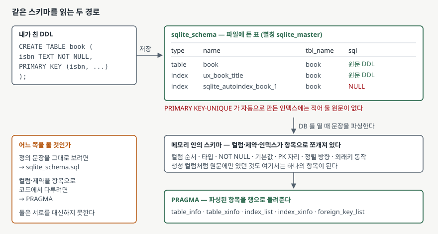

## 들어가며

남이 쓰다 넘긴 데이터베이스 파일을 받아 적재 스크립트를 짜야 할 때가 있다. CSV를 표에 넣기만
하면 되는 일인데, 그 표에 컬럼이 몇 개인지 모른다. 그래서 대개는 DB 뷰어를 열고 표를 하나씩
눌러 컬럼 이름을 받아 적는다.

표가 세 개면 할 만하다. 서른 개면 옮겨 적는 동안 오타가 한두 개 섞이고, 그 오타는 스크립트를
돌려 봐야 드러난다. 더 나쁜 것은 다음 달에 컬럼이 두 개 늘면 서른 개를 다시 훑어야 한다는
점이다.

스키마 정의는 DB 안에 들어 있고 질의로 꺼낼 수 있다. 꺼내는 길은 두 갈래인데 돌려주는 것이
서로 달라서, 어느 쪽을 쓸지부터 정해야 한다.

## 개념

SQLite는 모든 객체의 정의를 **`sqlite_schema`라는 보통의 표 하나에** 담는다. 표·인덱스·뷰·
트리거를 가리지 않고 한 행씩 들어간다. 예전 이름은 `sqlite_master`이고 지금도 그대로 쓸 수
있다([SQLite — The Schema Table §2](https://www.sqlite.org/schematab.html#alternative_names)).

컬럼은 다섯 개다. `type`(table·index·view·trigger 중 하나), `name`(객체 이름),
`tbl_name`(어느 표에 딸린 것인지), `rootpage`(b-tree 뿌리 페이지 번호), `sql`(정의 문장)
([SQLite — The Schema Table §3](https://www.sqlite.org/schematab.html#interpretation_of_the_schema_table)).

여기서 `sql`이 중요하다. 이 컬럼에는 **내가 친 `CREATE` 문장이 텍스트 그대로** 들어 있다.
SQLite가 손대는 것은 맨 앞 키워드를 대문자로 올리고, `TEMP`를 떼고, 데이터베이스 이름
한정자를 지우는 정도다. 줄바꿈도 들여쓰기도 남는다.

그래서 `sqlite_schema`만으로는 "`book` 표의 세 번째 컬럼 이름"을 알 수 없다. 알려면 그
문장을 직접 파싱해야 한다. 그 일을 대신해 주는 것이 `PRAGMA`다.

## 구조



> **출처**: [SQLite — The Schema Table §3 Interpretation Of The Schema Table](https://www.sqlite.org/schematab.html#interpretation_of_the_schema_table), [SQLite — PRAGMA Statements · PRAGMA table_info](https://www.sqlite.org/pragma.html#pragma_table_info)

## 동작 원리

SQLite는 데이터베이스를 열 때 `sqlite_schema`를 읽어 그 안의 `CREATE` 문장을 전부 파싱한다.
파싱 결과는 메모리에 남아 질의 계획을 세우는 데 쓰이고, `PRAGMA`는 **그 메모리 쪽을 읽어**
행으로 돌려준다.

`PRAGMA table_info(표이름)`이 돌려주는 컬럼은 `name`, `type`, `notnull`, `dflt_value`, `pk`
다섯 개다. 맨 앞의 `cid`는 "이번 결과 안에서의 순번" 이상의 뜻이 없다고 문서가 못 박는다.
`pk`는 참·거짓이 아니라 **기본키 안에서 몇 번째인지**를 1부터 센 숫자이고, 기본키가 아니면
0이다([SQLite — PRAGMA · table_info](https://www.sqlite.org/pragma.html#pragma_table_info)).

`PRAGMA`들은 `SELECT` 안에서도 쓸 수 있다. 이름 앞에 `pragma_`를 붙이면 표처럼 조인되는
함수가 된다. SQLite 3.16.0부터 들어갔다
([SQLite — PRAGMA · PRAGMA functions](https://www.sqlite.org/pragma.html#pragfunc)).
`sqlite_schema`와 조인하면 "모든 표의 모든 컬럼"을 한 번의 질의로 받을 수 있다.

## 실습 예제

전체 소스는 [`code/schema_introspection.py`](code/schema_introspection.py), 돌린 기록은
[`code/output.txt`](code/output.txt)에 있다. 표 둘·인덱스 둘·뷰 하나·트리거 하나로 된
스키마를 만들고 열한 가지를 확인했다.

먼저 목록이다. 넣은 적 없는 행이 둘 섞여 있다.

```text
1. sqlite_master — 이 데이터베이스에 무엇이 들어 있는가
  type    | name                      | tbl_name      | sql_is_null
  --------+---------------------------+---------------+------------
  index   | ix_book_cheap             | book          | 0
  index   | sqlite_autoindex_author_1 | author        | 1
  index   | sqlite_autoindex_book_1   | book          | 1
  index   | ux_book_title             | book          | 0
  table   | author                    | author        | 0
  table   | book                      | book          | 0
  trigger | trg_book_price_floor      | book          | 0
  view    | v_book_author             | v_book_author | 0
```

`sqlite_autoindex_`로 시작하는 둘은 `PRIMARY KEY`와 `UNIQUE` 제약이 자동으로 만든 인덱스다.
적어 둘 원문이 없으므로 `sql`이 `NULL`이다
([SQLite — The Schema Table §3](https://www.sqlite.org/schematab.html#interpretation_of_the_schema_table)).
인덱스 정의를 전부 뽑는 스크립트에서 `WHERE sql IS NOT NULL`을 빼먹으면 여기서 `None`을 만난다.

컬럼 목록을 보면 `pk`가 0과 1이 아니라는 것이 바로 보인다.

```text
3. PRAGMA table_info(book) — 컬럼 목록
  cid | name      | type    | notnull | dflt_value | pk
  ----+-----------+---------+---------+------------+---
  0   | isbn      | TEXT    | 1       | NULL       | 1
  1   | edition   | INTEGER | 1       | 1          | 2
  2   | title     | TEXT    | 1       | NULL       | 0
  3   | author_id | INTEGER | 0       | NULL       | 0
  4   | price     | INTEGER | 0       | NULL       | 0
```

`PRIMARY KEY (isbn, edition)`이라고 썼으므로 `isbn`이 1, `edition`이 2다.

**그런데 컬럼이 하나 빠져 있다.** 스키마에는 `title_fold`라는 생성 컬럼이 있는데 여기에는
없다. `table_info`가 생성 컬럼과 가상 테이블의 숨은 컬럼을 빼고 돌려주기 때문이다. 전부
보려면 `table_xinfo`를 쓴다.

```text
4. PRAGMA table_xinfo(book) — 숨은 컬럼까지
  cid | name       | type    | notnull | dflt_value | pk | hidden
  ----+------------+---------+---------+------------+----+-------
  ...
  5   | title_fold | TEXT    | 0       | NULL       | 0  | 2
```

`hidden`은 보통 컬럼이 0, 가상 테이블의 숨은 컬럼이 1, 생성 컬럼이 2 또는 3이다
([SQLite — PRAGMA · table_xinfo](https://www.sqlite.org/pragma.html#pragma_table_xinfo)).
스키마를 복제하는 코드를 `table_info`로 짜면 생성 컬럼이 조용히 사라진다.

인덱스 쪽은 `index_list`가 출처까지 알려준다.

```text
5. PRAGMA index_list — 이 표에 달린 인덱스
  seq | name                    | unique | origin | partial
  ----+-------------------------+--------+--------+--------
  0   | ix_book_cheap           | 0      | c      | 1
  1   | ux_book_title           | 1      | c      | 0
  2   | sqlite_autoindex_book_1 | 1      | pk     | 0
```

네 번째 칸이 `c`면 `CREATE INDEX`로 만든 것, `u`면 `UNIQUE` 제약이 만든 것, `pk`면
`PRIMARY KEY`가 만든 것이다. 마지막 칸이 1이면 부분 인덱스다
([SQLite — PRAGMA · index_list](https://www.sqlite.org/pragma.html#pragma_index_list)).
인덱스를 옮겨 심는 스크립트라면 `origin`이 `c`인 것만 가져가야 한다. 나머지는 제약을 옮기면
따라온다.

**가장 예상 밖이었던 것은 여덟 번째다.** 모든 표의 컬럼을 한 번에 뽑았더니 `author` 표의
기본키 컬럼이 `notnull = 0`으로 나왔다.

```text
8. pragma_ 테이블 값 함수 — 모든 표의 컬럼을 한 번에
  tbl    | cid | col       | type    | notnull | dflt_value
  -------+-----+-----------+---------+---------+-----------
  author | 0   | author_id | INTEGER | 0       | NULL
  author | 1   | name      | TEXT    | 1       | NULL
  author | 2   | country   | TEXT    | 0       | 'KR'
```

`author_id INTEGER PRIMARY KEY`인데 `notnull`이 0이다. 그렇다고 `NULL`이 들어가지는 않는다.
넣어 보면 이렇다.

```text
10. author_id 는 PK 인데 notnull 이 0 이다 — 정말 NULL 이 들어가나
  author_id | name
  ----------+------------------
  1         | 김연수
  2         | Ursula K. Le Guin
  3         | 이름 없음
```

`INTEGER PRIMARY KEY`는 rowid의 별칭이고, rowid 컬럼에 `NULL`을 넣으면 SQLite가 정수를 골라
대신 채운다([SQLite — CREATE TABLE §5](https://www.sqlite.org/lang_createtable.html#rowid)).
`notnull = 0`은 "선언에 `NOT NULL`이 없었다"는 사실일 뿐, "`NULL`을 넣을 수 있다"가 아니다.
`PRAGMA`가 돌려주는 것은 **선언된 내용**이지 **실행 시 동작**이 아니라는 점을 여기서 기억해 둘 만하다.

마지막으로 `pragma_` 함수의 쓸모를 보여주는 질의다. `NOT NULL`인데 기본값이 없는 컬럼,
그러니까 적재할 때 값을 반드시 채워야 하는 컬럼을 표 전체에서 한 번에 찾는다.

```sql
SELECT m.name AS tbl, c.name AS col
FROM sqlite_master AS m
JOIN pragma_table_info(m.name) AS c
WHERE m.type = 'table'
  AND c."notnull" = 1 AND c."dflt_value" IS NULL AND c.pk = 0
ORDER BY m.name, c.cid
```

`notnull`을 따옴표로 감싼 데는 이유가 있다. 감싸지 않으면 `sqlite3.OperationalError: near
"notnull": syntax error`가 난다. `NOTNULL`이 SQLite에서 `IS NOT NULL`과 같은 뜻의 후위
연산자 키워드이기 때문이다([SQLite — Keywords](https://www.sqlite.org/lang_keywords.html)).

## 실무에서 주의할 점

- **스키마를 복제하거나 비교하는 코드는 `table_xinfo`로 짠다.** `table_info`는 생성 컬럼을
  빼고 돌려주므로, 원본에 있던 컬럼이 복제본에서 조용히 사라진다. 에러가 나지 않아서
  나중에 조회가 비어 나올 때까지 모른다.
- **`pk` 컬럼을 참·거짓으로 쓰지 않는다.** 복합 기본키에서는 2, 3이 나온다. 파이썬에서는
  둘 다 참이라 단일 키 표에서는 멀쩡히 돌다가 복합 키 표에서 순서가 뒤집힌다.
  기본키 컬럼을 순서대로 모으려면 `pk > 0`으로 거르고 `pk` 순으로 정렬한다.
- **`sqlite_master`를 훑을 때 `sql IS NULL`을 먼저 처리한다.** 자동 생성 인덱스가 여기에
  걸린다. 정의 문장을 쓰려고 꺼냈다면 `WHERE sql IS NOT NULL`을, 목록만 필요하면 그대로 둔다.
- **`PRAGMA`의 인자에는 플레이스홀더를 쓸 수 없다.** 돌려 보면
  `OperationalError: near "?": syntax error`가 난다. 그래서 표 이름을 문자열로 이어 붙이게
  되는데, 그 이름이 바깥에서 들어온 값이면 주입 경로가 된다. 테이블 값 함수
  `pragma_table_info(?)`로 쓰면 플레이스홀더가 그대로 통한다(예제 11번).
- **`dflt_value`는 값이 아니라 식의 텍스트다.** `country TEXT DEFAULT 'KR'`은 `KR`이 아니라
  따옴표가 붙은 `'KR'`로 돌아온다. `CURRENT_TIMESTAMP` 같은 식도 계산되지 않은 문자열이다.
  비교하거나 바로 넣을 값으로 쓰면 틀린다.

## 정리

- 정의는 전부 `sqlite_schema`(= `sqlite_master`) 한 표에 들어 있고, `sql` 컬럼에는 친
  `CREATE` 문장이 텍스트 그대로 남는다.
- 자동 생성 인덱스는 `sql`이 `NULL`이다. 목록을 훑는 코드는 이 행을 먼저 처리한다.
- 컬럼·제약을 항목으로 다루려면 `PRAGMA table_info` 계열을 쓴다. 생성 컬럼까지 보려면
  `table_xinfo`다.
- `pk`는 참·거짓이 아니라 기본키 안에서의 1부터 센 순번이다.
- `pragma_` 접두사를 붙이면 `SELECT`에서 조인할 수 있다. `sqlite_master`와 조인하면 스키마
  전체를 한 질의로 훑는다.

## 참고 자료

- [SQLite — The Schema Table §2 Alternative Names](https://www.sqlite.org/schematab.html#alternative_names)
- [SQLite — The Schema Table §3 Interpretation Of The Schema Table](https://www.sqlite.org/schematab.html#interpretation_of_the_schema_table)
- [SQLite — PRAGMA Statements · PRAGMA table_info](https://www.sqlite.org/pragma.html#pragma_table_info)
- [SQLite — PRAGMA Statements · PRAGMA table_xinfo](https://www.sqlite.org/pragma.html#pragma_table_xinfo)
- [SQLite — PRAGMA Statements · PRAGMA index_list](https://www.sqlite.org/pragma.html#pragma_index_list)
- [SQLite — PRAGMA Statements · PRAGMA index_xinfo](https://www.sqlite.org/pragma.html#pragma_index_xinfo)
- [SQLite — PRAGMA Statements · PRAGMA functions](https://www.sqlite.org/pragma.html#pragfunc)
- [SQLite — CREATE TABLE §5 ROWIDs and the INTEGER PRIMARY KEY](https://www.sqlite.org/lang_createtable.html#rowid)
- [SQLite — SQL Keywords](https://www.sqlite.org/lang_keywords.html)
