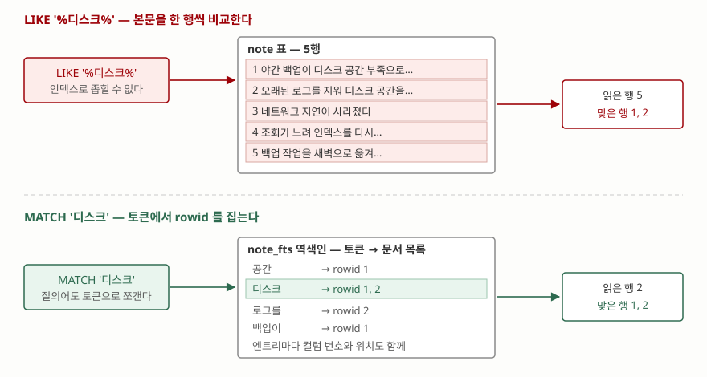

## 들어가며

취미로 만든 메모 앱이든 업무용 장애 기록이든, 글을 쌓아 두는 도구를 직접 만들면
"본문에서 찾기"가 반드시 필요해진다. 대개 처음 떠오르는 방법은 하나다.

```sql
SELECT * FROM note WHERE body LIKE '%디스크%';
```

기록이 몇백 건일 때는 바로 나온다. 그래서 그대로 둔다. 그러다 기록이 5만 건쯤
되면 검색 한 번에 눈에 띄는 멈칫거림이 생기고, 그때 보통 인덱스를 만든다.
그런데 인덱스를 만들어도 빨라지지 않는다. 이 글은 그 이유와, SQLite가 그 자리에
따로 마련해 둔 FTS5 가상 테이블을 다룬다.

## 개념 — `%` 로 시작하는 패턴은 범위가 되지 않는다

인덱스는 **정렬된 목록**이다. 값이 순서대로 놓여 있으니 "ㅇ으로 시작하는 것"은
그 구간만 보면 되지만, "어딘가에 ㄷ이 들어간 것"은 구간이 만들어지지 않는다.
`LIKE '%디스크%'` 가 바로 두 번째 경우다. 앞이 `%` 로 열려 있으면 시작점을
정할 수 없으므로, 인덱스가 있든 없든 **값을 전부 꺼내 하나씩 비교**해야 한다.

전문검색(full-text search)은 이 문제를 데이터를 뒤집어 푼다. "이 행의 본문은
무엇인가"가 아니라 **"이 낱말이 어느 행에 있는가"** 를 미리 적어 두는 것이다.
이렇게 뒤집어 놓은 표를 역색인(inverted index)이라 부르고, SQLite에서는
`fts5` 모듈이 만드는 가상 테이블이 그 역할을 한다.

## 구조



> **출처**: [SQLite FTS5 §4.6 The Detail Option](https://www.sqlite.org/fts5.html#the_detail_option) — "For each term in a document, the FTS index maintained by FTS5 stores the rowid of the document, the column number of the column that contains the term and the offset of the term within the column value."

위쪽이 `LIKE`, 아래쪽이 `MATCH` 다. 둘 다 같은 두 행을 찾아내지만 읽는 양이
다르다. `LIKE` 는 5행을 전부 읽고 그중 2행을 고르고, `MATCH` 는 토큰에서 rowid
1과 2를 먼저 알아낸 다음 그 2행만 읽는다. 기록이 5만 건이 되면 왼쪽은 5만 번
비교하고 오른쪽은 여전히 맞는 행 수만큼만 읽는다.

## 동작 원리

가상 테이블은 이렇게 만든다. `content` 로 원본 표를 가리키면 본문을 두 벌
들고 있지 않고 색인만 따로 쌓는다.

```sql
CREATE VIRTUAL TABLE note_fts USING fts5(
    title, body,
    content = 'note',
    content_rowid = 'id'
);
INSERT INTO note_fts(note_fts) VALUES ('rebuild');
```

`rebuild` 는 원본 표를 처음부터 훑어 색인을 다시 쌓으라는 지시다. 이렇게 만들고
나면 `note_fts` 말고도 `note_fts_data`·`note_fts_idx`·`note_fts_docsize`·
`note_fts_config` 네 개가 같이 생긴다. 검색에 쓰는 자료가 실제로 들어가는 곳은
`note_fts_data` 이고, 나머지는 색인 위치·문서 길이·설정을 들고 있다.

검색은 `MATCH` 로 한다.

```sql
SELECT rowid, title FROM note_fts WHERE note_fts MATCH '디스크';
```

실행계획을 보면 두 길이 갈린 것이 보인다. 아래 값은 `EXPLAIN QUERY PLAN` 의
`detail` 원문이다.

| 질의 | `detail` |
|---|---|
| `body LIKE '%디스크%'` | `SCAN note USING COVERING INDEX idx_note_body` |
| `body = '네트워크 지연이 사라졌다'` | `SEARCH note USING COVERING INDEX idx_note_body (body=?)` |
| `note_fts MATCH '디스크'` | `SCAN note_fts VIRTUAL TABLE INDEX 0:M2` |

첫 줄에 `COVERING INDEX` 가 보인다고 인덱스를 쓴 것으로 읽으면 안 된다. 앞말이
`SCAN` 이다. 인덱스를 **처음부터 끝까지 훑는다**는 뜻이고, 본래 표 대신 인덱스를
훑는 편이 폭이 좁아 조금 쌀 뿐이다. 둘째 줄의 `SEARCH` 가 구간을 찍어 들어가는
경우다. 셋째 줄도 `SCAN` 으로 적히지만 가상 테이블의 `SCAN` 은 뜻이 다르다 —
FTS5 모듈 내부에서 어떻게 찾는지를 SQLite가 알지 못하므로 그렇게 적을 뿐이다.

## 실습 예제

전체 코드는 [`code/fts5_search.py`](code/fts5_search.py) 에 있고, 돌린 기록은
[`code/output.txt`](code/output.txt) 다. 5만 행에서 잰 결과는 이렇다.

```text
  LIKE '%트랜잭션%'       6250건    3.05 ms
  MATCH '트랜잭션'        6250건    0.13 ms

  색인 구축(rebuild)  59 ms
  색인이 차지한 행 수  doc_fts_data 267행
  LIKE / MATCH 비율    23배
```

맞는 행이 6,250건으로 꽤 많은데도 23배가 벌어졌다. 맞는 행이 적을수록 차이는
더 커진다. 대신 공짜는 아니다. 색인을 쌓는 데 59ms가 들었고, 쓰기가 일어날
때마다 그만큼의 비용이 본문 저장 쪽에 붙는다.

### 한국어에서 가장 자주 걸리는 곳

기본 토크나이저(`unicode61`)는 **공백과 구두점으로만 낱말을 끊는다.** 한국어는
조사가 붙어 다니므로 "로그를"·"작업을"·"지연이"가 통째로 한 토큰이 된다.
같은 다섯 행을 세 가지로 찾아본 결과다.

```text
    질의       MATCH 낱말     MATCH 낱말*    LIKE %낱말%
    백업       [5]          [1, 5]       [1, 5]
    로그       []           [2]          [2]
    작업       []           [5]          [5]
    지연       []           [3]          [3]
    디스크      [1, 2]       [1, 2]       [1, 2]
```

`MATCH '로그'` 가 **0건**이다. 본문에 "로그를"이라고 적혀 있어서 `로그` 라는
토큰이 아예 없기 때문이다. `LIKE` 는 글자 비교라 당연히 찾아낸다. 1번 행의
"백업이"도 같은 이유로 `MATCH '백업'` 에서 빠지고 5번 행만 나왔다.

낱말 뒤에 `*` 를 붙인 접두 검색이 이 틈을 메운다. 토큰 전체가 아니라 앞부분만
맞으면 되므로 "로그를"이 `로그*` 에 걸린다. 한국어 본문을 FTS5로 검색할
때 질의어에 `*` 를 붙이는 것이 거의 기본값이 되는 이유다.

### 어디가 맞았는지 보여주기

```text
  highlight(note_fts, 1, '[', ']')
    야간 백업이 [디스크] 공간 부족으로 중단되었다

  snippet(note_fts, 1, '<', '>', '…', 4)
    야간 백업이 <디스크> 공간…

  bm25 로 매긴 순서 (값이 작을수록 위)
    rowid=1  bm25=-0.4486  백업 실패
```

`highlight` 는 맞은 토큰을 감싸 본문 전체를 돌려주고, `snippet` 은 그 언저리만
잘라 준다. 둘 다 둘째 인자가 **컬럼 번호**(0부터)라 `body` 를 보려면 1을 준다.
`bm25` 가 음수인 것은 오타가 아니다. 더 잘 맞는 문서에 더 작은 값을 주려고
FTS5가 계산 결과에 -1을 곱해 돌려주기 때문이고, 그래서 정렬은
`ORDER BY bm25(note_fts)` 오름차순이 된다.

## 실무에서 주의할 점

**첫째, 접두 `LIKE` 가 인덱스를 타는 조건은 따로 있다.** `LIKE '야간%'` 는
앞이 열려 있지 않으니 범위가 될 것 같지만, 기본 설정에서는 타지 않는다.
`LIKE` 가 기본적으로 ASCII 대소문자를 무시하도록 정의돼 있어 인덱스의
정렬 순서와 어긋나기 때문이다. 직접 돌려 보면 조건이 분명하다.

| 조건 | `LIKE '야간%'` 의 `detail` |
|---|---|
| 기본 | `SCAN t` |
| `PRAGMA case_sensitive_like = ON` | `SEARCH t USING COVERING INDEX i (v>? AND v<?)` |
| 컬럼과 인덱스를 `COLLATE NOCASE` 로 | `SEARCH t USING COVERING INDEX i (v>? AND v<?)` |

다만 이건 **접두 검색일 때 이야기**다. `%` 로 시작하는 패턴은 어느 설정에서도
구간이 되지 않으므로 FTS5가 필요한 자리는 그대로 남는다.

**둘째, `content=` 를 쓰면 동기화는 내 몫이다.** 외부 콘텐츠 테이블은 원본에
행이 들어가고 빠지는 것을 스스로 따라가지 않는다. 공식 문서도 원본 표에
`INSERT`/`UPDATE`/`DELETE` 트리거를 걸어 색인을 같이 고치라고 적는다. 트리거를
빠뜨리면 `MATCH` 질의와 보통 질의가 서로 다른 답을 내놓는데, 이게 특히 성가신
것은 **에러가 나지 않고 결과만 어긋난다**는 점이다. 어긋난 뒤에는 `rebuild` 로
다시 쌓는다.

**셋째, 색인은 쓰기 비용이다.** 읽기가 23배 빨라진 만큼 쓰기 쪽에 일이 붙는다.
행 하나를 넣을 때마다 토큰을 쪼개 역색인에 엔트리를 추가해야 하므로, 쓰기가
읽기보다 훨씬 잦은 표라면 FTS5가 오히려 손해다. 로그처럼 "한 번 쓰고 여러 번
찾는" 데이터가 맞는 자리다.

**넷째, 한국어는 토크나이저를 정하고 시작한다.** 위에서 본 대로 기본
토크나이저로는 조사 때문에 검색이 빠진다. 질의어에 `*` 를 붙여 메우는 방법이
가장 간단하지만, 그러면 "로그"가 "로그인"도 함께 찾는다. 정확도가 중요하면
형태소 분석기를 붙인 토크나이저를 쓰게 되는데, 그건 SQLite 바깥에서 준비해야
하는 일이라 처음에 결정하는 편이 낫다. 색인을 다 쌓은 뒤에 토크나이저를 바꾸면
전부 다시 쌓아야 한다.

## 정리

- `LIKE '%단어%'` 는 인덱스를 만들어도 전체 스캔이다. `%` 로 시작하는 패턴은 정렬된 목록에서 구간이 되지 않는다
- FTS5는 "낱말 → 그 낱말이 있는 rowid" 를 미리 적어 둔다. 5만 행에서 `LIKE` 3.05ms, `MATCH` 0.13ms 로 23배 차이가 났다
- `content=` 로 원본 표를 가리키면 본문을 두 벌 들지 않지만, 원본이 바뀔 때 색인을 따라 고치는 일은 트리거로 직접 해야 한다
- 한국어는 기본 토크나이저가 조사까지 묶어 한 토큰으로 만든다. `MATCH '로그'` 가 "로그를"을 못 찾으므로 접두 검색 `로그*` 가 사실상 기본이다
- `highlight`·`snippet`·`bm25` 는 검색 결과를 보여 주는 쪽의 도구다. `bm25` 값이 음수인 것은 작을수록 잘 맞는다는 뜻이다

## 참고 자료

- [SQLite FTS5](https://www.sqlite.org/fts5.html) — 모듈 전체 문서
- [SQLite FTS5 §3.3 FTS5 Prefix Queries](https://www.sqlite.org/fts5.html#fts5_prefix_queries) — `*` 접두 토큰
- [SQLite FTS5 §4.4.3 External Content Tables](https://www.sqlite.org/fts5.html#external_content_tables) — `content=` 와 트리거
- [SQLite FTS5 §4.6 The Detail Option](https://www.sqlite.org/fts5.html#the_detail_option) — 역색인 엔트리에 무엇이 들어가는가
- [SQLite FTS5 §5.1.1 The bm25() function](https://www.sqlite.org/fts5.html#the_bm25_function) — 값에 -1을 곱하는 이유
- [SQLite Query Planner — The LIKE Optimization](https://www.sqlite.org/optoverview.html#the_like_optimization) — 접두 `LIKE` 가 인덱스를 타는 조건
