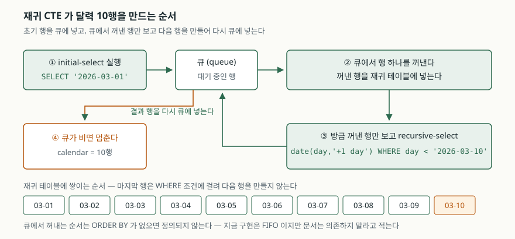
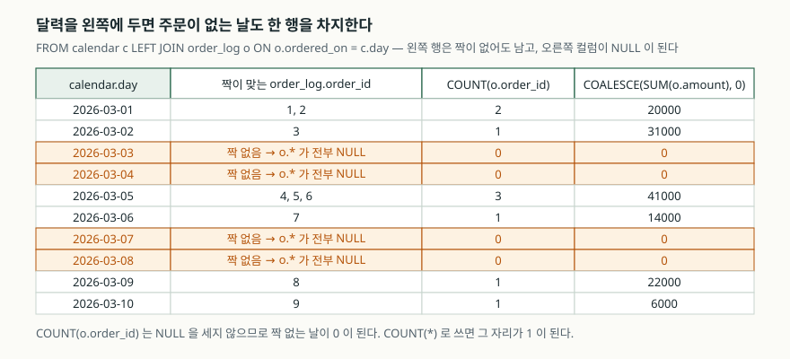

## 들어가며

주간 매출 리포트를 만든다고 하자. 주문 로그에서 날짜별로 건수와 금액을 뽑아
차트 라이브러리에 넘긴다. 질의는 `GROUP BY ordered_on` 한 줄이면 끝난다.

그런데 차트를 열어 보면 3월 3일과 4일이 보이지 않는다. 그 이틀은 주문이
한 건도 없었고, 주문이 없으면 `order_log`에 행이 없으니 `GROUP BY`도 묶을
것이 없다. 없는 날은 결과에서 통째로 빠지고, 차트는 2일 다음에 5일을
바로 붙여 그린다. 열흘치 그래프가 여섯 칸짜리로 줄어든다.

여기서 대부분은 결과를 애플리케이션으로 받아 와서 채운다. 시작일부터 하루씩
더해 가며 날짜 목록을 만들고, 없는 날은 0으로 넣는 코드다. 짧으면 열 줄,
집계가 둘 셋으로 늘면 서른 줄이 된다. 문제는 그 코드가 **리포트마다 다시
쓰인다**는 데 있다. 일별이 주별이 되면 고쳐야 하고, 백엔드가 둘이면 두
벌을 맞춰야 한다. 빠진 것은 숫자가 아니라 **행**이므로, 행을 만들어 주는
쪽이 질의 안이어야 한다.

## 개념

없는 행을 만들어 쓰는 가장 곧은 도구는 **테이블 값 함수(table-valued
function)** 다. 함수처럼 호출하지만 `FROM` 절에 놓이고, 호출할 때마다
행 여러 개를 내놓는다. 디스크에 저장된 행은 없고 질의가 도는 동안에만
값이 만들어진다. 이런 식으로 `FROM` 절에 설 수 있는 대상을 통틀어
**가상 테이블(virtual table)** 이라고 부른다.

SQLite가 제공하는 것이 `generate_series`다. 인자는 세 개다.

| 인자 | 뜻 | 기본값 |
|---|---|---|
| `START` | 첫 값 | 없음 — 3.37.0부터 **필수** |
| `STOP` | 마지막 값 | 4294967295 |
| `STEP` | 증가폭 | 1 |

결과 컬럼은 `value` 하나이고, `start`·`stop`·`step`은 숨김 컬럼으로 들어
있다. `SELECT value FROM generate_series(1, 5)`라고 쓰면 1부터 5까지
다섯 행이 나온다.

다만 이 함수는 SQLite 본체가 아니라 **소스 트리에 들어 있는 로더블
확장**이다. 명령줄 셸에는 컴파일되어 들어가지만, 라이브러리를 가져다 쓰는
쪽에는 들어 있다는 보장이 없다. 이 글을 쓴 환경에서 실제로 확인해 보면
이렇다.

```text
등록된 가상 테이블 모듈: fts3, fts3tokenize, fts4, fts4aux, fts5, fts5vocab,
                        json_each, json_tree, pragma_module_list, rtree, rtree_i32
generate_series(1, 5) -> OperationalError: no such table: generate_series
```

파이썬에 내장된 SQLite 3.49.1에는 `generate_series`가 없다. `fts5`나
`rtree`는 들어 있는데 이것만 빠져 있다. 그러니 **쓸 수 있으면 쓰되,
없을 때 같은 일을 하는 방법을 알아야 한다.** 그 방법이 재귀 CTE다.

## 구조



> **출처**: [SQLite — WITH clause §3 Recursive Common Table Expressions](https://www.sqlite.org/lang_with.html#recursive_common_table_expressions)



> **출처**: [SQLite — SELECT §2.1 Determination of input data (FROM clause processing)](https://www.sqlite.org/lang_select.html#determination_of_input_data_from_clause_processing_)

## 동작 원리

재귀 CTE는 이름과 달리 함수가 자기를 부르는 모양이 아니다. 공식 문서가
적는 절차는 **큐를 쓰는 반복**이다.

1. `initial-select`를 실행해 나온 행을 큐에 넣는다
2. 큐에서 행 하나를 꺼내 재귀 테이블에 넣는다
3. **방금 꺼낸 그 행만** 재귀 테이블의 전부인 것처럼 두고 `recursive-select`를
   실행해, 나온 행을 전부 큐에 넣는다
4. 큐가 빌 때까지 2~3을 되풀이한다

달력을 만드는 질의가 이 절차를 그대로 탄다.

```sql
WITH RECURSIVE calendar(day) AS (
    SELECT '2026-03-01'
    UNION ALL
    SELECT date(day, '+1 day') FROM calendar WHERE day < '2026-03-10'
)
SELECT day FROM calendar;
```

`'2026-03-01'`이 큐에 들어가고, 꺼내지면서 `'2026-03-02'`를 만들어 다시
큐에 넣는다. `'2026-03-10'` 차례가 되면 `WHERE day < '2026-03-10'`이
거짓이 되어 새 행이 나오지 않고, 큐가 비면서 끝난다. 열 행이다.

`UNION ALL`과 `UNION`은 큐에 넣는 규칙이 다르다. `UNION ALL`은 중복이어도
전부 넣고, `UNION`은 이미 큐에 들어갔던 행을 버린다. 날짜처럼 값이 겹칠
일이 없으면 `UNION ALL`이 싸다. 사이클이 있는 그래프를 따라갈 때는
`UNION`이 같은 행을 다시 밀어 넣는 것을 막아 준다.

실행계획을 보면 이 달력이 임시 표로 쌓이지 않는다는 것이 보인다.

```text
QUERY PLAN
|-- CO-ROUTINE calendar
|   |-- SETUP
|   |   `-- SCAN CONSTANT ROW
|   `-- RECURSIVE STEP
|       `-- SCAN calendar
|-- SCAN c
|-- SEARCH o USING AUTOMATIC COVERING INDEX (ordered_on=?) LEFT-JOIN
`-- USE TEMP B-TREE FOR GROUP BY
```

`CO-ROUTINE`은 행을 한 번에 다 만들어 두는 대신 **바깥에서 한 행이 필요할
때마다 하나씩 만들어 넘기는** 실행 방식이다. 그래서 범위를 백만 일로
늘려도 백만 행이 메모리에 올라가지 않는다.

예상 밖이었던 것은 그 아래 줄이다. `order_log`에는 인덱스를 만든 적이
없는데 `AUTOMATIC COVERING INDEX`가 잡혔다. 적당한 인덱스가 없고 같은
조회를 여러 번 반복할 것 같으면, SQLite는 **그 문장이 도는 동안만 살아
있는 인덱스**를 즉석에서 만든다. 통계가 없을 때 대상 행 수를 100만으로
가정하고 비용을 따지기 때문에, 아홉 행짜리 표에도 이 판단이 떨어진다.

## 실습 예제

전체 소스: [`code/`](code/) · 실행 기록: [`code/output.txt`](code/output.txt)

달력을 왼쪽에 두고 주문을 붙인다.

```sql
WITH RECURSIVE calendar(day) AS (
    SELECT '2026-03-01'
    UNION ALL
    SELECT date(day, '+1 day') FROM calendar WHERE day < '2026-03-10'
)
SELECT c.day,
       COUNT(o.order_id)          AS orders,
       COALESCE(SUM(o.amount), 0) AS total
  FROM calendar c
  LEFT JOIN order_log o ON o.ordered_on = c.day
 GROUP BY c.day
 ORDER BY c.day;
```

그냥 `GROUP BY`만 했을 때와 나란히 놓으면 이렇다.

```text
-- GROUP BY ordered_on          -- 달력 LEFT JOIN
day        | orders | total     day        | orders | total
-----------+--------+------     -----------+--------+------
2026-03-01 |      2 | 20000     2026-03-01 |      2 | 20000
2026-03-02 |      1 | 31000     2026-03-02 |      1 | 31000
2026-03-05 |      3 | 41000     2026-03-03 |      0 |     0
2026-03-06 |      1 | 14000     2026-03-04 |      0 |     0
2026-03-09 |      1 | 22000     2026-03-05 |      3 | 41000
2026-03-10 |      1 |  6000     2026-03-06 |      1 | 14000
(6행)                           2026-03-07 |      0 |     0
                                2026-03-08 |      0 |     0
                                2026-03-09 |      1 | 22000
                                2026-03-10 |      1 |  6000
                                (10행)
```

재귀가 내키지 않으면 **보조 표(tally table)** 를 쓰는 길도 있다. 0~9
열 행을 두 벌 교차 조인하면 0~99가 나온다.

```sql
WITH digit(d) AS (VALUES (0),(1),(2),(3),(4),(5),(6),(7),(8),(9)),
     seq(n)   AS (SELECT tens.d * 10 + ones.d FROM digit tens, digit ones)
SELECT date('2026-03-01', '+' || n || ' day') AS day
  FROM seq
 WHERE n <= 9
 ORDER BY day;
```

실행계획은 재귀 쪽과 전혀 다른 모양이 된다.

```text
QUERY PLAN
|-- MATERIALIZE digit
|   `-- SCAN 10 CONSTANT ROWS
|-- SCAN tens
|-- SCAN ones
`-- USE TEMP B-TREE FOR ORDER BY
```

열 행짜리 상수 표를 한 번 만들어 두고(`MATERIALIZE`) 두 번 훑는다.
재귀가 없으니 깊이 걱정이 없고, 대신 **상한이 자릿수로 고정**된다.
천 행이 필요하면 `digit`을 한 벌 더 붙여야 한다.

## 실무에서 주의할 점

**멈추는 조건을 질의가 아니라 눈으로 보장하지 않는다.** `WHERE day < ...`를
빠뜨린 재귀 CTE는 스스로 끝나지 않는다. 공식 문서는 상한을 알고 있다면
`LIMIT`을 안전장치로 두라고 권한다. `LIMIT`은 재귀 테이블에 추가되는 행
수의 상한이라 `WHERE` 조건이 꼬여도 재귀를 멈춘다.

```sql
WITH RECURSIVE cnt(x) AS (SELECT 1 UNION ALL SELECT x + 1 FROM cnt LIMIT 5)
SELECT x FROM cnt;   -- 1, 2, 3, 4, 5
```

**조인 방향을 뒤집으면 빈칸이 도로 사라진다.** 달력이 `LEFT JOIN`의
오른쪽에 가면 기준이 `order_log`가 되므로, 같은 달력을 붙이고도 결과는
여섯 행이다. 빈칸을 남기려는 쪽이 **반드시 왼쪽**이어야 한다.

**`COUNT(*)`와 `COUNT(컬럼)`을 바꿔 쓰지 않는다.** 짝이 없는 날의
`o.*`는 전부 NULL이지만 행 자체는 하나 있다. `COUNT(*)`를 쓰면 그 자리가
0이 아니라 1이 된다. `COUNT(o.order_id)`는 NULL을 세지 않으므로 0이 된다.
`SUM`도 전부 NULL이면 결과가 NULL이라 `COALESCE`로 받아야 한다.

**자동 인덱스를 성능 대책으로 믿지 않는다.** 위 실행계획의
`AUTOMATIC COVERING INDEX`는 그 문장이 끝나면 사라진다. 같은 리포트가
하루에 수백 번 돈다면 임시 인덱스를 수백 번 다시 만드는 셈이므로,
`ordered_on`에 진짜 인덱스를 만들어 두는 편이 낫다.

**`generate_series`가 있는지 먼저 확인한다.** 쓰려는 환경에서
`SELECT name FROM pragma_module_list`로 목록을 보면 한 줄로 끝난다.
PostgreSQL처럼 내장 함수로 제공하는 엔진도 있고, SQLite처럼 빌드에 따라
갈리는 엔진도 있다. 여러 DB를 함께 지원해야 하는 질의라면 재귀 CTE나
보조 표 쪽이 옮기기 쉽다.

## 정리

- 일별 집계에서 빈 날이 사라지는 것은 집계의 문제가 아니라 **그 날짜를 가진
  행이 없다**는 문제다. 기준이 될 행을 질의 안에서 만들어 채운다
- `generate_series`는 테이블 값 함수지만 SQLite에서는 로더블 확장이라
  빌드에 따라 없을 수 있다. 파이썬 내장 SQLite 3.49.1에는 없었다
- 재귀 CTE는 큐에 행을 넣고 꺼내는 반복이다. `CO-ROUTINE`으로 실행되어
  범위를 넓혀도 전부 메모리에 쌓지 않는다
- 멈추는 조건은 `WHERE`로 쓰되 `LIMIT`을 안전장치로 같이 둔다
- 빈칸을 남길 쪽을 `LEFT JOIN`의 왼쪽에 두고, 집계는 `COUNT(컬럼)`과
  `COALESCE`로 받는다

## 참고 자료

- [SQLite — The generate_series Table-Valued Function](https://sqlite.org/series.html)
- [SQLite — WITH clause §3 Recursive Common Table Expressions](https://www.sqlite.org/lang_with.html#recursive_common_table_expressions)
- [SQLite — WITH clause §5 Limitations And Caveats](https://www.sqlite.org/lang_with.html#limitations_and_caveats)
- [SQLite — SELECT §2.1 Determination of input data (FROM clause processing)](https://www.sqlite.org/lang_select.html#determination_of_input_data_from_clause_processing_)
- [SQLite Query Optimizer Overview §12 Subquery Co-routines](https://www.sqlite.org/optoverview.html#subquery_co_routines)
- [SQLite Query Optimizer Overview §14 Automatic Query-Time Indexes](https://www.sqlite.org/optoverview.html#automatic_query_time_indexes)
