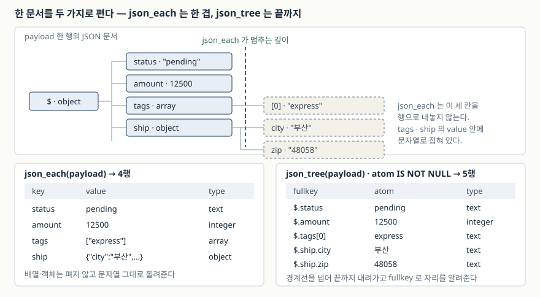

## 들어가며

혼자 만든 도구가 외부 API 응답을 받아 쌓기 시작하면, 처음에는 대개 응답 전체를
문자열 한 칸에 넣는다. 어떤 필드가 들어올지 아직 모르니 컬럼을 미리 정할 수 없고,
`payload TEXT` 한 칸이면 일단 들어가기 때문이다.

그러다 "결제된 주문이 몇 건이냐", "`gift` 태그가 붙은 주문을 뽑아 달라"는 질문이
들어온다. 이때 흔히 하는 일이 파이썬으로 전 행을 읽어 `json.loads` 를 돌리고
반복문에서 세는 것이다. 1만 행이면 1만 번의 파싱이 애플리케이션 쪽에서 일어나고,
조건이 하나 늘 때마다 그 반복문을 다시 고친다. 정렬이나 그룹핑이 붙으면 SQL 이
공짜로 해 주던 일을 손으로 짜게 된다.

SQLite 에는 그 파싱을 엔진 안에서 하는 함수들이 들어 있다.

## 개념

**JSON 함수**는 문자열에 담긴 JSON 문서를 SQL 식 안에서 읽는 내장 함수들이다.
예전에는 `json1` 이라는 선택 확장이었지만, SQLite 3.38.0(2022-02-22)부터는 기본으로
들어가 별도 설정 없이 쓸 수 있다.

중심에 **경로(path)** 라는 개념이 있다. `$` 가 문서 전체를 가리키고, `.키` 로
객체 안으로, `[번호]` 로 배열 안으로 내려간다. `$.ship.city` 는 "문서의 `ship`
객체 안의 `city`"다.

```sql
SELECT json_extract(payload, '$.ship.city') FROM orders;
```

함수는 크게 셋으로 나뉜다. **값을 하나 꺼내는 것**(`json_extract`, `->`, `->>`),
**문서를 행으로 펴는 것**(`json_each`, `json_tree`), **값을 다시 JSON 으로 묶는
것**(`json_object`, `json_group_array`)이다.

## 구조

문서를 행으로 펴는 두 함수가 어디까지 내려가는지가 이 트랙에서 가장 자주 헷갈리는
지점이다. 예제의 2번 주문 문서를 두 함수에 각각 넣으면 이렇게 갈린다.



> **출처**: [SQLite — JSON Functions §4.24 json_each() and json_tree()](https://www.sqlite.org/json1.html#table_valued_functions_for_parsing_json_json_each_jsonb_each_json_tree_and_jsonb_tree_)

## 동작 원리

### 값 하나 꺼내기 — 세 가지 표기

같은 일을 하는 표기가 셋이다. 결과 타입이 다르다.

```text
  SQL> SELECT payload -> '$.status'  AS arrow,
              payload ->> '$.status' AS arrow2,
              typeof(payload -> '$.status')  AS t1,
              typeof(payload ->> '$.status') AS t2
       FROM orders WHERE order_id = 1
       ('"paid"', 'paid', 'text', 'text')
```

`->` 는 **JSON 텍스트**를 돌려준다. 문자열이었으니 따옴표까지 붙은 `'"paid"'` 다.
`->>` 는 **SQL 값**을 돌려주므로 `'paid'` 다. 둘 다 `typeof` 는 `text` 로 나오는데,
JSON 텍스트도 SQLite 에게는 그냥 문자열이기 때문이다. 겉보기 타입이 같아서 더
헷갈린다. **`WHERE` 절에서 값을 비교할 때는 `->>` 나 `json_extract` 를 쓴다.**
`-> '$.status' = 'paid'` 는 `'"paid"' = 'paid'` 가 되어 영영 참이 되지 않는다.

`json_extract` 는 경로 하나를 줄 때 `->>` 와 같은 SQL 값을 돌려준다. 다만 경로를
여러 개 주면 JSON 배열 텍스트가 나오므로, 그때는 성격이 달라진다.

### 배열을 행으로 — json_each

`json_each` 는 표처럼 쓰는 함수다. `FROM` 절에 놓으면 문서의 한 겹을 행으로 편다.

```text
  SQL> SELECT o.order_id, o.customer, t.key, t.value
       FROM orders AS o, json_each(o.payload, '$.tags') AS t
       ORDER BY o.order_id, t.key
       (1, '김하늘', 0, 'express')
       (1, '김하늘', 1, 'gift')
       (2, '박도윤', 0, 'express')
       (4, '최민재', 0, 'coupon')
       (4, '최민재', 1, 'gift')
       (4, '최민재', 2, 'first')
```

주문은 4건인데 6행이 나왔다. 태그 수만큼 행이 늘어나고, **태그가 빈 배열인 3번
주문은 아예 사라졌다.** 조인이 그렇게 동작하기 때문이다. 3번도 남기려면
`LEFT JOIN json_each(...)` 로 바꿔야 한다.

행으로 펴지고 나면 그 다음은 평범한 SQL 이다.

```text
  SQL> SELECT t.value AS tag, COUNT(*) AS n
       FROM orders AS o, json_each(o.payload, '$.tags') AS t
       GROUP BY t.value ORDER BY n DESC, tag
       ('express', 2)
       ('gift', 2)
       ('coupon', 1)
       ('first', 1)
```

## 실습 예제

전체 소스: [`code/json_demo.py`](code/json_demo.py) · 돌린 기록: [`code/output.txt`](code/output.txt)

### 인덱스는 **적은 모양 그대로** 잡힌다

이 글에서 가장 걸리기 쉬운 지점이다. `json_extract` 식에 인덱스를 하나 걸고,
같은 뜻의 질의를 두 가지 표기로 적어 실행계획을 봤다.

```text
  (가) CREATE INDEX idx_status ON orders(json_extract(payload, '$.status'))
  SQL> EXPLAIN QUERY PLAN
       SELECT order_id FROM orders WHERE json_extract(payload, '$.status') = 'paid'
       (3, 0, 53, 'SEARCH orders USING COVERING INDEX idx_status (<expr>=?)')

  (나) SQL> EXPLAIN QUERY PLAN
       SELECT order_id FROM orders WHERE payload ->> '$.status' = 'paid'
       (2, 0, 216, 'SCAN orders')
```

뜻이 같은데 (나)는 인덱스를 못 탄다. 질의 최적기가 식을 **적힌 모양으로** 맞춰
보기 때문이다. 공식 문서는 식 인덱스에 대해 "질의 최적기는 대수 계산을 하지
않는다"고 적고, 공백 차이 정도를 빼면 `CREATE INDEX` 에 적은 것과 똑같이
나타나야 쓴다고 밝힌다. `x+y` 에 건 인덱스를 `y+x` 가 못 쓰는 것과 같은 이유다.

같은 모양으로 인덱스를 하나 더 걸어 보면 바로 잡힌다.

```text
  (나-2) CREATE INDEX idx_status_arrow ON orders(payload ->> '$.status')
  SQL> EXPLAIN QUERY PLAN
       SELECT order_id FROM orders WHERE payload ->> '$.status' = 'paid'
       (3, 0, 53, 'SEARCH orders USING COVERING INDEX idx_status_arrow (<expr>=?)')
```

인덱스를 두 개 두는 것이 답은 아니다. **팀에서 한 표기로 통일하는 쪽**이 맞다.
또는 아래처럼 생성 컬럼으로 빼 두면, 질의를 어떻게 적든 컬럼 이름 하나로 모인다.

```text
  (다) ALTER TABLE orders ADD COLUMN amount INTEGER
         GENERATED ALWAYS AS (json_extract(payload, '$.amount')) VIRTUAL
       CREATE INDEX idx_amount ON orders(amount)
  SQL> EXPLAIN QUERY PLAN SELECT order_id FROM orders WHERE amount > 20000
       (3, 0, 203, 'SEARCH orders USING INDEX idx_amount (amount>?)')
```

`VIRTUAL` 생성 컬럼은 값을 따로 저장하지 않고 읽을 때 계산한다. 그래도 인덱스는
만들어지므로, 저장 공간을 거의 안 쓰면서 탐색은 인덱스로 간다.

### 배열 안을 조건으로 쓰면 인덱스가 없다

```text
  SQL> EXPLAIN QUERY PLAN
       SELECT o.order_id FROM orders AS o, json_each(o.payload, '$.tags') AS t
       WHERE t.value = 'gift'
       (3, 0, 216, 'SCAN o')
       (5, 0, 0, 'SCAN t VIRTUAL TABLE INDEX 3:')
```

바깥 표를 전부 읽고, 행마다 문서를 파싱해 태그를 편 뒤 거른다. 행이 적을 때는
문제가 없지만, **태그로 찾는 일이 잦아지면 그때가 태그를 따로 표로 빼야 할
시점**이다. JSON 을 쓸지 컬럼으로 쪼갤지는 취향이 아니라 이 질의 패턴이 정한다.

## 실무에서 주의할 점

**1. 없는 경로와 `null` 값이 구분되지 않는다.**

```text
  SQL> SELECT json_extract('{"a":null}', '$.a') AS stored_null,
              json_type('{"a":null}', '$.a')    AS stored_type,
              json_extract('{"a":null}', '$.b') AS missing,
              json_type('{"a":null}', '$.b')    AS missing_type
       (None, 'null', None, None)
```

둘 다 `NULL` 로 나온다. "값을 비워 둔 것"과 "키가 아예 없는 것"을 갈라야 하면
`json_type` 을 봐야 한다. 있으면 `'null'`, 없으면 `NULL` 이다.

**2. 검증이 들어오는 문서에만 의존하지 않게 한다.** 잘못된 JSON 이 한 행이라도
섞이면 그 행을 건드리는 순간 질의 전체가 오류로 끝난다. `json_valid` 는
`'{a:1}'` 처럼 키에 따옴표가 없는 문서를 `0` 으로 판정한다. 넣을 때
`CHECK (json_valid(payload))` 를 걸어 두는 편이 나중에 싸다.

**3. 집계는 `json_group_array`, 중첩은 `jsonb` 로 나눠 쓴다.** 비집계 함수 안에
다른 함수 결과를 넣을 때는 공식 문서가 `jsonb()` 쪽을 권하고, 집계 함수는 텍스트로
동작하므로 `json_group_array` 를 쓴다.

**4. JSONB 로 바꾸면 크기가 준다 — 다만 재는 방법을 틀리기 쉽다.**

```text
  SQL> SELECT length(payload)              AS text_chars,
              octet_length(payload)        AS text_bytes,
              octet_length(jsonb(payload)) AS jsonb_bytes
       FROM orders ORDER BY order_id
       (104, 108, 76)
       (99, 103, 73)
       (88, 92, 63)
       (99, 103, 74)
```

`length()` 는 TEXT 에 **글자 수**를, BLOB 에 **바이트 수**를 돌려준다. 그대로
나란히 놓으면 한글 한 글자가 UTF-8 로 3바이트라서 비교가 성립하지 않는다.
양쪽 다 `octet_length()` 로 재야 같은 단위가 된다. 이 문서들에서는 108바이트가
76바이트로 줄었다.

**5. 문서가 커지면 꺼내는 비용도 같이 커진다.** JSONB 라도 대부분의 연산이
문서 길이에 비례한다고 공식 문서가 밝힌다. 한 행에 수백 KB 짜리 문서를 넣고
필드 하나를 자주 꺼내 쓰는 구조라면, 그 필드는 컬럼으로 빼는 편이 맞다.

## 정리

- 경로는 `$` 에서 시작해 `.키` 와 `[번호]` 로 내려간다. 값 하나는 `json_extract`
  또는 `->>` 로 꺼낸다
- `->` 는 JSON 텍스트, `->>` 는 SQL 값이다. `WHERE` 비교에는 `->>` 를 쓴다
- `json_each` 는 한 겹만, `json_tree` 는 끝까지 편다. 배열을 펴면 행이 늘고
  빈 배열인 행은 사라진다
- **식 인덱스는 적은 모양 그대로 잡힌다.** `json_extract` 에 걸어 두고 `->>` 로
  질의하면 안 탄다. 표기를 통일하거나 생성 컬럼으로 빼서 이름 하나로 모은다
- 배열 안을 조건으로 자주 찾게 되면 그때가 따로 표로 쪼갤 시점이다

## 참고 자료

- [SQLite — JSON Functions And Operators](https://www.sqlite.org/json1.html)
- [SQLite — JSON Functions §4.10 The `->` and `->>` operators](https://www.sqlite.org/json1.html#the_and_operators)
- [SQLite — JSON Functions §4.24 json_each() and json_tree()](https://www.sqlite.org/json1.html#table_valued_functions_for_parsing_json_json_each_jsonb_each_json_tree_and_jsonb_tree_)
- [SQLite — JSON Functions §3.2 JSONB](https://www.sqlite.org/json1.html#jsonb)
- [SQLite — Indexes On Expressions](https://www.sqlite.org/expridx.html)
- [SQLite — Generated Columns](https://www.sqlite.org/gencol.html)
