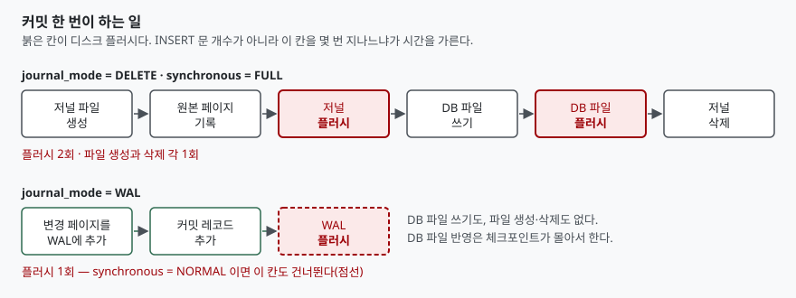

## 들어가며

CSV 파일을 읽어 표에 넣는 스크립트를 처음 쓰면 대개 이런 모양이 된다. 한 줄을 읽고,
`INSERT` 를 한 번 날리고, 잊지 말라고 배운 `commit()` 을 그 자리에서 부른다. 1만 줄짜리
파일을 넣어 보면 몇 초 안에 끝날 줄 알았던 것이 30초 가까이 걸린다.

여기서 보통 택하는 길은 두 가지다. 하나는 그냥 기다리는 것이고, 다른 하나는
`INSERT INTO ... VALUES (...), (...), (...)` 처럼 한 문장에 여러 건을 욱여넣어 **문장 개수를
줄이는** 것이다. 두 번째는 효과가 있긴 한데, 효과가 나는 이유가 사람들이 생각하는 것과
다르다. 1만 번 반복되는 비싼 일은 `INSERT` 가 아니라 `commit()` 이다. 그래서 문장을
묶지 않고 커밋만 묶어도 거의 같은 만큼 빨라진다.

## 개념

트랜잭션은 "여기부터 여기까지를 한 덩어리로 친다"는 선언이다. 커밋은 그 덩어리를
닫으면서 **지금까지의 변경이 전원이 꺼져도 남는다**고 약속하는 지점이다.

약속을 지키려면 변경된 내용이 메모리나 운영체제 캐시가 아니라 실제 저장 장치에
도달해 있어야 한다. 그래서 커밋마다 디스크 플러시(`fsync`, 윈도우에서는
`FlushFileBuffers`)가 일어난다. 이 호출은 저장 장치가 "다 썼다"고 답할 때까지
기다리므로, CPU가 하는 다른 어떤 일보다도 느리다.

`INSERT` 문 하나를 처리하는 비용은 구문을 해석하고 페이지에 값을 적는 정도다.
커밋 한 번의 비용은 저장 장치의 응답을 기다리는 시간이다. 둘은 단위가 다르다.
1만 건을 넣을 때 `INSERT` 는 어차피 1만 번 일어나지만, 커밋은 1번으로 줄일 수 있다.

## 구조

커밋 한 번이 실제로 무슨 단계를 밟는지 보면 왜 그렇게 비싼지가 드러난다.
SQLite의 기본 모드인 롤백 저널 방식은 변경 전 원본 페이지를 별도 파일에 적어 두고,
그 파일이 디스크에 닿은 것을 확인한 뒤에야 본 DB 파일을 고친다.



> **출처**: [SQLite — Atomic Commit In SQLite §3.5 Creating A Rollback Journal File ~ §3.11 Deleting The Rollback Journal](https://www.sqlite.org/atomiccommit.html#deleting_the_rollback_journal), [SQLite — Write-Ahead Logging §2 How WAL Works](https://www.sqlite.org/wal.html#how_wal_works)

롤백 저널 모드의 커밋 한 번에는 디스크 플러시가 두 번 들어간다. 저널을 디스크에
내리는 플러시와, 본 DB 파일을 내리는 플러시다. 공식 문서는 이 두 번의 플러시가
커밋 시간의 대부분을 차지한다고 적는다. 거기에 저널 파일을 만들고 지우는
파일 시스템 작업이 커밋마다 한 번씩 더 붙는다.

## 동작 원리

이제 같은 1만 건을 커밋 횟수만 바꿔 가며 넣어 본다. 비교가 성립하려면 넣는 데이터와
표 구조는 그대로 두고 **커밋 지점만** 움직여야 한다.

```python
def insert_per_row_commit(conn, rows):
    """건마다 커밋한다. for 문 안에 commit() 을 넣으면 이 모양이 된다."""
    sql = "INSERT INTO measurement (sensor_id, reading, taken_at) VALUES (?, ?, ?)"
    for row in rows:
        conn.execute("BEGIN")
        conn.execute(sql, row)
        conn.execute("COMMIT")

def insert_single_commit_loop(conn, rows):
    """execute 는 똑같이 1만 번 부른다. 다른 것은 커밋이 바깥에 있다는 점뿐이다."""
    sql = "INSERT INTO measurement (sensor_id, reading, taken_at) VALUES (?, ?, ?)"
    conn.execute("BEGIN")
    for row in rows:
        conn.execute(sql, row)
    conn.execute("COMMIT")
```

두 함수는 `INSERT` 문을 똑같이 1만 번 실행한다. 차이는 `BEGIN`·`COMMIT` 의 위치뿐이다.

## 실습 예제

전체 소스: [`code/`](code/) · 실행 기록: [`code/output.txt`](code/output.txt)

```text
  방식                         journal sync          커밋        행         초        배수
  -------------------------------------------------------------------------------
  건마다 커밋                  DELETE  FULL      10,000   10,000    24.479      1.0x
  500건마다 커밋               DELETE  FULL          20   10,000     0.056    439.0x
  한 번만 커밋 (execute 루프)  DELETE  FULL           1   10,000     0.011   2327.1x
  한 번만 커밋 (executemany)   DELETE  FULL           1   10,000     0.007   3518.7x
  건마다 커밋                  DELETE  OFF       10,000   10,000    10.497      2.3x
  건마다 커밋                  WAL     FULL      10,000   10,000     6.295      3.9x
  건마다 커밋                  WAL     NORMAL    10,000   10,000     0.261     93.6x
```

위 네 줄만 보면 결론이 분명하다. 커밋을 1만 번에서 20번으로 줄이자 439배 빨라졌고,
1번으로 줄이자 2,327배가 됐다. 반면 `executemany` 로 문장을 묶은 마지막 줄은 같은
"한 번만 커밋"보다 1.5배 빨라졌을 뿐이다. **문장을 묶어서 얻은 몫은 1.5배, 커밋을
묶어서 얻은 몫은 2,327배다.** 사람들이 흔히 효과의 원인으로 지목하는 쪽이 작은 쪽이다.

아래 세 줄은 그 24초가 어디서 나왔는지 가르려고 한 가지씩만 바꿔 본 것이다.
결과가 예상과 달랐다. 디스크 플러시를 아예 끄면(`synchronous = OFF`) 0초에 가까워질
줄 알았는데 10.5초가 남았다. 플러시를 다 걷어내도 커밋당 1ms가 그대로 든다는 뜻이다.
남은 것은 **저널 파일을 만들고 지우는 작업**이다. 커밋 1만 번이면 파일 생성 1만 번,
삭제 1만 번이고, 윈도우 파일 시스템에서 이 비용이 만만치 않다.

이 추측은 `journal_mode` 를 WAL로 바꾼 두 줄로 확인된다. WAL은 저널 파일을 매번
만들지 않고 하나의 `-wal` 파일에 이어 붙이기만 한다. 플러시는 그대로 하는데
(`synchronous = FULL`) 24.5초가 6.3초로 줄었다. 파일 생성·삭제가 18초를 쓰고 있었던
것이다. 여기서 플러시까지 빼면(`synchronous = NORMAL`) 0.26초가 된다.

정리하면 건별 커밋 24.5초의 내역은 대략 이렇다. 저널 파일 생성·삭제가 18초,
디스크 플러시가 6초, 나머지가 0.26초다. 커밋을 한 번으로 묶으면 앞의 둘이 1만 번에서
1번으로 줄어든다.

## 실무에서 주의할 점

**1만 건을 한 트랜잭션에 몰면 롤백 단위도 1만 건이 된다.** 9,999번째에서 제약 조건
위반이 나면 앞의 9,998건이 전부 되돌아간다. 중간에 끊겨도 넣은 데까지는 남기고 싶다면
묶음 커밋이 맞다. 위 측정에서 500건 묶음은 한 번만 커밋한 것과 같은 자릿수의 시간에
들어왔다. **묶음 크기를 키우는 이득은 금방 평평해지므로**, 수백~수천 건 선에서
끊어 주면 속도와 복구 단위를 둘 다 챙길 수 있다.

**긴 트랜잭션은 잠금을 그만큼 오래 쥔다.** SQLite는 쓰기 트랜잭션이 하나뿐이므로
1만 건을 넣는 동안 다른 연결은 쓰기를 못 한다. 위 측정에서는 0.011초라 문제가 안 되지만,
수백만 건을 한 덩어리로 넣으면 그 시간 내내 다른 쓰기가 막힌다. 여러 사용자가 붙어 있는
서버라면 이쪽이 커밋 횟수보다 먼저 고려할 사항이다.

**`synchronous = OFF` 로 속도를 사는 것은 내구성을 파는 것이다.** 위에서 2.3배가
나왔다고 이 설정을 운영에 쓰면, 전원이 꺼졌을 때 커밋했다고 응답한 데이터가 사라질 수
있다. 바꿀 것을 고르자면 `synchronous` 보다 `journal_mode = WAL` 이 먼저다. WAL은
내구성을 유지하면서도(`FULL` 기준) 파일 생성·삭제 비용을 없앤다.

**측정값은 저장 장치와 운영체제에 따라 달라진다.** 위 숫자는 윈도우 11에서 나온 것이고,
리눅스 ext4나 NVMe SSD에서는 배수가 다르게 나온다. 옮겨 적을 값은 "2,327배"가 아니라
"커밋 횟수가 지배한다"는 구조다. 본인 환경에서 `code/` 를 돌려 직접 재 보는 편이 낫다.

## 정리

- 1만 건 삽입에서 건별 커밋과 단일 커밋의 차이는 24.5초 대 0.011초였다.
- 비싼 것은 `INSERT` 문의 개수가 아니라 **커밋 횟수**다. 문장을 묶어 얻은 몫은 1.5배,
  커밋을 묶어 얻은 몫은 2,327배였다.
- 커밋 한 번의 비용은 디스크 플러시 두 번과 저널 파일 생성·삭제 한 벌이다.
  이 환경에서는 후자가 더 컸다.
- 전부를 한 트랜잭션에 몰면 롤백 단위와 잠금 시간도 같이 커진다. 수백~수천 건 묶음이
  속도와 복구 단위를 함께 챙기는 지점이다.

## 참고 자료

- [SQLite — Atomic Commit In SQLite](https://www.sqlite.org/atomiccommit.html) — §3.7 저널 플러시, §3.10 DB 파일 플러시, §3.11 저널 삭제
- [SQLite — Write-Ahead Logging](https://www.sqlite.org/wal.html) — §2 How WAL Works, §2.3 Performance Considerations
- [SQLite — PRAGMA Statements: synchronous](https://www.sqlite.org/pragma.html#pragma_synchronous)
- [Python — sqlite3: Transaction control](https://docs.python.org/3/library/sqlite3.html#sqlite3-controlling-transactions)
