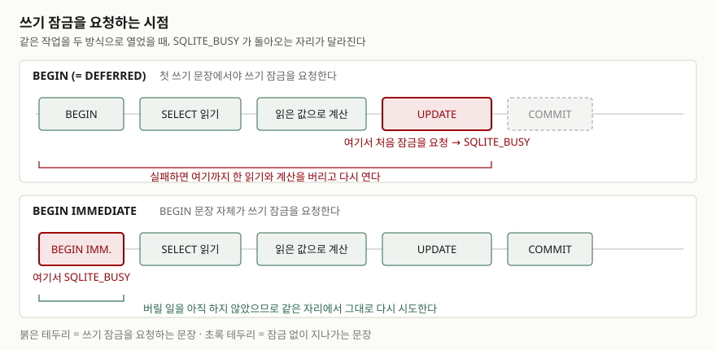

## 들어가며

혼자 쓰던 SQLite 파일에 두 번째 프로그램이 붙는 순간이 온다. 가계부 앱에 정산
스크립트를 하나 더 붙인다든가, 웹 서버에 배치 작업을 얹는다든가 하는 식이다.
그때부터 `database is locked` 가 가끔 뜨기 시작한다.

대부분은 여기서 재시도 루프를 씌운다. 예외를 잡아 0.1초 쉬고 다시 돌린다. 그런데
이 루프가 어떤 자리에서는 결국 성공하고, 어떤 자리에서는 몇 번을 돌려도 같은
예외를 뱉는다. 로그만 보면 둘 다 `database is locked` 라서 구분이 안 된다. 그래서
재시도 횟수를 5번에서 50번으로 늘려 보고, `busy_timeout` 도 10초로 올려 본다.
둘 다 효과가 없는 경우가 있다.

갈리는 지점은 재시도 횟수가 아니라 **트랜잭션을 어떻게 열었는가**다.

## 개념

SQL에서 트랜잭션을 여는 문장은 `BEGIN` 이다. SQLite는 여기에 세 가지 방식을 둔다.

| 문장 | 쓰기 트랜잭션이 시작되는 시점 |
|---|---|
| `BEGIN` (= `BEGIN DEFERRED`) | 첫 쓰기 문장을 만났을 때 |
| `BEGIN IMMEDIATE` | `BEGIN` 문장 자체에서 |
| `BEGIN EXCLUSIVE` | `BEGIN` 문장 자체에서 (롤백 저널 모드에서는 다른 연결의 읽기도 막는다) |

공식 문서에 따르면 `BEGIN DEFERRED` 는 데이터베이스에 처음 접근할 때까지 트랜잭션을
실제로 시작하지 않고 플래그만 세워 둔다. 첫 문장이 `SELECT` 이면 읽기 트랜잭션이
시작되고, 그 뒤의 쓰기 문장이 **가능하면** 쓰기 트랜잭션으로 승격되며, 안 되면
`SQLITE_BUSY` 를 돌려준다. `IMMEDIATE` 는 쓰기 문장을 기다리지 않고 곧바로 쓰기
트랜잭션을 시작하며, 다른 연결이 이미 쓰기 트랜잭션을 열고 있으면 `BEGIN IMMEDIATE`
자체가 `SQLITE_BUSY` 로 실패한다.

두 방식 모두 결국 `SQLITE_BUSY` 를 만날 수 있다. 차이는 **그것을 만나는 자리**다.

## 구조



> **출처**: [SQLite — BEGIN TRANSACTION, §2.2 DEFERRED, IMMEDIATE and EXCLUSIVE](https://www.sqlite.org/lang_transaction.html)

`DEFERRED` 로 열면 읽고 계산하는 동안은 아무 잠금도 없다가, `UPDATE` 에 가서야
쓰기 잠금을 요청한다. 거기서 거절당하면 그 앞에서 읽고 계산한 것이 전부 쓸모를
잃는다. `IMMEDIATE` 는 첫 문장에서 거절당하므로 버릴 것이 없다.

## 동작 원리

### 롤백 저널 모드 — 서로가 서로를 막는다

SQLite의 기본 저널 모드(`delete`)에서 잠금은 다섯 단계다. 읽는 연결은 `SHARED` 를
잡고, 쓰려는 연결은 `RESERVED` 를 거쳐 `EXCLUSIVE` 까지 올라가야 파일에 쓸 수 있다.
`RESERVED` 는 다른 연결의 `SHARED` 와 같이 있을 수 있지만, `EXCLUSIVE` 는 어떤 잠금과도
같이 있을 수 없다.

두 연결이 모두 `BEGIN` 으로 열고 읽기부터 하면 이렇게 된다. A는 `RESERVED` 를
잡았으니 B는 쓸 수 없고, B는 아직 `SHARED` 를 쥐고 있으니 A는 `EXCLUSIVE` 로 올라갈
수 없다. SQLite는 이 자리에서 기다리지 않는다. 공식 문서는 busy 핸들러를 부르면
교착에 빠질 수 있다고 판단되면 핸들러를 부르지 않고 그대로 `SQLITE_BUSY` 를
돌려준다고 적는다. 한쪽이 읽기 잠금을 놓게 만들어 다른 쪽을 진행시키려는 것이다.

### WAL 모드 — 스냅샷이 밀린다

WAL 모드에서는 읽는 연결이 쓰는 연결을 막지 않는다. 대신 읽기 트랜잭션은 열린
시점의 스냅샷을 본다. 그 사이에 다른 연결이 커밋해 버리면, 읽기 트랜잭션이
쓰기로 승격하려 할 때 자기가 읽은 내용이 이미 낡았다는 문제가 생긴다.

이때 돌아오는 것이 `SQLITE_BUSY` 의 확장 코드인 **`SQLITE_BUSY_SNAPSHOT`(517)** 이다.
공식 문서는 이를 "다른 연결이 이미 데이터베이스에 써서 앞선 읽기를 무효로 만든"
경우라고 설명한다.

이름에 `BUSY` 가 들어 있지만 성격이 다르다. 기다린다고 풀리지 않는다. 그 읽기
트랜잭션 자체가 낡은 것이라서, `ROLLBACK` 으로 닫고 새로 열어야 한다.

## 실습 예제

두 연결을 같은 파일에 붙여 놓고 문장을 하나씩 번갈아 치면서 결과를 찍는다.
전체 소스: [`code/locking_demo.py`](code/locking_demo.py) ·
돌린 기록: [`code/output.txt`](code/output.txt)

```python
def connect(busy_timeout_ms: int = 0) -> sqlite3.Connection:
    # isolation_level=None 이라야 BEGIN 을 내가 직접 친다. 파이썬이 끼어들면
    # 어느 시점에 트랜잭션이 열렸는지가 흐려져서 이 실험이 성립하지 않는다.
    return sqlite3.connect(
        DB_PATH, isolation_level=None, timeout=busy_timeout_ms / 1000
    )


def step(label: str, conn: sqlite3.Connection, sql: str) -> None:
    started = time.perf_counter()
    try:
        conn.execute(sql)
        outcome = "OK"
    except sqlite3.Error as exc:
        outcome = exc.sqlite_errorname
    elapsed = time.perf_counter() - started
    print(f"  {label:<13} {sql:<56} {outcome:<22} {elapsed:5.2f}s")
```

`sqlite3.Error` 의 `sqlite_errorname` 은 파이썬 3.11부터 쓸 수 있고, 여기서
`SQLITE_BUSY` 와 `SQLITE_BUSY_SNAPSHOT` 이 갈린다. 메시지는 둘 다
`database is locked` 라서 문자열만 봐서는 구분되지 않는다.

### 둘 다 `BEGIN` 으로 열었을 때 (롤백 저널)

```text
[1] 롤백 저널 모드 · 두 연결 모두 BEGIN (= DEFERRED)
  연결          문장                                                     결과                       소요
  A             BEGIN                                                    OK                      0.00s
  B             BEGIN                                                    OK                      0.00s
  A             SELECT balance FROM account WHERE id = 1                 OK                      0.00s
  B             SELECT balance FROM account WHERE id = 2                 OK                      0.00s
  A             UPDATE account SET balance = balance - 100 WHERE id = 1  OK                      0.00s
  B             UPDATE account SET balance = balance + 100 WHERE id = 2  SQLITE_BUSY             0.00s
  A             COMMIT                                                   SQLITE_BUSY             0.00s
  B             COMMIT                                                   OK                      0.00s
  A             COMMIT                                                   OK                      0.00s
```

B가 막히는 것까지는 예상대로다. 그런데 **A의 `COMMIT` 도 막힌다.** A는 먼저
`RESERVED` 를 잡은 쪽인데도 그렇다. B가 쥐고 있는 읽기 잠금 때문이다. B가
`COMMIT` 으로 트랜잭션을 닫고 나서야 A가 커밋된다.

먼저 들어간 쪽이 반드시 먼저 끝나지는 않는다는 뜻이다. 서로 다른 행을 건드리고
있어도 이렇게 된다 — 위 예제에서 A는 1번 행, B는 2번 행을 고치고 있다.

### 둘 다 `BEGIN` 으로 열었을 때 (WAL)

```text
[2] WAL 모드 · 두 연결 모두 BEGIN (= DEFERRED)
  A             UPDATE account SET balance = balance - 100 WHERE id = 1  OK                      0.00s
  A             COMMIT                                                   OK                      0.00s
  B             UPDATE account SET balance = balance + 100 WHERE id = 2  SQLITE_BUSY_SNAPSHOT    0.00s
  B             ROLLBACK                                                 OK                      0.00s
```

WAL에서는 A가 막히지 않고 바로 커밋된다. 대신 B가 받는 코드가 `SQLITE_BUSY` 에서
`SQLITE_BUSY_SNAPSHOT` 으로 바뀐다.

### 둘 다 `BEGIN IMMEDIATE` 로 열었을 때

```text
[3] WAL 모드 · 두 연결 모두 BEGIN IMMEDIATE
  A             BEGIN IMMEDIATE                                          OK                      0.00s
  B             BEGIN IMMEDIATE                                          SQLITE_BUSY             0.00s
  A             SELECT balance FROM account WHERE id = 1                 OK                      0.00s
  A             UPDATE account SET balance = balance - 100 WHERE id = 1  OK                      0.00s
  A             COMMIT                                                   OK                      0.00s
  B             BEGIN IMMEDIATE                                          OK                      0.00s
  B             UPDATE account SET balance = balance + 100 WHERE id = 2  OK                      0.00s
  B             COMMIT                                                   OK                      0.00s
```

B는 첫 문장에서 거절당한다. 읽지도 계산하지도 않은 상태라 버릴 것이 없고,
A가 끝난 뒤 같은 `BEGIN IMMEDIATE` 를 다시 쳐서 그대로 진행한다.

### `busy_timeout` 은 한쪽만 구제한다

`busy_timeout` 은 잠금에 걸렸을 때 바로 실패하지 말고 정해진 시간만큼 자면서
다시 시도하게 하는 설정이다. 두 경우에 각각 3초를 주고 돌려 봤다.

```text
[4] busy_timeout 3000ms · 같은 충돌을 두 방식으로
  A             BEGIN IMMEDIATE                                          OK                      0.00s
  B(IMMEDIATE)  BEGIN IMMEDIATE                                          SQLITE_BUSY             3.41s
  A             COMMIT                                                   OK                      0.00s
  B(DEFERRED)   BEGIN                                                    OK                      0.00s
  B(DEFERRED)   SELECT balance FROM account WHERE id = 2                 OK                      0.00s
  A             UPDATE account SET balance = balance - 1 WHERE id = 1    OK                      0.00s
  B(DEFERRED)   UPDATE account SET balance = balance + 1 WHERE id = 2    SQLITE_BUSY_SNAPSHOT    0.00s
  B(DEFERRED)   ROLLBACK                                                 OK                      0.00s
```

소요 시간 칸이 핵심이다. `BEGIN IMMEDIATE` 의 `SQLITE_BUSY` 는 3.41초를 **기다린 뒤**
실패했다. 그 3초 안에 A가 커밋했다면 B는 성공했을 것이다.

반면 `SQLITE_BUSY_SNAPSHOT` 은 **0.00초에** 돌아왔다. `busy_timeout` 이 3초로 걸려
있는데도 핸들러가 불리지 않았다. 기다려 봐야 소용없는 자리라는 것을 SQLite가 알고
있어서다. 앞에서 본 "교착에 빠질 수 있다고 판단하면 핸들러를 부르지 않는다"가
여기에 그대로 해당한다.

재시도 횟수를 50번으로 늘리고 타임아웃을 10초로 올려도 안 되던 경우의 정체가
이것이다. 고칠 자리는 재시도 쪽이 아니라 `BEGIN` 쪽이다.

## 실무에서 주의할 점

1. **쓸 생각이면 `BEGIN IMMEDIATE` 로 연다.** 트랜잭션 안에 `UPDATE`·`INSERT`·`DELETE`
   가 하나라도 들어갈 예정이면, 읽기로 시작하더라도 `IMMEDIATE` 가 맞다. 실패를 맨
   앞으로 당기면 재시도가 단순해진다. 읽기만 하는 트랜잭션은 그대로 `BEGIN` 을 쓴다.

2. **`SQLITE_BUSY` 와 `SQLITE_BUSY_SNAPSHOT` 을 구분해서 처리한다.** 메시지는 둘 다
   `database is locked` 라서 `str(exc)` 로는 갈라낼 수 없다. 파이썬에서는
   `exc.sqlite_errorcode` 가 각각 5와 517이고, `sqlite_errorname` 으로도 읽힌다.
   517은 기다릴 대상이 아니라 `ROLLBACK` 후 트랜잭션 전체를 다시 실행할 대상이다.

3. **`busy_timeout` 을 길게 잡는 것으로 때우지 않는다.** 위 [4]에서 보듯 3초짜리
   타임아웃은 충돌이 날 때마다 그 연결을 3초 동안 세운다. 잠금 경합이 잦으면
   응답 시간이 통째로 그만큼 늘어난다. 타임아웃은 드물게 겹치는 경우의 완충이고,
   자주 겹친다면 트랜잭션을 짧게 만드는 쪽이 먼저다.

4. **파이썬의 기본 트랜잭션 처리를 끄고 쓴다.** `sqlite3.connect()` 는 기본적으로
   `BEGIN` 을 자동으로 끼워 넣는다. `isolation_level=None` 으로 두고 `BEGIN IMMEDIATE`
   를 직접 쳐야 이 글의 내용이 적용된다. 파이썬 3.12부터는 `autocommit` 속성으로
   같은 일을 더 분명하게 할 수 있다.

5. **트랜잭션 안에서 외부 작업을 하지 않는다.** `BEGIN IMMEDIATE` 로 열면 그 시점부터
   커밋까지 다른 연결은 쓸 수 없다. 사이에 HTTP 호출을 넣으면 잠금을 쥔 시간이
   네트워크 지연만큼 늘어난다.

## 정리

- `BEGIN` 은 첫 쓰기 문장에서, `BEGIN IMMEDIATE` 는 `BEGIN` 에서 쓰기 잠금을 요청한다.
- 롤백 저널 모드에서 둘 다 `BEGIN` 으로 열면 먼저 쓰기 시작한 쪽의 `COMMIT` 까지 막힌다.
  서로 다른 행을 고치고 있어도 그렇다.
- WAL 모드에서는 읽기 트랜잭션이 쓰기로 승격할 때 `SQLITE_BUSY_SNAPSHOT`(517)이 난다.
  이건 기다려서 풀리는 종류가 아니다.
- `busy_timeout` 은 `SQLITE_BUSY` 에만 적용된다. 측정해 보면 한쪽은 3.41초를 기다리고
  실패했고, 다른 쪽은 타임아웃이 걸려 있는데도 0.00초에 실패했다.
- 쓸 트랜잭션은 `BEGIN IMMEDIATE` 로 연다. 그것만으로 재시도 로직이 단순해진다.

## 참고 자료

- [SQLite — BEGIN TRANSACTION, §2.2 DEFERRED, IMMEDIATE and EXCLUSIVE](https://www.sqlite.org/lang_transaction.html)
- [SQLite — Result and Error Codes, (517) SQLITE_BUSY_SNAPSHOT](https://www.sqlite.org/rescode.html#busy_snapshot)
- [SQLite — File Locking And Concurrency In SQLite Version 3, §3.0 Locking](https://www.sqlite.org/lockingv3.html)
- [SQLite — sqlite3_busy_handler()](https://www.sqlite.org/c3ref/busy_handler.html)
- [SQLite — sqlite3_busy_timeout()](https://www.sqlite.org/c3ref/busy_timeout.html)
- [Python — sqlite3 Transaction control](https://docs.python.org/3/library/sqlite3.html#sqlite3-controlling-transactions)
