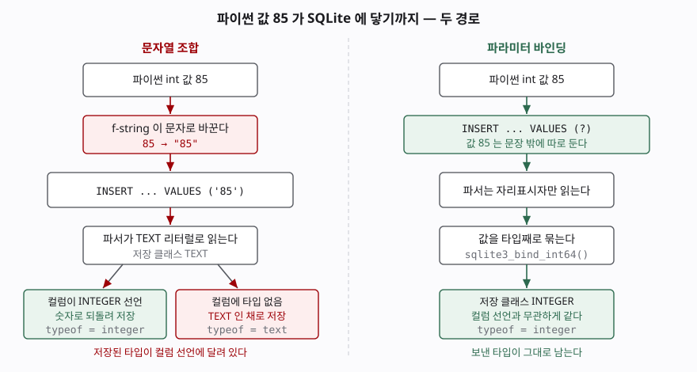

## 들어가며

SQL을 막 배우고 파이썬에서 처음 질의를 날릴 때, 코드는 대개 이렇게 생긴다.

```python
name = input("찾을 닉네임: ")
rows = conn.execute(f"SELECT * FROM member WHERE nickname = '{name}'")
```

읽기 쉽고, 돌려 보면 잘 된다. 그래서 이 모양이 코드 전체로 퍼진다.

그러다 어느 날 `O'Brien` 이라는 닉네임을 쓰는 사람이 가입하고 검색이 터진다.
여기까지는 금방 알아챈다. 문제는 이 방식이 **터지지 않으면서 틀리는** 경우가
더 많다는 것이다. 닉네임이 비어 있는 사람을 찾으면 0행이 나오고, 센서가 보낸
`85`를 저장했더니 900보다 크다고 나온다. 둘 다 에러가 없으니 틀린 줄도 모른다.

이 글은 그 네 가지를 SQLite로 하나씩 돌려 보고, 자리표시자(placeholder)를
쓰면 왜 그 사고가 생기지 않는지를 정리한다.

## 개념

**파라미터 바인딩**은 값이 들어갈 자리를 질의문에 표시만 해 두고, 값은 문장과
따로 넘기는 방식이다.

```python
conn.execute("SELECT * FROM member WHERE nickname = ?", (name,))
```

`?` 가 자리표시자다. SQLite 문서는 이것을 "실행 시점에 채워지는 값의 자리표시자"로
정의하고, SQL 텍스트 안에 값을 담지 않는다고 적는다.

용어를 하나 정리하고 간다. **질의문(SQL 텍스트)**은 데이터베이스가 읽고 해석하는
문장이고, **값**은 그 문장이 다룰 데이터다. 문자열 조합은 둘을 한 덩어리로
만들어 보내고, 바인딩은 둘을 끝까지 나눠서 보낸다. 이 글에서 벌어지는 일은
전부 이 한 가지 차이에서 나온다.

바인딩이 보안 이야기로만 소개되는 경우가 많은데, 인젝션은 이 차이가 만드는
결과 중 하나일 뿐이다. 공격자가 없어도 값은 깨진다. 인젝션 쪽을 따로 보고
싶으면 [SQL 인젝션은 이스케이프가 아니라 바인딩으로 막는다](../../../Security/2026-10-16-sql-injection-binding-not-escaping/index.md)에
정리해 두었다. 이 글은 **평범한 값이 평범하게 망가지는 쪽**을 본다.

## 구조

파이썬 값 `85` 하나가 SQLite에 저장되기까지 두 경로를 지난다.



> **출처**: [SQLite Datatypes §3 Type Affinity](https://www.sqlite.org/datatype3.html#type_affinity) · [§3.1 Determination Of Column Affinity](https://www.sqlite.org/datatype3.html#determination_of_column_affinity) · [SQLite Expressions §4 Parameters](https://www.sqlite.org/lang_expr.html#parameters)

왼쪽에서 값은 f-string을 지나는 순간 문자가 된다. `85`가 `"85"`로 바뀌고,
질의문 안에 따옴표로 감싸여 들어간다. 파서는 그것을 TEXT 리터럴로 읽는다.
여기서 숫자로 되돌아갈지는 **컬럼이 어떻게 선언됐는가**에 달린다.

오른쪽에서는 값이 질의문에 들어가지 않는다. 파서는 `?` 자리만 보고 문장을
해석하고, 값은 타입이 붙은 채로 따로 전달된다. 되돌릴 일이 없으니 컬럼 선언과
무관하게 같은 타입으로 저장된다.

## 동작 원리

SQLite가 값을 담는 통은 다섯 가지다 — NULL, INTEGER, REAL, TEXT, BLOB.
이것을 **저장 클래스**라고 부른다. 바인딩은 파이썬 타입을 여기에 그대로 대응시켜
넘긴다. `int`는 INTEGER로, `None`은 NULL로, `str`은 TEXT로.

문자열 조합에는 그 대응이 없다. 파이썬이 `str()`로 바꾼 글자가 질의문의 일부가
되고, 그다음은 전부 SQLite가 그 글자를 어떻게 읽느냐의 문제다. SQLite가 그것을
보정해 주는 장치가 **컬럼 어피니티**다. 컬럼 선언에서 정해지며 규칙은
[§3.1](https://www.sqlite.org/datatype3.html#determination_of_column_affinity)에
다섯 개로 적혀 있는데, 이 글에 필요한 것은 두 개다.

- 선언에 `INT`가 들어가면 INTEGER 어피니티. 텍스트가 들어오면 "올바른 정수
  리터럴일 때" 숫자로 바꿔 저장한다
- **타입을 아예 안 적으면 BLOB 어피니티.** 이쪽은 "저장 클래스를 바꾸려는 시도를
  하지 않는다"고 문서가 못 박는다. 텍스트로 보냈으면 텍스트로 남는다

그래서 조합으로 넣은 값이 숫자로 저장되는지는 **운에 가깝다.** 컬럼을 `INTEGER`로
선언해 뒀다면 보정이 걸리고, `CREATE TABLE t (v)` 처럼 타입을 생략했거나
`SELECT '85' > 900` 처럼 컬럼을 거치지 않는 자리에서는 보정이 없다.

보정이 없을 때 무슨 일이 생기는지는 비교 규칙에서 나온다. SQLite의 정렬
순서(§4.1)는 **저장 클래스가 먼저**다. NULL이 가장 작고, 그다음이 INTEGER와
REAL, 그다음이 TEXT, 마지막이 BLOB이다. 즉 **텍스트는 어떤 숫자보다도 크다.**
`'12' > 9000000` 이 참이 되는 이유가 이것이다. 12와 9000000을 비교한 것이
아니라 TEXT와 INTEGER를 비교한 것이다.

## 실습 예제

전체 소스: [`code/`](code/) · 돌린 기록: [`code/output.txt`](code/output.txt)

회원 표 세 행으로 시작한다. 닉네임에 따옴표가 든 행과 비어 있는 행을 하나씩 뒀다.

```text
[member]  3행
  member_id | login  | nickname | score
  ----------+--------+----------+------
          1 | lee    | NULL     |   610
          2 | kim    | 김작가   |   820
          3 | obrien | O'Brien  |   745
```

**1. 따옴표가 든 값 — 문장이 깨진다**

```text
  SQL   : SELECT login, nickname FROM member WHERE nickname = 'O'Brien'
  결과  : OperationalError: near "Brien": syntax error

  SQL   : SELECT login, nickname FROM member WHERE nickname = ?
  바인딩: ("O'Brien",)
  결과  : 1행 [('obrien', "O'Brien")]
```

조합 쪽은 따옴표가 세 개가 되면서 `Brien` 이 문장 한가운데 떠 버렸다.
네 가지 중 이것만 에러로 드러난다.

**2. 값이 비어 있을 때 — 조용히 틀린다**

```text
  SQL   : SELECT login, nickname FROM member WHERE nickname = 'None'
  결과  : 0행 []
```

파이썬 `None`을 f-string에 넣으면 `None` 이라는 **네 글자**가 된다. 닉네임이
비어 있는 `lee`를 찾으려던 질의가 "None이라는 닉네임을 쓰는 사람"을 찾았다.
에러도 경고도 없고 결과는 0행이다.

바인딩하면 `None`이 NULL로 넘어간다. 그런데 이쪽도 0행이다.

```text
  SQL   : SELECT login, nickname FROM member WHERE nickname = ?
  바인딩: (None,)
  결과  : 0행 []
```

이건 바인딩이 실패한 것이 아니라 **SQL에서 맞는 답**이다. NULL은 "값을 모른다"는
뜻이라 `NULL = NULL`도 참이 아니다. 비어 있는 행을 찾으려면 연산자를 바꿔야 한다.

```text
  SQL   : SELECT login, nickname FROM member WHERE nickname IS NULL
  결과  : 1행 [('lee', None)]
```

**3. 저장할 때 — 타입이 갈린다**

같은 값 `85`를 두 컬럼에 넣어 봤다. `member.score`는 `INTEGER`로 선언됐고,
`metric.value`는 타입을 적지 않았다.

```text
  member.score — INTEGER 로 선언된 컬럼
    bind     85       typeof=integer
    concat   85       typeof=integer

  metric.value — 타입을 선언하지 않은 컬럼
    bind     85       typeof=integer
    concat   '85'     typeof=text
```

**여기가 처음 돌렸을 때 예상과 달랐던 부분이다.** 조합이면 당연히 텍스트로
저장될 줄 알았는데, `INTEGER` 선언이 있는 쪽은 숫자로 되돌아왔다. 어피니티가
잡아 준 것이다. 그래서 "조합하면 타입이 깨진다"는 설명은 반만 맞다.
정확히는 **컬럼 선언이 받쳐 줄 때만 안 깨진다.**

받쳐 주지 않으면 이렇게 된다.

```text
  그래서 같은 조건이 다른 답을 준다 (85 는 900 보다 작다):
    concat   value > 900 에 걸리는가: True
    bind     value > 900 에 걸리는가: False
```

`'85'`는 TEXT라서 어떤 숫자보다도 크다. 값이 커서가 아니다. 자릿수를 바꿔 보면
더 분명해진다.

```text
    SELECT '85' > 900         ->  1
    SELECT '12' > 900         ->  1
    SELECT '12' > 9000000     ->  1
```

**4. 자리표시자 문법 두 가지**

위치로 채우는 `?`와 이름으로 채우는 `:name`이 있다. 값이 서너 개를 넘어가면
이름식이 읽기 쉽다.

```python
conn.execute("SELECT login FROM member WHERE score >= ? AND score <= ?", (600, 800))
conn.execute("SELECT login FROM member WHERE score >= :low AND score <= :high",
             {"low": 600, "high": 800})
```

개수가 어긋나면 질의가 **실행되기 전에** 막힌다.

```text
  SQL   : SELECT login FROM member WHERE score > ?
  결과  : ProgrammingError: Incorrect number of bindings supplied.
          The current statement uses 1, and there are 2 supplied.
```

문자열 조합에는 이 검사가 없다. 값을 하나 빠뜨려도 그냥 이상한 문장이 만들어진다.

**5. 반복 비용**

같은 INSERT를 20,000번 돌려 봤다.

```text
  문자열 조합   0.048초
  바인딩        0.015초
  executemany   0.009초
```

메모리 DB에 넣은 값이라 절대 시간은 환경에 따라 달라진다. 비율만 보면 된다.
조합은 매번 새 문장이라 SQLite가 매번 파싱한다. 바인딩은 같은 문장이 반복되므로
파이썬 `sqlite3`가 준비된 문장을 캐시에 두고 다시 쓴다. `executemany`는
루프까지 C 쪽으로 내린다.

## 실무에서 주의할 점

- **컬럼 이름과 테이블 이름은 바인딩되지 않는다.** `ORDER BY ?`에 `'score'`를
  넘기면 에러도 안 나고 정렬도 안 된다. 바인딩된 값이 컬럼이 아니라 문자열 상수
  하나로 해석되어 모든 행의 정렬 키가 같아지기 때문이다. 정렬 컬럼이 사용자
  입력에서 와야 하면 **허용 목록으로 거른 뒤** 문자열에 넣는다.

  ```python
  allowed = {"score", "login"}
  if column not in allowed:
      raise ValueError(column)
  conn.execute(f"SELECT login, score FROM member ORDER BY {column} DESC")
  ```

- **`IN` 목록은 값이 아니라 자리표시자를 만든다.** `IN ?`은 동작하지 않는다.
  개수만큼 `?`를 찍어 문장을 만들고 값은 따로 넘긴다.

  ```python
  marks = ",".join("?" * len(wanted))
  conn.execute(f"SELECT login FROM member WHERE login IN ({marks})", wanted)
  ```

- **`LIKE` 패턴은 값 쪽에 붙인다.** `LIKE '%?%'`는 자리표시자로 인식되지 않는다.
  `LIKE ?`로 두고 파이썬에서 `f"%{keyword}%"`를 만들어 넘긴다. 와일드카드는
  패턴의 일부이지 질의문의 문법이 아니다.

- **타입 없는 컬럼을 만들지 않는다.** `CREATE TABLE t (v)` 처럼 타입을 생략하면
  SQLite는 받아 주지만 같은 컬럼에 integer와 text가 섞여 들어갈 수 있다.
  바인딩을 쓰더라도 선언은 적어 둔다. 섞인 뒤에 발견하면 `typeof()`로 행마다
  확인하며 고쳐야 한다.

- **값이 하나일 때 괄호를 빠뜨리지 않는다.** `conn.execute(sql, (name))`는
  튜플이 아니라 그냥 `name`이다. 쉼표를 붙여 `(name,)`로 쓴다. 파이썬에서
  가장 자주 나는 바인딩 실수다.

- **"어차피 내부용이니까"는 이유가 되지 않는다.** 이 글의 2·3번 사고에는
  공격자가 없다. 값에 따옴표가 들어가거나 비어 있거나 숫자인 것만으로 충분하다.

## 정리

- 문자열 조합은 질의문과 값을 한 덩어리로 만들고, 바인딩은 끝까지 나눠 보낸다.
- 따옴표가 깨지는 것은 넷 중 하나일 뿐이다. `None`이 `'None'`이 되고 숫자가
  텍스트로 저장되는 쪽은 에러 없이 틀린다.
- 조합한 값이 숫자로 되돌아오는지는 컬럼 어피니티에 달려 있다. 타입을 선언하지
  않은 컬럼에서는 되돌아오지 않는다.
- SQLite 비교는 저장 클래스가 먼저다. 텍스트는 어떤 숫자보다도 크다.
- 컬럼·테이블 이름은 바인딩할 수 없으므로 허용 목록으로 처리한다.

## 참고 자료

- [SQLite — Datatypes In SQLite §3 Type Affinity](https://www.sqlite.org/datatype3.html#type_affinity)
- [SQLite — Datatypes In SQLite §4.1 Sort Order](https://www.sqlite.org/datatype3.html#sort_order)
- [SQLite — SQL Language Expressions §4 Parameters](https://www.sqlite.org/lang_expr.html#parameters)
- [Python 3.13 — sqlite3, How to use placeholders to bind values in SQL queries](https://docs.python.org/3/library/sqlite3.html#how-to-use-placeholders-to-bind-values-in-sql-queries)
- [Python 3.13 — sqlite3, Cursor.executemany](https://docs.python.org/3/library/sqlite3.html#sqlite3.Cursor.executemany)
