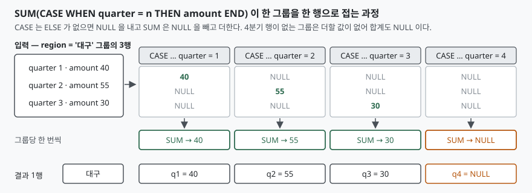

## 들어가며

분기별 매출을 지역별로 저장해 둔 표가 있다. 한 행에 지역 하나, 분기 하나, 금액
하나가 들어 있는 평범한 구조다. 그런데 보고서에 넣을 모양은 그게 아니다.
지역이 한 행이고 1~4분기가 각각 한 칸인, 엑셀에서 보던 그 표를 달라고 한다.

이 지점에서 흔히 하는 선택이 둘 있다. 하나는 분기마다 `WHERE quarter = 1`로
질의를 따로 날려 네 번 받아 오는 것이고, 다른 하나는 전체 행을 그대로 받아
애플리케이션에서 딕셔너리에 모아 다시 조립하는 것이다. 앞쪽은 지역 수가 아니라
**분기 수만큼 왕복이 늘고**, 뒤쪽은 DB가 이미 할 줄 아는 집계를 코드로 옮겨
적는 일이 된다. 분기가 12개월로 바뀌면 왕복이 열두 번이 되거나 조립 코드가
한 번 더 길어진다.

이 변환에는 이름이 있다. 세로로 쌓인 값을 가로로 펴는 것이 **피벗**이고,
그 반대가 **언피벗**이다. 둘 다 질의 한 번으로 끝난다.

## 개념 — PIVOT 구문은 표준에 없다

먼저 걸림돌을 하나 치우고 시작한다. **표준 SQL에는 `PIVOT` 구문이 없다.**
SQL Server와 Oracle이 각자 `PIVOT` 절을 가지고 있어 표준인 것처럼 보이지만,
문법이 서로 다르고 SQLite·MySQL·PostgreSQL에는 아예 없다.

그래서 어느 DB에서나 통하는 방법은 구문이 아니라 조합이다. **집계 함수 안에
`CASE`를 넣는다.** 분기 1의 금액만 통과시키는 `CASE`를 만들어 `SUM`으로 감싸면
그게 `q1` 열이 되고, 같은 것을 분기 수만큼 늘어놓으면 표가 가로로 펴진다.

용어를 하나 정해 두면 편하다. 한 행에 한 값이 들어 있는 원래 모양을
**긴 형식(long)**, 가로로 편 모양을 **넓은 형식(wide)**이라고 부른다. 저장은 긴
형식이 유리하고(분기가 늘어도 스키마를 바꿀 필요가 없다), 사람이 읽기는 넓은
형식이 낫다. 피벗은 저장 모양과 읽는 모양 사이를 오가는 변환이다.

## 구조



> **출처**: [SQLite — The CASE expression](https://www.sqlite.org/lang_expr.html#the_case_expression), [SQLite — sum(X) and total(X)](https://www.sqlite.org/lang_aggfunc.html#sumunc)

## 동작 원리

피벗이 성립하는 이유는 두 규칙이 맞물려서다.

첫째, **`CASE`는 `ELSE`가 없고 어느 `WHEN`도 참이 아니면 `NULL`을 낸다.**
SQLite 문서는 이 경우 "전체 결과는 NULL"이라고 못 박는다. 즉
`CASE WHEN quarter = 1 THEN amount END`은 1분기 행에서는 금액을, 나머지
행에서는 `NULL`을 낸다. 걸러 내는 게 아니라 **값을 `NULL`로 바꿔 통과시킨다.**

둘째, **집계 함수는 `NULL` 입력을 건너뛴다.** `SUM`은 `NULL`이 아닌 값만 더하고,
`COUNT(X)`는 `X`가 `NULL`이 아닌 횟수를 센다. 그래서 1분기 금액 하나와
`NULL` 세 개가 `SUM`에 들어가면 결과는 그 금액 하나다.

이 둘을 붙이면 **그룹 안의 행을 분기별로 갈라 각자의 칸에 떨어뜨리는 장치**가
된다. `GROUP BY region`이 지역당 한 행을 만들고, 열마다 놓인 `CASE`가 그 행의
어느 칸에 값이 들어갈지를 고른다.

집계를 빼면 이 장치가 작동하지 않는다. 실제로 돌려 보면 그 차이가 바로 보인다.

```text
  region | q1   | q2
  -------+------+-----
    서울 |  120 | NULL
    서울 | NULL |  150
    서울 | NULL | NULL
    서울 | NULL | NULL
```

`CASE`만 쓰면 열은 생겼지만 **행이 접히지 않는다.** 행을 접는 것은 `GROUP BY`와
집계 함수이고, `CASE`는 값을 어느 열로 보낼지만 정한다.

## 실습 예제

전체 소스는 [code/pivot_unpivot.py](code/pivot_unpivot.py)에 있다. 표는 지역·분기·금액
세 컬럼이고, **대구의 4분기 행만 일부러 비워 두었다.** 빈 칸이 어떻게 나오는지
보려는 것이다.

```sql
SELECT region,
       SUM(CASE WHEN quarter = 1 THEN amount END) AS q1,
       SUM(CASE WHEN quarter = 2 THEN amount END) AS q2,
       SUM(CASE WHEN quarter = 3 THEN amount END) AS q3,
       SUM(CASE WHEN quarter = 4 THEN amount END) AS q4
  FROM sale
 GROUP BY region
 ORDER BY region
```

```text
  region | q1  | q2  | q3  | q4
  -------+-----+-----+-----+-----
    대구 |  40 |  55 |  30 | NULL
    부산 |  80 |  70 | 110 |   60
    서울 | 120 | 150 |  90 |  200
```

SQLite 3.30.0(2019-10-04)부터는 같은 것을 `FILTER` 절로도 쓸 수 있다. 변경 이력에
"집계 함수의 FILTER 절 지원 추가"로 올라와 있다. 읽기는 이쪽이 낫다 —
무엇을 더하는지(`amount`)와 어떤 행만 더하는지(`WHERE quarter = 1`)가 분리된다.

```sql
SELECT region,
       SUM(amount) FILTER (WHERE quarter = 1) AS q1,
       SUM(amount) FILTER (WHERE quarter = 2) AS q2
  FROM sale
 GROUP BY region
```

출력은 `CASE` 방식과 한 글자도 다르지 않다. 다만 `FILTER`는 SQLite·PostgreSQL에
있고 MySQL 8.0에는 없으므로, 옮겨 다닐 질의라면 `CASE` 쪽이 안전하다.

반대 방향인 언피벗은 **열 하나당 `SELECT` 하나를 만들어 `UNION ALL`로 쌓는다.**
분기 번호를 상수로 적어 넣는 것이 요령이다.

```sql
SELECT region, 1 AS quarter, q1 AS amount FROM sale_wide WHERE q1 IS NOT NULL
UNION ALL
SELECT region, 2, q2 FROM sale_wide WHERE q2 IS NOT NULL
UNION ALL
SELECT region, 3, q3 FROM sale_wide WHERE q3 IS NOT NULL
UNION ALL
SELECT region, 4, q4 FROM sale_wide WHERE q4 IS NOT NULL
ORDER BY region, quarter
```

돌린 기록은 [code/output.txt](code/output.txt)에 그대로 있다.

## 실무에서 주의할 점

**빈 칸은 0이 아니라 `NULL`이다.** 위 출력의 대구 `q4`가 그렇다. 더할 행이 없으면
`SUM`은 `NULL`을 돌려준다 — SQLite 문서도 "non-NULL 입력 행이 없으면 sum()은 NULL을
돌려주지만 total()은 0.0을 돌려준다"고 적는다. 합계 칸을 그대로 더하거나 화면에
찍으면 여기서 틀어진다. 0으로 보이고 싶으면 `COALESCE(..., 0)`로 감싸거나,
건수를 세고 싶으면 `COUNT`를 쓴다. `COUNT`는 같은 자리에서 `0`을 낸다.

```text
  region | q4_cnt | q4_sum | q4_zero
  -------+--------+--------+--------
    대구 |      0 |   NULL |       0
```

**열 목록은 질의를 쓰는 시점에 고정된다.** 분기는 넷이라 외워 쓰면 되지만,
"지난 12개월"처럼 값이 바뀌는 축이면 열 개수도 같이 바뀐다. SQL만으로는 해결되지
않고 질의 문자열을 만들어 내야 한다. 이때 축 값을 문자열로 이어 붙이면 SQL
인젝션이 열리므로, **원본 표에서 뽑은 값만 쓰고 숫자·날짜로 검증한 뒤 넣는다.**

**언피벗의 `UNION ALL`은 원본을 열 개수만큼 읽는다.** 실행계획을 보면 분기할 것
없이 드러난다. 아래는 위 `UNION ALL` 질의의 계획 일부다.

```text
QUERY PLAN
`--MERGE (UNION ALL)
   |--LEFT
   |  `--MERGE (UNION ALL)
   |     |--LEFT
   |     |  |--CO-ROUTINE sale_wide
   |     |  |  |--SCAN sale
```

`SCAN sale`이 네 번 나온다. 분기 번호 목록을 만들어 교차 조인하면 한 번으로 준다.

```text
QUERY PLAN
|--CO-ROUTINE sale_wide
|  |--SCAN sale
|  `--USE TEMP B-TREE FOR GROUP BY
|--MATERIALIZE quarter_no
|  `--SCAN 4 CONSTANT ROWS
|--SCAN w
|--SCAN q
`--USE TEMP B-TREE FOR ORDER BY
```

행이 몇 개인 예제에서는 차이가 안 느껴지지만, 원본이 뷰나 무거운 서브질의면
같은 계산을 열 개수만큼 반복하는 셈이 된다.

**`CASE`의 `ELSE` 가지를 함부로 쓰지 않는다.** 예제의 교차 조인 언피벗은
`WHEN 4 THEN` 대신 `ELSE w.q4`를 썼는데, 이러면 분기 번호가 5인 행이 섞여 들어와도
조용히 `q4` 값을 받아 버린다. 축 값을 `WHEN`으로 전부 적어 두면 목록에 없는 값은
`NULL`이 되어 눈에 띈다.

## 정리

- 표준 SQL에 `PIVOT`은 없다. 집계 함수 안의 `CASE`가 그 자리를 대신한다
- `CASE`가 해당 열이 아닌 행을 `NULL`로 바꾸고, 집계 함수가 `NULL`을 건너뛴다.
  행을 접는 것은 `GROUP BY`이지 `CASE`가 아니다
- 값이 없는 칸은 `0`이 아니라 `NULL`이다. `COALESCE`나 `COUNT`로 뜻을 분명히 한다
- SQLite 3.30.0 이상이면 `FILTER` 절이 같은 일을 더 읽기 좋게 한다
- 언피벗의 `UNION ALL`은 원본을 열 개수만큼 읽는다. 축 목록과 교차 조인하면 한 번이다

## 참고 자료

- [SQLite — The CASE expression](https://www.sqlite.org/lang_expr.html#the_case_expression)
- [SQLite — sum(X) and total(X)](https://www.sqlite.org/lang_aggfunc.html#sumunc)
- [SQLite — Aggregate function count(X)](https://www.sqlite.org/lang_aggfunc.html#count)
- [SQLite — The FILTER clause](https://www.sqlite.org/syntax/filter-clause.html)
- [SQLite Release History — 3.30.0 (2019-10-04)](https://www.sqlite.org/changes.html)
- [SQLite — EXPLAIN QUERY PLAN](https://www.sqlite.org/eqp.html)
