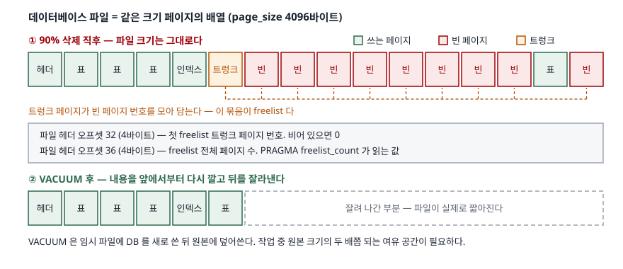

## 들어가며

개인 프로젝트로 만든 수집기가 몇 달째 돌면서 SQLite 파일이 5GB 가까이 불었다.
오래된 로그는 더 볼 일이 없으니 `DELETE FROM log WHERE created_at < '2026-01-01'`
한 줄로 90%를 지운다. 커밋까지 끝냈는데 탐색기에서 보니 파일 크기가 **1바이트도
줄지 않았다.**

여기서 보통 두 가지를 한다. 하나는 같은 DELETE 를 한 번 더 돌려 보는 것이고,
다른 하나는 프로그램을 껐다 켜는 것이다. 둘 다 아무 일도 하지 않는다.
결국 "SQLite 가 지워지지 않는다"고 결론 내리고 파일을 새로 만들어
필요한 행만 옮겨 담는다. 5GB 를 다시 쓰는 작업을 디스크가 꽉 찰 때마다
반복하게 되는 셈이다.

지워진 행이 어디로 갔는지 알면 그럴 필요가 없다. 명령 한 줄이면 된다.

## 개념

SQLite 파일은 **같은 크기의 페이지가 줄줄이 붙어 있는 배열**이다. 기본
페이지 크기는 4096바이트고, 파일 크기는 항상 `page_size × page_count` 다.
행 하나를 지운다고 파일 중간에 구멍이 뚫리지는 않는다. 파일은 페이지 단위로만
늘고 준다.

DELETE 가 한 페이지의 마지막 행까지 비우면 SQLite 는 그 페이지를 파일에서
빼지 않는다. 대신 **freelist** 라는 목록에 그 페이지 번호를 적어 둔다.
"이 페이지는 비었으니 다음에 공간이 필요하면 여기를 써라"는 메모다.

그래서 삭제 직후의 파일에는 두 종류의 페이지가 섞여 있다. 실제로 데이터를
담은 페이지와, 비었지만 자리는 차지하고 있는 페이지다. 파일 크기는 둘을
합한 값이므로 줄지 않는다.

## 구조



> **출처**: [SQLite Database File Format §1.5 The Freelist](https://www.sqlite.org/fileformat2.html#the_freelist), [§1.3 The Database Header](https://www.sqlite.org/fileformat2.html#the_database_header), [VACUUM §3 How VACUUM works](https://www.sqlite.org/lang_vacuum.html)

freelist 는 **트렁크 페이지**가 빈 페이지 번호들을 모아 담는 구조다.
파일 헤더의 오프셋 32에 첫 트렁크 페이지 번호가, 오프셋 36에 freelist 전체
페이지 수가 들어간다. 뒤쪽 값이 바로 `PRAGMA freelist_count` 가 읽어 주는
숫자다.

## 동작 원리

DELETE 는 freelist 를 **늘리고**, INSERT 는 freelist 에서 페이지를 꺼내 쓴다.
둘 다 파일 크기를 건드리지 않는다. 빈 페이지가 바닥났을 때만 파일 뒤에
새 페이지가 붙는다.

VACUUM 은 다른 일을 한다. 임시 파일에 DB 를 **처음부터 다시 쓴** 다음
그것으로 원본을 덮어쓴다. 새로 쓰는 과정에서 빈 페이지는 아예 만들어지지
않으므로 결과 파일에는 freelist 가 남지 않는다. 그래서 작업 중에는
원본 크기의 두 배쯤 되는 여유 공간이 필요하다.

`auto_vacuum` 을 켜면 VACUUM 을 부르지 않아도 커밋 때마다 뒤쪽 빈 페이지를
잘라낸다. 다만 이게 가능하려면 "이 페이지가 원래 어디 소속이었는지"를 알아야
해서 **포인터 맵 페이지**가 추가로 들어간다. 아래 측정에서 같은 데이터가
1,332페이지 대신 1,334페이지를 쓰는 것이 그 비용이다.

## 실습 예제

20,000행(한 행당 memo 200바이트)을 넣고 90%를 지운 뒤 숫자 세 개를 같이 본다.
전체 소스: [`code/vacuum_demo.py`](code/vacuum_demo.py) ·
돌린 기록: [`code/output.txt`](code/output.txt)

```python
def measure(conn, path):
    def pragma(name):
        return conn.execute(f"PRAGMA {name}").fetchone()[0]

    return {
        "rows": conn.execute("SELECT COUNT(*) FROM order_log").fetchone()[0],
        "page_size": pragma("page_size"),
        "page_count": pragma("page_count"),
        "freelist_count": pragma("freelist_count"),
        "file_bytes": os.path.getsize(path),
    }
```

기본 설정(`auto_vacuum = NONE`)의 결과다.

```text
  적재 직후                     행 20,000 · 페이지 1,332 · freelist     0 · 파일 5,455,872 바이트
  90% 삭제 후                  행  2,000 · 페이지 1,332 · freelist 1,168 · 파일 5,455,872 바이트
  5,000행 다시 넣은 뒤            행  7,000 · 페이지 1,332 · freelist   857 · 파일 5,455,872 바이트
  VACUUM 후                  행  7,000 · 페이지   445 · freelist     0 · 파일 1,822,720 바이트
```

18,000행이 사라졌는데 파일은 5,455,872바이트 그대로다. 대신 freelist 가
0에서 1,168로 늘었다. 그다음 5,000행을 다시 넣자 freelist 가 857로 **줄었고**
파일은 여전히 그대로다 — 새 행이 빈 페이지를 재사용한 것이다. 마지막에
VACUUM 을 돌리자 페이지가 445로 떨어지고 파일이 3분의 1로 줄었다.

`auto_vacuum = FULL` 은 VACUUM 없이도 삭제 시점에 파일을 줄인다.

```text
  적재 직후                     행 20,000 · 페이지 1,334 · freelist     0 · 파일 5,464,064 바이트
  90% 삭제 후                  행  2,000 · 페이지   165 · freelist     0 · 파일   675,840 바이트
```

`INCREMENTAL` 은 freelist 에 쌓아 두었다가 `PRAGMA incremental_vacuum` 을
부를 때만 돌려준다. 여기서 예상과 다른 결과가 나왔다.

```text
  90% 삭제 후                  행  2,000 · 페이지 1,334 · freelist 1,168 · 파일 5,464,064 바이트
  execute 만 (100 요청)        행  2,000 · 페이지 1,333 · freelist 1,167 · 파일 5,459,968 바이트
  fetchall (100 요청)         행  2,000 · 페이지 1,233 · freelist 1,067 · 파일 5,050,368 바이트
      ↑ 받은 결과 행 100개 — 돌려준 페이지 수와 같다
  fetchall (전부)             행  2,000 · 페이지   165 · freelist     0 · 파일   675,840 바이트
      ↑ 받은 결과 행 1067개
```

100페이지를 요청했는데 `conn.execute()` 만 부른 쪽은 **한 페이지만** 돌려줬다.
`PRAGMA incremental_vacuum` 이 페이지를 하나 돌려줄 때마다 결과 행을 하나씩
내놓기 때문이다. 파이썬 `sqlite3` 의 `execute()` 는 첫 행에서 멈추므로
거기서 작업도 멈춘다. `.fetchall()` 로 끝까지 받아내자 요청한 100페이지가
정확히 돌아왔고, 받은 결과 행 수가 돌려받은 페이지 수와 같았다.

## 실무에서 주의할 점

- **`auto_vacuum` 은 표를 만들기 전에 정해야 한다.** 이미 표가 있는 DB 에
  `PRAGMA auto_vacuum = FULL` 을 걸면 값이 0 그대로다. 그 상태로 VACUUM 을
  한 번 돌려야 1로 바뀐다. 예제의 4번 절이 이 순서를 그대로 찍는다.
- **`incremental_vacuum` 은 결과를 끝까지 받아야 한다.** 위에서 본 대로
  드라이버가 첫 행에서 멈추면 한 페이지만 정리된다. 파이썬이라면
  `.fetchall()`, CLI 라면 그냥 실행해도 끝까지 돈다.
- **VACUUM 은 쓰기 잠금을 잡고 DB 전체를 다시 쓴다.** 수 GB 짜리 파일을
  서비스 시간에 돌리면 그 동안 쓰기가 막힌다. 열린 트랜잭션이 있으면
  아예 실패한다.
- **`INTEGER PRIMARY KEY` 가 없는 표는 rowid 가 바뀔 수 있다.** rowid 를
  애플리케이션이 외부 키처럼 들고 있었다면 VACUUM 뒤에 어긋난다.
- **공간을 비우는 것이 목적이 아니라면 VACUUM 을 습관처럼 돌리지 않는다.**
  삭제한 만큼 곧 다시 채울 테이블이면 freelist 에 남겨 두는 편이 낫다.
  재사용은 공짜고 VACUUM 은 전체 재작성이다.
- **원본을 멈추기 싫으면 `VACUUM INTO` 가 있다.** 정리된 사본을 새 파일로
  쓰고 원본은 건드리지 않는다. 예제 5번 절에서 원본은 1,332페이지
  그대로인데 사본은 135페이지로 나왔다.

## 정리

- SQLite 파일은 페이지 배열이고, DELETE 는 빈 페이지를 freelist 에 묶어 둘 뿐
  파일을 줄이지 않는다.
- 빈 페이지는 다음 INSERT 가 재사용한다. 파일이 안 커지는 것은 정상 동작이다.
- 파일을 실제로 줄이는 것은 VACUUM 이다. DB 를 다시 써서 빈 페이지를 없앤다.
- `auto_vacuum = FULL` 은 자동으로 줄이는 대신 포인터 맵 페이지를 더 쓴다.
  `INCREMENTAL` 은 호출할 때만 돌려주되, 결과 행을 끝까지 받아야 한다.
- 원본을 잠그지 않고 정리본이 필요하면 `VACUUM INTO` 를 쓴다.

## 참고 자료

- [SQLite Database File Format §1.5 The Freelist](https://www.sqlite.org/fileformat2.html#the_freelist)
- [SQLite Database File Format §1.3 The Database Header](https://www.sqlite.org/fileformat2.html#the_database_header)
- [SQLite Database File Format §1.6 The B-tree Pointer Map](https://www.sqlite.org/fileformat2.html#pointer_map_or_ptrmap_pages)
- [VACUUM](https://www.sqlite.org/lang_vacuum.html)
- [PRAGMA auto_vacuum](https://www.sqlite.org/pragma.html#pragma_auto_vacuum)
- [PRAGMA incremental_vacuum](https://www.sqlite.org/pragma.html#pragma_incremental_vacuum)
- [PRAGMA freelist_count](https://www.sqlite.org/pragma.html#pragma_freelist_count)
