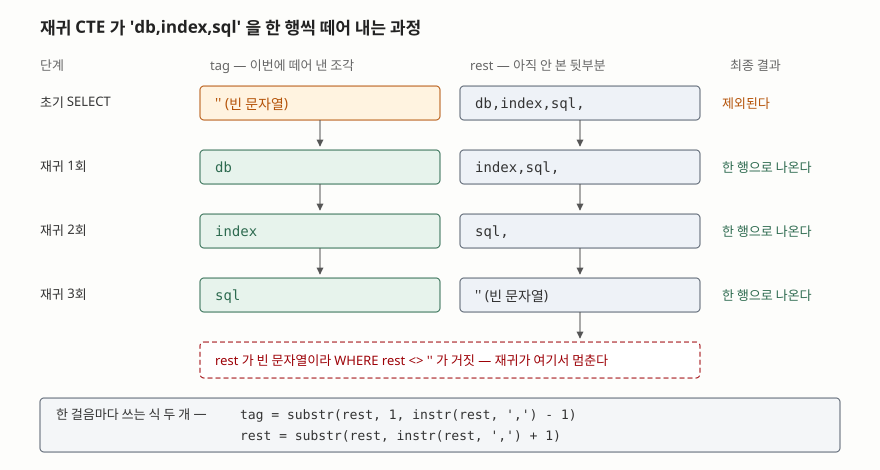

## 들어가며

게시판을 하나 만들었다고 하자. 글마다 태그를 여러 개 달 수 있게 했는데, 표를
따로 만들기는 번거로워서 `tags` 컬럼 하나에 `db,index,sql` 처럼 쉼표로 이어
붙여 넣었다. 글을 보여 줄 때는 애플리케이션에서 쉼표로 잘라 뿌리면 되니
한동안은 아무 문제가 없다.

문제는 "태그가 `db` 인 글만 보여 줘" 가 들어오는 날 생긴다. 컬럼에는 쉼표로
이어 붙인 한 덩어리가 들어 있으니 `WHERE tags = 'db'` 로는 `db` 하나만 달린
글밖에 못 찾는다. 그래서 대부분 `LIKE '%db%'` 로 넘어가는데, 이쪽은 글자가
들어 있기만 하면 전부 걸린다. 태그가 `in` 인 글을 찾으면 `index` 도 `linux` 도
딸려 온다. 찾는 대상이 **문자열 조각이 아니라 항목**이라는 것을 질의가 모르기
때문이다.

항목으로 다루려면 먼저 항목으로 만들어야 한다. 한 행에 든 `db,index,sql` 을
세 행으로 펼쳐 놓으면 그 뒤는 평범한 `WHERE tag = 'db'` 다.

## 개념

여러 DBMS는 이 일을 하는 함수를 이름을 달리해 갖고 있다. PostgreSQL의
`string_to_table`, SQL Server의 `STRING_SPLIT`, MySQL의
`JSON_TABLE` 이 그렇다. **SQLite에는 이에 해당하는 내장 함수가 없다.**
공식 함수 목록에 문자열을 쪼개 행으로 내놓는 함수는 올라와 있지 않다.

없으면 만들어야 한다. 쓸 수 있는 길은 둘이다.

| 방법 | 쓰는 것 | 성격 |
|---|---|---|
| 재귀 CTE | `WITH RECURSIVE` + `instr` + `substr` | 표준 SQL 문법만 쓴다 |
| `json_each` | JSON 배열로 모양을 바꿔 테이블 값 함수에 넘긴다 | JSON 확장이 필요하다 |

두 방법 모두 **한 행을 여러 행으로 늘린다.** 이렇게 한 행을 여러 행으로 펼치는
동작을 보통 언네스트(unnest)라고 부른다.

## 구조

재귀 CTE는 자기 자신을 참조하는 CTE다. 초기 `SELECT` 로 첫 행을 만들고,
그 행을 재귀 `SELECT` 에 넣어 다음 행을 만들고, 더 만들 것이 없을 때까지
반복한다. 문자열 쪼개기는 이 틀에 그대로 들어맞는다. **아직 안 본 뒷부분을
행에 들고 다니면서 앞에서 한 조각씩 떼어 내면 된다.**



> **출처**: [SQLite — Recursive Common Table Expressions](https://www.sqlite.org/lang_with.html#recursive_common_table_expressions), [SQLite — Core Functions (`instr`, `substr`)](https://www.sqlite.org/lang_corefunc.html)

떼어 내는 식은 두 줄이다. `instr(rest, ',')` 가 첫 쉼표의 위치(1부터 센다)를
주므로, 그 앞까지가 이번 조각이고 그 뒤가 다음 걸음의 `rest` 다.

```sql
WITH RECURSIVE split(id, tag, rest) AS (
    SELECT id, '', tags || ','          -- 끝에 구분자를 하나 붙여 둔다
      FROM article
    UNION ALL
    SELECT id,
           substr(rest, 1, instr(rest, ',') - 1),
           substr(rest, instr(rest, ',') + 1)
      FROM split
     WHERE rest <> ''
)
SELECT id, tag FROM split WHERE tag <> '';
```

초기 `SELECT` 에서 `tags || ','` 로 **끝에 구분자를 하나 더 붙이는 것**이 요령이다.
붙이지 않으면 마지막 조각 뒤에 쉼표가 없어 `instr` 이 0을 돌려주고,
`substr(rest, 1, -1)` 이 되어 마지막 항목이 사라진다. 대신 초기 행의 `tag` 가
빈 문자열이 되므로 바깥 `SELECT` 에서 `tag <> ''` 로 걸러 낸다.

## 동작 원리

재귀 CTE가 어떻게 도는지는 실행계획에 그대로 나온다.

```text
QUERY PLAN
|--CO-ROUTINE split
|  |--SETUP
|  |  `--SCAN article
|  `--RECURSIVE STEP
|     `--SCAN split
|--SCAN split
`--USE TEMP B-TREE FOR ORDER BY
```

`SETUP` 아래의 `SCAN article` 이 초기 `SELECT`, `RECURSIVE STEP` 아래가 반복
구간이다. 중요한 것은 맨 아래 `SCAN split` 이다. **펼쳐 놓은 결과를 처음부터
끝까지 읽는다**는 뜻이고, 여기에 걸 인덱스는 없다. 질의가 도는 동안 만들어진
값이라 인덱스를 만들어 둘 대상 자체가 없기 때문이다.

그래서 `WHERE tag = 'db'` 를 아무리 정확히 써도 **글 네 건이면 네 건을 다 펼친
뒤에 거른다.** 글이 10만 건이면 10만 건을 펼친다. 같은 자료를 `article_tag`
표로 쪼개 저장해 두고 `tag` 에 인덱스를 걸면 계획이 이렇게 바뀐다.

```text
QUERY PLAN
`--SEARCH article_tag USING INDEX idx_article_tag_tag (tag=?)
```

`SCAN` 이 `SEARCH` 로 바뀌었다. 찾는 값이 있는 자리로 바로 들어간다는 뜻이다.
두 질의가 같은 결과(`[1, 3, 4]`)를 내는지도 예제에서 함께 확인했다.

## 실습 예제

전체 소스: [`code/`](code/) · 실행 기록: [`code/output.txt`](code/output.txt)

`LIKE` 가 왜 못 쓰는 도구인지부터 보인다.

```text
-- tags LIKE '%in%' — 부분 문자열이 그대로 걸린다
   (1, 'db,index,sql')
   (2, 'linux,container')
```

`in` 이라는 태그는 어느 글에도 없는데 두 건이 걸렸다. `index` 와 `linux`
안에 그 두 글자가 들어 있어서다.

재귀 CTE로 펼치면 한 행이 태그 수만큼 행이 된다.

```text
-- article 한 행이 태그 수만큼 행이 된다
   (1, 'db')
   (1, 'index')
   (1, 'sql')
   (2, 'container')
   (2, 'linux')
```

`json_each` 쪽은 문자열을 JSON 배열처럼 보이게 고쳐 넘긴다. 쉼표를 `","` 로
바꾸고 앞뒤에 `["` 와 `"]` 를 붙이면 `["db","index","sql"]` 이 된다.

```sql
SELECT a.id, j.value AS tag
  FROM article a,
       json_each('["' || replace(a.tags, ',', '","') || '"]') j;
```

정상적인 값에서는 두 방법이 같은 결과를 낸다. **갈리는 곳은 경계값이다.**

| 입력 | 재귀 CTE | `json_each` |
|---|---|---|
| `''` | `[]` | `['']` |
| `'db,'` | `['db']` | `['db', '']` |
| `'db,,sql'` | `['db', 'sql']` | `['db', '', 'sql']` |
| `'db, sql'` | `['db', ' sql']` | `['db', ' sql']` |
| `'say"hi,db'` | `['say"hi', 'db']` | `OperationalError: malformed JSON` |

마지막 줄이 이 방법의 한계다. 값에 큰따옴표가 하나 섞이면 만들어 낸 JSON이
깨져 질의 전체가 실패한다. 역슬래시도 같다. **사용자가 입력한 값을 이 방식으로
쪼개면 언제 터질지 모르는 자리를 남기는 셈이다.**

빈 항목을 두 방법이 다르게 내놓는 것은 성격 차이가 아니라 **바깥 `SELECT` 의
`tag <> ''` 때문**이다. 재귀 CTE 쪽도 그 조건을 떼면 빈 항목이 그대로 나온다.
어느 쪽을 원하는지는 자료에 따라 다르니, 빈 항목이 뜻을 갖는 자료라면 그
조건을 두지 않는 편이 맞다.

## 실무에서 주의할 점

- **공백은 아무도 안 떼어 준다.** `'db, sql'` 은 두 방법 모두 `' sql'` 을 그대로
  내놓는다. 사람이 손으로 넣은 값이라면 `trim()` 을 한 겹 씌워야 하고, 씌우지
  않으면 `tag = 'sql'` 이 빈손으로 돌아온다.
- **구분자가 여러 글자면 식을 같이 고쳐야 한다.** `'||'` 처럼 두 글자를 쓰면
  `substr(rest, instr(rest, '||') + 1)` 의 `+ 1` 을 `+ 2` 로 바꿔야 한다.
  구분자 길이만큼 건너뛰어야 하는데 한 글자만 건너뛰면 남은 한 글자가 다음
  조각 앞에 붙는다.
- **재귀에는 멈출 조건이 반드시 있어야 한다.** 위 질의의 `WHERE rest <> ''` 가
  그것이다. `rest` 가 줄어들지 않는 식을 쓰면 끝나지 않고 돈다. 공식 문서도
  이런 질의를 멈추는 수단으로 `LIMIT` 을 들고 있으니, 미덥지 않으면 바깥에
  하나 걸어 둔다.
- **쪼개 저장할 수 있으면 쪼개 저장한다.** 펼치는 질의는 전체를 읽는다는 것이
  실행계획에 드러난다. 태그로 거르는 일이 자주 있다면 `article_tag` 같은 표를
  만드는 편이 질의도 단순하고 인덱스도 걸린다. 펼치기는 **이미 그렇게 저장된
  자료를 어쩔 수 없이 다룰 때**와 **한 번 쪼개 넣는 마이그레이션**에 쓰는 도구다.

## 정리

- SQLite에는 문자열을 행으로 쪼개는 내장 함수가 없다. 재귀 CTE나 `json_each` 로 직접 만든다.
- 재귀 CTE는 `tags || ','` 로 끝에 구분자를 붙이고, `instr`·`substr` 로 앞에서 한 조각씩 뗀다.
- `json_each` 는 짧지만 값에 큰따옴표가 섞이면 질의가 실패한다. 사용자 입력에는 쓰지 않는다.
- 공백 제거는 어느 쪽도 해 주지 않는다. 필요하면 `trim()` 을 따로 씌운다.
- 펼친 결과에는 인덱스가 없다. 자주 거를 값이면 쪼갠 표로 저장하는 편이 맞다.

## 참고 자료

- [SQLite — WITH clause: Recursive Common Table Expressions](https://www.sqlite.org/lang_with.html#recursive_common_table_expressions)
- [SQLite — Built-In Scalar SQL Functions (`instr`, `substr`, `replace`, `trim`)](https://www.sqlite.org/lang_corefunc.html)
- [SQLite — The JSON1 Extension: `json_each`](https://www.sqlite.org/json1.html#jeach)
- [SQLite — EXPLAIN QUERY PLAN](https://www.sqlite.org/eqp.html)
- [PostgreSQL 16 — String Functions: `string_to_table`](https://www.postgresql.org/docs/16/functions-string.html)
