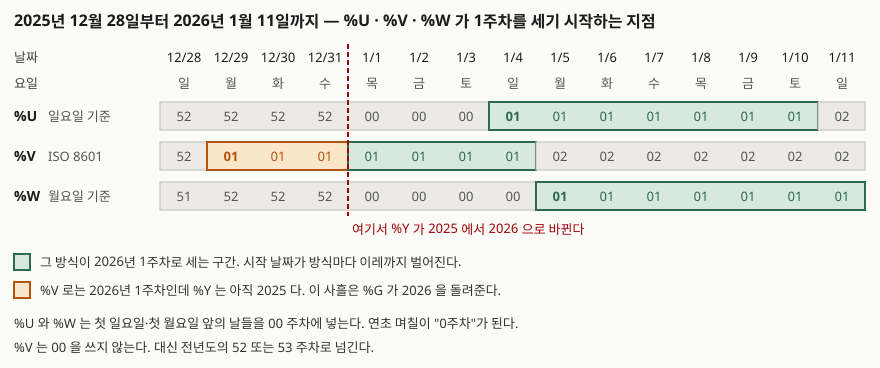

## 들어가며

주간 매출을 뽑아 달라는 요청을 받는다. 어려울 게 없어 보여서 `strftime('%W', ordered)`로
묶어 넘긴다. 며칠 뒤 "1월 첫째 주 숫자가 왜 0주차로 나오느냐"는 말이 돌아온다.
`%W`를 `%V`로 바꿔 다시 돌리면 이번에는 작년 12월 29일 주문이 2026년 1주차에 들어가 있다.

여기서 보통 택하는 방법은 포맷 문자를 하나씩 바꿔 가며 눈에 그럴듯한 값이 나오는 것을
고르는 것이다. 하지만 연초 2주를 벗어나면 세 포맷이 전부 같은 값을 내므로, 어느 것을
골라도 그 뒤 50주 동안은 아무 차이가 없다. 틀렸다는 사실은 다음 연말에, 집계를 이미
한 해 치 쌓아 둔 다음에 드러난다. 포맷 문자를 고르는 일이 아니라 **주차를 무엇으로
정의할지 고르는 일**이라는 것을 그때 알게 된다.

## 개념

SQLite에는 날짜 타입이 없다. 공식 문서는 전용 date/time 자료형이 없다고 분명히 적고,
날짜를 ISO-8601 문자열·율리우스일 숫자·유닉스 타임스탬프 중 하나로 저장한다고 설명한다.
`strftime()`은 그렇게 저장된 값을 받아 포맷 문자열에 따라 **문자열**을 돌려준다.
반환값이 항상 문자열이라는 점이 뒤에서 한 번 발목을 잡는다.

포맷 치환 문자는 3.46.0 기준으로 27개다. 주차·요일과 관련된 것만 모으면 일곱 개다.

| 문자 | 무엇 | 3.49.1에서 2026-01-03 토요일에 넣으면 |
|---|---|---|
| `%w` | 요일, 일요일이 0 | `6` |
| `%u` | 요일, 월요일이 1 | `6` |
| `%U` | 주차, 첫 일요일부터 1주차 | `00` |
| `%W` | 주차, 첫 월요일부터 1주차 | `00` |
| `%V` | ISO 8601 주차 | `01` |
| `%G` | `%V`에 대응하는 ISO 연도 | `2026` |
| `%g` | `%G`의 두 자리 표기 | `26` |

분기를 뽑는 포맷 문자는 **없다**. 월을 꺼내 계산해야 한다.

목록에 없는 문자를 쓰면 에러가 아니라 `NULL`이 돌아온다. `%a`(요일 이름), `%b`(월 이름),
`%y`(두 자리 연도)가 전부 그렇다. 실행해 보면 이렇게 나온다.

```text
  %a   | %b   | %y   | %D
  -----+------+------+-----
  None | None | None | None
```

조용히 `NULL`이 된다는 것은 오타가 난 포맷 문자열도 조용히 통과한다는 뜻이다.

## 구조

세 가지 주차 포맷이 연말·연초에 어떻게 갈리는지가 이 글의 핵심이다.
2025년 12월 28일부터 2026년 1월 11일까지 열닷새를 나란히 놓고 값을 찍어 보면 이렇다.



> **출처**: [SQLite Date And Time Functions §2.2 The strftime() Function](https://www.sqlite.org/lang_datefunc.html#strftm) — 포맷 문자의 정의. 칸에 들어간 값은 SQLite 3.49.1에서 직접 뽑은 것이다.

세 방식이 2026년 1주차를 시작하는 날짜가 각각 다르다. `%V`는 12월 29일, `%U`는 1월 4일,
`%W`는 1월 5일이다. 가장 이른 것과 늦은 것이 이레 차이다.

## 동작 원리

`%U`와 `%W`가 쓰는 규칙은 단순하다. 그해 **첫 일요일**(또는 첫 월요일) 이전의 날들은
전부 `00`주차고, 그 뒤부터 `01`이 시작된다. 2026년 1월 1일은 목요일이라 1월 1일부터
3일까지가 `00`주차에 들어간다. 1월 4일이 일요일이므로 `%U`는 거기서 `01`을 시작하고,
`%W`는 하루 뒤 월요일인 1월 5일부터 `01`을 시작한다.

`%V`는 다르다. ISO 8601은 `00`주차를 두지 않는다. 대신 어느 주가 1주차인지를 먼저
정하고, 그 앞의 날들은 **전년도의 마지막 주차**로 밀어 넣는다. 그래서 연말 며칠이
다음 해 1주차로 당겨지기도 하고, 연초 며칠이 전년도 52·53주차로 밀리기도 한다.
2025년 12월 29일부터 31일까지가 전자의 경우다.

```text
  ordered    | iso요일 | 달력연도 | %U | %V | %W | %G
  -----------+-------+------+----+----+----+-----
  2025-12-28 | 7     | 2025 | 52 | 52 | 51 | 2025
  2025-12-29 | 1     | 2025 | 52 | 01 | 52 | 2026
  2025-12-31 | 3     | 2025 | 52 | 01 | 52 | 2026
  2026-01-01 | 4     | 2026 | 00 | 01 | 00 | 2026
  2026-01-04 | 7     | 2026 | 01 | 01 | 00 | 2026
  2026-01-05 | 1     | 2026 | 01 | 02 | 01 | 2026
```

12월 31일 줄을 본다. `%Y`는 `2025`인데 `%G`는 `2026`이다. **`%V`를 쓸 때 연도를 `%Y`로
붙이면 안 되는 이유가 이것이다.** `strftime('%Y-W%V', ...)`로 라벨을 만들면 이 사흘이
`2025-W01`이라는, 달력에 존재하지 않는 주로 분류된다. `%V`에는 반드시 `%G`를 짝지어야
한다. 포맷 문자 목록에 `%G`가 따로 있는 이유도 거기에 있다.

## 실습 예제

전체 소스: [`code/`](code/) · 실행 기록: [`code/output.txt`](code/output.txt)

주문 열두 건을 연말·연초에 걸치게 깔고 분기별로 묶어 본다. 분기 포맷 문자가 없으므로
월에서 계산한다. 1~3월이 1분기이므로 `(월 + 2) / 3`이면 된다. SQLite의 `/`는 정수끼리
나누면 정수 몫을 주므로 내림 처리가 따로 필요 없다.

```sql
SELECT strftime('%Y', ordered) || '-Q'
         || (CAST(strftime('%m', ordered) AS INTEGER) + 2) / 3 AS 분기,
       COUNT(*) AS 건수,
       SUM(amount) AS 합계
FROM orders
GROUP BY 분기
ORDER BY 분기
```

돌려 보면 이렇게 나온다.

```text
  분기  | 건수 | 합계
  ----+----+-------
  675 | 12 | 203000
```

열두 건이 전부 `675`라는 한 칸에 들어갔다. 분기가 다섯 개로 갈려야 하는데 하나다.

이유는 날짜가 아니라 연산자 우선순위에 있다. SQLite의 우선순위 표에서 `||`는
`*` `/` `%`보다 **한 칸 위에 있다**. 그래서 위 식은 `(('2026' || '-Q') || (월 + 2)) / 3`
으로 묶인다. `'2026-Q1'`을 3으로 나누라는 요청이 되고, 실제로 돌려 보면 `675`가 나온다.
문서가 `CAST`에 대해 적은 규칙 — 숫자로 읽히는 **가장 긴 앞부분**을 떼고 나머지는
버린다 — 과 같은 결과다. `CAST('2026-Q1' AS INTEGER)`가 `2026`이고, `2026 / 3`의
정수 몫이 `675`다.

```text
  반환타입 | '01' > 9 | CAST 후 | '2026-Q1' / 3 | CAST('2026-Q1')
  -----+----------+--------+---------------+----------------
  text | 1        | 0      | 675           | 2026
```

문자열이 숫자로 조용히 바뀌는 것도, 정수 나눗셈이 몫만 남기는 것도 에러가 아니라서
아무 경고 없이 통과한다.

나눗셈 전체를 괄호로 묶으면 의도대로 나온다.

```sql
       || ((CAST(strftime('%m', ordered) AS INTEGER) + 2) / 3) AS 분기,
```

```text
  분기      | 건수 | 합계
  --------+----+------
  2025-Q4 | 3  | 50000
  2026-Q1 | 5  | 53000
  2026-Q2 | 1  | 15000
  2026-Q3 | 1  | 42000
  2026-Q4 | 2  | 43000
```

주 단위 집계는 주차 번호 대신 **그 주의 시작 날짜**로 묶는 쪽이 안전하다.
`'-6 days', 'weekday 1'` 두 수정자를 이어 쓰면 그 날짜가 속한 주의 월요일이 나온다.
`weekday N`은 문서 설명대로 해당 요일까지 날짜를 앞으로 보내므로, 엿새를 먼저 빼 두면
이번 주 월요일을 넘기지 않는다.

```text
  iso주     | 주시작        | 건수 | 합계
  ---------+------------+----+------
  2025-W52 | 2025-12-22 | 1  | 12000
  2026-W01 | 2025-12-29 | 5  | 59000
  2026-W02 | 2026-01-05 | 1  | 11000
```

날짜로 묶으면 연도를 따로 붙일 필요가 없고, 정렬도 문자열 비교로 그냥 맞는다.

## 실무에서 주의할 점

**`%V`에 `%Y`를 붙이지 않는다.** 위에서 본 대로 연말 며칠이 존재하지 않는 주로
분류된다. `%G-W%V`로 쓴다. 반대로 `%U`·`%W`에는 `%G`가 아니라 `%Y`를 붙여야 한다.
`%G`는 ISO 주차 체계의 연도이므로 `%U`와 섞으면 또 다른 어긋남이 생긴다.

**월말에 `+1 month`를 더하면 날짜가 다음 달로 넘어간다.** 문서는 월 길이가 달라
모호함이 생긴다고 밝히고, 기본값으로 **늦은 쪽 날짜**를 택한다고 적는다. 2월 31일은
없으므로 사흘이 넘쳐 3월로 간다.

```text
  d          | 기본값        | floor      | ceiling
  -----------+------------+------------+-----------
  2024-01-29 | 2024-02-29 | 2024-02-29 | 2024-02-29
  2026-01-31 | 2026-03-03 | 2026-02-28 | 2026-03-03
  2026-03-31 | 2026-05-01 | 2026-04-30 | 2026-05-01
```

"다음 달 말일"을 구하려면 `'start of month', '+1 month', '-1 day'`처럼 **월초로 먼저
내려놓고** 더해야 한다. 월말을 그대로 더하면 위 표처럼 밀린다. `floor` 수정자를 쓰면
전월 말일로 맞춰 주지만, 수정자를 아는 사람만 읽히는 질의가 된다.

**이 버전에 없는 수정자는 `NULL`이 된다.** `end of month`와 음수 `weekday`는 3.54.0에서
들어온 것이라 3.49.1에서는 값이 없다.

```text
  end of month | %Q   | weekday -1
  -------------+------+-----------
  None         | None | None
```

에러가 아니므로 운영 중에 바뀐 값이 한참 뒤에 드러난다. 배포 환경의 SQLite 버전을
먼저 확인하고, 수정자를 쓴 질의는 그 환경에서 한 번 돌려 본다.

**`strftime`의 반환값은 문자열이다.** `typeof()`로 찍어 보면 `text`가 나온다.
월을 비교하거나 계산에 쓰려면 `CAST(... AS INTEGER)`를 붙여야 한다. SQLite는 비교할 때
숫자를 문자열보다 항상 작게 보므로, `strftime('%m', d) > 9`는 **1월에도 참이 된다.**
위 7번 절 출력의 `'01' > 9` 칸이 `1`인 것이 그것이다. 4분기만 뽑겠다고 이렇게 쓰면
열두 달이 전부 걸린다. `CAST`를 씌운 칸은 같은 1월에 `0`을 돌려준다.

**로컬 시간 변환은 윈도우에서 믿기 어렵다.** 문서는 비(非)Vista 윈도우 플랫폼이
서머타임 규칙을 한 벌만 지원한다고 경고한다. `localtime` 수정자를 쓴 집계는
서버 OS에 따라 값이 달라질 수 있다.

## 정리

- 주차 포맷은 셋이고 서로 다른 정의를 쓴다. `%U`는 첫 일요일, `%W`는 첫 월요일,
  `%V`는 ISO 8601 규칙이다. 연초 2주 안에서만 값이 갈린다
- `%V`는 반드시 `%G`와 짝지어 쓴다. `%Y`를 붙이면 연말 사흘이 없는 주로 분류된다
- 분기 포맷 문자는 없다. `(월 + 2) / 3`으로 계산하되, `||`가 `/`보다 우선순위가
  높으므로 나눗셈을 괄호로 묶는다
- 주 단위 집계는 주차 번호보다 주 시작 날짜(`'-6 days', 'weekday 1'`)로 묶는 쪽이 안전하다
- 월말 날짜에 `+1 month`를 더하면 다음 달로 넘어간다. 월초로 내려놓고 더한다

## 참고 자료

- [SQLite — Date And Time Functions](https://www.sqlite.org/lang_datefunc.html) — 포맷 문자 전체 목록과 수정자 정의
- [SQLite — Date And Time Functions §2.2 The strftime() Function](https://www.sqlite.org/lang_datefunc.html#strftm) — `%U` · `%V` · `%W` · `%G` 의 정의
- [SQLite — Date And Time Functions §3 Modifiers](https://www.sqlite.org/lang_datefunc.html#modifiers) — `weekday N` · `start of month` · `+N months` 와 ceiling/floor
- [SQLite — SQL Language Expressions §2 Operators, and Parse-Affecting Attributes](https://www.sqlite.org/lang_expr.html#operators_and_parse_affecting_attributes) — `||` 가 `/` 보다 먼저 묶이는 근거
- [SQLite — SQL Language Expressions §13 CAST expressions](https://www.sqlite.org/lang_expr.html#castexpr) — TEXT 를 INTEGER 로 변환할 때 숫자 접두사만 취한다는 규칙
- [SQLite — Datatypes In SQLite §4.1 Sort Order](https://www.sqlite.org/datatype3.html#sort_order) — 비교에서 숫자가 문자열보다 항상 작다는 규칙
- [SQLite — Datatypes In SQLite §2.2 Date and Time Datatype](https://www.sqlite.org/datatype3.html#date_and_time_datatype) — 날짜 전용 타입이 없다는 서술
