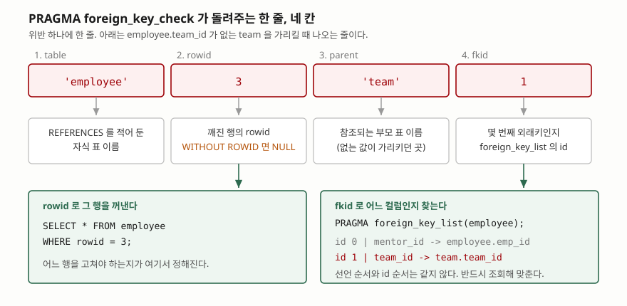

## 들어가며

혼자 만들던 서비스가 1년쯤 돌았다. 처음 스키마를 잡을 때 `employee.team_id INTEGER
REFERENCES team(team_id)` 라고 적어 뒀으니 팀이 없는 직원은 들어올 수 없다고 믿고
있었다. 그런데 팀별 인원을 세는 화면을 만들다 보니 합계가 전체 인원보다 적다.
조인에서 떨어져 나간 행이 있다는 뜻이다.

여기서 보통 하는 일은 `LEFT JOIN` 으로 빠진 행을 찾아 눈으로 세는 것이다.
외래키가 하나면 그래도 된다. 그런데 표가 서른 개고 외래키가 쉰 개면 쿼리를
쉰 번 써야 하고, 자기 자신을 참조하는 외래키나 복합키가 섞이면 조인 조건을
한 번씩 틀리기 시작한다. 그러고 나서 `PRAGMA foreign_keys = ON` 을 켜 두면
과거 데이터까지 정리됐으리라 생각하는데, **켜는 것만으로는 이미 들어 있는 행에
아무 일도 일어나지 않는다.**

SQLite 에는 이 쉰 번을 한 번으로 줄여 주는 명령이 따로 있다.

## 개념

**외래키(foreign key)** 는 "이 컬럼의 값은 저쪽 표에 실제로 있어야 한다"는 약속이다.
약속을 어긴 행 — 없는 팀 번호를 가진 직원 — 을 **깨진 참조**라고 부른다.

SQLite 에서 헷갈리기 쉬운 점은, 스키마에 `REFERENCES` 를 적는 것과 그 약속을
**실제로 검사하는 것이 별개**라는 데 있다. 공식 문서는 외래키 강제가 하위 호환을
위해 기본으로 꺼져 있고, **연결마다 따로 켜야 한다**고 적는다. 즉 같은 파일이라도
어제 쓴 프로그램은 켜고 오늘 쓴 스크립트는 안 켰다면, 오늘 들어온 행은 검사를
받지 않은 채 남는다.

`PRAGMA foreign_key_check` 는 지금 파일에 들어 있는 행 전부를 훑어 깨진 참조를
한 줄씩 돌려준다. 강제를 켜고 끄는 것과 무관하게 **언제든 셀 수 있다**는 점이
이 명령의 쓸모다.

## 구조



> **출처**: [SQLite PRAGMA Statements §PRAGMA foreign_key_check](https://www.sqlite.org/pragma.html#pragma_foreign_key_check)

공식 문서는 결과에 네 칸이 있다고 적는다. 차례로 `REFERENCES` 절을 가진 자식 표
이름, 문제가 된 행의 rowid(자식 표가 `WITHOUT ROWID` 면 NULL), 참조되는 부모 표
이름, 그리고 실패한 외래키가 몇 번째인지를 가리키는 정수다. 마지막 칸은
`foreign_key_list` 의 첫 칸과 같은 값이라고 문서가 못 박아 둔다.

## 동작 원리

네 칸 중 쓸모가 갈리는 것은 2번과 4번이다.

**rowid** 는 "어느 행을 고쳐야 하는가"에 답한다. SQLite 의 모든 일반 표는 숨은 정수
키 `rowid` 를 하나씩 갖고 있어서, 기본키가 무엇이든 `WHERE rowid = 3` 으로 행
하나를 집을 수 있다. 반대로 `WITHOUT ROWID` 로 만든 표에는 그 숨은 키가 없고,
그래서 이 칸이 NULL 로 나온다. 그런 표는 결과만 보고 행을 특정할 수 없으므로
부모 표와 조인해 직접 찾아야 한다.

**fkid** 는 "어느 컬럼이 문제인가"에 답한다. 한 표에 외래키가 둘 이상이면
결과 줄만 봐서는 구분이 안 되기 때문이다. 이 번호를
`PRAGMA foreign_key_list(<표>)` 의 `id` 와 맞추면 어떤 컬럼이 어디를 가리키다
틀렸는지가 나온다.

```sql
SELECT e.emp_id, e.emp_name, e.team_id
  FROM pragma_foreign_key_check('employee') AS c
  JOIN employee AS e ON e.rowid = c.rowid
 WHERE c.fkid = 1;
```

`pragma_foreign_key_check(...)` 라는 표 값 함수 형태로 쓰면 결과를 그대로 조인에
끼워 넣을 수 있다. 위 질의는 1번 외래키를 위반한 행만 사람이 읽을 수 있는
컬럼과 함께 꺼낸다.

## 실습 예제

전체 소스: [`code/`](code/) · 실행 기록: [`code/output.txt`](code/output.txt)

외래키 강제를 끈 채로 데이터를 넣어 운영에서 흔히 만들어지는 상태를 재현했다.
`employee` 는 외래키를 둘 가진다 — `mentor_id` 가 자기 자신을, `team_id` 가
`team` 을 가리킨다. `badge` 는 `WITHOUT ROWID` 표다.

```python
conn.execute("PRAGMA foreign_keys = OFF")
conn.executescript(SCHEMA)
conn.executescript(SEED)   # team 30, employee 99, employee 77 은 없는 값
```

강제를 켠 직후에 세어 보면 세 줄이 나온다.

```text
   컬럼: ['table', 'rowid', 'parent', 'fkid']
    ('badge', None, 'employee', 0)
    ('employee', 3, 'team', 1)
    ('employee', 4, 'employee', 0)
```

`badge` 줄의 두 번째 칸이 `None` 인 것이 `WITHOUT ROWID` 표의 결과다. 그리고
`employee` 두 줄의 `fkid` 가 각각 1 과 0 인데, 이 번호가 선언 순서와 반대다.

```text
   컬럼: ['id', 'seq', 'table', 'from', 'to', 'on_update', 'on_delete', 'match']
    (0, 0, 'employee', 'mentor_id', 'emp_id', 'NO ACTION', 'NO ACTION', 'NONE')
    (1, 0, 'team', 'team_id', 'team_id', 'NO ACTION', 'NO ACTION', 'NONE')
```

`CREATE TABLE` 에 `team_id` 를 먼저 적고 `mentor_id` 를 나중에 적었는데,
`foreign_key_list` 는 `mentor_id` 에 0 을, `team_id` 에 1 을 매겼다. 공식 문서는
`id` 칸의 순서를 규정하지 않는다. **선언 순서로 짐작하지 말고 매번 조회해서
맞춰야 한다**는 뜻이다. 이 글의 환경에서 관측한 값이 그렇다는 것이지,
다른 버전에서 같다고 보장할 수 없다.

빠진 팀을 만들고, 없는 멘토를 NULL 로 바꾸고, 주인 없는 배지를 지우면 결과가
0행이 된다. 그 뒤로는 새 위반이 들어오지 못한다.

```text
   sqlite3.IntegrityError: FOREIGN KEY constraint failed
```

### 예상과 달랐던 것 — 트랜잭션 안에서는 강제를 끄지 못한다

위 `IntegrityError` 를 확인한 다음, 강제를 다시 꺼서 같은 INSERT 가 통과하는
것을 보이려 했다. 그런데 통과하지 않았다.

```text
   conn.in_transaction = True

-- OFF 를 넣었는데 값이 그대로다
   PRAGMA foreign_keys
   (1,)
   sqlite3.IntegrityError: FOREIGN KEY constraint failed
```

`PRAGMA foreign_keys = OFF` 를 실행했는데 조회해 보면 여전히 1 이다. 에러도
나지 않는다. 공식 문서가 이 동작을 적어 두고 있다 — 이 PRAGMA 는 트랜잭션
안에서는 아무 일도 하지 않으며, 시도해도 오류를 돌려주지 않고 그냥 효과가
없다. 파이썬 `sqlite3` 모듈은 기본 설정에서 DML 을 만나면 암묵적으로
트랜잭션을 열기 때문에, 앞 절에서 돌린 INSERT·UPDATE·DELETE 가 그대로
열린 트랜잭션을 남겨 둔 상태였다.

커밋해서 닫은 뒤에는 꺼진다.

```text
   conn.in_transaction = False

-- 이번에는 꺼졌다
   PRAGMA foreign_keys
   (0,)

-- 그리고 깨진 행이 다시 쌓인다
   PRAGMA foreign_key_check(employee)
   ('employee', 7, 'team', 1)
```

조용히 무시되는 설정이라 더 위험하다. 애플리케이션이 시작할 때 커넥션마다
`PRAGMA foreign_keys = ON` 을 넣어 두는 코드가 흔한데, 그 자리가 이미 트랜잭션
안이면 **켜졌다고 생각만 하고 실제로는 꺼진 채로 도는** 일이 생긴다.
설정 직후 `PRAGMA foreign_keys` 를 되읽어 확인하는 편이 안전하다.

## 실무에서 주의할 점

- **제약을 켜기 전에 반드시 센다.** `PRAGMA foreign_keys = ON` 은 앞으로 들어올
  행에만 적용된다. 이미 깨진 행은 그대로 남아 있다가, 나중에 그 행을 UPDATE
  하려는 순간 처음으로 거부당한다. 원인을 엉뚱한 곳에서 찾게 된다.
- **PRAGMA 설정은 트랜잭션 밖에서 건다.** 위에서 본 대로 트랜잭션 안의
  `foreign_keys` 변경은 오류 없이 무시된다. 켠 뒤 되읽어 확인한다.
- **`foreign_key_check` 는 자식 표를 전부 훑는다.** 공식 문서는 자식 키 컬럼에
  인덱스가 없으면 외래키가 관여하는 조회가 자식 표 전체 스캔이 되고, 규모가
  있는 DB 에서는 그 비용이 감당하기 어려울 수 있다고 적는다. 운영 중에 큰 표를
  대상으로 돌릴 생각이면 `PRAGMA foreign_key_check(<표>)` 처럼 표를 하나씩
  끊어서 본다.
- **부모 키에는 UNIQUE 가 필수다.** 부모 쪽 컬럼이 기본키가 아니라면 UNIQUE
  제약이나 UNIQUE 인덱스가 있어야 한다고 문서가 요구한다. 보통 인덱스만
  걸어 두고 넘어가기 쉬운데, UNIQUE 가 아니면 외래키 자체가 성립하지 않는다.
- **지연 제약은 COMMIT 때 검사된다.** `DEFERRABLE INITIALLY DEFERRED` 로 선언한
  외래키는 문장마다 보지 않고 커밋 시점에 본다. 반대로 `foreign_key_check` 는
  시점과 무관하게 현재 상태를 세므로, 지연 제약을 쓰는 코드에서도 중간 상태를
  확인하는 데 쓸 수 있다.

## 정리

- SQLite 의 외래키 강제는 기본으로 꺼져 있고 **연결마다** 켜야 한다. 스키마에
  `REFERENCES` 를 적어 둔 것만으로는 아무것도 검사되지 않는다.
- `PRAGMA foreign_key_check` 는 깨진 참조마다 한 줄, 네 칸을 돌려준다 —
  자식 표, rowid, 부모 표, 몇 번째 외래키인지.
- rowid 로 고칠 행을 집고, fkid 를 `foreign_key_list` 의 id 와 맞춰 어느 컬럼인지
  찾는다. id 순서는 선언 순서와 다를 수 있으므로 조회해서 확인한다.
- `WITHOUT ROWID` 표는 두 번째 칸이 NULL 로 나오므로 행을 다른 방법으로 찾아야 한다.
- `PRAGMA foreign_keys` 변경은 트랜잭션 안에서 오류 없이 무시된다. 켠 뒤 되읽어
  확인하는 습관이 사고를 막는다.

## 참고 자료

- [SQLite PRAGMA Statements §PRAGMA foreign_key_check](https://www.sqlite.org/pragma.html#pragma_foreign_key_check)
- [SQLite PRAGMA Statements §PRAGMA foreign_keys](https://www.sqlite.org/pragma.html#pragma_foreign_keys)
- [SQLite PRAGMA Statements §PRAGMA foreign_key_list](https://www.sqlite.org/pragma.html#pragma_foreign_key_list)
- [SQLite Foreign Key Support §Enabling Foreign Key Support](https://www.sqlite.org/foreignkeys.html#fk_enable)
- [SQLite Foreign Key Support §Required and Suggested Database Indexes](https://www.sqlite.org/foreignkeys.html#fk_indexes)
- [SQLite Foreign Key Support §Deferred Foreign Key Constraints](https://www.sqlite.org/foreignkeys.html#fk_deferred)
- [Python sqlite3 — Transaction control](https://docs.python.org/3/library/sqlite3.html#sqlite3-controlling-transactions)
