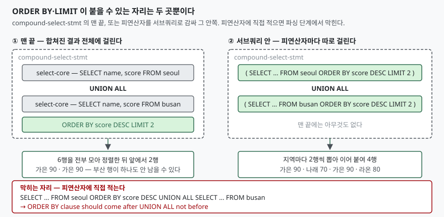

<!-- related:start -->
> **같은 기능을 다른 환경에서 다룬 글** (`union-compound-select`)
> - [UNION과 UNION ALL — 중복 제거 비용](../2026-09-28-union-vs-union-all/index.md) — SQLite 3.49.1, Python 3.13.5, Windows 11
<!-- related:end -->

## 들어가며

서울 지점과 부산 지점의 점수표가 따로 있다. 두 지점을 합쳐 상위 두 명을 뽑아
달라는 요청이 오면 `UNION ALL`을 쓰고 `ORDER BY score DESC LIMIT 2`를 붙이면
된다. 여기까지는 막힘이 없다.

문제는 다음 요청이다. "지점**마다** 상위 두 명씩, 그러니까 네 명." 같은
질의에서 `LIMIT 2`만 옮기면 될 것 같아 왼쪽 `SELECT` 끝에 붙여 보면 이런 메시지가
나온다.

```text
LIMIT clause should come after UNION ALL not before
```

그러면 보통 두 갈래로 간다. 질의를 지점마다 하나씩 나눠 두 번 날린 뒤
애플리케이션에서 이어 붙이거나, 전체를 받아 와서 코드에서 지점별로 세 보고
자르거나. 앞쪽은 지점이 늘어날 때마다 왕복이 같이 늘고, 뒤쪽은 **상위 두 명을
얻으려고 전부 가져오는** 일이 된다. 지점이 다섯 개면 행 수가 다섯 배가 되는데
버릴 행이 그만큼이다.

이건 문법의 심술이 아니다. `ORDER BY`와 `LIMIT`이 **무엇에 걸리는 절인지**가
정해져 있고, 그 자리가 둘뿐이라서 생기는 일이다. 자리를 알면 지점별 상위 N개도
질의 한 번으로 끝난다.

## 개념 — 합성 SELECT는 하나의 문장이다

`UNION`, `UNION ALL`, `INTERSECT`, `EXCEPT`로 이어 붙인 질의를 **합성
SELECT**(compound SELECT)라고 부른다. 이때 이어지는 각각은 완전한 문장이 아니라
**단순 SELECT**(simple SELECT)이고, 이 둘은 문법에서 아예 다른 것으로 정의된다.

SQLite 문서는 이 관계를 한 문장으로 못 박는다. 합성 SELECT의 구성 요소는 단순
SELECT여야 하므로 "`ORDER BY`나 `LIMIT` 절을 가질 수 없다"는 것이다. 그리고
이어서 이 두 절은 "합성 SELECT 전체의 맨 끝에만" 올 수 있다고 적는다.

그러니 `ORDER BY`와 `LIMIT`은 **지점별 표를 다루는 절이 아니라 합쳐진 결과
하나를 다루는 절**이다. 위의 에러 메시지는 "순서가 틀렸다"는 뜻이 아니라
"그 자리에 올 수 있는 절이 아니다"는 뜻에 가깝다.

용어를 하나 정해 두면 뒤가 쉽다. `UNION ALL` 좌우에 놓인 각각의 `SELECT`를
**피연산자**라고 부르겠다. 더하기의 좌변·우변과 같은 자리다.

## 구조



> **출처**: [SQLite — Compound Select Statements](https://www.sqlite.org/lang_select.html#compound_select_statements), [SQLite — The LIMIT clause](https://www.sqlite.org/lang_select.html#the_limit_clause)

자리는 둘뿐이다. 하나는 합성 SELECT의 **맨 끝**이고, 다른 하나는 피연산자를
**서브쿼리로 감싼 그 안쪽**이다. 서브쿼리 안은 그 자체로 독립된 단순 SELECT라
`ORDER BY`도 `LIMIT`도 자유롭게 쓸 수 있다. 피연산자 자리에 직접 적는 길만 막혀
있는 것이고, 괄호 하나를 치면 그 제약 밖으로 나간다.

## 동작 원리

### 맨 끝의 LIMIT은 합쳐진 뒤의 행을 센다

문서는 `LIMIT`에 대해 "합성 SELECT에서 LIMIT은 마지막 SELECT가 아니라 합성 전체에
적용된다"고 분명히 적는다. 실제로 돌려 보면 그 말대로다.

```sql
SELECT name, score FROM seoul
UNION ALL
SELECT name, score FROM busan
ORDER BY score DESC
LIMIT 2
```

```text
  행   : 가은 | 90
  행   : 가은 | 90
  합계 : 2행
```

서울의 가은과 부산의 가은이 나란히 90점이라 상위 2행을 둘이 차지했다. **부산
행이 하나도 안 남을 수 있다**는 점이 여기서 드러난다. 지점별로 고르게 뽑히기를
기대하고 `LIMIT`을 걸었다면 이 결과가 틀린 답이다.

`ORDER BY` 없이 `LIMIT`만 건 경우는 더 조심해야 한다. 문서는 `ORDER BY` 절이
없으면 "행이 반환되는 순서는 정의되어 있지 않다"고 적는다. 예제에서 `UNION ALL`과
`UNION`이 둘 다 같은 5행을 냈지만, 그 5행이 **그 5행이어야 할 이유는 없다.**
`LIMIT`을 쓰면서 `ORDER BY`를 생략하면 어느 행이 잘릴지를 엔진에 맡기는 셈이다.

### ORDER BY 항은 출력 컬럼으로만 해석된다

합성 SELECT의 `ORDER BY`에는 아무 표현식이나 쓸 수 없다. 문서는 단순
SELECT라면 "ORDER BY가 임의의 표현식을 담을 수 있다"고 하면서, 합성 SELECT의
경우에는 출력 컬럼의 별칭이 아닌 표현식은 **출력 컬럼으로 쓰인 표현식과 정확히
같아야 한다**는 조건을 단다.

그래서 결과에 없는 소스 컬럼으로 정렬하려 하면 막힌다.

```sql
SELECT name FROM seoul
UNION ALL
SELECT name FROM busan
ORDER BY score
```

```text
  에러 : OperationalError: 1st ORDER BY term does not match any column in the result set
```

단순 SELECT 하나였다면 통했을 질의다. 합치고 나면 `score`는 더 이상 어느
표에서 온 컬럼이 아니라 **없는 출력 컬럼**이다. 표현식도 같다. 출력에
`score`만 있는데 `ORDER BY score * -1`을 쓰면 같은 에러가 난다. 반대로 출력
컬럼 자리에도 `score * -1`을 적어 두면 글자가 일치해 통과한다.

여기서 예상과 어긋난 것이 하나 있었다. **별칭을 오른쪽 피연산자에만 붙여도
정렬이 된다.**

```sql
SELECT name, score FROM seoul
UNION ALL
SELECT name AS who, score FROM busan
ORDER BY who
```

결과 컬럼 이름은 왼쪽 `SELECT`에서 오므로 `who`라는 이름은 결과 어디에도 없는데,
질의는 성공하고 이름순으로 정렬된다. 문서에 근거가 있다. 합성 SELECT에서
`ORDER BY` 항이 정수가 아니면 SQLite는 **가장 왼쪽 `SELECT`의 결과 컬럼부터
찾고, 없으면 오른쪽으로 하나씩 옮겨 가며 찾는다.** 어느 한쪽에서라도 맞으면
그 컬럼의 별칭으로 취급한다. 항마다 따로 처리되므로, 한 `ORDER BY`의 서로 다른
항이 서로 다른 `SELECT`에서 매칭될 수도 있다.

읽는 사람 입장에서는 함정이다. 오른쪽에만 있는 이름으로 정렬하는 질의는
**결과 헤더에 없는 이름으로 정렬하는 질의**라서, 나중에 보면 어느 컬럼인지
추적하기 어렵다. 통한다고 해서 쓸 일은 아니다.

### 정렬은 합친 다음이 아니라 피연산자마다 일어난다

실행계획을 보면 `UNION ALL`에 `ORDER BY`를 건 질의가 안에서 무엇을 하는지 보인다.

```text
QUERY PLAN
`--MERGE (UNION ALL)
   |--LEFT
   |  |--SCAN seoul
   |  `--USE TEMP B-TREE FOR ORDER BY
   `--RIGHT
      |--SCAN busan
      `--USE TEMP B-TREE FOR ORDER BY
```

이어 붙인 뒤 한 번 정렬하는 것이 아니라 **양쪽을 각각 정렬해 놓고
병합**한다(`MERGE`). 각 피연산자 아래에 `USE TEMP B-TREE FOR ORDER BY`가 하나씩
붙어 있다. 정렬 작업이 전체에 한 번이 아니라 피연산자 수만큼 생긴다는 뜻이다.

중복 제거가 붙으면 모양이 달라진다.

```text
QUERY PLAN
`--COMPOUND QUERY
   |--LEFT-MOST SUBQUERY
   |  `--SCAN seoul
   `--UNION USING TEMP B-TREE
      `--SCAN busan
```

이쪽에는 `MERGE`도 `ORDER BY`용 임시 B-Tree도 없다. 대신 `UNION USING TEMP
B-TREE` 한 줄이 양쪽을 받아 같은 행을 지운다. 정렬을 요구하지 않았으니 정렬은
안 하고, 중복을 지우기 위한 자료구조만 세운 것이다. 앞 글
[UNION과 UNION ALL — 중복 제거 비용](../2026-09-28-union-vs-union-all/index.md)에서
잰 `UNION`의 추가 비용이 이 한 줄에서 나온다.

## 실습 예제

전체 소스는 [code/set_operation_scope.py](code/set_operation_scope.py)에 있다.
돌린 기록은 [code/output.txt](code/output.txt)에 그대로 있다. 표는 지점마다
이름·점수 두 컬럼이고, **부산에도 `가은 90`을 넣어 두었다.** `UNION`과
`UNION ALL`의 차이가 드러나게 하려는 것이다.

지점별 상위 두 명은 피연산자를 서브쿼리로 감싸면 된다.

```sql
SELECT * FROM (SELECT name, score FROM seoul ORDER BY score DESC LIMIT 2)
UNION ALL
SELECT * FROM (SELECT name, score FROM busan ORDER BY score DESC LIMIT 2)
```

```text
  행   : 가은 | 90
  행   : 나래 | 70
  행   : 가은 | 90
  행   : 라온 | 80
  합계 : 4행
```

서울에서 둘, 부산에서 둘이 나왔다. 앞의 `LIMIT 2`가 2행을 돌려준 것과 비교하면
같은 숫자 2가 전혀 다른 일을 한 셈이다.

여기에 전체 정렬을 더하고 싶으면 **맨 끝에 `ORDER BY`를 또 쓴다.** 서브쿼리
안쪽의 `ORDER BY`는 각 지점에서 누가 뽑히는지를 정하고, 바깥의 `ORDER BY`는
뽑힌 넷을 어떤 순서로 줄 세울지를 정한다. 역할이 겹치지 않는다.

```sql
SELECT * FROM (SELECT name, score FROM seoul ORDER BY score DESC LIMIT 2)
UNION ALL
SELECT * FROM (SELECT name, score FROM busan ORDER BY score DESC LIMIT 2)
ORDER BY score DESC
```

```text
  행   : 가은 | 90
  행   : 가은 | 90
  행   : 라온 | 80
  행   : 나래 | 70
  합계 : 4행
```

실행계획을 보면 서브쿼리가 각각 코루틴으로 돌아가고, 그 안에서 지점별 정렬이
일어난다.

```text
QUERY PLAN
`--COMPOUND QUERY
   |--LEFT-MOST SUBQUERY
   |  |--CO-ROUTINE (subquery-1)
   |  |  |--SCAN seoul
   |  |  `--USE TEMP B-TREE FOR ORDER BY
   |  `--SCAN (subquery-1)
   `--UNION ALL
      |--CO-ROUTINE (subquery-3)
      |  |--SCAN busan
      |  `--USE TEMP B-TREE FOR ORDER BY
      `--SCAN (subquery-3)
```

## 실무에서 주의할 점

**`LIMIT`에 콤마를 쓰면 앞이 `OFFSET`이다.** `LIMIT 2, 3`은 "2개를 건너뛰고
3개"라는 뜻이라 `LIMIT 2 OFFSET 2`와 다르다. 예제에서 각각 2행과 3행이 나왔다.
SQLite 문서도 이 형식이 "직관에 반한다"고 적으면서, 다른 DB와의 호환 때문에
일부러 순서를 뒤집었다고 밝히고 `OFFSET` 키워드를 쓰는 쪽을 권한다. 숫자 두
개를 콤마로 붙여 쓰는 코드를 보면 어느 쪽이 개수인지 세 보고 넘어가는 편이 낫다.

**`ORDER BY` 없는 `LIMIT`은 어느 행이 잘릴지를 정하지 않는다.** 합성 SELECT는
안에서 병합이든 임시 B-Tree든 거치므로 피연산자에 넣은 순서가 그대로 나온다는
보장이 없다. 페이지를 넘기는 화면에서 이렇게 쓰면 같은 행이 두 쪽에 나오거나
어느 쪽에도 안 나오는 일이 생긴다. `LIMIT`을 쓸 거면 **순서가 유일하게 정해지는
`ORDER BY`를 같이 쓴다** — 동점이 있으면 기본키까지 덧붙인다. 문서도 모든
`ORDER BY` 식이 같은 두 행의 순서는 정의되어 있지 않다고 적는다.

**서브쿼리로 감싸는 방식은 피연산자 수만큼 정렬이 생긴다.** 위 실행계획에
`USE TEMP B-TREE FOR ORDER BY`가 두 번 나온 것이 그것이다. 지점이 열 곳이면 열
번이다. 지점 수가 많고 각 지점의 행이 많으면, 지점별 상위 N개는 윈도 함수
(`ROW_NUMBER() OVER (PARTITION BY ...)`)로 한 번에 푸는 쪽이 읽기도 낫다.
SQLite는 3.25.0부터 윈도 함수를 지원한다. 다만 합성 SELECT 방식은 지점마다
대상 표가 아예 다를 때(표가 분리돼 있을 때)도 쓸 수 있어서 쓸모가 남는다.

**`INTERSECT`와 `EXCEPT`도 같은 규칙을 받는다.** 자리 제약은 연산자 종류와
무관하게 합성 SELECT 전체에 걸린 것이라, `EXCEPT` 질의에 `LIMIT`을 붙여도 그것은
차집합 결과 전체를 자른다. 그리고 셋 이상을 이어 붙이면 문서가 적는 대로 왼쪽부터
묶인다 — `A op B op C`는 `((A op B) op C)`다. `EXCEPT` 뒤에 `UNION`을 붙여 쓰면
앞의 차집합이 먼저 끝난 뒤 합쳐진다.

## 정리

- `ORDER BY`와 `LIMIT`은 합성 SELECT **전체**에 걸리는 절이다. 피연산자에
  직접 적으면 파싱 단계에서 막힌다
- 피연산자마다 걸고 싶으면 **서브쿼리로 감싼다.** 괄호 안은 독립된 단순
  SELECT라 제약을 받지 않는다
- 합성 SELECT의 `ORDER BY` 항은 출력 컬럼 번호, 출력 컬럼의 별칭, 또는 출력
  컬럼과 글자까지 같은 표현식만 된다. 결과에 없는 소스 컬럼은 에러다
- 별칭은 왼쪽 `SELECT`부터 오른쪽으로 찾으므로 오른쪽에만 붙인 별칭으로도
  정렬이 되지만, 결과 헤더에 없는 이름이라 읽기 나쁘다
- `LIMIT 2, 3`의 앞 숫자는 `OFFSET`이다. `OFFSET` 키워드를 쓰는 쪽이 안전하다

## 참고 자료

- [SQLite — Compound Select Statements](https://www.sqlite.org/lang_select.html#compound_select_statements)
- [SQLite — The ORDER BY clause](https://www.sqlite.org/lang_select.html#the_order_by_clause)
- [SQLite — The LIMIT clause](https://www.sqlite.org/lang_select.html#the_limit_clause)
- [SQLite — EXPLAIN QUERY PLAN](https://www.sqlite.org/eqp.html)
- [SQLite — Window Functions](https://www.sqlite.org/windowfunctions.html)
