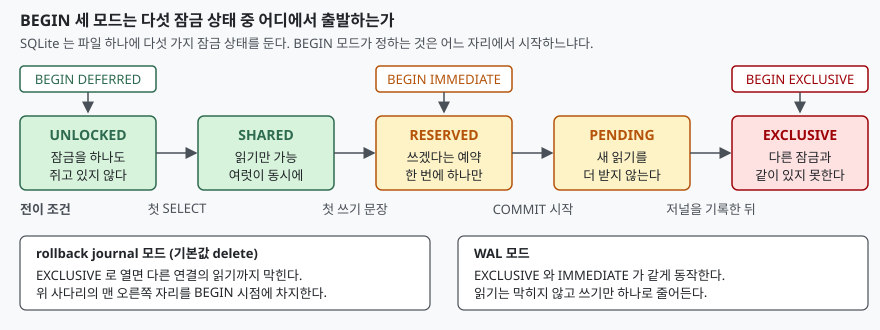

## 들어가며

혼자 쓰는 작은 도구를 SQLite 로 만들어 두면 한동안은 아무 문제가 없다. 그러다
백업 스크립트를 따로 돌리거나, 같은 파일을 보는 웹 화면을 하나 더 띄우거나,
작업을 스레드 둘로 나누는 순간 `database is locked` 가 뜨기 시작한다.

처음 받는 대응은 대개 비슷하다. 재시도 루프를 감거나, `timeout` 을 5초에서
30초로 늘리거나, 그래도 안 되면 트랜잭션을 아예 쓰지 않는다. 셋 다 증상만
미룬다. 30초 기다렸다 같은 오류를 받으면 사용자는 30초를 버린 셈이고,
트랜잭션을 걷어내면 중간에 끊긴 쓰기가 반쯤 반영된 채 남는다.

그런데 `BEGIN` 에는 모드가 세 개 있다. 기본값인 `DEFERRED` 를 그냥 쓰고 있었다면,
언제 잠금을 잡을지를 아직 한 번도 고른 적이 없다는 뜻이다. 이 글은 세 모드를
같은 상황에 놓고 `SQLITE_BUSY` 가 **어느 문장에서** 나는지를 대조한다.

## 개념

### 트랜잭션과 잠금은 다른 것이다

트랜잭션은 "여기부터 여기까지를 한 덩어리로 친다"는 선언이다. 잠금은 "그 덩어리가
도는 동안 남이 끼어들지 못하게 막는다"는 실행 수단이다. 선언을 한 시점과
수단을 쓰기 시작한 시점이 같을 필요는 없고, SQLite 는 실제로 둘을 떼어 놓았다.

`BEGIN` 모드란 **둘 사이의 간격을 얼마로 둘지** 고르는 것이다.

| 모드 | BEGIN 시점에 잡는 것 | 이름의 뜻 |
|---|---|---|
| `DEFERRED` (기본값) | 아무것도 안 잡는다 | 잠금 획득을 미룬다(defer) |
| `IMMEDIATE` | 쓰기 자리를 바로 잡는다 | 즉시(immediate) 잡는다 |
| `EXCLUSIVE` | 쓰기 자리를 바로 잡고, 저널 모드에 따라 읽기까지 막는다 | 독점(exclusive) |

공식 문서는 기본값을 이렇게 못 박는다 — "The default transaction behavior is
DEFERRED."

### 다섯 가지 잠금 상태

SQLite 는 데이터베이스 파일 하나에 대해 다섯 가지 잠금 상태를 정의한다.
`UNLOCKED` · `SHARED` · `RESERVED` · `PENDING` · `EXCLUSIVE` 다.
여기서 중요한 것은 개수가 아니라 **공존 규칙**이다.

- `SHARED` 는 여럿이 동시에 쥘 수 있다. 읽기끼리는 서로를 막지 않는다
- `RESERVED` 는 한 번에 하나만 존재한다. 다만 `SHARED` 와는 같이 있을 수 있다 —
  누군가 쓰겠다고 예약해 둔 동안에도 읽기는 계속 돈다
- `EXCLUSIVE` 는 다른 어떤 잠금과도 같이 있지 못한다

`PENDING` 은 머무는 자리가 아니라 지나가는 자리다. 쓰려는 쪽이 `RESERVED` 에서
`EXCLUSIVE` 로 올라가려면 기존 독자들이 다 빠져야 하는데, 그동안 새 독자가 계속
들어오면 영원히 못 올라간다. `PENDING` 은 "새 읽기는 이제 그만 받는다"는 표시이고,
그래서 쓰기가 굶지 않는다.

## 구조



> **출처**: [SQLite — File Locking And Concurrency, §3.0 Locking / §7.0 Transaction Control At The SQL Level](https://www.sqlite.org/lockingv3.html), [SQLite — BEGIN TRANSACTION, §2.2 DEFERRED, IMMEDIATE, and EXCLUSIVE transactions](https://www.sqlite.org/lang_transaction.html)

사다리의 오른쪽으로 갈수록 다른 연결이 할 수 있는 일이 줄어든다.
세 모드의 차이는 **이 사다리의 몇 번째 칸에서 출발하느냐** 하나뿐이다.

## 동작 원리

### DEFERRED — BEGIN 은 아무 일도 하지 않는다

`BEGIN` 을 쳐도 잠금은 걸리지 않는다. 문서의 설명이 직설적이다 — "DEFERRED means
that the transaction does not actually start until the database is first accessed."

그래서 첫 문장이 무엇이냐에 따라 트랜잭션의 성격이 갈린다.

- 첫 문장이 `SELECT` 면 읽기 트랜잭션으로 시작한다 (`SHARED`)
- 첫 문장이 쓰기면 쓰기 트랜잭션으로 시작한다 (`RESERVED`)

읽기로 시작한 뒤 나중에 쓰려고 하면 그 자리에서 승급을 시도한다. 그 사이 다른
연결이 쓰기 자리를 가져갔으면 승급이 실패하고, 문서가 적은 대로 `SQLITE_BUSY` 가
돌아온다.

### IMMEDIATE — 자리부터 잡고 시작한다

`BEGIN IMMEDIATE` 는 쓰기 문장을 기다리지 않고 바로 쓰기 트랜잭션을 연다.
그 대신 **실패가 BEGIN 으로 앞당겨진다.** 다른 연결이 이미 쓰기 트랜잭션을 열어
두었으면 `BEGIN IMMEDIATE` 자체가 `SQLITE_BUSY` 로 떨어진다.

실패 시점이 앞으로 당겨지는 것은 손해가 아니다. 뒤에서 다시 본다.

### EXCLUSIVE — 저널 모드에 따라 의미가 갈린다

`EXCLUSIVE` 는 쓰기 트랜잭션을 즉시 연다는 점에서 `IMMEDIATE` 와 같다.
다른 점은 읽기를 막느냐다. 공식 문서는 WAL 모드에서 둘이 같아진다고 적고 있고,
다른 저널 모드에서는 `EXCLUSIVE` 가 다른 연결의 읽기까지 막는다고 적는다.

그러니 WAL 모드로 돌리는 데이터베이스에서 `BEGIN EXCLUSIVE` 를 쓰는 것은
`BEGIN IMMEDIATE` 를 쓰는 것과 같다. 더 강하게 잠근다고 믿고 쓰면 그 믿음만 틀린다.

## 실습 예제

연결 두 개를 열어 두고, A 가 트랜잭션을 연 동안 B 가 무엇을 할 수 있는지 본다.
`timeout=0` 을 준 이유는, 기본값인 5초로 두면 B 가 기다리다 성공해 버려서
"잠금을 잡았다"는 사실 자체가 출력에 안 나타나기 때문이다.

```python
def open_connection() -> sqlite3.Connection:
    return sqlite3.connect(DB_PATH, timeout=0, isolation_level=None)


def attempt(who: str, conn: sqlite3.Connection, sql: str) -> None:
    """한 문장을 실행하고 통과했는지 어떤 오류로 막혔는지 한 줄로 찍는다."""
    label = f"  {who}: {sql}"
    try:
        conn.execute(sql)
    except sqlite3.Error as exc:
        print(f"{label}\n       -> {type(exc).__name__}: {exc}")
    else:
        print(f"{label}\n       -> OK")
```

`isolation_level=None` 이 필요하다. 파이썬 `sqlite3` 모듈은 기본적으로 트랜잭션을
자기가 관리해서 `BEGIN` 을 몰래 끼워 넣는데, 그러면 우리가 친 `BEGIN DEFERRED` 와
섞인다. `None` 으로 두면 우리가 친 문장만 그대로 간다.

전체 소스: [`code/`](code/) · 아래 출력은 전부 돌린 기록인
[code/output.txt](code/output.txt)에서 가져왔다.

### 1. DEFERRED 는 정말 아무것도 안 잡는다

```text
  A: BEGIN DEFERRED
       -> OK
  B: UPDATE account SET balance = balance - 1 WHERE id = 3
       -> OK
       (A 가 아직 아무 문장도 안 돌렸으므로 B 의 쓰기가 통과한다)
  A: SELECT SUM(balance) FROM account
       -> OK
  B: UPDATE account SET balance = balance - 1 WHERE id = 3
       -> OperationalError: database is locked
  A: COMMIT
       -> OK
```

같은 `UPDATE` 가 한 번은 통과하고 한 번은 막혔다. 그 사이에 바뀐 것은
A 가 `SELECT` 를 한 번 돌렸다는 사실뿐이다. `BEGIN` 이 아니라 **첫 문장**이
잠금을 건다는 말이 이 네 줄에 다 들어 있다.

### 2. 읽다가 쓰려고 올라가는 순간 막힌다

```text
  A: BEGIN DEFERRED
       -> OK
  A: SELECT balance FROM account WHERE id = 1
       -> OK
  B: BEGIN IMMEDIATE
       -> OK
  A: UPDATE account SET balance = balance + 1 WHERE id = 1
       -> OperationalError: database is locked
```

A 가 먼저 트랜잭션을 열었는데 막힌 쪽은 A 다. A 는 `SELECT` 로 시작해 `SHARED` 만
쥐고 있었고, `SHARED` 와 `RESERVED` 는 공존할 수 있으므로 B 의 `BEGIN IMMEDIATE`
가 통과했다. 그 뒤 A 가 쓰려고 하자 올라갈 자리가 이미 없다.

**먼저 시작했다고 먼저 쓰는 것이 아니다.** 읽고 나서 그 값을 보고 쓰는 코드
— 잔액을 읽어 검사한 뒤 차감하는 식 — 이 전부 이 모양에 놓인다.

### 3. IMMEDIATE 는 실패를 BEGIN 으로 앞당긴다

```text
  A: BEGIN IMMEDIATE
       -> OK
  B: SELECT COUNT(*) FROM account
       -> OK
  B: BEGIN IMMEDIATE
       -> OperationalError: database is locked
  B: UPDATE account SET balance = 0 WHERE id = 2
       -> OperationalError: database is locked
```

B 의 읽기는 통과한다. `RESERVED` 가 `SHARED` 를 막지 않기 때문이다.
B 의 `BEGIN IMMEDIATE` 는 그 자리에서 막힌다. 2번 시나리오와 비교하면 차이가
분명하다 — 거기서는 읽기를 다 하고 계산까지 마친 뒤에 막혔고, 여기서는
한 줄도 읽기 전에 막혔다. **버릴 일을 덜 하고 막혔다.**

### 4. EXCLUSIVE 는 읽기까지 막는다

```text
  A: BEGIN EXCLUSIVE
       -> OK
  B: SELECT COUNT(*) FROM account
       -> OperationalError: database is locked
  A: COMMIT
       -> OK
  B: SELECT COUNT(*) FROM account
       -> OK
```

A 가 커밋하자마자 B 의 같은 `SELECT` 가 통과한다. 막혀 있던 것이 데이터가 아니라
잠금이었다는 확인이다.

### 5. 같은 EXCLUSIVE 를 WAL 모드에서

예상과 달랐던 자리는 여기다. 같은 문장을 `journal_mode = WAL` 에서 돌리면
결과가 뒤집힌다.

```text
  journal_mode -> wal
  A: BEGIN EXCLUSIVE
       -> OK
  B: SELECT COUNT(*) FROM account
       -> OK
  B: UPDATE account SET balance = 0 WHERE id = 2
       -> OperationalError: database is locked
  A: COMMIT
       -> OK
```

4번에서 막혔던 B 의 `SELECT` 가 통과한다. 문장도, 순서도, 데이터도 같은데
`PRAGMA journal_mode` 한 줄이 달라졌을 뿐이다. 막히는 것은 쓰기뿐이므로
`BEGIN IMMEDIATE` 와 구분되지 않는다.

**`BEGIN EXCLUSIVE` 를 썼다는 사실만으로 읽기가 막혀 있다고 가정하면 안 된다.**
그 가정이 맞는지는 저널 모드가 정한다.

## 실무에서 주의할 점

### 읽고 나서 쓰는 트랜잭션은 IMMEDIATE 로 연다

잔액을 읽어 검사하고 차감하는 코드, 재고를 세고 빼는 코드, 버전을 읽고 올리는
코드가 전부 여기 해당한다. `DEFERRED` 로 열면 2번 시나리오처럼 **읽기를 다 마치고
판단까지 끝낸 다음에** 막힌다. 그때까지 한 일은 전부 버린다.

`BEGIN IMMEDIATE` 로 열면 쓸 자리가 있는지를 먼저 확인하고 들어간다.
재시도를 걸어도 되돌릴 것이 없어 로직이 단순해진다.

반대로 **읽기만 하는 트랜잭션은 `DEFERRED` 가 맞다.** 쓰기 자리를 잡아 둘 이유가
없고, `IMMEDIATE` 로 열면 다른 쓰기를 공연히 막는다.

### timeout 을 늘리는 것은 해결이 아니다

파이썬 `sqlite3` 의 `timeout`(기본 5초)은 `SQLITE_BUSY` 를 만났을 때 기다리는
시간이다. 상대가 그 안에 커밋하면 통과하고, 아니면 같은 오류가 난다.

문제는 2번 시나리오 같은 경우에 **기다려도 소용이 없다**는 점이다. A 가 `SHARED` 를
쥔 채 승급을 기다리고 B 도 커밋하려면 A 가 빠져야 하면, 둘 다 타임아웃까지 버티다
같이 실패한다. 기다린 시간만큼 늦게 실패하는 것이다. 자리를 먼저 잡고 들어가는
쪽이 맞다.

### WAL 모드에서도 쓰기는 하나뿐이다

WAL 을 "동시성이 좋아진다"로만 기억하면 쓰기도 여럿이 되는 줄 안다. WAL 이
푸는 것은 읽기와 쓰기 사이의 충돌이고, 5번 시나리오가 보이듯 **쓰기끼리는
여전히 하나**다. 쓰기가 몰리는 작업을 스레드로 늘려도 처리량은 그대로다.

### 파이썬의 자동 트랜잭션과 섞지 않는다

`isolation_level` 을 기본값으로 두면 파이썬이 쓰기 문장 앞에 `BEGIN` 을 알아서
넣는다. 거기에 내가 친 `BEGIN IMMEDIATE` 가 겹치면 어느 쪽이 실제로 연 트랜잭션인지
읽는 사람이 알 수 없다. 모드를 직접 고르기로 했다면 `isolation_level=None` 으로
두고 `BEGIN`·`COMMIT`·`ROLLBACK` 을 전부 손으로 친다.

### journal_mode 를 바꾸는 PRAGMA 는 파일을 혼자 잡아야 한다

예제를 쓰다 걸린 자리다. WAL 에서 `delete` 로 되돌리는 `PRAGMA journal_mode`
는 다른 연결이 하나라도 열려 있으면 `database is locked` 로 떨어진다.
저널 모드 전환은 애플리케이션이 뜰 때 한 번만 하고, 도는 중에는 건드리지 않는다.

## 정리

- `BEGIN` 모드는 트랜잭션 선언과 잠금 획득 **사이의 간격**을 고르는 것이다
- `DEFERRED` 는 `BEGIN` 에서 아무것도 안 잡는다. 첫 문장이 `SELECT` 면 읽기로
  시작하고, 나중에 쓰려 할 때 승급이 막히면 거기서 `SQLITE_BUSY` 가 난다
- `IMMEDIATE` 는 `BEGIN` 에서 쓰기 자리를 잡는다. 실패가 앞당겨지므로
  **읽고 나서 쓰는 트랜잭션은 이쪽이 맞다**
- `EXCLUSIVE` 가 읽기까지 막는 것은 rollback journal 모드에서다.
  WAL 모드에서는 `IMMEDIATE` 와 같게 동작한다
- `timeout` 을 늘리는 것은 실패 시각을 뒤로 미룰 뿐이다. 잠금을 언제 잡을지를
  고르는 쪽이 먼저다

## 참고 자료

- [SQLite — BEGIN TRANSACTION (§2.2 DEFERRED, IMMEDIATE, and EXCLUSIVE transactions)](https://www.sqlite.org/lang_transaction.html)
- [SQLite — File Locking And Concurrency In SQLite Version 3 (§3.0 Locking, §7.0 Transaction Control At The SQL Level)](https://www.sqlite.org/lockingv3.html)
- [SQLite — Write-Ahead Logging (§9 Sometimes Queries Return SQLITE_BUSY In WAL Mode)](https://www.sqlite.org/wal.html)
- [Python 문서 — sqlite3 Transaction control](https://docs.python.org/3/library/sqlite3.html#sqlite3-controlling-transactions)
