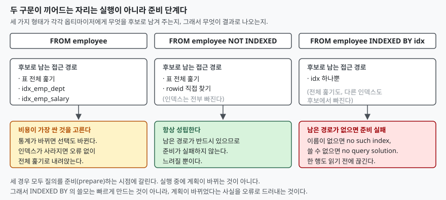

## 들어가며

운영 중인 서비스에서 한 화면만 유독 느려졌다고 연락이 온다. 어제까지는 멀쩡했고,
그 사이에 바뀐 것은 다른 팀이 올린 스키마 마이그레이션 한 건뿐이다. 로그를 보면
질의문 자체는 그대로다. 그래서 보통은 질의를 복사해 개발 DB에 붙여 넣고,
실행 계획을 눈으로 비교하는 일부터 시작한다.

문제는 이 확인이 **사람이 눈치챈 뒤에야** 시작된다는 데 있다. 인덱스가 하나
사라져도 SQL은 오류를 내지 않는다. 조용히 표 전체를 훑는 계획으로 내려앉고,
2만 행짜리 표에서는 그 차이가 체감되지도 않는다. 행이 2천만 행이 된 어느 날,
혹은 동시 접속이 몰린 어느 저녁에야 드러난다. 그때까지 몇 주가 지나 있고,
원인이 된 마이그레이션은 이미 기억에서 멀어져 있다.

SQLite에는 이 틈을 메우라고 만든 구문이 둘 있다. `INDEXED BY`와 `NOT INDEXED`다.

## 개념

둘 다 `FROM` 절의 표 이름 뒤에 붙어, 그 표에 접근할 때 **인덱스를 쓸 수 있는
범위를 제한한다.** `SELECT`·`UPDATE`·`DELETE`에 붙일 수 있다.

```sql
SELECT COUNT(*) FROM employee NOT INDEXED              WHERE dept = '영업';
SELECT COUNT(*) FROM employee INDEXED BY idx_emp_dept  WHERE dept = '영업';
```

`NOT INDEXED`는 그 표에 인덱스를 하나도 쓰지 말라는 뜻이다. `UNIQUE`나
`PRIMARY KEY` 제약 때문에 자동으로 생긴 인덱스까지 포함한다. 다만 rowid로
직접 찾아가는 경로는 남는다 — 공식 문서가 "rowid는 `NOT INDEXED`가 지정돼도
항목을 찾는 데 쓰일 수 있다"고 밝히고 있다.

`INDEXED BY idx`는 **그 인덱스 하나만** 후보로 남긴다. 표 전체 훑기도,
다른 인덱스도 후보에서 빠진다. 이름이 비슷해서 오해하기 쉬운데, 이것은
"가능하면 이 인덱스를 써 달라"는 권유가 아니다. 공식 문서의 표현대로
**옵티마이저에게 어느 인덱스를 쓸지 요구 사항으로 준다.** 요구를 못 맞추면
질의는 실패한다.

## 구조



> **출처**: [SQLite — The INDEXED BY clause, §1 How INDEXED BY Works](https://www.sqlite.org/lang_indexedby.html)

세 경우 모두 갈리는 지점은 질의를 **준비(prepare)하는 시점**이다. 실행이 시작된
뒤에 계획이 바뀌는 것이 아니라, 문장을 컴파일하면서 쓸 수 있는 접근 경로를 추리고
그중 하나를 고정한다. `INDEXED BY`가 오류를 내는 자리도 여기다. 한 행도 읽기 전에
끊기므로, 잘못된 계획으로 오래 돌다가 멈추는 일이 없다.

## 동작 원리

예제는 2만 행짜리 `employee` 표에 부서 인덱스와 급여 인덱스를 하나씩 둔다.
질의는 둘 다 쓸 수 있는 모양이다.

```sql
SELECT COUNT(*) FROM employee WHERE dept = '영업' AND salary > 8000;
```

수행량은 파이썬 `sqlite3`의 진행 콜백을 1스텝마다 걸어 **가상머신이 실행한 명령
수**로 셌다. 경과 시간과 달리 기계 상태에 흔들리지 않아 같은 입력이면 같은 값이
나온다. 결과(816행)는 네 경우 모두 같다.

| 쓴 구문 | 계획 (`EXPLAIN QUERY PLAN`의 `detail`) | 스텝 |
|---|---|---|
| 지정 없음 | `SEARCH employee USING INDEX idx_emp_dept (dept=?)` | 25,909 |
| `NOT INDEXED` | `SCAN employee` | 70,862 |
| `INDEXED BY idx_emp_dept` | `SEARCH employee USING INDEX idx_emp_dept (dept=?)` | 25,912 |
| `INDEXED BY idx_emp_salary` | `SEARCH employee USING INDEX idx_emp_salary (salary>?)` | 13,740 |

여기서 지정 없이 둔 쪽이 가장 싼 선택을 못 했다. 부서 인덱스를 골랐는데,
급여 인덱스를 쓰면 스텝이 절반 가까이로 줄어든다. 두 조건이 각각 남기는 행 수가
다르기 때문이다 — `dept = '영업'`은 5,016행을 남기고, `salary > 8000`은
3,227행을 남긴다(둘 다 적용하면 816행). 좁게 거르는 쪽을 먼저 타는 편이 싸다.
옵티마이저가 이것을 모르는 이유는 **통계가 없어서**다. `ANALYZE`를 돌려 보면
그대로 드러난다.

| 쓴 구문 | `ANALYZE` 뒤 계획 | 스텝 |
|---|---|---|
| 지정 없음 | `SEARCH employee USING INDEX idx_emp_salary (salary>?)` | 13,741 |
| `INDEXED BY idx_emp_dept` | `SEARCH employee USING INDEX idx_emp_dept (dept=?)` | 25,912 |

통계가 생기자 지정 없이 둔 쪽은 스스로 더 싼 계획으로 옮겨 갔다. 반면
`INDEXED BY idx_emp_dept`는 그 자리에 그대로 있다. **이것이 이 구문의 성격을
가장 잘 보여 주는 대목이다.** 지정하는 순간 그 계획이 고정되고, 데이터가 바뀌어도
통계가 갱신돼도 따라오지 않는다. 좋은 쪽으로 고정될 수도 있지만, 지금처럼
1.9배 비싼 쪽으로 고정될 수도 있다.

### 못 쓰는 인덱스를 지정하면

두 가지로 갈린다. 이름 자체가 없으면 `no such index`, 이름은 있는데 그 질의에
쓸 수 없으면 `no query solution`이다. 둘 다 준비 단계에서 나는 오류다.

조심할 것은 **"조건과 상관없는 인덱스"가 여기 해당하지 않는다**는 점이다.

```text
SELECT emp_id FROM employee INDEXED BY idx_emp_salary WHERE dept = '영업'
    SCAN employee USING INDEX idx_emp_salary
```

급여 인덱스는 `dept` 조건을 거르는 데 아무 도움이 안 되지만, 오류가 나지 않는다.
인덱스를 처음부터 끝까지 훑으면서 행마다 표를 다시 찾아가는 계획이 성립하기
때문이다. 이것은 표를 그냥 훑는 것보다 대개 **더 느리다.** `INDEXED BY`를
써 두고 "오류가 안 났으니 잘 쓰이고 있다"고 읽으면 안 되는 이유다.

실제로 오류가 나는 쪽은 **부분 인덱스**다. `salary > 7000` 조건으로 만든 인덱스에
`salary > 8000`을 물으면, 사람 눈에는 더 좁은 범위라 당연히 쓸 수 있어 보인다.
그런데 결과는 `no query solution`이다.

| 질의 조건 | 지정 없이 둔 계획 |
|---|---|
| `salary > 7000` | `SEARCH employee USING COVERING INDEX idx_emp_high (salary>?)` |
| `salary > 8000` | `SEARCH employee USING COVERING INDEX idx_emp_salary (salary>?)` |

부분 인덱스를 쓰려면 질의의 조건이 인덱스의 조건을 **함의**해야 하는데, SQLite는
이것을 증명할 정리 증명기를 두지 않았다. 공식 문서가 "SQLite는 대수를 하지
않는다"고 못 박고, 항이 글자까지 일치하는 단순한 규칙 둘만 쓴다고 밝힌다.
그래서 `salary > 7000`은 통과하고 `salary > 8000`은 통과하지 못한다.

### 인덱스가 사라진 뒤

처음 이야기로 돌아간다. `idx_emp_dept`를 지우고 같은 질의를 돌리면 이렇게 갈린다.

```text
SELECT COUNT(*) FROM employee WHERE dept = '영업'
    SCAN employee

SELECT COUNT(*) FROM employee INDEXED BY idx_emp_dept WHERE dept = '영업'
    OperationalError: no such index: idx_emp_dept
```

위쪽은 아무 일도 없었던 것처럼 답을 돌려준다. 아래쪽은 그 자리에서 끊긴다.
공식 문서가 밝히는 `INDEXED BY`의 용도가 정확히 이것이다 — **인덱스를 지우거나
만드는 스키마 변경이 계획을 바꿨을 때 런타임 오류를 일으키는 것**,
그리고 회귀 테스트에서 원치 않는 계획 변경을 잡아내는 것.

## 실습 예제

전체 소스: [`code/`](code/) · 수행 기록: [`code/output.txt`](code/output.txt)

```python
def count_steps(conn: sqlite3.Connection, sql: str) -> tuple[int, list]:
    """진행 콜백을 1 스텝마다 걸어 가상머신 명령 수를 센다."""
    counter = [0]

    def tick() -> int:
        counter[0] += 1
        return 0

    conn.set_progress_handler(tick, 1)
    rows = conn.execute(sql).fetchall()
    conn.set_progress_handler(None, 1)
    return counter[0], rows
```

위 표의 숫자는 전부 이 함수가 센 값이다. `output.txt`에 명령·시각·환경과 함께
그대로 들어 있다.

## 실무에서 주의할 점

- **성능을 올리려고 쓰지 않는다.** 공식 문서는 설계·구현·테스트·튜닝 과정에서
  `INDEXED BY` 사용을 전부 빼라고 적고, 쓴다면 설계를 잠그는 개발 막바지에
  넣으라고 권한다. 계획을 유도하고 싶으면 단항 `+` 연산자를 먼저 본다.
- **오류가 안 났다고 인덱스가 제대로 쓰인 것은 아니다.** 위에서 본 것처럼
  엉뚱한 인덱스를 지정해도 전체 인덱스 훑기로 성립한다. 지정한 뒤에는
  `EXPLAIN QUERY PLAN`으로 `SEARCH`인지 `SCAN ... USING INDEX`인지를
  눈으로 확인해야 한다.
- **`ANALYZE`를 먼저 의심한다.** 계획이 이상하면 구문으로 고정하기 전에 통계부터
  본다. 위 예제는 통계 하나로 스텝이 절반 가까이로 줄었다. 구문으로 고정했다면
  그 개선을 영영 못 받았을 것이다.
- **부분 인덱스와 함께 쓰면 조건을 글자까지 맞춘다.** 의미가 더 좁아도
  표현이 다르면 `no query solution`이 난다. 질의를 조금 고치는 순간
  깨질 수 있는 결합이다.
- **다른 DBMS로 옮길 수 없다.** SQLite 전용 확장이라 Oracle의 힌트 주석이나
  MySQL의 `FORCE INDEX`와 문법이 다르다. 성격도 다르다 — 이쪽은 힌트가 아니라
  못 맞추면 실패하는 요구 사항이다.

## 정리

- `NOT INDEXED`는 그 표의 인덱스를 전부 빼고, rowid 경로만 남긴다. 늘 성립하므로
  느려질 뿐 실패하지 않는다.
- `INDEXED BY`는 지정한 인덱스 하나만 후보로 남긴다. 못 맞추면 준비 단계에서
  `no such index` 또는 `no query solution`으로 끊긴다.
- 두 구문 다 질의를 준비하는 시점에 작동한다. 한 행도 읽기 전에 결판난다.
- 지정은 계획을 **고정**한다. 통계가 좋아져도 따라가지 않으므로, 예제에서는
  지정한 쪽이 1.9배 비싼 계획에 묶였다.
- 쓸 자리는 성능 조정이 아니라 회귀 테스트다. 인덱스가 사라진 변경을 조용한
  성능 저하 대신 오류로 받고 싶을 때 쓴다.

## 참고 자료

- [SQLite — The INDEXED BY clause](https://www.sqlite.org/lang_indexedby.html)
- [SQLite — Partial Indexes §3 Queries Using Partial Indexes](https://www.sqlite.org/partialindex.html#queries_using_partial_indexes)
- [SQLite — The ANALYZE command](https://www.sqlite.org/lang_analyze.html)
- [SQLite — EXPLAIN QUERY PLAN](https://www.sqlite.org/eqp.html)
- [Python 문서 — sqlite3.Connection.set_progress_handler](https://docs.python.org/3/library/sqlite3.html#sqlite3.Connection.set_progress_handler)
