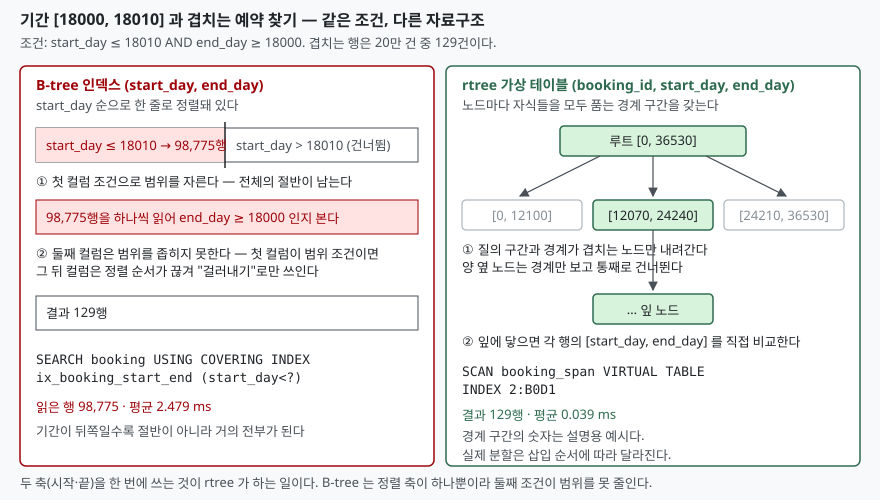

## 들어가며

회의실 예약 기능을 만드는 중이다. 새 예약이 들어오면 같은 방에 이미 잡힌 예약과
기간이 겹치는지 확인해야 한다. 예약 표에는 `start_day`, `end_day` 두 컬럼이 있고,
겹침 조건은 교과서대로 `start_day <= 새 끝 AND end_day >= 새 시작` 으로 적었다.
느리다는 말이 나와 `(start_day, end_day)` 에 복합 인덱스를 걸었더니 처음엔 괜찮았다.

그런데 예약이 20만 건을 넘기자 다시 느려졌다. 인덱스는 분명 타고 있다.
`EXPLAIN QUERY PLAN` 에도 `SEARCH ... USING COVERING INDEX` 라고 나온다.
그래서 대개는 "인덱스를 탔으니 할 만큼 했다"고 넘어가거나, 컬럼 순서를 바꾼 인덱스를
하나 더 만들어 본다. 둘 다 효과가 없다. 조건 두 개가 **서로 다른 컬럼에 걸린 범위
조건**이라서, 한 줄로 정렬된 인덱스로는 어느 쪽을 앞에 두든 한쪽만 범위를 줄이기
때문이다. 이 자리에 쓰라고 SQLite 가 따로 넣어 둔 것이 `rtree` 모듈이다.

## 개념

R-Tree 는 "구간"을 저장하고 **구간이 겹치는 것을 찾는** 자료구조다. SQLite 문서는
이것을 "질의 사각형과 겹치거나 그 안에 든 항목을 빠르게 찾는" 인덱스로 설명한다.
지도에서 화면 안에 들어오는 가게를 찾는 것이 전형적인 쓰임이지만, 1차원이면
**시간 구간**이 된다. 예약 기간, 유효 기간, IP 대역 같은 것들이다.

SQLite 에서는 `CREATE VIRTUAL TABLE ... USING rtree(...)` 로 만든다. 첫 컬럼은
정수 기본키고, 그 뒤로 차원마다 `최소, 최대` 두 컬럼이 온다. 컬럼 수는 3개(1차원)부터
11개(5차원)까지 **홀수**여야 한다.

```sql
CREATE VIRTUAL TABLE booking_span USING rtree(booking_id, start_day, end_day);
INSERT INTO booking_span SELECT booking_id, start_day, end_day FROM booking;
```

가상 테이블이라 보통 표처럼 `INSERT`·`SELECT` 를 쓰지만 **실제 저장은 그림자 표
세 개**가 맡는다. 20만 건을 넣고 세어 보면 이렇다.

```text
[booking_span]  rtree 가상 테이블. 내용은 booking 과 같다 (앞 5행)
  (9600, 0.0, 1.0)
  (130405, 0.0, 2.0)
  ...
  실제 저장은 아래 그림자 표가 맡는다:
    booking_span_node      5,844행
    booking_span_parent    5,843행
    booking_span_rowid   200,000행
```

`_node` 가 트리의 노드, `_parent` 가 노드의 부모, `_rowid` 가 "이 행이 어느 노드에
있는가"다. 문서는 이 표들을 고치면 인덱스가 깨지므로 **없는 셈 치라**고 적는다.
값이 `0.0`, `1.0` 처럼 실수로 돌아오는 것도 눈여겨볼 점인데, 뒤에서 다시 다룬다.

## 구조



> **출처**: [SQLite R*Tree Module §1 Overview](https://www.sqlite.org/rtree.html#overview), [§6.2 The New xQueryFunc Callback — 노드는 경계 상자다](https://www.sqlite.org/rtree.html#the_new_xqueryfunc_callback), [SQLite Query Optimizer Overview §2.1 Index Term Usage Examples](https://www.sqlite.org/optoverview.html#index_term_usage_examples)

## 동작 원리

B-tree 쪽부터 보자. `(start_day, end_day)` 인덱스는 `start_day` 순으로 정렬돼 있고,
`start_day` 가 같을 때만 `end_day` 순이다. 조건 `start_day <= 18010` 은 정렬된 띠의
앞부분을 잘라 준다. 그런데 그 안에서 `end_day >= 18000` 은 아무 순서도 없다.
SQLite 최적화 문서가 적듯 **범위 조건이 걸린 컬럼 뒤의 컬럼은 범위를 더 줄이지
못한다.** 그래서 계획은 `(start_day<?)` 까지만 인덱스를 쓰고, 나머지는 한 행씩 읽어
거른다.

```text
QUERY PLAN
`--SEARCH booking USING COVERING INDEX ix_booking_start_end (start_day<?)
  start_day <= 18010 인 행: 98,775 / 200,000
```

20만 건 중 98,775건을 읽어 129건을 건진다. 찾는 기간이 뒤쪽 날짜일수록 이 비율은
절반이 아니라 거의 전부가 된다.

rtree 는 노드마다 **자식 전체를 품는 경계 구간**을 갖는다. 문서 표현으로는
"트리의 각 노드가 경계 상자"다. 질의 구간 `[18000, 18010]` 과 경계가 겹치지 않는
노드는 그 아래를 통째로 건너뛰고, 겹치는 노드만 내려가 잎에서 행 하나하나를 비교한다.
계획에는 가상 테이블이라 `SCAN` 으로 찍히지만 뒤의 `INDEX 2:B0D1` 이 두 축의 제약을
모두 넘겨받았다는 표시다.

```text
QUERY PLAN
`--SCAN booking_span VIRTUAL TABLE INDEX 2:B0D1
```

같은 129건을 돌려주고 시간은 이렇게 갈린다.

```text
  B-tree  겹치는 예약 129건  평균    2.479 ms
  rtree   겹치는 예약 129건  평균    0.039 ms
```

64배 차이다. 숫자 자체보다 **왜 그런지**가 중요하다. B-tree 는 읽는 행 수가 조건
한쪽에만 비례하고, rtree 는 두 축을 한 번에 써서 겹치는 노드 수에 비례한다.

## 실습 예제

전체 소스: [`code/`](code/) · 수행 기록: [`code/output.txt`](code/output.txt)

rtree 표에는 좌표와 기본키만 있으므로 나머지 컬럼은 본 표와 조인해 가져온다.
문서가 보여 주는 형태 그대로다.

```sql
SELECT b.*
FROM booking_span s JOIN booking b ON b.booking_id = s.booking_id
WHERE s.start_day <= 18010 AND s.end_day >= 18000;
```

이 조인이 이 글에서 **예상과 가장 달랐던 자리**다. 처음엔 rtree 가 바깥 루프를 맡고
본 표를 기본키로 찾아가는, 기대한 모양이 나온다. 그런데 `ANALYZE` 를 한 번 돌리면
계획이 뒤집힌다.

```text
-- ANALYZE 전: JOIN
QUERY PLAN
|--SCAN s VIRTUAL TABLE INDEX 2:B0D1
`--SEARCH b USING INTEGER PRIMARY KEY (rowid=?)
   129건  평균    0.078 ms
-- ANALYZE 후: JOIN
QUERY PLAN
|--SCAN b
`--SCAN s VIRTUAL TABLE INDEX 1:
   129건  평균  227.158 ms
```

`ANALYZE` 뒤에는 **본 표 20만 행을 전부 훑으면서** 행마다 rtree 를 기본키로 찾는다.
rtree 의 범위 제약은 쓰이지도 않는다(`INDEX 1:`). 0.078 ms 가 227 ms 로, 2,900배
느려졌다. 통계를 모으면 더 좋아질 거라는 기대가 정반대로 간 것이다. 통계가 생기면
플래너가 두 표의 비용을 새로 견주는데, 이때 가상 테이블 쪽 비용 추정이 바깥 루프를
맡기에 불리하게 나온 것으로 보인다. 어느 쪽 추정이 어떻게 틀렸는지는 가상 테이블
모듈 내부라 계획만으로는 알 수 없다.

고치는 법은 SQLite 최적화 문서에 있는 그대로다. `CROSS JOIN` 은 **왼쪽 표를 바깥
루프로 고정**한다.

```text
-- ANALYZE 후: CROSS JOIN 으로 순서를 고정
QUERY PLAN
|--SCAN s VIRTUAL TABLE INDEX 2:B0D1
`--SEARCH b USING INTEGER PRIMARY KEY (rowid=?)
   129건  평균    0.162 ms
```

같은 효과를 `WHERE booking_id IN (SELECT booking_id FROM booking_span WHERE ...)`
서브쿼리로도 얻을 수 있다. 확인용 스크립트에서는 두 형태 모두 `ANALYZE` 전후에
같은 계획을 유지했다.

## 실무에서 주의할 점

**첫째, 좌표는 32비트 실수로 저장된다.** 문서는 `rtree` 가 좌표를 32비트 부동소수점으로
저장한다고 적는다. 32비트 실수의 가수부는 24비트라 2^24(16,777,216)을 넘는 정수는
그대로 담기지 않는다. 유닉스 시각(초) 같은 10자리 정수를 넣으면 이렇게 된다.

```text
  넣은 값              rtree 가 돌려준 값                rtree_i32
  16777217~16777219  16777216~16777220  16777217~16777219
  1700000001~1700000002  1700000000~1700000256  1700000001~1700000002
```

1,700,000,001초부터 1,700,000,002초까지 1초짜리 구간이 **256초짜리**가 됐다. 문서가
적은 규칙대로 하한은 내림, 상한은 올림이라 원래 구간을 품는 쪽으로만 틀리므로
**겹침 질의에서 빠뜨리는 행은 없지만 남는 행이 생긴다.** 정수 좌표를 정확히 쓰려면
`rtree_i32` 를 쓴다. 이 글이 날짜를 "일 번호"로 쓴 것도 2^24 안에 들어오게 하려는
선택이다. 초 단위 시각은 `rtree_i32` 에 넣거나 적당한 기준점에서 뺀 값으로 줄인다.

**둘째, 하한이 상한보다 크면 넣을 때 바로 실패한다.** 컬럼 수가 홀수가 아니어도
만들 때 실패한다. 둘 다 조용히 틀어지는 종류가 아니라 에러로 알려 주니 그나마 낫다.

```text
  에러 INSERT INTO span_f32 VALUES (9, 5, 3)
       rtree constraint failed: span_f32.(lo<=hi)
  에러 CREATE VIRTUAL TABLE bad USING rtree(id, lo, hi, extra)
       Wrong number of columns for an rtree table
```

**셋째, 쓰기는 B-tree 인덱스보다 비싸다.** 같은 20만 건을 넣는 데 인덱스가 붙은 보통
표는 0.34초, rtree 는 1.21초가 걸렸다. 노드가 5,844개, 노드 데이터만 4.6 MiB 다.
읽기가 쓰기보다 훨씬 잦은 자리에 쓰는 구조고, 대량 적재는 한 트랜잭션으로 묶는다.

**넷째, rtree 는 정확한 답이 아니라 후보를 줄여 준다.** 문서가 "핵심"이라고 따로 적은
문장이다. 1차원 구간 겹침은 경계 비교가 곧 답이라 차이가 없지만, 2차원 이상에서
"다각형 안에 있는가" 같은 질문은 rtree 가 **경계 상자**로 후보를 수십 건으로 줄인 뒤
정확한 판정은 조인한 본 표나 사용자 함수가 맡는다.

**다섯째, 본 표와 rtree 표의 내용을 같이 맞춰 줘야 한다.** 가상 테이블은 본 표의
인덱스가 아니라 **별개의 표**라서 `INSERT`·`UPDATE`·`DELETE` 를 두 번 하거나
트리거로 묶어야 한다. 한쪽만 고치면 조인 결과가 조용히 어긋난다. `rtreecheck('표이름')`
은 트리 구조의 정합성만 보고, 본 표와 내용이 같은지는 보지 않는다.

## 정리

- 서로 다른 컬럼에 범위 조건이 둘 걸리면 B-tree 인덱스는 첫 컬럼으로만 범위를
  줄인다. 20만 건 중 98,775건을 읽어 129건을 건졌다
- `rtree` 가상 테이블은 노드마다 경계 구간을 두고 겹치는 노드만 내려간다.
  같은 질의가 2.479 ms 에서 0.039 ms 로 줄었다
- `ANALYZE` 뒤 조인 순서가 뒤집혀 2,900배 느려질 수 있다.
  `CROSS JOIN` 으로 rtree 를 바깥 루프에 고정하거나 `IN (서브쿼리)` 로 쓴다
- 좌표는 32비트 실수다. 2^24 를 넘는 정수는 깨지므로 `rtree_i32` 를 쓰거나 값을 줄인다
- rtree 는 본 표와 별개라 내용을 같이 맞춰야 하고, 쓰기는 B-tree 보다 3배 넘게 걸렸다

## 참고 자료

- [SQLite — The SQLite R*Tree Module](https://www.sqlite.org/rtree.html)
- [SQLite R*Tree Module §3.4 Roundoff Error](https://www.sqlite.org/rtree.html#roundoff_error)
- [SQLite R*Tree Module §4 Using R*Trees Effectively](https://www.sqlite.org/rtree.html#using_r_trees_effectively)
- [SQLite R*Tree Module §5 Integer-Valued R-Trees](https://www.sqlite.org/rtree.html#integer_valued_r_trees)
- [SQLite R*Tree Module §7.1 Shadow Tables](https://www.sqlite.org/rtree.html#shadow_tables)
- [SQLite Query Optimizer Overview §2.1 Index Term Usage Examples](https://www.sqlite.org/optoverview.html#index_term_usage_examples)
- [SQLite Query Optimizer Overview — Manual Control Of Query Plans Using CROSS JOIN](https://www.sqlite.org/optoverview.html#manual_control_of_query_plans_using_cross_join)
- [IEEE 754 binary32 — 가수부 24비트](https://en.wikipedia.org/wiki/Single-precision_floating-point_format)
