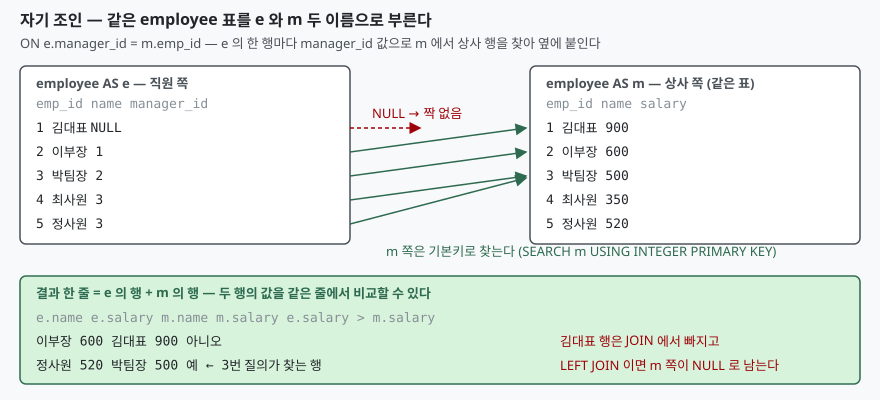

## 들어가며

사내 조직도를 그리는 작은 도구를 만드는 중이다. 직원 표에는 `manager_id` 라는
컬럼이 있고, 거기에 상사의 사번이 적혀 있다. 화면에는 "직원 이름 — 상사 이름"을
나란히 찍어야 하는데, 상사 이름은 같은 표의 다른 행에 들어 있다.

이때 흔히 하는 일은 직원 목록을 한 번 가져온 뒤, 애플리케이션에서 행마다
`manager_id` 로 다시 한 번 조회하는 것이다. 직원이 7명이면 쿼리 8번, 700명이면
701번이다. 조금 나은 방법은 목록을 통째로 가져와 사번을 키로 하는 사전을 만들어
두고 메모리에서 찾는 것인데, 그러면 "상사보다 급여가 많은 직원"처럼 두 행을
비교하는 조건이 전부 애플리케이션 코드로 옮겨 간다. 이 일은 SQL 한 문장으로
끝난다. 같은 표를 두 번 부르면 된다.

## 개념

조인은 두 표의 행을 조건에 맞춰 짝짓는 연산이다. 그런데 **두 표가 꼭 다른 표일
필요는 없다.** `FROM` 절에 같은 표를 두 번 적으면 SQL 은 그것을 **별개의 입력
둘**로 본다. 이것을 자기 조인(self join)이라 부르는데, 문법에 따로 있는 것이
아니라 평범한 조인의 한 쓰임새다.

문제는 이름이다. 두 입력이 모두 `employee` 라서 `name` 이라고 적으면 어느 쪽
`name` 인지 가릴 수 없다. 실제로 돌리면 바로 막힌다.

```text
  에러 별칭 없음: ambiguous column name: name
  OK   별칭 e, m: 6행
```

그래서 **별칭(alias)** 을 붙인다. `employee AS e` 처럼 적으면 그 입력은 이 질의
안에서 `e` 라는 이름으로 불리고, 컬럼은 `e.name` 으로 가리킨다. `AS` 는 생략할
수 있지만 입문 단계에서는 붙여 쓰는 편이 읽기 쉽다. 다른 조인에서 별칭이
"있으면 편한 것"이라면, 자기 조인에서는 **없으면 성립하지 않는 것**이다.

```sql
SELECT e.name AS employee, m.name AS manager
FROM employee AS e JOIN employee AS m ON e.manager_id = m.emp_id;
```

읽는 법은 이렇다. `e` 는 직원 쪽, `m` 은 상사 쪽이다. `e` 의 한 행마다
`manager_id` 값을 들고 `m` 에서 `emp_id` 가 같은 행을 찾아 옆에 붙인다.

## 구조



> **출처**: [SQLite — SELECT: Determination of input data (FROM clause processing)](https://www.sqlite.org/lang_select.html#determination_of_input_data_from_clause_processing_), [SQLite — table-or-subquery 문법 (AS 별칭)](https://www.sqlite.org/syntax/table-or-subquery.html)

## 동작 원리

SQLite 문서는 `FROM` 절 처리를 이렇게 적는다. `FROM` 에 항목이 둘 이상이면
각 항목의 행을 **모두 짝지은 집합**(카티전 곱)을 먼저 만들고, `ON` 조건으로
거른다. 항목이 같은 표를 가리키는지는 이 규칙에 아무 영향이 없다. 자기 조인은
엔진에게 특별한 경우가 아니다.

물론 실제로 7행 × 7행 = 49행을 만들고 거르지는 않는다. 질의 계획을 보면 두
번째 `employee` 를 어떻게 다루는지 보인다.

```text
QUERY PLAN
|--SCAN e
`--SEARCH m USING INTEGER PRIMARY KEY (rowid=?)
```

`e` 는 처음부터 끝까지 읽고(`SCAN`), `m` 은 `e` 의 행 하나마다 `manager_id`
값으로 기본키를 바로 찾아간다(`SEARCH`). 같은 파일, 같은 B-트리를 두 개의
커서가 따로 읽는 것이다. 한쪽을 읽는 동안 다른 쪽 위치가 흐트러지지 않으므로,
별칭 둘은 이름만 다른 것이 아니라 **읽는 위치도 따로 가진 두 입력**이다.

## 실습 예제

전체 소스: [`code/`](code/) · 수행 기록: [`code/output.txt`](code/output.txt)

직원 7명이다. 대표는 상사가 없고(`manager_id` 가 `NULL`), 정사원은 일부러
팀장보다 급여를 많이 받게 넣었다.

**상사 이름 붙이기.** `JOIN` 으로 하면 상사가 없는 대표가 결과에서 빠진다.
대표 행도 남기려면 `LEFT JOIN` 으로 바꾸고, `NULL` 자리는 `COALESCE` 로 채운다.

```text
-- JOIN: 상사가 있는 직원만
  이부장    상사 김대표
  박팀장    상사 이부장
  ...
-- LEFT JOIN: 상사가 없는 대표까지
  김대표    상사 (없음)
  이부장    상사 김대표
  ...
```

**상사보다 급여가 많은 직원.** 두 행이 한 줄에 놓이므로 `WHERE e.salary > m.salary`
한 줄로 끝난다. 애플리케이션으로 가져가면 반복문과 사전 조회가 필요했던 조건이다.

```text
  정사원 520 > 박팀장 500
```

**같은 부서 직원끼리 짝짓기.** 이번에는 상사·부하 관계가 아니라 **같은 표의 두 행이
같은 값을 가지는 쌍**을 찾는다. 조건을 `a.emp_id <> b.emp_id` 로 쓰면 한부장-오대리와
오대리-한부장이 둘 다 나오고, `<` 로 바꾸면 한 번만 나온다.

```text
-- a.emp_id <> b.emp_id : 14행
  영업 한부장-오대리
  영업 오대리-한부장
-- a.emp_id < b.emp_id : 7행
  영업 한부장-오대리
```

**전날과 비교하기.** 날짜별 매출에서 전날 매출을 옆에 붙이려면 `prev.sale_day =
date(cur.sale_day, '-1 day')` 로 자기 조인한다. 3월 4일 행이 빠져 있을 때 결과가
어떻게 되는지가 이 예제의 핵심이다.

```text
-- 자기 조인: prev.sale_day = date(cur.sale_day, '-1 day')
  2026-03-03   90  전날 2026-03-02  120
  2026-03-05  130  전날 None       None
-- LAG(): 정렬 순서에서 바로 앞 행
  2026-03-03   90  앞행 2026-03-02  120
  2026-03-05  130  앞행 2026-03-03   90
```

자기 조인은 **달력상의 전날**을 찾으므로 3월 4일이 없으면 `NULL` 이 된다.
`LAG()` 창 함수는 **정렬 순서에서 바로 앞 행**을 가져오므로 3월 3일이 붙는다.
둘 중 어느 것이 맞느냐는 질문이 무엇이냐에 달렸다. "어제보다 늘었나"를 묻는다면
자기 조인이 맞고, "직전 기록보다 늘었나"를 묻는다면 `LAG()` 가 맞다.
같은 "이전 값"이라도 두 질의는 다른 것을 센다.

## 실무에서 주의할 점

**첫째, 조건을 어느 별칭에 거느냐로 결과가 달라진다.** `WHERE dept = '개발'` 이라고만
쓰면 다시 모호성 에러다. `e.dept` 면 개발부 직원, `m.dept` 면 상사가 개발부인 직원이고
행 수가 다르다.

```text
  에러 WHERE dept = '개발' (별칭 없음): ambiguous column name: dept
  WHERE e.dept = '개발' → 4행 (개발부 직원)
  WHERE m.dept = '개발' → 3행 (상사가 개발부)
```

이부장은 개발부 직원이지만 상사인 대표는 경영이라 `m.dept` 쪽에서 빠진다.
별칭을 붙이는 순간 "누구의 부서인가"를 매번 정해야 한다.

**둘째, 짝짓기 조인은 `<>` 와 `<` 를 구분한다.** 위에서 본 대로 `<>` 는 같은 쌍을 두 번
센다. 짝의 수를 세거나 짝마다 한 번만 처리해야 하면 `<` 를 쓴다. 조건을 아예 빼면
자기 자신과의 짝까지 들어온다.

**셋째, 자기 조인의 '전날'과 `LAG()` 의 '이전 행'은 다른 것이다.** 빠진 날짜가 있을 때
갈린다. 자기 조인은 없는 날을 `NULL` 로 드러내고, `LAG()` 는 건너뛴다. 결과가 `NULL`
이라고 데이터 오류로 단정하기 전에 어느 쪽을 쓴 질의인지 본다.

**넷째, 조인에 쓰는 컬럼에 인덱스가 없으면 임시 인덱스가 만들어진다.** 부서로
짝짓는 조인의 계획은 인덱스를 만들기 전과 후가 다르다.

```text
-- 짝짓기 조인: 부서에 인덱스가 없을 때
QUERY PLAN
|--SCAN a
`--SEARCH b USING AUTOMATIC COVERING INDEX (dept=?)
-- 부서에 인덱스를 만든 뒤
QUERY PLAN
|--SCAN a
`--SEARCH b USING INDEX ix_employee_dept (dept=? AND rowid>?)
```

`AUTOMATIC COVERING INDEX` 는 SQLite 가 이 질의를 위해 그때그때 만드는 인덱스다.
질의가 끝나면 버리므로 같은 질의를 돌릴 때마다 다시 만든다. 자주 도는 자기 조인이면
그 컬럼에 인덱스를 두는 편이 낫다. 기본키로 짝짓는 상사 조인에는 이미 인덱스가
있으므로 처음부터 `SEARCH` 였다.

**다섯째, 자기 조인 한 번은 한 단계만 올라간다.** 상사의 상사까지 보려면 `employee`
를 세 번 불러야 하고, 단계 수를 미리 모르는 조직도 전체는 자기 조인으로 풀 수 없다.
그때는 재귀 `WITH` 절을 쓴다. 자기 조인은 **단계가 정해진 관계**에 쓰는 도구다.

## 정리

- 자기 조인은 따로 있는 문법이 아니다. `FROM` 에 같은 표를 두 번 적으면
  SQL 은 별개의 입력 둘로 본다
- 별칭은 필수다. 둘 다 `employee` 라서 `name` 이 어느 쪽인지 가릴 수 없고,
  실제로 `ambiguous column name` 에러가 난다
- 상사가 없는 행을 남기려면 `LEFT JOIN`, 짝을 한 번씩만 세려면 `<>` 대신 `<` 를 쓴다
- 자기 조인의 '전날'은 달력을 보고, `LAG()` 의 '이전 행'은 정렬 순서를 본다.
  빠진 날짜가 있으면 둘의 결과가 갈린다
- 조인 컬럼에 인덱스가 없으면 임시 인덱스를 매번 만든다. 자주 도는 질의면 인덱스를 둔다

## 참고 자료

- [SQLite — SELECT: Determination of input data (FROM clause processing)](https://www.sqlite.org/lang_select.html#determination_of_input_data_from_clause_processing_)
- [SQLite — table-or-subquery 문법](https://www.sqlite.org/syntax/table-or-subquery.html)
- [SQLite — Window Functions: Built-in Window Functions](https://www.sqlite.org/windowfunctions.html#built_in_window_functions)
- [SQLite — Date And Time Functions](https://www.sqlite.org/lang_datefunc.html)
- [SQLite — Query Planner Overview: Automatic Query-Time Indexes](https://www.sqlite.org/optoverview.html#automatic_query_time_indexes)
- [SQLite — EXPLAIN QUERY PLAN](https://www.sqlite.org/eqp.html)
