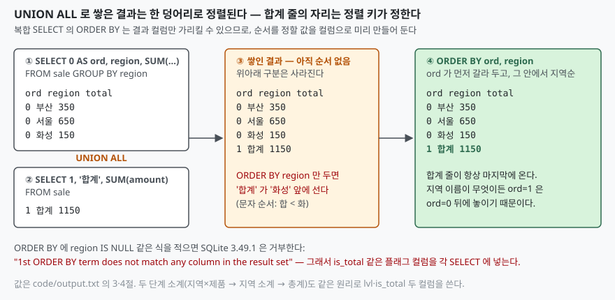

## 들어가며

지역별 매출을 뽑아 달라는 요청은 `GROUP BY region` 한 줄로 끝난다. 그런데 보고서를
받는 쪽은 거의 항상 맨 아래에 **합계 줄**을 원한다. 그래서 흔히 두 번 질의한다.
지역별 결과를 한 번 받고, `SUM(amount)` 를 한 번 더 받아서 애플리케이션이나
엑셀에서 아래에 붙인다. 지역 안에 제품별 소계까지 넣으라고 하면 질의가 셋으로
늘고, 붙이는 순서를 코드가 맞춰야 한다. 합계 줄 하나 때문에 질의 횟수와 붙이는
코드가 같이 는다.

다른 DB 에는 이 자리에 `ROLLUP` 이 있다. SQLite 에는 없다. 그래서 같은 결과를
`UNION ALL` 로 만들어야 하는데, 그냥 쌓으면 합계 줄이 엉뚱한 자리에 서고,
정렬을 고치려다 보면 복합 질의에서만 걸리는 제약에 부딪힌다. 그 자리들을
하나씩 돌려 본다.

## 개념

`GROUP BY` 는 **그룹마다 한 행**을 만든다. 합계 줄은 그룹을 전부 묶은 "그룹이
없는 집계"이므로, 같은 질의가 두 수준의 집계를 한꺼번에 내야 한다. 표준 SQL 의
`ROLLUP` 이 그 일을 하지만, SQLite 3.49.1 에 `GROUP BY ROLLUP(region)` 을 주면
이렇게 거부한다.

```text
GROUP BY ROLLUP(region) → no such function: ROLLUP
```

문법 오류가 아니라 **"그런 함수가 없다"** 다. SQLite 는 `ROLLUP(region)` 을
함수 호출로 읽는다. 키워드로도 모른다는 뜻이다.

대신 쓸 수 있는 방법은 셋이다.

| 방법 | 무엇을 더하나 | 쓰는 자리 |
|---|---|---|
| `UNION ALL` | 집계 수준이 다른 **행**을 쌓는다 | 합계 줄이 결과 **행**으로 필요할 때 |
| CTE 위에서 한 번 더 집계 | 지역별 집계를 재료로 총계를 낸다 | 원본 표가 커서 두 번 읽기 싫을 때 |
| `SUM() OVER ()` | 총계를 각 행의 **칸**에 붙인다 | 비율·구성비를 같은 줄에 적을 때 |

## 구조



> **출처**: [SQLite — SELECT §3 Compound Select Statements](https://www.sqlite.org/lang_select.html#compound_select_statements) · [§4 The ORDER BY clause](https://www.sqlite.org/lang_select.html#the_order_by_clause)

## 동작 원리

`UNION ALL` 은 왼쪽 SELECT 의 행 전부와 오른쪽 SELECT 의 행 전부를 돌려준다.
위아래라는 구분은 결과에 남지 않는다. **정렬은 쌓인 뒤에 한 덩어리로 걸린다.**
그래서 `ORDER BY region` 만 두면 `'합계'` 라는 글자도 지역 이름과 같은 줄에서
비교된다. 지역 이름이 전부 `'합계'` 보다 앞에 오면 우연히 맨 아래에 서고,
`'화성'` 처럼 뒤에 오는 이름이 하나라도 있으면 합계 줄이 중간에 낀다.

```text
-- ORDER BY region 만 두었을 때
  부산        350
  서울        650
  합계       1150
  화성        150
```

고치는 법은 **순서를 정할 값을 컬럼으로 미리 만드는 것**이다. 지역별 행에는
`0`, 합계 행에는 `1` 을 `ord` 컬럼으로 붙이고 `ORDER BY ord, region` 을 건다.

```sql
SELECT 0 AS ord, region, SUM(amount) AS total FROM sale GROUP BY region
UNION ALL
SELECT 1, '합계', SUM(amount) FROM sale
ORDER BY ord, region;
```

```text
      0  부산        350
      0  서울        650
      0  화성        150
      1  합계       1150
```

"그냥 `ORDER BY region IS NULL` 로 하면 되지 않나" 싶은데, 복합 SELECT 에서는
안 된다. SQLite 문서의 ORDER BY 절은 **복합 SELECT 에서는 출력 컬럼의 별칭이
아닌 ORDER BY 식이 출력 컬럼으로 쓰인 식과 정확히 같아야 한다**고 적는다.
단순 SELECT 라면 아무 식이나 되지만, `UNION` 으로 묶는 순간 정렬 기준은 결과
컬럼 중 하나여야 한다. 그래서 식이 아니라 **플래그 컬럼**을 쓴다.

```text
ORDER BY region IS NULL, ... → 1st ORDER BY term does not match any column in the result set
```

## 실습 예제

전체 소스: [`code/`](code/) · 수행 기록: [`code/output.txt`](code/output.txt)

지역 세 곳, 제품 세 가지, 매출 7건이다. 두 단계 소계는 세 SELECT 를 쌓는다.
지역×제품 행에 `lvl=0`, 지역 소계에 `lvl=1`, 총계에 `lvl=2` 를 붙이고,
총계만 맨 아래로 보내는 `is_total` 을 따로 둔다.

```sql
SELECT region, product, SUM(amount) AS total, 0 AS lvl, 0 AS is_total
FROM sale GROUP BY region, product
UNION ALL
SELECT region, NULL, SUM(amount), 1, 0 FROM sale GROUP BY region
UNION ALL
SELECT NULL, NULL, SUM(amount), 2, 1 FROM sale
ORDER BY is_total, region, lvl, product;
```

```text
  부산      노트북       250      0      0
  부산      모니터       100      0      0
  부산      NULL      350      1      0
  서울      노트북       500      0      0
  서울      모니터       150      0      0
  서울      NULL      650      1      0
  화성      모니터       120      0      0
  화성      키보드        30      0      0
  화성      NULL      150      1      0
  NULL    NULL     1150      2      1
```

지역 안에서 소계가 제품 뒤에 오는 것은 `lvl` 이 `product` 보다 앞에 있기
때문이다. 같은 지역 안에서 `lvl=0` 행들이 먼저, `lvl=1` 소계가 그 뒤에 선다.
`NULL` 은 "이 수준에서는 묶였다"는 표시이고, 화면에 보일 때만
`COALESCE(product, '소계')` 로 바꾼다. 데이터에서부터 글자로 넣으면 그 글자가
정렬에 끼어든다.

### 표를 몇 번 읽는가

`UNION ALL` 의 각 SELECT 는 따로 돈다. 질의 계획에 표를 읽는 횟수만큼 `SCAN` 이
찍힌다.

```text
QUERY PLAN
`--MERGE (UNION ALL)
   |--LEFT
   |  |--SCAN sale
   |  |--USE TEMP B-TREE FOR GROUP BY
   |  `--USE TEMP B-TREE FOR ORDER BY
   `--RIGHT
      `--SCAN sale
```

7행짜리 표에서는 상관없지만, 수백만 행이면 두 번 읽는 것이 비용이다. 지역별
집계를 CTE 에 두고 **총계는 그 집계를 더해서** 내면 원본은 한 번만 읽는다.

```sql
WITH by_region AS (
    SELECT region, SUM(amount) AS total FROM sale GROUP BY region
)
SELECT 0 AS ord, region, total FROM by_region
UNION ALL
SELECT 1, '합계', SUM(total) FROM by_region
ORDER BY ord, region;
```

```text
QUERY PLAN
`--MERGE (UNION ALL)
   |--LEFT
   |  |--MATERIALIZE by_region
   |  |  |--SCAN sale
   |  |  `--USE TEMP B-TREE FOR GROUP BY
   |  |--SCAN by_region
   |  `--USE TEMP B-TREE FOR ORDER BY
   `--RIGHT
      `--SCAN by_region
```

`MATERIALIZED` 힌트를 붙이지 않았는데도 첫 줄이 `MATERIALIZE by_region` 이다.
SQLite 문서는 힌트가 없으면 **"가장 잘 될 것 같은 구현 전략을 자유롭게
고른다"** 고만 적는데, 두 번 참조되는 이 CTE 에서는 한 번 계산해 임시 표에
두는 쪽을 골랐다. `NOT MATERIALIZED` 를 붙이면 계획이 바뀌어 `CO-ROUTINE` 이
두 번 나오고 `SCAN sale` 도 두 번이 된다. 총계를 "합계의 합계" 로 내도 결과가
같은 이유는 `SUM` 이 결합법칙을 따르기 때문이고, 이것이 다음 절의 함정과
이어진다.

### 행이 아니라 칸에 붙이기

합계가 필요한 이유가 "비율을 적기 위해서" 라면 행을 추가할 것이 아니다.
집계 결과 위에 윈도우 함수를 한 번 더 걸면 총계가 **각 행의 칸**으로 들어온다.

```sql
SELECT region, SUM(amount) AS total,
       SUM(SUM(amount)) OVER () AS grand_total,
       ROUND(100.0 * SUM(amount) / SUM(SUM(amount)) OVER (), 1) AS pct
FROM sale GROUP BY region ORDER BY region;
```

```text
  부산        350   1150  30.4
  서울        650   1150  56.5
  화성        150   1150  13.0
```

`SUM(SUM(amount)) OVER ()` 는 안쪽 `SUM` 이 그룹별 합계를 먼저 만들고, 바깥
`SUM ... OVER ()` 가 그 합계들을 전체 구간으로 다시 더한 것이다. 행이 늘지
않으므로 정렬 키도 플래그도 필요 없다.

## 실무에서 주의할 점

**첫째, `AVG` 의 소계는 소계의 평균이 아니다.** `SUM` 과 `COUNT` 는 합계의
합계가 전체 합계와 같지만, 평균은 그렇지 않다. 지역별 평균 세 개를 다시
평균 내면 155.6 이고 전체 평균은 164.3 이다. 건수가 다른 그룹을 같은 무게로
섞었기 때문이다.

```text
      0  부산      175.0
      0  서울      216.66666666666666
      0  화성      75.0
      1  평균의 평균  155.55555555555554
      2  전체 평균   164.28571428571428
```

CTE 위에서 총계를 낼 때 `AVG(avg_amount)` 를 쓰면 틀린다. 평균이 필요하면 CTE 에
`SUM` 과 `COUNT` 를 따로 두고 총계 줄에서 나눈다.

**둘째, 합계 행의 글자는 정렬에 끼어든다.** `'합계'`, `'Total'`, `'전체'`
어느 것이든 지역 이름과 같은 컬럼에 놓이는 순간 문자 순서로 비교된다. 정렬
키 컬럼을 두고, 그래도 글자가 필요하면 `COALESCE` 로 보일 때만 바꾼다.

**셋째, 컬럼 수와 자리를 세 SELECT 에서 똑같이 맞춘다.** 복합 SELECT 는 각
SELECT 의 결과 컬럼 수가 같아야 하고, 이름은 **첫 SELECT 의 것**을 쓴다. 두
번째 SELECT 에서 `NULL` 자리를 하나 빼먹으면 "SELECTs to the left and right
of UNION ALL do not have the same number of result columns" 로 멈춘다. 컬럼을
추가할 때 세 군데를 다 고쳐야 하는 것이 이 방식의 유지보수 비용이다.

**넷째, 소계를 넣는 순간 `COUNT(*)` 가 틀린다.** 결과 행 수를 세어 "지역이
세 곳" 이라고 보고하는 코드가 있으면, 소계·총계 행까지 세어 네 곳이 된다.
`lvl` 이나 `is_total` 로 걸러서 센다.

## 정리

- SQLite 3.49.1 에는 `ROLLUP` 이 없다. `ROLLUP(region)` 은 함수 호출로 읽혀
  "no such function" 으로 거부된다
- 합계 **행**은 `UNION ALL` 로 쌓는다. 정렬은 쌓인 뒤 한 덩어리로 걸리므로,
  순서를 정할 값을 `ord`·`lvl`·`is_total` 같은 컬럼으로 미리 만든다
- 복합 SELECT 의 `ORDER BY` 에는 식을 못 쓴다. 결과 컬럼과 정확히 같아야 한다
- 두 번 참조하는 CTE 는 힌트 없이도 `MATERIALIZE` 로 한 번만 읽혔다.
  `NOT MATERIALIZED` 를 붙이면 원본을 두 번 읽는다
- 비율이 목적이면 행을 더하지 말고 `SUM(SUM(x)) OVER ()` 로 칸을 더한다
- `SUM`·`COUNT` 는 합계의 합계가 맞지만 `AVG` 는 아니다

## 참고 자료

- [SQLite — SELECT §3 Compound Select Statements](https://www.sqlite.org/lang_select.html#compound_select_statements)
- [SQLite — SELECT §4 The ORDER BY clause](https://www.sqlite.org/lang_select.html#the_order_by_clause) — 복합 SELECT 의 ORDER BY 식 제약
- [SQLite — The WITH Clause §4 Materialization Hints](https://www.sqlite.org/lang_with.html#materialization_hints)
- [SQLite — Window Functions](https://www.sqlite.org/windowfunctions.html) — 내장 집계 함수에 `OVER` 를 붙여 윈도우 함수로 쓰는 규칙
- [SQLite — EXPLAIN QUERY PLAN](https://www.sqlite.org/eqp.html)
