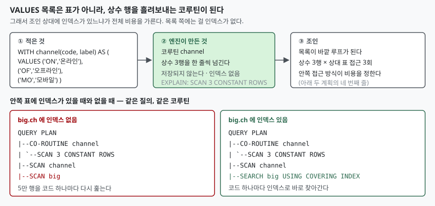

## 들어가며

매출 집계 쿼리를 하나 짜는 중이다. 채널 코드가 `ON`, `OF`, `MO` 세 글자로만
들어 있어서 결과에 그대로 찍으면 보는 사람이 알아볼 수가 없다. 코드표가 따로
있으면 조인하면 그만인데, 하필 이 코드는 애플리케이션 상수로만 존재하고 DB 에는
없다. 세 줄짜리 표를 만들자고 `CREATE TABLE` 을 치자니 그 표를 누가 지울지가
또 일이다.

그래서 대개는 `CASE ch WHEN 'ON' THEN '온라인' ...` 을 적는다. 세 줄이니까 참을
만하다. 그런데 이 쿼리를 쓰는 자리가 셋으로 늘고 코드가 여덟 개로 늘면, 같은
`CASE` 덩어리가 여덟 줄씩 세 군데에 복사된다. 코드 하나가 추가되면 세 군데를
모두 고쳐야 하고, 한 군데를 빠뜨려도 쿼리는 에러 없이 `NULL` 을 뱉는다.
표준 SQL 에는 이런 자리에 쓰라고 만들어 둔 구문이 있다. `VALUES` 절이다.

## 개념

`VALUES` 는 `INSERT` 뒤에만 붙는 구문이 아니다. 그 자체로 **행 여러 개를 만들어
내는 독립된 질의**다. SQLite 문서는 `VALUES` 절을 `FROM` 절 없는 `SELECT` 의
축약형으로 설명하고, 이렇게 만든 결과의 컬럼 이름이 `column1`, `column2` 순으로
붙는다고 적는다.

```sql
VALUES ('ON', '온라인'), ('OF', '오프라인');
```

```text
컬럼 이름: ['column1', 'column2']
행       : [('ON', '온라인'), ('OF', '오프라인')]
```

이것만으로는 쓸 데가 없다. `column1` 이라는 이름으로 조인 조건을 적고 싶은 사람은
없다. 그래서 `WITH` 로 감싸 이름을 붙인다.

```sql
WITH channel(code, label) AS (
    VALUES ('ON','온라인'), ('OF','오프라인'), ('MO','모바일')
)
SELECT channel.label, COALESCE(SUM(sale.amount), 0) AS total
FROM channel LEFT JOIN sale ON sale.ch = channel.code
GROUP BY channel.code, channel.label
ORDER BY channel.code;
```

`WITH 이름(컬럼1, 컬럼2) AS (...)` 형태로 컬럼 이름을 함께 적을 수 있다.
이 한 줄 덕분에 `VALUES` 목록이 `channel.code`, `channel.label` 로 불리는
평범한 표가 되고, 그 뒤로는 실제 표와 똑같이 조인·`GROUP BY`·`LEFT JOIN` 을
걸 수 있다.

## 구조



> **출처**: [SQLite — The VALUES clause](https://www.sqlite.org/lang_select.html#the_values_clause), [EXPLAIN QUERY PLAN — Subqueries](https://www.sqlite.org/eqp.html#subqueries)

## 동작 원리

`VALUES` 목록은 임시 표로 **저장되지 않는다.** SQLite 는 이것을 코루틴으로
만들어 둔다. 조인이 한 행을 요구할 때마다 상수 행을 하나씩 넘겨주는 작은
생산자다. 디스크에 쓰이지도, 메모리에 표로 쌓이지도 않는다.

그래서 **목록 쪽에는 인덱스가 없다.** 조인에서 목록이 바깥 루프를 맡고,
비용은 전적으로 안쪽 표를 어떻게 읽느냐에 달린다. 5만 행짜리 표와 세 줄짜리
목록을 조인해 보면 이것이 그대로 드러난다.

```text
-- big.ch 에 인덱스가 없을 때
QUERY PLAN
|--CO-ROUTINE channel
|  `--SCAN 3 CONSTANT ROWS
|--SCAN channel
|--SCAN big
`--USE TEMP B-TREE FOR GROUP BY
-- big.ch 에 인덱스를 만든 뒤
QUERY PLAN
|--CO-ROUTINE channel
|  `--SCAN 3 CONSTANT ROWS
|--SCAN channel
|--SEARCH big USING COVERING INDEX ix_big_ch (ch=?)
`--USE TEMP B-TREE FOR GROUP BY
```

위쪽 계획의 `SCAN big` 은 코드 하나마다 5만 행을 다시 훑는다는 뜻이다. 아래쪽은
코드 하나마다 인덱스로 바로 찾아간다. `VALUES` 를 썼다고 느려지는 것이 아니라,
**조인 상대에 인덱스가 없으면 원래 느린 질의**였다는 사실이 보일 뿐이다.
`VALUES` 목록 자체는 세 줄이라 어느 쪽에서도 비용이 아니다.

## 실습 예제

전체 소스: [`code/`](code/) · 수행 기록: [`code/output.txt`](code/output.txt)

`CASE` 로 하던 일을 `VALUES` 로 옮기면 두 가지가 더 따라온다. 같은 매출 4건에
대해 두 방식의 결과를 나란히 두면 바로 보인다.

```text
-- WITH channel(code,label) AS (VALUES ...) 로 LEFT JOIN
  모바일        0
  오프라인     200
  온라인      150

-- CASE ch WHEN ... 로 분기
  None      10
  오프라인     200
  온라인      150
```

`CASE` 쪽에는 **매출이 0인 모바일 행이 아예 없다.** 데이터에 없는 코드는
`CASE` 가 만들어 낼 수 없기 때문이다. 반대로 코드표에 없는 `XX` 는 `NULL` 이
되어 집계에 끼어들었다. `VALUES` 로 만든 코드표를 기준 표로 놓고 `LEFT JOIN`
하면 0인 행이 살아나고, 조인 방향을 뒤집으면 코드표에 없는 값만 뽑아낼 수도 있다.

```sql
SELECT DISTINCT sale.ch
FROM sale LEFT JOIN channel ON sale.ch = channel.code
WHERE channel.code IS NULL;
```

```text
  코드표에 없는 값: ['XX']
```

`CASE` 로는 "코드표에 없는 값을 찾아라"를 쓸 수 없다. 코드표가 표가 아니라
분기문이라서, 바깥에서 들여다볼 대상이 없기 때문이다. 코드 묶음을 **데이터로**
두느냐 **제어 구문으로** 두느냐의 차이가 여기서 갈린다.

## 실무에서 주의할 점

**첫째, 컬럼 이름은 `WITH` 에서만 붙는다.** 다른 DB 에서 쓰던
`FROM (VALUES ...) AS n(a, b)` 형태는 SQLite 3.49.1 에서 문법 오류다.
별칭만 붙이면 컬럼 이름은 `column1` 그대로 남는다.

```text
  에러 SELECT * FROM (VALUES (1,'x')) AS n(a, b)        near "(": syntax error
  OK   SELECT * FROM (VALUES (1,'x')) AS n              ['column1', 'column2']
  OK   WITH n(a, b) AS (VALUES (1,'x')) SELECT * FROM n ['a', 'b']
```

**둘째, `VALUES` 리터럴에는 타입 친화성이 없다.** 이것이 가장 헷갈리는 자리다.
`VALUES ('1')` 의 문자열 `'1'` 을 `INTEGER` 컬럼과 비교하면, SQLite 는 비교 전에
한쪽에 친화성을 적용하는 규칙을 따라 `'1'` 을 숫자로 바꿔 비교한다. 그래서
**매칭된다.** 그런데 `VALUES` 끼리 비교하면 양쪽 다 친화성이 없어 규칙의 세 번째
가지로 떨어지고, 아무 변환 없이 문자와 숫자를 그대로 견주므로 **매칭되지 않는다.**

```text
  INTEGER 컬럼 = VALUES 의 문자 '1'       매칭 1건
  VALUES 의 숫자 1 = VALUES 의 문자 '1'    매칭 0건
```

표를 상대할 때는 느슨하고 목록끼리는 엄격하다. 애플리케이션에서 숫자 키를
문자열로 만들어 넘기는 코드가 섞여 있으면, 표와 조인할 때는 멀쩡하다가
목록 두 개를 합치는 순간 조용히 0건이 된다.

**셋째, 목록이 길어지면 파라미터 상한에 먼저 걸린다.** 행 수 자체는 10만 줄을
넣어도 돌아갔지만, 값을 `?` 로 바인딩해 넘기면 한 문장에 쓸 수 있는 호스트
파라미터 수에 걸린다. SQLite 3.32.0 이후 기본값은 32766 이고, 실제로 그 선에서
끊겼다.

```text
  OK   리터럴 10000행 — COUNT(*) = 10000
  OK   리터럴 100000행 — COUNT(*) = 100000
  OK   파라미터 32766개
  에러 파라미터 32767개 — too many SQL variables
```

**넷째, 같은 목록을 여러 번 훑는 질의라면 `MATERIALIZED` 를 생각한다.**
기본값은 코루틴이라 매번 다시 만든다. `WITH m(a,b) AS MATERIALIZED (VALUES ...)`
로 적으면 계획의 첫 줄이 바뀐다.

```text
  (힌트 없음)          첫 줄: CO-ROUTINE channel
  MATERIALIZED     첫 줄: MATERIALIZE channel
```

다만 세 줄짜리
코드표에서는 재사용할 것이 없어 의미가 없고, 목록이 길고 여러 번 참조될 때
따져볼 선택지다.

**다섯째, 수백 줄이 넘어가면 그건 이미 표다.** `VALUES` 는 쿼리 안에서 눈으로
읽히는 분량일 때 값을 한다. 수백 줄이 박혀 있으면 코드표를 쿼리에 하드코딩한
것과 다르지 않으므로, 그때는 진짜 표를 만들고 인덱스를 거는 편이 낫다.

## 정리

- `VALUES` 는 `INSERT` 전용 구문이 아니라 행을 만들어 내는 독립된 질의다.
  단독으로 쓰면 컬럼 이름이 `column1`, `column2` 로 붙는다
- 쓸 만하게 만드는 것은 `WITH 이름(컬럼…) AS (VALUES …)` 다.
  SQLite 에서 컬럼 이름을 붙이는 방법은 이것뿐이다
- 코드 묶음을 `CASE` 분기 대신 데이터로 두면 0인 행이 살아나고,
  코드표에 없는 값을 거꾸로 찾아낼 수 있다
- 목록은 저장되지 않는 코루틴이라 인덱스가 없다.
  비용은 조인 상대 표에 인덱스가 있느냐로 갈린다
- 표와 비교할 때는 친화성이 적용돼 느슨하고, 목록끼리는 적용되지 않아 엄격하다

## 참고 자료

- [SQLite — The VALUES clause](https://www.sqlite.org/lang_select.html#the_values_clause)
- [SQLite — WITH clause](https://www.sqlite.org/lang_with.html)
- [SQLite — Materialization Hints](https://www.sqlite.org/lang_with.html#materialization_hints)
- [SQLite — EXPLAIN QUERY PLAN: Subqueries](https://www.sqlite.org/eqp.html#subqueries)
- [SQLite — Type Conversions Prior To Comparison](https://www.sqlite.org/datatype3.html#type_conversions_prior_to_comparison)
- [SQLite — Limits In SQLite](https://www.sqlite.org/limits.html)
