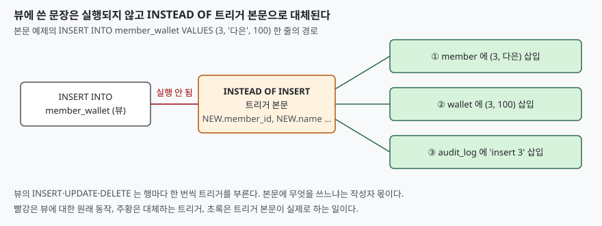

## 들어가며

회원 정보는 `member` 표에, 잔액은 `wallet` 표에 나눠 두었다. 화면에서는 둘을 합쳐
한 줄로 보여 주려고 조인 뷰를 만들었고, 조회는 잘 된다. 그런데 신규 가입 화면이
`INSERT INTO member_wallet ...` 한 줄로 저장하려 하면 에러가 난다. 보통은 애플리케이션
코드에서 두 표에 INSERT 를 따로 날리도록 고치는데, 그러면 뷰를 쓰는 모든 호출처가
두 표의 구조를 알아야 하고, 한 곳이라도 한쪽 INSERT 를 빠뜨리면 회원은 있는데 지갑이
없는 행이 생긴다. 뷰를 만든 이유가 두 표를 가리는 것이었는데 쓰기에서는 그 이점이 사라진다.

## 개념

뷰(view)는 이름을 붙인 `SELECT` 문이다. 조인이나 집계를 담은 뷰에는 행이 저장돼 있지
않으므로, 거기에 `INSERT`·`UPDATE`·`DELETE` 를 하면 어느 표의 어느 행을 바꿔야 하는지
정해지지 않는다. SQLite 는 이를 `cannot modify member_wallet because it is a view` 로
거절한다.

`INSTEAD OF` 트리거는 이 빈자리를 사용자가 채우게 한다. 뷰에 대한 쓰기 문장이 실행될
때, 그 문장을 실행하는 대신 트리거 본문을 실행한다. 본문에서 `NEW`(새로 쓰려는 값)와
`OLD`(바꾸거나 지울 기존 행)를 쓸 수 있고, 둘의 컬럼은 **뷰의 컬럼**이다. 어느 표에
어떻게 나눠 쓸지는 본문을 쓰는 사람이 정한다.

## 구조



> **출처**: [SQLite CREATE TRIGGER — INSTEAD OF triggers](https://www.sqlite.org/lang_createtrigger.html#instead_of_trigger)

도식의 ①·②는 원래 쓰려던 두 표이고 ③은 트리거에서 덧붙인 감사 기록이다. 트리거 본문은
여러 문장을 담을 수 있으므로 감사 기록 같은 부수 작업도 같은 자리에 넣는다.

## 동작 원리

뷰 위의 트리거에는 두 가지 제약이 있다. 하나는 종류다. 뷰에는 `INSTEAD OF` 만 만들 수
있다. 아래 예제의 2번에서 `BEFORE`·`AFTER` 를 시도하자 둘 다 `cannot create ... trigger
on view` 로 거절됐다. 다른 하나는 반대 방향이다. `INSTEAD OF` 는 표에 대해서는 만들 수
없고 뷰에만 쓴다. 이 글에서는 표 쪽을 시도하지 않았으므로 문서의 설명을 따른다.

다음은 실행 방식이다. 뷰에 대한 `UPDATE` 가 여러 행에 걸리면 트리거는 **행마다 한 번씩**
돈다. 뷰를 조회해 조건에 맞는 행을 찾고, 그 행 하나하나에 대해 본문을 실행하는 방식이다.
조건에 맞는 행이 없으면 트리거는 한 번도 돌지 않는다.

## 실습 예제

`member` 2행과 `wallet` 2행으로 시작한다. 전체 소스는 [`code/`](code/)에 있고, 출력은
`code/output.txt` 에서 가져왔다.

```text
  member_id | name        member_id | balance
  ----------+-----        ----------+--------
          1 | 가영                1 |     500
          2 | 나래                2 |     800
```

**1. 트리거가 없을 때** 세 문장 모두 `OperationalError: cannot modify member_wallet because
it is a view` 로 실패했다.

**2. 뷰에 `BEFORE`·`AFTER` 트리거를 만들려는 시도**도 실패했다. 메시지는 각각
`cannot create BEFORE trigger on view: member_wallet`, `cannot create AFTER trigger on
view: member_wallet` 이었다.

**3. `INSTEAD OF INSERT`** 를 만들고 `(3, '다은', 100)` 을 넣으면 `member` 에 `(3, '다은')`,
`wallet` 에 `(3, 100)` 이 들어갔다. 뷰 한 줄이 두 표로 나뉜 것이다.

```sql
CREATE TRIGGER member_wallet_ins INSTEAD OF INSERT ON member_wallet
BEGIN
    INSERT INTO member(member_id, name) VALUES (NEW.member_id, NEW.name);
    INSERT INTO wallet(member_id, balance) VALUES (NEW.member_id, COALESCE(NEW.balance, 0));
    INSERT INTO audit_log(action) VALUES ('insert ' || NEW.member_id);
END;
```

**4. 여러 행에 걸친 `UPDATE`.** `UPDATE member_wallet SET balance = balance + 50 WHERE
balance < 600` 은 회원 1(500)과 3(100)에 해당한다. 뷰에는 `(1, '가영', 550)`, `(3, '다은',
150)` 이 반영됐고 `audit_log` 에는 `update 1`, `update 3` 두 줄이 쌓였다. 회원 2(800)는
조건 밖이라 그대로다.

**5. 조건에 맞는 행이 없는 `UPDATE`.** `member_id = 99` 로 갱신하자 `audit_log` 는 3행
그대로였다. 트리거가 한 번도 돌지 않았다.

**6. 쓴 건수.** 이번 결과가 가장 예상 밖이었다. 뷰에 `UPDATE` 로 3행을 바꾸자 `audit_log`
에는 3행이 늘었는데, 파이썬 `rowcount` 는 **0** 이었다. 같은 문장을 `wallet` 표에 하면
`rowcount=3` 이다. 뷰에 대한 `INSERT` 도 `rowcount=0` 이었다. 이 값은 SQLite 가 세는
변경 건수이고, 트리거 본문이 한 일은 포함되지 않는 것으로 보인다. 그러니 뷰에 쓴 뒤
"몇 건 바뀌었는가"를 `rowcount` 로 확인하는 코드는 항상 0을 받는다.

**7. `RETURNING`.** `INSERT INTO member_wallet VALUES (4, '라온', 10) RETURNING
member_id` 는 에러 없이 `[(4,)]` 를 돌려줬다. 뷰라서 안 될 것이라 짐작했으나 이
버전에서는 됐다.

**8. 뷰의 `WHERE` 밖 행.** 잔액 1000 이상만 보이는 뷰 `rich` 에 `INSTEAD OF INSERT` 를
달고 잔액 10인 회원 5를 넣었다. 문장은 성공했고, `rich` 에서 회원 5는 보이지 않으며
`member_wallet` 에서는 보인다. 뷰의 `WHERE` 는 조회를 거를 뿐 트리거가 쓰는 값을
검사하지 않는다.

## 실무에서 주의할 점

1. **쓴 건수를 `rowcount` 로 믿지 않는다.** 6번처럼 뷰에 쓰면 0이 돌아온다. 성공 여부는
   에러 유무로 보고, 건수가 필요하면 바뀐 표를 다시 조회한다.
2. **`UPDATE` 트리거에서 기본키를 조건으로 쓸 때는 `OLD` 를 쓴다.** 본문의 `WHERE` 에
   `NEW.member_id` 를 쓰면 키를 바꾸는 갱신에서 엉뚱한 행을 겨냥한다. 예제는 `OLD.member_id` 로
   찾고 `NEW.name`·`NEW.balance` 로 바꾼다.
3. **뷰의 `WHERE` 는 쓰기를 막지 않는다.** 8번처럼 조건 밖의 값이 들어갈 수 있다. 막으려면
   트리거 본문에서 `RAISE(ABORT, ...)` 로 직접 검사해야 하고, 이 글에서는 그 방법을 돌려 보지 않았다.
4. **본문의 문장 순서와 외래키.** `wallet.member_id` 가 `member` 를 참조하므로 INSERT 는
   `member` 먼저, DELETE 는 `wallet` 먼저다. 외래키 검사는 기본적으로 꺼져 있으므로 순서가
   틀려도 조용히 지나갈 수 있다는 점을 알고 있어야 한다. 이 순서는 예제에서 켜고 검증하지 않았다.
5. **트리거는 한 번 만들면 호출처 모두에 적용된다.** 이점이지만 본문의 오류도 전부에
   퍼지므로, 쓰기 경로를 뷰 하나로 모으는 만큼 본문을 신중히 다룬다.

## 정리

- 조인 뷰에 쓰면 어느 표를 바꿀지 정해지지 않아 거절되고, `INSTEAD OF` 트리거가 그 규칙을 대신 정한다
- 뷰에는 `INSTEAD OF` 만 만들 수 있다. `BEFORE`·`AFTER` 는 거절됐다
- 트리거는 영향받는 행마다 한 번씩 돌고, 해당 행이 없으면 돌지 않는다
- 뷰에 쓴 건수는 `rowcount` 에 0으로 찍혔다. 본문이 바꾼 표를 다시 조회해 확인한다
- 뷰의 `WHERE` 는 트리거가 쓰는 값을 검사하지 않는다

## 참고 자료

- [SQLite CREATE TRIGGER](https://www.sqlite.org/lang_createtrigger.html)
- [SQLite CREATE VIEW](https://www.sqlite.org/lang_createview.html)
