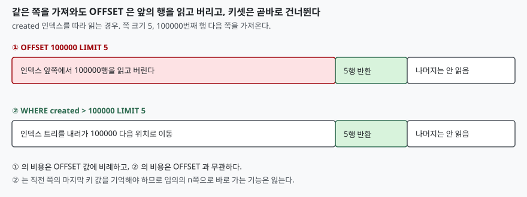

## 들어가며

게시판 목록을 만든다고 하자. 한 쪽에 5건씩 보여 주고 "다음" 버튼을 누르면 다음 쪽이 나와야 한다. 검색해 보면 `LIMIT 5 OFFSET 10` 같은 한 줄이 가장 먼저 나오고, 실제로 잘 돌아간다. 테스트 데이터 열두 건으로 확인하면 아무 문제가 없다.

문제는 몇 달 뒤에 나온다. 글이 수십만 건 쌓인 뒤 누군가 마지막 쪽 근처로 이동하면 응답이 눈에 띄게 느려지고, 쪽을 넘기는 사이 새 글이 올라오면 같은 글이 두 번 보인다. 원인은 질의가 틀려서가 아니라 `OFFSET` 이 **앞의 행을 전부 읽은 뒤 버리는** 방식으로 동작하기 때문이다.

## 개념

`LIMIT n` 은 결과에서 앞의 n행만 돌려주고, `OFFSET m` 은 그 앞에서 m행을 건너뛴다. 쪽 크기가 5이면 k번째 쪽(1부터)은 `LIMIT 5 OFFSET (k-1)*5` 이다. 여기서 **건너뛴다**는 말이 함정이다. 건너뛰는 행도 정렬 순서대로 한 번은 읽어야 몇 번째인지 셀 수 있다.

또 하나, 표준 SQL 에서 `ORDER BY` 가 없으면 결과 순서는 정해져 있지 않다. 쪽을 나누려면 반드시 `ORDER BY` 가 있어야 하고, 그 정렬이 행마다 값이 달라 **순서가 하나로 정해져야** 쪽 경계가 의미를 갖는다.

## 구조



> **출처**: [SQLite — SELECT 문, LIMIT 절 (The LIMIT clause)](https://www.sqlite.org/lang_select.html#limitoffset)

## 동작 원리

실습은 SQLite 3.49.1 에서 했다. 20만 행짜리 표를 `created` 인덱스 순으로 읽을 때 계획은 다음과 같았다. `OFFSET` 이 얼마든 계획 줄은 같다.

```text
SCAN big USING INDEX ix_big_created
```

인덱스를 따라 읽는다는 사실은 같지만, 어디서 읽기 시작하는지는 다르다. `OFFSET` 방식은 맨 앞에서 시작해 m행을 버리고, 키셋 방식(`WHERE created > ?`)은 인덱스 트리를 내려가 그 위치에서 곧바로 시작한다.

```text
SEARCH big USING INDEX ix_big_created (created>?)
```

같은 5행을 가져오는 데 걸린 시간은 20회 평균으로 이렇게 나왔다. 절대 값은 환경마다 다르지만 증가하는 모양이 중요하다.

```text
  OFFSET        OFFSET 방식 ms   키셋 방식 ms   같은 결과
        0           0.005          0.005   True
     1000           0.019          0.006   True
    10000           0.148          0.006   True
   100000           1.446          0.007   True
   190000           2.765          0.007   True
```

`OFFSET` 방식은 건너뛴 행 수에 거의 비례해 느려지고, 키셋 방식은 변하지 않는다. 두 방식이 돌려준 행은 모든 줄에서 같았다.

## 실습 예제

전체 소스: [`code/`](code/) · 수행 기록: [`code/output.txt`](code/output.txt)

두 번째 문제는 정렬에 **동률**이 있을 때다. 점수(`score`)가 같은 행이 여럿인 12행짜리 표를 `ORDER BY score DESC` 로 5건씩 끊었다. 동률 행끼리의 순서는 정해져 있지 않으므로 엔진이 계획을 바꾸면 달라질 수 있다. `score` 에 인덱스를 만들기 전과 후를 비교했다.

```text
  인덱스 없음 : [['l', 'j', 'k', 'g', 'h'], ['i', 'e', 'f', 'b', 'c'], ['d', 'a']]
  인덱스 생성 후: [['l', 'k', 'j', 'i', 'h'], ['g', 'f', 'e', 'd', 'c'], ['b', 'a']]
```

두 결과 모두 `score` 기준으로는 올바른 정렬이다. 그러나 사용자가 인덱스 생성 전에 1쪽(`l j k g h`)을 받고 생성 후에 2쪽(`g f e d c`)을 받으면 `g` 가 두 번 나오고 `i` 는 어느 쪽에도 나오지 않는다. 정렬 기준 끝에 `id` 를 덧붙이면 인덱스 유무와 관계없이 두 결과가 같았다.

세 번째는 쪽을 넘기는 사이에 행이 들어올 때다. `ORDER BY id DESC` 로 1쪽을 받은 뒤 새 행 `m` 을 삽입하고 2쪽을 받았다.

```text
  1쪽: ['l', 'k', 'j', 'i', 'h']
  (새 행 m 삽입)
  2쪽: ['h', 'g', 'f', 'e', 'd'] <- 1쪽의 마지막 행 h 이 또 나온다
```

새 행이 맨 앞으로 들어오면서 모든 행이 한 칸씩 밀려, 1쪽의 마지막 행이 2쪽의 첫 행이 되었다. 삭제가 일어나면 반대로 한 행이 건너뛰어진다.

## 실무에서 주의할 점

**첫째, 정렬 기준은 유일해야 한다.** 동률이 가능한 컬럼으로 정렬한다면 마지막에 기본 키를 덧붙인다. `ORDER BY score DESC, id` 처럼 쓰면 쪽 경계가 계획과 무관하게 고정된다.

**둘째, 뒤쪽 쪽이 많이 열리는 화면에는 OFFSET 을 쓰지 않는다.** 앞쪽 몇 쪽만 보는 화면이라면 비용이 작아 문제가 되지 않는다. 그러나 "마지막 쪽으로" 버튼이 있거나 크롤러가 끝까지 훑는 목록이면 키셋 방식으로 바꾼다. 직전 쪽의 마지막 정렬 키를 `WHERE` 에 넣는다. 정렬 키가 둘 이상이면 `(score, id) < (?, ?)` 같은 행 값 비교를 쓰면 된다.

**셋째, 키셋 방식은 임의의 쪽으로 바로 갈 수 없다.** "37쪽으로 이동"은 직전 쪽의 키를 모르면 표현할 수 없다. 그래서 무한 스크롤이나 "다음/이전" 버튼에는 맞고, 쪽 번호 목록에는 맞지 않는다.

**넷째, 전체 건수를 구하는 `COUNT(*)` 는 쪽 질의와 따로 비용이 든다.** 전체 쪽 수를 화면에 보여 주려면 조건에 맞는 행을 모두 세야 하고, 이 비용은 `OFFSET` 과 무관하게 항상 든다. 쪽 수 대신 "다음 쪽 있음"만 알려도 되면 `LIMIT` 을 쪽 크기 + 1 로 받아 한 건이 더 오는지만 본다.

## 정리

- `OFFSET m` 은 앞의 m행을 읽고 버리므로 m 이 커질수록 느려진다. 20만 행 표에서 OFFSET 0 과 190000 의 시간 차이는 약 500배였다
- 정렬에 동률이 있으면 계획이 바뀔 때 같은 쪽의 내용이 달라져 행이 중복되거나 빠진다. 정렬 기준 끝에 기본 키를 붙인다
- 쪽을 넘기는 사이 삽입·삭제가 일어나면 `OFFSET` 쪽 경계가 밀린다
- 키셋 방식(`WHERE 키 > 직전 쪽의 마지막 키`)은 비용이 일정하지만 임의 쪽 이동이 안 된다

## 참고 자료

- [SQLite — SELECT, LIMIT 절](https://www.sqlite.org/lang_select.html#limitoffset)
- [SQLite — ORDER BY 절](https://www.sqlite.org/lang_select.html#orderby)
- [SQLite — Row Values](https://www.sqlite.org/rowvalue.html)
