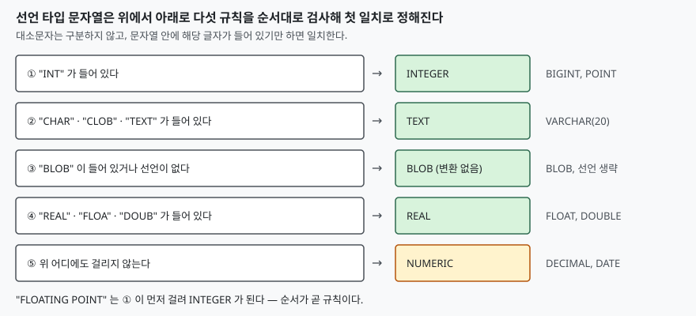

## 들어가며

CSV 파일을 표로 옮기다 보면 모든 값이 문자열로 들어온다. 나이 컬럼은 `INTEGER` 로 선언해 두었는데 파이썬 코드는 `'42'` 를 그대로 바인딩해서 넣는다. 그런데 에러가 나지 않는다. 조회해 보면 값이 잘 나오니 그냥 넘어가고, 몇 주 뒤 `WHERE age = 42` 가 어떤 행에서는 걸리고 어떤 행에서는 안 걸린다는 제보가 온다. 이때 보통은 데이터를 한 줄씩 열어 눈으로 비교하는데, 컬럼에 실제로 어떤 종류의 값이 섞여 있는지는 `typeof()` 한 번이면 확인된다. 그 전에 SQLite 가 선언한 타입을 어떻게 해석하는지부터 알아야 한다.

## 개념

> 친화성 규칙 자체와 우편번호 앞자리 0 문제는 [자료형 — SQLite의 동적 타입](../2026-10-06-sqlite-dynamic-typing-affinity/index.md)에서 먼저 다뤘다. 이 글은 그 규칙을 짧게 되짚고, **`CAST` 와 비교 연산이 친화성과 어떻게 다른지**와 `BLOB` 친화성 컬럼의 동작을 더한다.

대부분의 DB 는 컬럼 타입이 저장 가능한 값을 정한다. `INTEGER` 컬럼에 `'abc'` 를 넣으면 에러가 난다. SQLite 는 다르다. 값 자체가 타입을 가지고(`NULL`, `INTEGER`, `REAL`, `TEXT`, `BLOB` 다섯 가지 저장 클래스), 컬럼의 선언 타입은 **그 컬럼에 들어오는 값을 어느 쪽으로 바꾸려고 시도할지**를 정하는 권고에 가깝다. 이 권고를 **타입 친화성**(type affinity)이라고 부른다.

친화성은 다섯 가지다. `TEXT`, `NUMERIC`, `INTEGER`, `REAL`, `BLOB`. 선언한 타입 이름이 이 다섯 중 하나로 접히고, 값이 들어올 때 그 친화성이 선호하는 클래스로 **바꿔도 정보가 사라지지 않을 때만** 바꾼다. 바꿀 수 없으면 에러 없이 원래 값을 그대로 저장한다.

## 구조

선언 문자열이 친화성으로 접히는 규칙은 다섯 줄이고, **위에서 아래로 첫 일치**가 이긴다. 순서가 중요하다는 점이 이 규칙의 함정이다.



> **출처**: [SQLite Datatypes §3.1 Determination Of Column Affinity](https://www.sqlite.org/datatype3.html#determination_of_column_affinity)

규칙은 문자열을 해석하는 방식이다. `VARCHAR(20)` 은 `CHAR` 를 포함하므로 `TEXT`, `DECIMAL(10,2)` 는 어느 글자에도 걸리지 않으므로 `NUMERIC` 이다. 길이나 소수 자리 `(10,2)` 는 무시된다. 앞의 예제 출력에서 `BOOLEAN`·`DATE` 도 `NUMERIC` 으로 접히는 것을 볼 수 있다.

## 동작 원리

값이 컬럼에 들어올 때 일어나는 일은 친화성별로 다르다. `TEXT` 친화성은 숫자를 문자열로 바꿔 저장한다. `INTEGER` 와 `NUMERIC` 친화성은 문자열이 **숫자로 읽히면** 숫자로 바꾼다. `42.0` 처럼 소수부가 0 인 값은 정수로 줄여 저장한다. `REAL` 친화성은 정수도 실수로 바꾼다. `BLOB` 친화성은 아무것도 바꾸지 않는다.

여기서 바뀌지 않는 값이 어떻게 되는지가 핵심이다. `INTEGER` 컬럼에 `'abc'` 를 넣으면 변환에 실패하지만 에러는 없고 `TEXT` 로 저장된다. 그래서 한 컬럼 안에 정수와 문자열이 섞인다. 반면 `CAST` 는 다르다. 친화성이 "가능하면 바꾼다" 라면 `CAST(x AS INTEGER)` 는 "무조건 정수로 만든다" 이다. 숫자로 읽을 수 없는 문자열은 `0` 이 되고, `'12abc'` 처럼 앞부분만 숫자면 앞부분만 쓴다.

비교 연산에서도 친화성이 쓰인다. 컬럼과 리터럴을 비교할 때, 컬럼이 숫자 친화성이면 리터럴이 숫자로, 컬럼이 `TEXT` 친화성이면 숫자가 문자열로 바뀐 뒤 비교된다. 컬럼이 `BLOB` 친화성이거나 양쪽 다 컬럼이 아닌 표현식이면 변환이 없고, 정수 `42` 와 문자열 `'42'` 는 서로 다른 값이다.

## 실습 예제

여섯 컬럼짜리 표에 같은 문자열을 넣고 `typeof()` 로 실제 저장 클래스를 본다. 전체 소스: [`code/`](code/), 수행 기록: [`code/output.txt`](code/output.txt)

표는 `INT`, `VARCHAR(20)`, `DECIMAL(10,2)`, `DOUBLE`, `BLOB` 로 선언한 컬럼 다섯 개이고, 1~6번 행은 문자열 `'42'`, `'42.0'`, `'3.14'`, `'007'`, `'abc'`, `' 12 '` 를 바인딩해 넣었다. 7번 행은 정수 `42`, 8번 행은 실수 `3.0` 이다.

```text
  id | as_int | as_text | as_num | as_real | as_none
  ---+--------+---------+--------+---------+--------
   1 | 42     | 42      | 42     | 42.0    | 42
   2 | 42     | 42.0    | 42     | 42.0    | 42.0
   3 | 3.14   | 3.14    | 3.14   | 3.14    | 3.14
   4 | 7      | 007     | 7      | 7.0     | 007
   5 | abc    | abc     | abc    | abc     | abc
   6 | 12     |  12     | 12     | 12.0    |  12
   7 | 42     | 42      | 42     | 42.0    | 42
   8 | 3      | 3.0     | 3      | 3.0     | 3.0
```

같은 `'42'` 가 컬럼마다 다른 클래스로 저장된다. `typeof()` 결과의 일부다.

```text
-- as_int
   (1, 42, 'integer')      <- '42'   -> 정수
   (3, 3.14, 'real')       <- '3.14' -> 실수
   (4, 7, 'integer')       <- '007'  -> 7 (앞의 0 이 사라진다)
   (5, 'abc', 'text')      <- 변환 실패, 에러 없이 문자열 그대로
   (6, 12, 'integer')      <- ' 12 ' -> 12 (앞뒤 공백은 무시된다)
-- as_text
   (1, '42', 'text')
   (7, '42', 'text')       <- 정수 42 도 문자열이 된다
-- as_none  (BLOB 친화성)
   (1, '42', 'text')
   (7, 42, 'integer')      <- 바인딩한 클래스 그대로
```

`INT` 컬럼에서 `'007'` 이 `7` 이 되고 `' 12 '` 의 공백이 사라지는 점이 눈에 띈다. 입력한 문자열과 저장된 값이 같다고 가정하면 우편번호나 코드값에서 앞의 0 이 날아간다. 반대로 `TEXT` 컬럼은 `'007'` 을 그대로 지킨다.

`CAST` 와 비교는 이렇게 나왔다.

```text
SELECT CAST('abc' AS INTEGER), CAST('12abc' AS INTEGER), CAST(' 12 ' AS INTEGER), CAST('3.9' AS INTEGER), CAST(42 AS TEXT)
(0, 12, 12, 3, '42')

SELECT id FROM sample WHERE as_int = '42'            -> (1,) (2,) (7,)
SELECT id FROM sample WHERE as_none = '42'           -> (1,)
SELECT 42 = '42', CAST(42 AS TEXT) = '42'            -> (0, 1)
```

`CAST('abc' AS INTEGER)` 는 에러 없이 `0` 이고, `CAST('3.9' AS INTEGER)` 는 반올림이 아니라 소수부를 버려 `3` 이다. `as_int = '42'` 는 행 1, 2, 7 을 모두 찾는다. 행 2 는 `'42.0'` 으로 넣었지만 정수 `42` 로 저장되어 있기 때문이다. 반면 `BLOB` 친화성 컬럼 `as_none` 에서는 문자열 `'42'` 인 1번 행만 찾고, 정수 `42` 인 7번 행은 빠진다.

## 실무에서 주의할 점

- **선언 타입 이름은 글자 포함 여부로만 판정된다.** `FLOATING POINT` 는 `POINT` 안의 `INT` 때문에 `INTEGER` 로 접힌다(출력의 1번 절). 이름을 직관대로 지으면 안 되고, 새 타입 이름을 쓸 때는 `typeof()` 로 확인한다.
- **변환 실패는 에러가 아니다.** `INTEGER` 컬럼에도 문자열이 들어간다. 정수만 허용하려면 `CHECK (typeof(col) = 'integer')` 를 걸거나, SQLite 3.37 이상의 `STRICT` 표를 쓴다. 이 글의 예제는 `STRICT` 없이 돌렸다.
- **앞의 0 이 필요한 값은 `TEXT` 로 선언한다.** 우편번호·전화번호·상품 코드가 대상이다. `INT` 계열로 선언하면 `'007'` 이 `7` 이 된다.
- **`DECIMAL(10,2)` 는 소수 두 자리를 보장하지 않는다.** `NUMERIC` 친화성으로 접히고 자리수는 무시되므로, 돈 계산은 정수(원·센트 단위)로 저장하는 편이 안전하다.
- **`CAST` 를 검증 대신 쓰지 않는다.** `'abc'` 도 `0` 이 되므로, 잘못된 입력이 조용히 0 으로 바뀌어 합계에 섞인다.

## 정리

- SQLite 에서 컬럼 타입은 저장 가능한 값을 제한하지 않고, 값을 어느 클래스로 바꿔 보려는지만 정한다(타입 친화성).
- 선언 문자열은 `INT` → `CHAR/CLOB/TEXT` → `BLOB` → `REAL/FLOA/DOUB` → 그 외(`NUMERIC`) 순으로 첫 일치가 친화성이 된다.
- 변환이 정보 손실 없이 가능할 때만 바뀌고, 실패하면 에러 없이 원래 값이 저장된다.
- `CAST` 는 친화성과 달리 값을 강제로 바꾸며 실패하면 `0` 이 된다.
- 의심스러우면 `typeof()` 로 컬럼에 실제로 들어 있는 클래스를 센다.

## 참고 자료

- [SQLite Datatypes §3 Type Affinity](https://www.sqlite.org/datatype3.html#type_affinity)
- [SQLite Datatypes §3.1 Determination Of Column Affinity](https://www.sqlite.org/datatype3.html#determination_of_column_affinity)
- [SQLite Datatypes §4.2 Type Conversions Prior To Comparison](https://www.sqlite.org/datatype3.html#type_conversions_prior_to_comparison)
- [SQLite Language Expressions — CAST expressions](https://www.sqlite.org/lang_expr.html#castexpr)
- [SQLite STRICT Tables](https://www.sqlite.org/stricttables.html)
