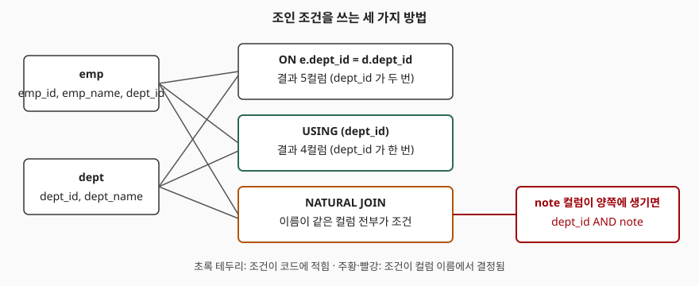

## 들어가며

사원 표와 부서 표를 합치는 쿼리를 쓰다 보면 `ON emp.dept_id = dept.dept_id` 를 매번 똑같이 타이핑하게 된다. 조인할 표가 셋, 넷으로 늘면 같은 모양의 조건이 줄줄이 이어지고, 어느 한 줄에서 `emp.` 를 `e.` 로 잘못 쓰는 일도 생긴다. 그래서 어느 날 "컬럼 이름이 같으면 알아서 붙여 주는 구문이 있다더라" 하고 `NATURAL JOIN` 으로 줄여 쓴다. 그 쿼리는 지금은 잘 돈다. 문제는 석 달 뒤 누군가 두 표에 `note` 컬럼을 하나씩 추가했을 때, 쿼리를 한 글자도 고치지 않았는데 결과가 0행이 되는 것이다. 이 글은 그 과정을 같은 데이터로 재현한다.

## 개념

조인(join, 두 표의 행을 조건에 맞게 이어 붙이는 연산)의 조건을 쓰는 방법은 세 가지다.

| 구문 | 조건을 누가 정하는가 | 결과에서 같은 이름 컬럼 |
|---|---|---|
| `ON a.x = b.x` | 쿼리 작성자가 식으로 적는다 | 두 번 나온다 |
| `USING (x)` | 작성자가 컬럼 이름만 적는다 | 한 번 나온다 |
| `NATURAL JOIN` | 두 표에 이름이 같은 컬럼 전부 | 한 번 나온다 |

`USING` 과 `NATURAL JOIN` 은 모두 "이름이 같은 컬럼의 값이 같다"는 조건을 만든다. 차이는 그 컬럼을 **누가 고르는가**다. `USING` 은 괄호 안에 적은 컬럼만 쓰고, `NATURAL JOIN` 은 이름이 겹치는 컬럼을 전부 쓴다. 적는 양은 `NATURAL JOIN` 이 가장 적지만, 조건이 코드에 보이지 않는다.

## 구조



> **출처**: [SQLite — SELECT, FROM 절 처리](https://www.sqlite.org/lang_select.html#fromclause)

## 동작 원리

SQLite 문서는 `USING` 과 `NATURAL` 을 같은 규칙으로 설명한다. `NATURAL` 은 두 표에 공통인 컬럼 이름 전체를 `USING` 목록으로 넣은 것과 같다. 비교는 `=` 이므로 어느 한쪽이 NULL 이면 그 행은 짝을 찾지 못한다. 이 점이 `ON` 과 다르지 않다.

`SELECT *` 의 결과에서는 차이가 보인다. `USING` 과 `NATURAL` 은 겹치는 컬럼을 한 번만 내보내고, `ON` 은 양쪽 컬럼을 모두 내보낸다. 컬럼 수가 다르므로 `SELECT *` 를 다른 쿼리에 끼워 넣는 코드는 구문을 바꾸는 순간 열이 밀릴 수 있다.

## 실습 예제

부서 3개, 사원 4명이다. 최민재는 부서가 NULL 이고, 인사 부서에는 사원이 없다. 전체 소스: [`code/`](code/)

```text
[dept]  3행                     [emp]  4행
  dept_id | dept_name             emp_id | emp_name | dept_id
  --------+----------            -------+----------+--------
       10 | 개발                      1 | 김하늘   |      10
       20 | 영업                      2 | 이서준   |      10
       30 | 인사                      3 | 박지우   |      20
                                     4 | 최민재   |    NULL
```

세 구문의 결과 컬럼 수는 이렇다 (`code/output.txt` 발췌).

```text
-- ON
   컬럼 5개: emp_id, emp_name, dept_id, dept_id, dept_name   (3행)
-- USING
   컬럼 4개: emp_id, emp_name, dept_id, dept_name            (3행)
-- NATURAL JOIN
   컬럼 4개: emp_id, emp_name, dept_id, dept_name            (3행)
```

행 수는 3으로 같다. 부서가 NULL 인 최민재와 사원이 없는 인사 부서는 세 구문 모두에서 빠진다. 남기고 싶으면 `LEFT JOIN` 을 쓴다. `emp LEFT JOIN dept USING (dept_id)` 는 4행이고 최민재의 `dept_name` 이 NULL 이다. 기준 표를 `dept` 로 바꾸면 인사 부서가 `emp_name` NULL 로 남는다.

이제 두 표에 `ALTER TABLE ... ADD COLUMN note TEXT` 를 한 번씩 실행한다. 쿼리는 그대로다.

```text
-- NATURAL JOIN (note 추가 후)
   컬럼 5개: emp_id, emp_name, dept_id, note, dept_name
   (0행)
-- USING (dept_id)  (note 추가 후)
   ('김하늘', '개발') ('이서준', '개발') ('박지우', '영업')   (3행)
```

`NATURAL JOIN` 은 3행에서 0행이 됐다. 조건이 `dept_id = dept_id AND note = note` 로 바뀌었는데, 두 `note` 가 모두 NULL 이어서 `NULL = NULL` 이 참이 되지 못하기 때문이다. `USING (dept_id)` 는 결과가 그대로다.

`note` 에 값을 채우면 또 다른 모양으로 어긋난다. 양쪽이 모두 빈 문자열이면 3행이 돌아오고, 개발 부서의 `note` 만 `'본사'` 로 바꾸면 개발 사원 둘이 빠져 박지우 1행만 남는다. 데이터가 바뀌는 것만으로도 행 수가 달라진다.

실행계획은 `ON` 과 `USING` 이 같다.

```text
SCAN emp
SEARCH dept USING INTEGER PRIMARY KEY (rowid=?)
```

두 구문은 같은 조건으로 풀려서 성능 차이가 없다. 고르는 기준은 읽기 쉬움과 변경에 대한 안전성이다.

## 실무에서 주의할 점

1. **`NATURAL JOIN` 은 스키마 변경에 약하다.** 컬럼이 추가되는 것만으로 결과가 달라진다. 위 예제에서는 쿼리 수정 없이 0행이 됐다. 에러가 나지 않으므로 발견이 늦다.
2. **`USING` 은 양쪽 컬럼 이름이 같아야 쓸 수 있다.** `dept.id` 와 `emp.dept_id` 처럼 이름이 다르면 `ON` 을 쓴다. 이름을 맞추려고 컬럼을 바꾸지 않는다.
3. **`SELECT *` 컬럼 수가 구문마다 다르다.** `ON` 에서 `USING` 으로 바꾸면 결과 열이 하나 줄어든다. 열 위치로 값을 읽는 코드가 있으면 같이 깨진다.
4. **NULL 은 어느 구문에서도 짝을 못 찾는다.** 짝 없는 행을 살리려면 `LEFT JOIN` 을 쓴다.
5. **다른 DB 에서 동작이 같다고 가정하지 않는다.** 구문의 세부 동작은 제품마다 다를 수 있으므로 이 글의 결과는 SQLite 3.49.1 에서만 확인한 것이다.

## 정리

- 조인 조건은 `ON`(식), `USING`(컬럼 이름), `NATURAL JOIN`(공통 컬럼 전부)의 세 가지로 쓴다.
- `USING` 과 `NATURAL` 은 겹치는 컬럼을 결과에 한 번만 내보낸다.
- `NATURAL JOIN` 은 양쪽 표에 같은 이름의 컬럼이 추가되면 조건이 조용히 늘어나, 3행이던 결과가 0행이 됐다.
- `USING (dept_id)` 처럼 컬럼을 직접 고르면 같은 변경에도 결과가 그대로다.
- 실행계획은 `ON` 과 `USING` 이 같았다.

## 참고 자료

- [SQLite — SELECT, FROM 절 처리](https://www.sqlite.org/lang_select.html#fromclause)
