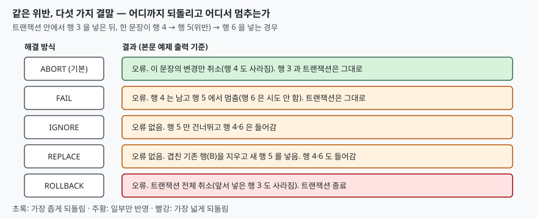

<!-- related:start -->
> **같은 기능을 다른 환경에서 다룬 글** (`conflict-resolution`)
> - [ON CONFLICT 다섯 가지 — ROLLBACK·ABORT·FAIL·IGNORE·REPLACE](../2026-10-19-on-conflict-five-resolutions/index.md) — SQLite 3.49.1, Python 3.13.5, Windows 11
<!-- related:end -->

## 들어가며

회원 목록을 외부 시스템과 맞추려고 `INSERT OR REPLACE` 로 통째로 넣었다. 오류 없이
끝났고 회원 수도 맞다. 며칠 뒤 어떤 회원의 로그인 기록이 통째로 비어 있고, 닉네임도 초기화돼
있다는 문의가 온다. 대부분은 동기화 쿼리가 아니라 로그 적재 쪽을 먼저 의심해 며칠을 쓴다.
원인은 `REPLACE` 가 갱신이 아니라 **지우고 다시 넣는** 동작이라는 데 있다.
이 글은 충돌 해결 방식 5가지 중 `UPDATE` 에서의 동작과 `REPLACE` 의 부작용을 다룬다.
`INSERT` 한 문장 안에서 5가지가 앞뒤 행을 어떻게 남기는지는
[이전 글](../2026-10-19-on-conflict-five-resolutions/index.md)에서 다뤘다.

## 개념

제약(constraint)은 `UNIQUE`·`NOT NULL`·`CHECK`·`PRIMARY KEY` 처럼 행이 지켜야 할 규칙이다.
행이 이를 어기면 SQLite 는 **충돌 해결 방식**(conflict resolution algorithm)에 따라 처리한다.
방식은 5가지다.

| 방식 | 한 줄 요약 |
|---|---|
| `ABORT` | 이 문장의 변경을 취소하고 오류를 낸다. 기본값 |
| `FAIL` | 오류를 내고 멈추되, 멈추기 전까지 한 변경은 그대로 둔다 |
| `IGNORE` | 위반한 그 행만 건너뛰고 계속한다. 오류가 없다 |
| `REPLACE` | 겹치는 기존 행을 지우고 새 행을 넣는다 |
| `ROLLBACK` | 오류를 내고 현재 트랜잭션 전체를 취소한다 |

문장마다 `INSERT OR IGNORE INTO ...`, `UPDATE OR FAIL ...` 처럼 `OR` 뒤에 붙여 고른다.
테이블 정의의 제약 뒤에 `ON CONFLICT REPLACE` 를 붙여 기본 방식을 바꿀 수도 있지만,
이 글은 문장 쪽만 다룬다. 이 `ON CONFLICT` 절은 SQLite 의 문법이며 다른 DBMS 의
`ON CONFLICT DO UPDATE` 와는 다르다. 후자(UPSERT)는 4번 예제에서 대조한다.

## 구조



> **출처**: [SQLite ON CONFLICT 절](https://www.sqlite.org/lang_conflict.html), [SQLite INSERT 문](https://www.sqlite.org/lang_insert.html)

도식의 초록·주황·빨강은 되돌림의 범위를 가리킨다. `ABORT` 는 문장 하나, `ROLLBACK` 은
트랜잭션 전체를 되돌리고, 그 사이에서 `FAIL`·`IGNORE`·`REPLACE` 는 이미 한 변경을 일부
남긴다.

## 동작 원리

가장 헷갈리는 구분은 `ABORT` 와 `ROLLBACK` 이다. 둘 다 오류를 내지만 되돌리는 단위가
다르다. `ABORT` 는 **지금 실행 중인 문장**이 한 변경만 취소하고 트랜잭션은 열어 둔다.
`ROLLBACK` 은 그 트랜잭션에서 앞서 한 모든 변경을 취소하고 트랜잭션을 끝낸다.

`FAIL` 은 `ABORT` 와 비슷하지만 **문장 안에서** 다르다. 한 문장이 여러 행을 건드릴 때,
위반을 만나기 전에 처리한 행은 남는다. 위반한 행에서 멈추고 오류를 내며, 그 뒤 행은
시도하지 않는다.

`REPLACE` 는 제약의 종류에 따라 하는 일이 갈린다. 공식 문서에 따르면 `UNIQUE`·`PRIMARY KEY`
위반은 기존 행을 지우고 새 행을 넣는다. `NOT NULL` 위반은 `NULL` 을 그 컬럼의 기본값으로
바꿔 넣고, 기본값이 없으면 `ABORT` 처럼 동작한다. `CHECK` 위반은 `ABORT` 처럼 동작한다.
아래 3번 예제가 이 세 가지를 같은 표에서 돌린 결과다.

## 실습 예제

전체 소스는 [`code/`](code/)에 있고, 아래 출력은 `code/output.txt` 에서 가져왔다.

**1. 여러 행 INSERT 중 UNIQUE 위반.** `product` 에 `(1,'A')`, `(2,'B')` 가 있고
`BEGIN` 후 `(3,'C')` 를 먼저 넣는다. 그다음 한 문장으로 `(4,'D')`, `(5,'B')`, `(6,'E')` 를
넣는데 행 5 의 코드 `B` 가 겹친다.

```text
INSERT OR ABORT    오류: UNIQUE constraint failed: product.code
  남은 행: [(1, 'A', 10), (2, 'B', 20), (3, 'C', 30)]
INSERT OR FAIL     오류: UNIQUE constraint failed: product.code
  남은 행: [(1, 'A', 10), (2, 'B', 20), (3, 'C', 30), (4, 'D', 40)]
INSERT OR IGNORE   오류 없음
  남은 행: [(1, 'A', 10), (2, 'B', 20), (3, 'C', 30), (4, 'D', 40), (6, 'E', 60)]
INSERT OR REPLACE  오류 없음
  남은 행: [(1, 'A', 10), (3, 'C', 30), (4, 'D', 40), (5, 'B', 50), (6, 'E', 60)]
INSERT OR ROLLBACK 오류: UNIQUE constraint failed: product.code
  남은 행: [(1, 'A', 10), (2, 'B', 20)]
```

`ABORT` 는 행 4 까지 취소해 행 3 만 앞에 남겼고, `FAIL` 은 행 4 를 남겼다. `IGNORE` 는 행 5 만
빼고 6 까지 넣었다. `REPLACE` 는 `(2,'B',20)` 을 지우고 `(5,'B',50)` 을 넣었다. 예상과 다르게
`ROLLBACK` 은 문장과 무관하게 먼저 넣은 행 3 까지 사라졌다. 출력에는 `트랜잭션 안인가`
도 찍었는데, `ROLLBACK` 만 `False` 이고 나머지는 모두 `True` 였다.

**2. 여러 행 UPDATE 중 CHECK 위반.** `stock` 에서 `qty >= 0` 을 지켜야 하는데 행 3 의
수량이 0 이다. `UPDATE ... SET qty = qty - 1` 을 모든 행에 적용하면 행 3 에서 위반한다.

```text
UPDATE OR ABORT    오류: CHECK constraint failed: qty >= 0
  남은 행: [(1, 5), (2, 5), (3, 0), (4, 5)]
UPDATE OR FAIL     오류: CHECK constraint failed: qty >= 0
  남은 행: [(1, 4), (2, 4), (3, 0), (4, 5)]
UPDATE OR IGNORE   오류 없음
  남은 행: [(1, 4), (2, 4), (3, 0), (4, 4)]
UPDATE OR REPLACE  오류: CHECK constraint failed: qty >= 0
  남은 행: [(1, 5), (2, 5), (3, 0), (4, 5)]
```

`FAIL` 은 행 1, 2 까지 바꾸고 멈췄고 행 4 는 건드리지 않았다. `IGNORE` 는 행 3 만 빼고 모두
바꿨다. `REPLACE` 는 `CHECK` 위반을 해결하지 못하고 `ABORT` 와 같은 결과를 냈다.
(`ROLLBACK` 도 같은 오류를 냈다. 출력 전체는 `output.txt` 에 있다.)

**3. REPLACE 가 위반 종류별로 하는 일.** `member` 에 `(1,'a@x.com','gold',30)` 이 있다.
`UNIQUE` 위반을 일으킨 `INSERT OR REPLACE` 는 오류 없이 행 1 을 지우고 행 2 를 넣었다.
`grade` 에 `NULL` 을 넣은 `NOT NULL` 위반은 오류 없이 기본값 `'basic'` 으로 들어갔다.
`age = -1` 인 `CHECK` 위반만 오류가 났다. 남은 행은 `(2,'a@x.com','basic',31)` 과
`(3,'b@x.com','basic',20)` 이다. 새 행에서 `grade` 를 생략했으므로 기존 행의 `'gold'` 는
이어지지 않고 기본값 `'basic'` 이 됐다.

**4. REPLACE 는 UPDATE 가 아니라 DELETE 후 INSERT 다.** `account` 에 닉네임이 있는 행이
있고, 이를 `ON DELETE CASCADE` 로 참조하는 `login_log` 3건과 삭제 감사용 `AFTER DELETE`
트리거가 붙어 있다. 외래키 검사는 `PRAGMA foreign_keys = ON` 으로 켰다.

```text
INSERT OR REPLACE INTO account (account_id, email) VALUES (1, 'a@x.com')
  account    : [(1, 'a@x.com', None)]
  login_log  : []
  delete_audit (recursive_triggers 꺼짐): []
  delete_audit (recursive_triggers 켜짐 후 한 번 더): [(1,)]
```

닉네임 `'민수'` 는 `None` 이 됐고, 같은 행의 로그 3건은 `CASCADE` 로 모두 사라졌다. 삭제 트리거는
기본 설정에서는 불리지 않았고, `recursive_triggers` 를 켠 뒤에는 불렸다. 같은 입력을
`ON CONFLICT (account_id) DO UPDATE SET email = excluded.email` 로 넣으면 닉네임
`'민수'` 가 그대로 남았다.

## 실무에서 주의할 점

1. **`REPLACE` 는 갱신이 아니다.** 4번처럼 새 문장에서 안 적은 컬럼은 기본값이 되고, 3번처럼
   `grade` 같은 기존 값도 이어지지 않는다. 일부 컬럼만 바꾸려면 `UPDATE` 나 UPSERT 를 쓴다.
2. **외래키가 켜져 있으면 `REPLACE` 가 자식 행을 지울 수 있다.** `CASCADE` 면 4번처럼 로그가
   사라진다. 다른 동작(`RESTRICT` 등)은 이 글에서 돌려 보지 않았다. `REPLACE` 하기 전에 그 행을 참조하는 표를 확인한다.
3. **삭제 트리거는 기본 설정에서 안 불린다.** 4번에서 감사 테이블이 비었다. `REPLACE` 로
   지워진 행의 삭제 감사가 필요하면 `recursive_triggers` 를 켜야 하고, 그 설정이 다른 트리거의
   연쇄 호출에도 영향을 준다는 점을 같이 본다.
4. **`ROLLBACK` 은 문장 단위로 쓸 방식이 아니다.** 1번에서 앞서 넣은 행 3 까지 사라졌다.
   호출한 쪽 코드가 그 트랜잭션에 다른 작업을 묶어 뒀다면 영향이 번진다.
5. **`IGNORE` 는 오류를 숨긴다.** 500건 중 몇 건이 빠졌는지 알려 주지 않으므로, 넣은 뒤
   건수를 비교하는 확인이 따로 필요하다.

## 정리

- 충돌 해결 방식은 `ABORT`·`FAIL`·`IGNORE`·`REPLACE`·`ROLLBACK` 5가지이고 기본은 `ABORT` 다
- 되돌리는 범위는 `ABORT`(문장) < `ROLLBACK`(트랜잭션) 이고 `FAIL` 은 멈춘 지점까지 남긴다
- `IGNORE` 는 위반한 행만 건너뛰고 오류를 내지 않는다
- `REPLACE` 는 `UNIQUE` 위반에서는 지우고 다시 넣고, `NOT NULL` 은 기본값으로, `CHECK` 는 `ABORT` 처럼 동작한다
- 지우고 다시 넣는 만큼 외래키 `CASCADE` 와 기본값 대체, 삭제 트리거 미호출을 함께 본다

## 참고 자료

- [SQLite ON CONFLICT 절](https://www.sqlite.org/lang_conflict.html)
- [SQLite INSERT 문](https://www.sqlite.org/lang_insert.html)
- [SQLite UPSERT](https://www.sqlite.org/lang_upsert.html)
- [SQLite 외래키 지원](https://www.sqlite.org/foreignkeys.html)
