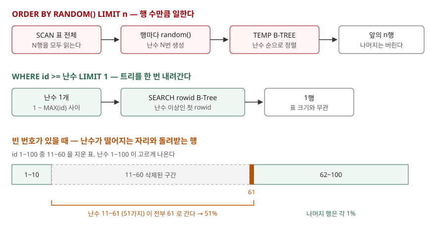

## 들어가며

이벤트 당첨자를 뽑거나, 화면에 "오늘의 추천 상품" 세 개를 띄우거나, 데이터가 맞는지 몇 건만 골라 눈으로 확인하고 싶을 때가 있다. 검색하면 `ORDER BY RANDOM() LIMIT 3` 한 줄이 가장 먼저 나오고, 개발 중인 작은 표에서는 아무 문제 없이 돈다. 그런데 이 한 줄은 3행을 뽑으려고 **표의 모든 행에 난수를 하나씩 매기고 정렬한다.** 회원이 10만 명이면 난수 10만 개를 만들고 10만 행을 줄 세운 뒤 3행만 남기고 버린다.

## 개념

**표본 추출**(sampling)은 전체 행 가운데 일부를 골라 내는 일이다. 무작위 표본이라면 모든 행이 뽑힐 확률이 같아야 한다.

SQL 에는 "무작위로 골라라"라는 문법이 따로 없다. 그래서 두 가지를 조합한다. 하나는 `random()` 함수다. SQLite 에서 이 함수는 부를 때마다 64비트 범위의 정수 하나를 돌려준다. 다른 하나는 `ORDER BY` 와 `LIMIT` 이다. 행마다 난수를 붙이고 그 난수 순으로 정렬한 뒤 앞의 n행을 자르면, 어느 행이 앞에 올지는 난수가 정하므로 무작위 표본이 된다.

이 방법은 정확하다. 행마다 난수가 독립적으로 붙으므로 모든 행의 확률이 같다. 문제는 비용이다. 정렬하려면 비교할 값이 전부 있어야 하므로 **모든 행에 난수를 먼저 붙여야 한다.**

## 구조



> **출처**: [SQLite — EXPLAIN QUERY PLAN, Temporary Sorting B-Trees](https://www.sqlite.org/eqp.html#temporary_sorting_b_trees) · [SQLite — CREATE TABLE, ROWIDs and the INTEGER PRIMARY KEY](https://www.sqlite.org/lang_createtable.html#rowid)

## 동작 원리

10행짜리 `product` 표에서 `ORDER BY RANDOM() LIMIT 3` 을 세 번 돌리면 매번 다른 3행이 나온다. 실행계획은 이렇다.

```text
QUERY PLAN
|--SCAN product
`--USE TEMP B-TREE FOR ORDER BY
```

`SCAN` 은 표를 처음부터 끝까지 읽는다는 뜻이고, `USE TEMP B-TREE FOR ORDER BY` 는 정렬을 위해 임시 B-Tree(정렬용 자료 구조)를 만든다는 뜻이다. 인덱스로 순서를 얻을 수 없으니 읽은 행을 모두 거기에 넣어 정렬한다.

난수를 실제로 몇 번 만드는지 세어 봤다. `random()` 대신 호출할 때마다 횟수를 세는 함수를 등록해 같은 질의를 돌렸다.

```text
  표의 행 수 | 뽑은 행 | 난수 생성 횟수
  -----------+---------+---------------
        1000 |       3 |           1000
       10000 |       3 |          10000
      100000 |       3 |         100000
```

`LIMIT 3` 이 붙어 있어도 난수는 행 수만큼 만들어진다. 어느 행이 가장 작은 난수를 받을지는 모든 행에 난수를 붙여 보기 전에는 알 수 없기 때문이다.

## 실습 예제

전체 소스: [`code/`](code/) · 수행 기록: [`code/output.txt`](code/output.txt)

빠른 대안으로 흔히 쓰는 방법은 **rowid 범위에서 난수 하나를 고르는 것**이다. SQLite 표의 `INTEGER PRIMARY KEY` 는 rowid(행마다 붙는 정수 번호)의 별칭이고, 표는 이 번호 순서의 B-Tree 로 저장된다. 1부터 가장 큰 id 사이에서 난수 하나를 고르고 그 이상인 첫 행을 읽으면 트리를 한 번 내려가는 것으로 끝난다.

```sql
SELECT id, payload FROM big WHERE id >= ? ORDER BY id LIMIT 1
```

```text
QUERY PLAN
`--SEARCH big USING INTEGER PRIMARY KEY (rowid>?)
```

20만 행 표에서 한 행을 뽑는 시간을 20회 평균으로 쟀다. `ORDER BY RANDOM() LIMIT 1` 은 9.952ms, rowid 방식은 0.006ms 였다. 절대 값은 환경마다 다르지만, 앞쪽은 행 수에 비례해 늘고 뒤쪽은 표 크기와 거의 무관하다.

그런데 이 방법에는 **빈 번호**라는 함정이 있다. id 1~100 인 표에서 11~60 을 지우고 1만 번 뽑아 봤다.

```text
  id  | 뽑힌 횟수 | 비율
  ----+-----------+------
    1 |        86 |  0.9%
   10 |       101 |  1.0%
   61 |      5052 | 50.5%
   62 |        93 |  0.9%
  100 |       103 |  1.0%
```

50행이 남았으니 고르게 뽑혔다면 행마다 2% 근처여야 한다. 그러나 61번이 절반을 가져갔다. 난수가 11~61 사이(51가지)에 떨어지면 전부 "그 이상인 첫 행"인 61번으로 가기 때문이다. 51/100 = 51% 로 계산과 측정이 맞는다. 다른 행은 자기 번호 하나에 떨어질 때만 뽑히므로 1% 다. 삭제가 잦은 표일수록 빈 구간 바로 뒤의 행이 자주 뽑힌다.

마지막으로 **같은 표본을 다시 뽑아야 할 때**다. SQLite 의 `random()` 은 SQL 에서 시드(난수 순서를 정하는 시작 값)를 줄 방법이 없어 같은 결과를 다시 낼 수 없다. 그래서 `(id * 1103515245 + 시드) % 2147483648` 처럼 시드를 섞은 식으로 정렬해 봤다.

```text
  seed=7: [(2, 'banana'), (4, 'grape'), (6, 'lemon')]
  seed=8: [(2, 'banana'), (4, 'grape'), (6, 'lemon')]
  seed=1000000000: [(3, 'cherry'), (5, 'kiwi'), (7, 'mango')]
```

시드를 7에서 8로 바꿔도 표본이 같았다. 시드를 **더하면** 모든 행의 정렬 키가 같은 양만큼 움직일 뿐 서로의 순서는 그대로다. 나머지 연산으로 일부 키가 2147483648 을 넘어 한 바퀴 돌아갈 만큼 시드가 커야 순서가 바뀐다. 시드 1000000000 에서 표본이 달라진 것이 그 경우다.

재현이 필요하면 id 목록을 받아 애플리케이션에서 시드를 준 난수 생성기로 고르고, 고른 id 를 `WHERE id IN (...)` 으로 읽는 편이 확실했다. 같은 시드에서 같은 3행이, 다른 시드에서 다른 3행이 나왔다.

## 실무에서 주의할 점

**첫째, `LIMIT` 이 작다고 비용이 작아지지 않는다.** `ORDER BY RANDOM()` 은 뽑는 행이 1개든 100개든 모든 행을 읽고 난수를 붙인다. 작은 표나 가끔 도는 관리용 질의에는 그대로 써도 되지만, 요청마다 도는 화면 질의라면 표가 커질 때 같이 느려진다.

**둘째, rowid 방식은 빈 번호가 없을 때만 고르다.** 삭제가 거의 없는 표라면 빠르고 쓸 만하다. 삭제가 잦다면 빈 구간 바로 뒤의 행이 자주 뽑힌다. 결과가 비었을 때(난수가 가장 큰 id 보다 클 때) 처리도 필요하다.

**셋째, 조건이 붙으면 rowid 방식이 더 어려워진다.** `WHERE category = '과일'` 처럼 일부 행에서만 뽑으려면 그 행들의 번호 사이가 비어 있는 것과 같아서 앞의 실험과 같은 치우침이 생긴다. 이럴 때는 조건에 맞는 id 만 먼저 뽑아 개수를 센 뒤 그 안에서 고르는 편이 정확하다.

**넷째, 재현 가능한 표본이 필요하면 SQL 식으로 흉내 내지 않는다.** 시드를 더하는 식은 시드를 바꿔도 순서가 거의 그대로였다. 검증용 표본처럼 같은 결과가 다시 나와야 한다면 고른 id 목록 자체를 저장해 두는 것도 방법이다.

## 정리

- `ORDER BY RANDOM() LIMIT n` 은 정확한 무작위 표본을 주지만, 행 수만큼 난수를 만들고 전체를 정렬한다
- rowid 범위에서 난수 하나를 고르면 트리를 한 번 내려가는 것으로 끝나 표 크기와 무관하게 빠르다
- 대신 빈 번호가 있으면 빈 구간 바로 뒤의 행이 그 구간 몫만큼 더 뽑힌다
- SQLite 의 `random()` 은 SQL 에서 시드를 줄 수 없고, 시드를 더한 선형식은 순서를 바꾸지 못했다

## 참고 자료

- [SQLite — Core Functions, random()](https://www.sqlite.org/lang_corefunc.html#random)
- [SQLite — EXPLAIN QUERY PLAN, Temporary Sorting B-Trees](https://www.sqlite.org/eqp.html#temporary_sorting_b_trees)
- [SQLite — CREATE TABLE, ROWIDs and the INTEGER PRIMARY KEY](https://www.sqlite.org/lang_createtable.html#rowid)
- [SQLite — SELECT, ORDER BY 절](https://www.sqlite.org/lang_select.html#orderby)
