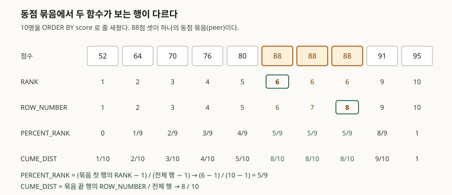

<!-- related:start -->
> **같은 기능을 다른 환경에서 다룬 글** (`window-function`)
> - [윈도우 함수 입문 — ROW_NUMBER로 그룹별 1등 뽑기](../2026-10-03-window-function-row-number-top-per-group/index.md) — SQLite 3.49.1, Python 3.13.5, Windows 11
> - [RANK와 DENSE_RANK — 동점을 어떻게 셀까](../2026-10-06-rank-dense-rank-ties/index.md) — SQLite 3.49.1, Python 3.13.5, Windows 11
> - [누적합과 이동평균 — SUM OVER의 프레임](../2026-10-06-sum-over-frame-rows-range/index.md) — SQLite 3.49.1, Python 3.13.5, Windows 11
> - [LAG와 LEAD — 앞뒤 행의 값을 같은 줄에 놓기](../2026-10-12-lag-lead-previous-next-row/index.md) — SQLite 3.49.1, Python 3.13.5, Windows 11
> - [FIRST_VALUE와 LAST_VALUE — 구간의 처음과 끝](../2026-10-16-first-value-last-value-window-frame/index.md) — SQLite 3.49.1, Python 3.13.5
> - [NTILE — 데이터를 n등분하는 법](../2026-10-16-ntile-quartile-remainder/index.md) — SQLite 3.49.1, Python 3.13.5
> - [Tibero 7 분석 함수의 윈도우 절 — ROWS와 RANGE는 어디서 갈리는가](../../tibero/2026-09-23-tibero7-window-clause/index.md) — Tibero 7
<!-- related:end -->

## 들어가며

시험 점수를 표로 받아 "각자 상위 몇 퍼센트인지 한 칸 붙여 달라"는 부탁을 받는다. 엑셀이라면 정렬해서 순위를 매기고
인원수로 나누겠지만, SQL로 하려면 먼저 전체 인원을 세는 질의를 돌리고, 그 숫자를 손으로 옮겨 순위 질의에 나눗셈을
붙인다. 반별로 달라고 하면 반 수만큼 인원을 센다. 게다가 88점이 세 명이면 셋이 같은 퍼센트를 받아야 하는데,
순위를 1, 2, 3으로 매긴 계산은 그 셋을 서로 다르게 만든다.

`PERCENT_RANK()`와 `CUME_DIST()`는 이 계산을 질의 하나로 한다. 다만 **둘은 같은 88점에게 다른 값을 준다** —
0.556과 0.8이다. 어느 쪽이 "상위 몇 %"에 맞는지는 둘이 무엇을 세는지 알아야 고를 수 있다.

## 개념

두 함수 모두 **윈도우 함수**다. 윈도우 함수는 행을 하나로 합치지 않고, 각 행 옆에 "다른 행과 비교한 값"을 한 칸 붙인다.
`OVER (ORDER BY score)`가 비교 기준이 되는 줄 세우기를 정하고, `PARTITION BY`를 붙이면 그 줄을 묶음(파티션)마다 따로 세운다.

| 함수 | 질문 | 값의 범위 |
|---|---|---|
| `RANK()` | 몇 등인가 (동점은 같은 등수, 다음 등수를 건너뜀) | 1 ~ 행 수 |
| `PERCENT_RANK()` | 나보다 **낮은** 사람이 몇 %인가 | 0.0 ~ 1.0 |
| `CUME_DIST()` | 나와 **같거나 낮은** 사람이 몇 %인가 | 0보다 큼 ~ 1.0 |

SQLite 문서는 두 함수를 공식으로 정의한다.

- `PERCENT_RANK()` = (*rank* − 1) / (*partition-rows* − 1). *rank*는 `RANK()`의 값이고, 파티션에 행이 하나뿐이면 0.0이다
- `CUME_DIST()` = *row-number* / *partition-rows*. *row-number*는 **동점 묶음의 마지막 행**의 `ROW_NUMBER()` 값이다

여기서 **동점 묶음**(문서 표현으로 peer)은 `ORDER BY` 값이 같은 행들이다.

## 구조

두 공식이 갈리는 곳은 동점 묶음에서 **어느 행의 번호를 쓰느냐**다.



> **출처**: [SQLite Window Functions §3 Built-in Window Functions — rank(), percent_rank(), cume_dist()](https://www.sqlite.org/windowfunctions.html#built_in_window_functions)

## 동작 원리

`RANK()`는 문서 표현으로 "각 묶음 첫 행의 `ROW_NUMBER()`"다. 88점 셋은 6·7·8번째 행이지만 모두 첫 행 번호인 6을 받는다.
`PERCENT_RANK`는 여기서 1을 빼고 (전체 − 1)로 나눈다. 1을 빼는 것은 **자기 자신을 세지 않기 위해서**다. RANK가 6이면
정렬 앞쪽(오름차순이니 더 낮은 점수)에 5명이 있고, 자기를 뺀 9명 중 5명이므로 5/9다.
그래서 정렬 맨 앞 행은 늘 0, 맨 끝 행은 늘 1이 된다.

`CUME_DIST`는 반대로 묶음의 **끝 행** 번호 8을 쓴다. "나와 같은 점수까지 포함해 몇 명이 내 자리 이하에 있는가"를
전체 10명으로 나누므로 8/10이다. 자기 자신을 포함하니 0이 나올 수 없고, 맨 끝 행은 늘 1이다.

정리하면 동점 셋은 `PERCENT_RANK`에서는 묶음의 **앞쪽 경계**를, `CUME_DIST`에서는 **뒤쪽 경계**를 함께 받는다.
동점이 없으면 두 값은 (n−1)과 n의 차이만 남는다.

## 실습 예제

10명짜리 점수표를 만들고 네 함수를 나란히 돌린다. 전체 소스: [`code/`](code/) · 돌린 기록: [`code/output.txt`](code/output.txt)

```python
conn.executescript("""
CREATE TABLE exam (
    student TEXT    NOT NULL,
    class   TEXT    NOT NULL,
    score   INTEGER
);
INSERT INTO exam (student, class, score) VALUES
  ('가온', 'A반', 95), ('나래', 'A반', 88), ('다온', 'A반', 88),
  ('라온', 'A반', 88), ('마루', 'A반', 76), ('바름', 'B반', 91),
  ('사름', 'B반', 70), ('아름', 'B반', 64), ('자람', 'B반', 52),
  ('차오', 'C반', 80);
""")
```

```sql
SELECT student, score,
       RANK()         OVER w AS rnk,
       ROW_NUMBER()   OVER w AS rn,
       PERCENT_RANK() OVER w AS pct_rank,
       CUME_DIST()    OVER w AS cume
FROM exam
WHERE score IS NOT NULL
WINDOW w AS (ORDER BY score)
ORDER BY score, student
```

```text
  student | score | rnk | rn | pct_rank           | cume
  --------+-------+-----+----+--------------------+-----
  자람    |    52 |   1 |  1 |                0.0 |  0.1
  아름    |    64 |   2 |  2 | 0.1111111111111111 |  0.2
  사름    |    70 |   3 |  3 | 0.2222222222222222 |  0.3
  마루    |    76 |   4 |  4 | 0.3333333333333333 |  0.4
  차오    |    80 |   5 |  5 | 0.4444444444444444 |  0.5
  나래    |    88 |   6 |  6 | 0.5555555555555556 |  0.8
  다온    |    88 |   6 |  7 | 0.5555555555555556 |  0.8
  라온    |    88 |   6 |  8 | 0.5555555555555556 |  0.8
  바름    |    91 |   9 |  9 | 0.8888888888888888 |  0.9
  가온    |    95 |  10 | 10 |                1.0 |  1.0
```

`WINDOW w AS (...)`는 같은 `OVER` 절을 네 번 쓰지 않으려고 이름을 붙인 것이다. 공식대로 손으로 계산한 값과 맞춰 보면
열 줄 모두 같다. `COUNT(*) OVER (ORDER BY score)`가 동점 끝까지 세는 것을 이용해 *row-number*를 구했다.

```text
  나래  88  (6-1)/(10-1)=0.5556 vs 0.5556   8/10=0.8000 vs 0.8000   일치=True
  바름  91  (9-1)/(10-1)=0.8889 vs 0.8889   9/10=0.9000 vs 0.9000   일치=True
```

`PARTITION BY class`를 붙이면 반마다 따로 센다. 한 명뿐인 C반이 눈에 띈다.

```text
  class | student | score | pct_rank           | cume
  ------+---------+-------+--------------------+-----
  B반   | 바름    |    91 |                1.0 |  1.0
  C반   | 차오    |    80 |                0.0 |  1.0
```

차오는 반에서 1등이자 꼴찌인데 `PERCENT_RANK`는 0, `CUME_DIST`는 1이다. 공식의 분모 (1 − 1)이 0이 되는 자리를
문서가 "0.0을 돌려준다"로 정해 둔 결과다. **한 명뿐인 반의 학생이 "하위 0%"로 찍힌다.**

## 실무에서 주의할 점

**1. "상위 몇 %"는 내림차순 `CUME_DIST`로 구한다.** 오름차순 값을 1에서 빼면 될 것 같지만 둘은 다른 값이다.

```text
  student | score | top_share | one_minus_asc
  --------+-------+-----------+--------------------
  가온    |    95 |       0.1 |                 0.0
  바름    |    91 |       0.2 | 0.09999999999999998
  나래    |    88 |       0.5 | 0.19999999999999996
```

`1 - CUME_DIST()`는 "나보다 높은 사람의 비율"이라 1등이 0%가 된다. `CUME_DIST() OVER (ORDER BY score DESC)`는
"나와 같거나 높은 사람의 비율"이라 1등이 10%, 88점 셋이 50%다. 게다가 뺄셈은 0.1을 0.09999999999999998로 만든다.
실수(부동소수점)가 0.1을 정확히 담지 못해서다. 화면에 보일 값이면 `ROUND()`를 씌운다.

**2. 손으로 공식을 쓰면 정수 나눗셈에 걸린다.** `RANK()`와 `COUNT(*)`는 둘 다 정수라 SQLite는 정수끼리 나눠 몫만 남긴다.

```text
  정수끼리 나눔: [0, 0, 0, 0, 0, 0, 0, 0, 0, 1]
  한쪽을 실수로: [0.0, 0.1111111111111111, 0.2222222222222222, ...]
```

`* 1.0`처럼 한쪽을 실수로 바꿔야 한다. 내장 함수를 쓰면 이 걱정이 없다.

**3. NULL 한 명이 전원의 값을 바꾼다.** 점수가 NULL인 학생 한 명을 넣으면 오름차순에서 NULL이 맨 앞에 선다.

```text
  student | score | pct_rank | cume
  --------+-------+----------+--------------------
  카람    |  NULL |      0.0 | 0.09090909090909091
  자람    |    52 |      0.1 | 0.18181818181818182
  가온    |    95 |      1.0 |                 1.0
```

자람은 0.0에서 0.1로 바뀌었다. 시험을 안 본 사람을 "가장 낮은 점수"로 센 것이다. `WHERE score IS NOT NULL`로 먼저
거르면 원래 값으로 돌아온다. `WHERE`는 윈도우 함수보다 먼저 처리되므로 걸러진 행은 분모에도 들어가지 않는다.

**4. `ORDER BY`를 빼면 전원이 같은 값을 받는다.** 문서가 `RANK()`에 대해 적은 대로 `ORDER BY`가 없으면 모든 행이
하나의 동점 묶음이 된다.

```text
  PERCENT_RANK 값 종류: [0.0]
  CUME_DIST 값 종류:    [1.0]
```

에러가 나지 않으므로 빠뜨려도 모른다.

**5. 백분위의 "값"을 구하는 함수는 없다.** 두 함수는 "이 점수가 몇 %인가"를 답하고, 반대 방향인 "50% 지점의 점수는
얼마인가"(중앙값)는 답하지 않는다. 파이썬 내장 SQLite 3.49.1에서는 다른 DB에 있는 이름들이 전부 없었다.

```text
  median(score) -> OperationalError: no such function: median
  percentile_cont(score, 0.5) -> OperationalError: no such function: percentile_cont
```

이 환경에서는 `CUME_DIST() >= 0.5`인 첫 행을 고르는 식으로 직접 구해야 한다.

**6. 정렬 비용이 든다.** 실행계획에 `ORDER BY`용 임시 B-Tree가 뜬다. 정렬 컬럼에 인덱스가 없으면 파티션 전체를 정렬한다.

```text
QUERY PLAN
|--CO-ROUTINE (subquery-2)
|  |--SCAN exam
|  `--USE TEMP B-TREE FOR ORDER BY
`--SCAN (subquery-2)
```

## 정리

- `PERCENT_RANK`는 (RANK − 1) / (n − 1)로 "나보다 앞에 선 사람의 비율"을, `CUME_DIST`는 (묶음 끝 행 번호) / n으로
  "나와 같거나 앞에 선 사람의 비율"을 돌려준다.
- 동점 묶음은 `PERCENT_RANK`에서 앞쪽 경계를, `CUME_DIST`에서 뒤쪽 경계를 함께 받는다. 88점 셋이 5/9와 8/10을 받은 이유다.
- 한 행뿐인 파티션은 `PERCENT_RANK`가 0, `CUME_DIST`가 1이다.
- "상위 몇 %"는 `ORDER BY ... DESC`로 다시 매긴 `CUME_DIST`다. `1 - CUME_DIST()`는 다른 값이다.
- NULL은 오름차순 맨 앞에 서서 분모와 순위에 들어가므로 `WHERE`로 먼저 거른다.

## 참고 자료

- [SQLite Window Functions §3 Built-in Window Functions — rank(), percent_rank(), cume_dist()](https://www.sqlite.org/windowfunctions.html#built_in_window_functions)
- [SQLite Window Functions](https://www.sqlite.org/windowfunctions.html)
