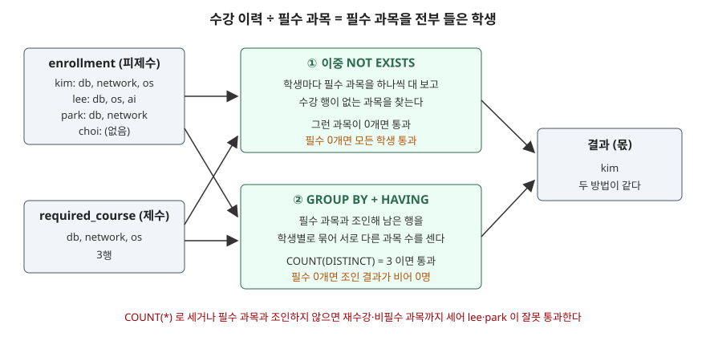

## 들어가며

학사 시스템에서 졸업 요건을 확인하는 화면을 만들다 보면 "필수 과목 세 개를 **전부** 들은 학생"을 뽑아야 하는 순간이 온다. "하나라도 들은 학생"은 `IN` 이나 `JOIN` 한 줄로 끝나는데, "전부"는 SQL 에 바로 대응하는 문법이 없다. 그래서 흔히 학생마다 수강 과목 목록을 애플리케이션으로 가져와 필수 목록과 하나씩 대 본다. 학생이 1만 명이면 질의를 1만 번 보내거나, 수강 이력 전체를 메모리로 끌어와 반복문을 돌리게 된다. 데이터베이스가 한 번에 답할 수 있는 질문을 네트워크 너머로 쪼개 보내는 셈이다.

## 개념

이런 질문을 **관계 나눗셈**(relational division)이라 부른다. 수강 이력(학생, 과목)을 필수 과목(과목)으로 "나누면", 필수 과목 모두와 짝을 이루는 학생만 몫으로 남는다는 뜻이다. 학생 한 명과 필수 과목들의 조합이 전부 피제수(수강 이력) 안에 있어야 그 학생이 몫에 들어간다.

SQL 에는 나눗셈 연산자가 없어서 다른 문장으로 바꿔 쓴다. 두 가지 방법이 널리 쓰인다.

| | 이중 `NOT EXISTS` | `GROUP BY` + `HAVING` |
|---|---|---|
| 바꿔 쓴 문장 | 이 학생이 **듣지 않은** 필수 과목이 **하나도 없다** | 이 학생이 들은 필수 과목 수가 필수 과목 수와 **같다** |
| 핵심 문법 | 상관 부질의 두 겹 | 조인 후 `COUNT(DISTINCT ...)` 비교 |
| 필수 목록이 비었을 때 | 모든 학생 | 0명 |

Silberschatz 교재의 SQL 장은 같은 질문을 집합 연산으로 적는다. "필수 과목 − 들은 과목 = 공집합"이면 필수 과목이 들은 과목에 포함된다는 것이다. 이 글의 예제는 이 세 번째 형태(`NOT EXISTS (... EXCEPT ...)`)도 함께 돌렸는데, 결과는 이중 `NOT EXISTS` 와 모든 경우에 같았다.

## 구조



> **출처**: [SQLite — SQL Language Expressions, The EXISTS operator](https://www.sqlite.org/lang_expr.html#the_exists_operator) · [SQLite — Built-in Aggregate Functions, count(X)](https://www.sqlite.org/lang_aggfunc.html#count) · [Silberschatz·Korth·Sudarshan, Database System Concepts 7판 슬라이드 3장 3.46 Use of "not exists" Clause](https://www.db-book.com/slides-dir/PDF-dir/ch3.pdf)

## 동작 원리

예제의 데이터는 학생 4명, 필수 과목 3개(`db`·`network`·`os`), 수강 행 8개다. kim 은 세 과목을 다 들었고, lee 는 `network` 대신 필수가 아닌 `ai` 를 들었고, park 은 두 과목만, choi 는 아무것도 듣지 않았다. 표 정의와 전체 행은 [`code/output.txt`](code/output.txt) 앞부분에 있다.

**이중 `NOT EXISTS`** 는 바깥에서 안으로 읽는다. SQLite 문서는 `EXISTS` 가 부질의 결과가 한 행 이상이면 1, 없으면 0 이 되고 부질의가 고른 컬럼 값은 결과에 영향이 없다고 적는다. 그래서 안쪽 부질의는 "이 학생이 이 과목을 들은 행이 있는가"만 묻는다. 가운데 부질의는 그런 행이 **없는** 필수 과목을 모으고, 바깥 `NOT EXISTS` 는 그 모음이 비어 있는 학생만 남긴다.

```sql
SELECT s.name
FROM student AS s
WHERE NOT EXISTS (
    SELECT 1 FROM required_course AS r
    WHERE NOT EXISTS (
        SELECT 1 FROM enrollment AS e
        WHERE e.student_id = s.student_id
          AND e.course = r.course))
```

두 부질의 모두 바깥 행의 값(`s.student_id`, `r.course`)을 쓰는 **상관 부질의**(correlated subquery)다. SQLite 문서는 상관 부질의를 결과가 필요할 때마다 다시 계산한다고 적는다. 학생 수 × 필수 과목 수만큼 안쪽 부질의가 돈다는 뜻이고, 그래서 안쪽 부질의가 무엇으로 수강 행을 찾는지가 속도를 정한다. 이 부분은 실습 예제의 실행계획에서 확인한다.

**`GROUP BY` 방식**은 앞에서 뒤로 읽는다. 수강 행을 필수 과목과 조인해 필수가 아닌 과목을 먼저 버리고, 학생별로 묶어 서로 다른 과목 수를 센 뒤, 그 수가 필수 과목 수와 같은 학생만 남긴다.

```sql
SELECT s.name
FROM student AS s
JOIN enrollment AS e ON e.student_id = s.student_id
JOIN required_course AS r ON r.course = e.course
GROUP BY s.student_id
HAVING COUNT(DISTINCT e.course) = (SELECT COUNT(*) FROM required_course)
```

기본 데이터에서는 셋 다 `['kim']` 을 냈다.

## 실습 예제

전체 소스: [`code/`](code/) · 수행 기록: [`code/output.txt`](code/output.txt)

**필수 과목과 조인하지 않으면 lee 가 통과한다.** `GROUP BY` 방식에서 `required_course` 조인을 빼고 학생별 수강 행 수만 세면, lee 는 `db`·`os`·`ai` 세 행이라 필수 과목 수 3 과 맞아떨어진다.

```text
== 2) 필수가 아닌 과목까지 세면 ==
  lee 의 수강 과목: ['ai', 'db', 'os']
  required_course 와 조인하지 않고 COUNT(*) : ['kim', 'lee']
  required_course 와 조인한 GROUP BY       : ['kim']
```

**재수강 행이 있으면 `COUNT(*)` 가 park 을 통과시킨다.** park 이 `db` 를 다음 학기에 한 번 더 들어 수강 행이 셋이 되자, 필수 과목과 조인해도 `COUNT(*)` 는 3 이 된다. 서로 다른 과목은 둘뿐이다. SQLite 문서는 집계 함수의 인자 앞에 `DISTINCT` 를 붙이면 중복을 걸러낸 뒤 집계한다고 적는다. `COUNT(DISTINCT e.course)` 로 세면 2 가 되어 park 이 빠진다. `NOT EXISTS` 는 행이 "있느냐"만 보므로 행이 몇 개든 영향이 없다.

```text
== 3) park 이 db 를 한 번 더 들으면 ==
  park 의 수강 행: [('db', '2025-1'), ('network', '2025-2'), ('db', '2026-1')]
  COUNT(*)              : ['kim', 'park']
  COUNT(DISTINCT course): ['kim']
  NOT EXISTS            : ['kim']
```

**필수 목록이 비면 두 방법이 정반대로 갈린다.** 이 글을 쓰며 가장 먼저 확인하고 싶었던 자리다. `required_course` 를 비우고 다시 돌렸다.

```text
== 4) 필수 과목이 하나도 없으면 ==
  required_course 행 수: 0
  NOT EXISTS : ['choi', 'kim', 'lee', 'park']
  GROUP BY   : []
  EXCEPT     : ['choi', 'kim', 'lee', 'park']
```

`NOT EXISTS` 쪽에서는 "듣지 않은 필수 과목"을 찾을 필수 과목 자체가 없으니 모음이 늘 비어 있고, 아무것도 듣지 않은 choi 까지 모두 통과한다. 공집합은 어떤 집합에도 포함된다는 집합론의 규칙과 같은 결과다. `GROUP BY` 쪽은 필수 과목과 조인한 결과가 0행이라 묶을 그룹이 없고, `HAVING` 이 검사할 대상도 없어 0명이다. 어느 쪽이 맞는지는 SQL 이 아니라 업무 규칙이 정한다. "요건이 없으면 모두 충족"이면 `NOT EXISTS`, "요건이 없으면 판정 불가"면 `GROUP BY` 쪽 동작이 맞다.

**인덱스가 없으면 안쪽 부질의가 매번 수강 표 전체를 훑는다.** 이중 `NOT EXISTS` 의 실행계획이다. SQLite 는 `EXISTS` 부질의를 `CORRELATED SCALAR SUBQUERY` 로 표시했다.

```text
QUERY PLAN
|--SCAN s
|--CORRELATED SCALAR SUBQUERY 2
|  |--SCAN r
|  `--CORRELATED SCALAR SUBQUERY 1
|     `--SCAN e
`--USE TEMP B-TREE FOR ORDER BY
```

맨 안쪽이 `SCAN e` 다. 학생 4명 × 필수 3과목, 최대 12번 수강 표를 처음부터 끝까지 읽는다. `(student_id, course)` 인덱스를 만들고 다시 보면 같은 자리가 인덱스 탐색으로 바뀐다. 인덱스에 두 컬럼이 다 있어서 표를 읽지 않는 커버링 인덱스로 쓰였다.

```text
|  `--CORRELATED SCALAR SUBQUERY 1
|     `--SEARCH e USING COVERING INDEX ix_enrollment_student_id_course (student_id=? AND course=?)
```

`GROUP BY` 쪽 계획에는 `USE TEMP B-TREE FOR count(DISTINCT)` 가 따로 찍혔다. 중복을 거르려고 임시 B-Tree 를 하나 더 만든다는 뜻이다. 전체 계획은 `output.txt` 의 5절에 있다.

## 실무에서 주의할 점

**첫째, `GROUP BY` 방식은 `COUNT(DISTINCT ...)` 로 센다.** 수강 이력·주문 이력처럼 같은 짝이 여러 번 들어갈 수 있는 표에서 `COUNT(*)` 는 반복된 행을 다른 과목처럼 센다. 표에 `(student_id, course)` 유니크 제약이 있다면 `COUNT(*)` 도 맞지만, 그 제약이 나중에 풀리면 질의가 조용히 틀린다.

**둘째, 세기 전에 제수 표와 조인하거나 걸러낸다.** 필수가 아닌 과목이 개수를 채워 주는 일이 생긴다. 들은 과목 수만 세는 질의는 "세 과목 이상 들었다"를 확인할 뿐 "그 세 과목을 들었다"를 확인하지 않는다.

**셋째, 제수가 빈 경우를 미리 정한다.** 필수 과목이 아직 등록되지 않은 학과, 조건이 하나도 선택되지 않은 검색 화면처럼 제수가 비는 일은 실제로 일어난다. 두 방법의 결과가 모든 학생과 0명으로 갈리므로, 업무 규칙에 맞는 쪽을 고르거나 애플리케이션에서 빈 경우를 먼저 처리한다.

**넷째, 이중 `NOT EXISTS` 는 안쪽 부질의의 조건 컬럼에 인덱스를 둔다.** 상관 부질의는 바깥 행 조합마다 다시 계산되므로, 인덱스가 없으면 피제수 표를 그 횟수만큼 전부 읽는다.

## 정리

- "전부 가진" 행을 찾는 질문은 관계 나눗셈이고, SQL 에는 전용 연산자가 없어 다른 문장으로 바꿔 쓴다
- 이중 `NOT EXISTS` 는 "빠진 것이 하나도 없다"로, `GROUP BY` 는 "가진 개수가 전체 개수와 같다"로 바꾼다
- `GROUP BY` 방식은 제수 표와 조인한 뒤 `COUNT(DISTINCT ...)` 로 세야 비필수 항목과 중복 행에 속지 않는다
- 제수가 비면 `NOT EXISTS` 는 모든 행을, `GROUP BY` 는 0행을 돌려준다
- 이중 `NOT EXISTS` 의 속도는 안쪽 부질의가 인덱스를 타느냐에 달려 있다

## 참고 자료

- [SQLite — SQL Language Expressions, The EXISTS operator](https://www.sqlite.org/lang_expr.html#the_exists_operator)
- [SQLite — SQL Language Expressions, Correlated Subqueries](https://www.sqlite.org/lang_expr.html#correlated_subqueries)
- [SQLite — Built-in Aggregate Functions, count(X)](https://www.sqlite.org/lang_aggfunc.html#count)
- [SQLite — EXPLAIN QUERY PLAN](https://www.sqlite.org/eqp.html)
- [Silberschatz·Korth·Sudarshan, Database System Concepts 7판 슬라이드 3장 Introduction to SQL](https://www.db-book.com/slides-dir/PDF-dir/ch3.pdf) — 3.44 Test for Empty Relations, 3.46 Use of "not exists" Clause
