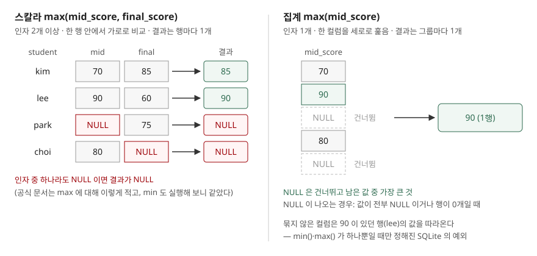

## 들어가며

학생마다 중간고사와 기말고사 점수가 있고, 둘 중 높은 점수로 성적을 매기기로 했다. 열마다 가장 큰 값을 구할 때 `MAX()` 를 썼으니 행마다 큰 값을 구할 때도 `max(mid_score, final_score)` 라고 쓰면 될 것 같다. 실제로 SQLite 에서는 이 문장이 오류 없이 돈다. 그런데 결과를 보면 한 시험을 빠진 학생들의 점수가 전부 비어 있다. 다섯 명 중 세 명이다. 열을 따라 구한 최댓값에서는 이런 일이 없었으니, 원인을 찾으려고 데이터부터 의심하며 행을 하나씩 열어 보게 된다.

## 개념

**집계 함수**(aggregate function)는 여러 행을 받아 값 하나를 돌려준다. `SELECT max(mid_score) FROM exam_score` 는 표 전체 행의 `mid_score` 를 훑어 가장 큰 값 하나를 낸다. `GROUP BY` 가 있으면 그룹마다 하나다.

**스칼라 함수**(scalar function)는 한 행 안에서 값 몇 개를 받아 값 하나를 돌려준다. `upper(name)` 이나 `coalesce(a, b)` 처럼 행 수만큼 결과가 나온다.

SQLite 의 `max()` 와 `min()` 은 **이름 하나로 두 함수를 겸한다.** 공식 문서의 핵심 함수 목록은 인자가 둘 이상이면 스칼라 함수로, 하나면 집계 함수로 동작한다고 적는다. 그래서 `max(final_score)` 는 열을 세로로 훑고, `max(mid_score, final_score)` 는 한 행 안의 두 값을 가로로 비교한다.

문제는 두 함수가 **NULL**(값이 없음을 나타내는 표시)을 정반대로 다룬다는 점이다.

| | 집계 `max(col)` | 스칼라 `max(a, b, ...)` |
|---|---|---|
| 인자 수 | 1개 | 2개 이상 |
| 비교 방향 | 여러 행의 한 컬럼 | 한 행의 여러 값 |
| NULL 을 만나면 | 건너뛴다 | 결과 전체가 NULL |
| 결과가 NULL 인 경우 | 값이 전부 NULL 이거나 행이 0개 | 인자 중 하나라도 NULL |

## 구조



> **출처**: [SQLite — Built-In Scalar SQL Functions, max(X,Y,...)](https://www.sqlite.org/lang_corefunc.html#max_scalar) · [SQLite — Built-in Aggregate Functions, max(X)](https://www.sqlite.org/lang_aggfunc.html#max_agg) · [SQLite Quirks §6 Aggregate Queries Can Contain Non-Aggregate Result Columns](https://www.sqlite.org/quirks.html#aggregate_queries_can_contain_non_aggregate_result_columns_that_are_not_in_the_group_by_clause)

## 동작 원리

예제의 `exam_score` 표는 다섯 행이다. park 은 중간고사, choi 는 기말고사가 NULL 이고, jung 은 둘 다 NULL 이다.

```text
  student | mid_score | final_score
  --------+-----------+------------
  kim     |        70 |          85
  lee     |        90 |          60
  park    |      NULL |          75
  choi    |        80 |        NULL
  jung    |      NULL |        NULL
```

집계 `max(mid_score)` 는 NULL 두 개를 건너뛰고 남은 70·90·80 가운데 90 을 낸다. 같은 줄에서 `count(mid_score)` 가 3 인 것도 같은 이유다. 공식 문서는 집계 `max()` 가 **그룹에 NULL 이 아닌 값이 하나도 없을 때만** NULL 을 돌려준다고 적는다. jung 한 행만 고르거나 `WHERE 0` 으로 행을 하나도 남기지 않으면 실제로 NULL 이 나왔다.

```text
  sql> SELECT max(mid_score), min(mid_score), count(mid_score) FROM exam_score
  max(mid_score) | min(mid_score) | count(mid_score)
  90 | 70 | 3
```

스칼라 쪽은 반대다. 문서는 스칼라 `max()` 가 **인자 중 하나라도 NULL 이면 NULL** 을 돌려준다고 적는다. `min()` 쪽 항목에는 NULL 에 대한 문장이 없어서 직접 돌려 봤는데, 결과는 같았다.

```text
  sql> SELECT max(3, NULL, 7), min(3, NULL, 7)
  max(3, NULL, 7) | min(3, NULL, 7)
  NULL | NULL
```

들어가며의 상황이 바로 이것이다. 점수 하나가 NULL 인 park·choi 와 둘 다 NULL 인 jung 이 전부 NULL 로 나온다.

## 실습 예제

전체 소스: [`code/`](code/) · 수행 기록: [`code/output.txt`](code/output.txt)

**NULL 이 섞인 행에서 큰 값 고르기.** 스칼라 `max()` 에 NULL 이 들어가지 않게 하면 된다. `coalesce(a, b)` 는 a 가 NULL 이면 b 를 돌려주므로, 각 인자를 "내가 없으면 상대 값"으로 바꿔 넣는다.

```sql
SELECT student,
       max(mid_score, final_score) AS naive,
       max(coalesce(mid_score, final_score),
           coalesce(final_score, mid_score)) AS fixed
FROM exam_score;
```

```text
  student | naive | fixed
  'kim' | 85 | 85
  'lee' | 90 | 90
  'park' | NULL | 75
  'choi' | NULL | 80
  'jung' | NULL | NULL
```

park 은 중간고사가 없으니 두 인자가 모두 75 가 되어 75 가 나온다. jung 은 두 점수가 다 없으므로 NULL 이 남는다. "응시하지 않음"을 0점으로 칠지 NULL 로 둘지는 업무 규칙이 정할 일이라, 여기서는 0 으로 바꾸지 않았다.

**타입이 섞이면 문자열이 이긴다.** 숫자를 문자열로 저장한 컬럼과 비교하면 이상한 값이 나온다.

```text
  sql> SELECT max('10', 99), typeof(max('10', 99))
  max('10', 99) | typeof(max('10', 99))
  '10' | 'text'
```

SQLite 의 값 비교 순서는 NULL < 숫자(INTEGER·REAL) < TEXT < BLOB 이다. 데이터 타입 문서의 정렬 순서 절이 이렇게 정한다. 그래서 TEXT 인 `'10'` 은 어떤 정수보다도 크다. 이 규칙은 집계 `max()` 에도 그대로 적용되므로, 숫자와 숫자 모양 문자열이 섞인 컬럼에서는 둘 다 엉뚱한 값을 낸다. `CAST('10' AS INTEGER)` 로 맞추면 99 가 나왔다.

**최댓값과 같은 행의 다른 컬럼.** 표준 SQL 에서는 `GROUP BY` 에 없는 컬럼을 집계와 함께 SELECT 하면 오류다. SQLite 는 이것을 허용하고, 이런 컬럼을 **묶지 않은 컬럼**(bare column)이라 부른다. 대부분은 어느 행의 값이 나올지 정해지지 않지만, **`min()` 이나 `max()` 가 하나뿐인 질의**에서는 그 최솟값·최댓값이 있던 행의 값이 나온다고 SQLite 문서가 정해 둔다.

```text
  sql> SELECT student, max(mid_score) FROM exam_score
  'lee' | 90
  sql> SELECT category, name, max(price) FROM product GROUP BY category
  'drink' | 'juice' | 2100
  'fruit' | 'mango' | 3500
```

"가장 비싼 상품의 이름"을 부질의 없이 한 번에 얻을 수 있어 편하다. 다만 경계가 분명하다. drink 에는 2,100원인 juice 와 coffee 가 동점인데, 문서는 동점이면 그중 아무 행이나 고른다고 적는다. 이번에는 juice 가 나왔지만 보장된 것이 아니다.

`max()` 와 `min()` 을 같이 쓰면 문서가 정한 범위를 벗어난다. 실제로 돌려 보니 이름이 최댓값의 mango 가 아니라 최솟값 행의 water 로 나왔다. `avg()` 처럼 다른 집계와 쓰면 apple 이 나왔는데, 이 값에도 뜻이 없다.

```text
  sql> SELECT name, max(price), min(price) FROM product
  'water' | 3500 | 900
```

## 다른 환경에서는

다른 DB 는 행 안의 최댓값을 `GREATEST()`·`LEAST()` 라는 별도 함수로 둔다. 이 절은 각 제품 공식 문서만 근거로 했고, 이 환경에 해당 DB 가 없어 **실행 검증 없음**이다.

| DB | 행 안의 최댓값 | NULL 인자 | 근거 |
|---|---|---|---|
| SQLite 3.49.1 | `max(a, b, ...)` | 하나라도 NULL 이면 NULL | 핵심 함수 문서, 위 실행 결과 |
| MySQL 8.0 | `GREATEST(a, b, ...)` | 하나라도 NULL 이면 NULL | MySQL 8.0 비교 함수 문서 |
| PostgreSQL 16 | `GREATEST(a, b, ...)` | NULL 을 무시, 전부 NULL 일 때만 NULL | PostgreSQL 16 조건 식 문서 |

PostgreSQL 문서는 이 동작이 SQL 표준과 다르며, 다른 DB 가운데에는 NULL 이 하나라도 있으면 NULL 을 내는 것이 있다고 스스로 밝힌다. 같은 `GREATEST(mid_score, final_score)` 를 옮겨 와도 park 의 결과가 75 와 NULL 로 갈린다. 묶지 않은 컬럼이 최댓값 행을 따라오는 동작은 SQLite 문서가 다른 SQL 구현에서는 알지 못한다고 적은 SQLite 고유 동작이다.

## 실무에서 주의할 점

**첫째, 인자 개수 하나로 함수가 바뀐다.** `max(a)` 를 고쳐 `max(a, b)` 로 쓰는 순간 집계가 스칼라로 바뀌어 결과 행 수가 1행에서 표의 행 수로 늘어난다. 반대로 스칼라로 쓰던 식에서 인자를 하나 지우면 GROUP BY 없는 집계가 되어 한 행만 남는다. 둘 다 오류 없이 돈다.

**둘째, NULL 이 있을 수 있는 컬럼은 스칼라 `max()` 에 그대로 넣지 않는다.** `coalesce()` 로 감싸거나, NULL 일 때 무엇을 낼지 `CASE` 로 직접 적는다. 그러지 않으면 값 하나가 빠진 행이 통째로 사라진 것처럼 보인다.

**셋째, 숫자를 TEXT 로 저장한 컬럼은 비교 전에 타입을 맞춘다.** `'10'` 이 99 보다 크다는 결과는 오류도 경고도 없이 나온다. CSV 를 그대로 적재한 표처럼 타입이 섞이기 쉬운 곳이 특히 그렇다.

**넷째, 묶지 않은 컬럼은 `min()`·`max()` 하나와 함께 쓸 때만 믿는다.** 동점이 있으면 어느 행인지 정해지지 않고, 집계가 둘 이상이면 문서가 보장하는 범위를 벗어난다. 다른 DB 로 옮기면 문법 오류이므로, 이식할 코드라면 `ROW_NUMBER()` 나 부질의로 쓴다.

## 정리

- SQLite 의 `max()`·`min()` 은 인자가 하나면 집계, 둘 이상이면 스칼라 함수다
- 집계는 NULL 을 건너뛰고, 스칼라는 인자 하나만 NULL 이어도 NULL 을 낸다
- 행 안에서 NULL 을 피하려면 각 인자를 `coalesce()` 로 상대 값으로 바꿔 넣는다
- 비교 순서는 NULL < 숫자 < TEXT < BLOB 이라 문자열 `'10'` 이 정수 99 보다 크다
- `max()` 하나와 함께 쓴 묶지 않은 컬럼은 최댓값 행의 값을 따라오지만, 동점이나 집계 여럿에서는 정해지지 않는다

## 참고 자료

- [SQLite — Built-In Scalar SQL Functions, max(X,Y,...)](https://www.sqlite.org/lang_corefunc.html#max_scalar)
- [SQLite — Built-In Scalar SQL Functions, min(X,Y,...)](https://www.sqlite.org/lang_corefunc.html#min_scalar)
- [SQLite — Built-in Aggregate Functions, max(X)](https://www.sqlite.org/lang_aggfunc.html#max_agg)
- [SQLite — Datatypes In SQLite, Sort Order](https://www.sqlite.org/datatype3.html#sort_order)
- [SQLite Quirks §6 Aggregate Queries Can Contain Non-Aggregate Result Columns](https://www.sqlite.org/quirks.html#aggregate_queries_can_contain_non_aggregate_result_columns_that_are_not_in_the_group_by_clause)
- [SQLite — SELECT, Bare columns in an aggregate query](https://www.sqlite.org/lang_select.html#bare_columns_in_an_aggregate_query)
- [MySQL 8.0 Reference Manual — Comparison Functions, GREATEST()](https://dev.mysql.com/doc/refman/8.0/en/comparison-operators.html#function_greatest)
- [PostgreSQL 16 — Conditional Expressions, GREATEST and LEAST](https://www.postgresql.org/docs/16/functions-conditional.html#FUNCTIONS-GREATEST-LEAST)
