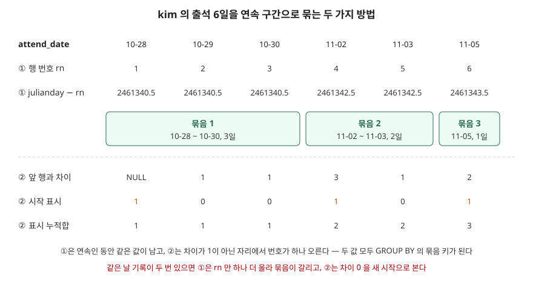

## 들어가며

출석 체크나 매일 접속 보상이 있는 서비스를 만들다 보면 "며칠 연속으로 들어왔는가"를 보여 달라는 요구가 붙는다. 기록 표에는 날짜가 한 줄씩 쌓여 있을 뿐 "연속"이라는 칸은 없다. 그래서 흔히 사용자별 기록을 날짜순으로 전부 애플리케이션에 가져와, 반복문으로 앞 날짜와 하루 차이인지 비교하며 묶음을 센다. 사용자 1만 명에 각자 1년치 기록이면 365만 행을 네트워크로 옮겨 놓고 한 줄씩 훑는 셈이다. SQL 한 문장으로 같은 묶음을 만들 수 있다.

## 개념

정렬된 값에서 끊김 없이 이어지는 구간을 **섬**(island), 그 사이의 빈 곳을 **틈**(gap)이라 부르고, 이런 묶음을 찾는 문제를 "gaps and islands"라고 부른다. 연속 출석, 연속 가동 시간, 끊긴 일련번호 찾기가 모두 같은 문제다.

풀이의 핵심은 **같은 섬에 속한 행끼리 같은 값을 갖는 열을 하나 만드는 것**이다. 그 열만 생기면 나머지는 `GROUP BY` 로 묶어 `MIN`·`MAX`·`COUNT` 를 구하면 끝난다. 그 열을 만드는 방법이 둘 있다.

| | 행 번호 차이 방식 | LAG 경계 방식 |
|---|---|---|
| 묶음 키 | 날짜 − 행 번호 | 섬 시작 표시의 누적합 |
| 쓰는 윈도 함수 | `ROW_NUMBER()` 하나 | `LAG()` 와 `SUM() OVER` 둘 |
| 생각하는 방식 | 연속이면 둘 다 1씩 늘어 차이가 같다 | 앞 행과 하루 차이가 아니면 새 섬이다 |

**윈도 함수**(window function)는 행을 묶어 하나로 줄이지 않고, 각 행 옆에 "같은 묶음 안에서의 계산 결과"를 붙여 주는 함수다. SQLite 는 3.25.0 부터 지원한다.

## 구조



> **출처**: [SQLite — Window Functions, Built-in Window Functions](https://www.sqlite.org/windowfunctions.html#built_in_window_functions) · [SQLite — Date And Time Functions, Overview](https://www.sqlite.org/lang_datefunc.html#overview)

## 동작 원리

**행 번호 차이 방식.** SQLite 문서는 `row_number()` 를 "현재 파티션 안에서 행의 번호"이고 윈도 정의의 `ORDER BY` 순서로 1부터 매긴다고 적는다. 날짜가 하루씩 이어지면 날짜도 1씩, 행 번호도 1씩 늘어나므로 둘의 차이는 그대로다. 하루라도 빠지면 날짜만 2 이상 뛰므로 차이가 커지고 새 값이 생긴다.

날짜를 숫자로 빼려면 `julianday()` 로 바꾼다. 문서는 이 함수가 기원전 4714년 11월 24일 그리니치 정오부터 센 날 수를 소수까지 돌려준다고 적는다. 기준이 정오라서 자정인 `'2026-10-28'` 은 `.5` 로 끝나는 값이 된다. 아래 중간값의 `2461340.5` 가 그것이다.

```text
    user_id | attend_date | rn | grp
    kim     | 2026-10-28  |  1 | 2461340.5
    kim     | 2026-10-29  |  2 | 2461340.5
    kim     | 2026-10-30  |  3 | 2461340.5
    kim     | 2026-11-02  |  4 | 2461342.5
    kim     | 2026-11-03  |  5 | 2461342.5
    kim     | 2026-11-05  |  6 | 2461343.5
```

`grp` 값 자체에는 뜻이 없다. 같은 섬에서 같다는 것만 쓴다. lee 의 `grp` 도 `2461342.5` 지만, `PARTITION BY user_id` 와 `GROUP BY user_id, grp` 로 사용자를 함께 묶으므로 섞이지 않는다.

**LAG 경계 방식.** 문서는 `lag(expr)` 가 파티션의 바로 앞 행에서 `expr` 를 계산한 값을 돌려주고, 앞 행이 없으면 NULL 이라고 적는다. 앞 행과의 날짜 차이가 1이면 0, 아니면(첫 행의 NULL 포함) 1 을 붙여 "섬의 시작"을 표시한 뒤, 그 표시를 위에서부터 누적해 더하면 섬마다 1, 2, 3 의 번호가 생긴다.

```sql
CASE WHEN julianday(attend_date)
          - julianday(LAG(attend_date) OVER w) = 1
     THEN 0 ELSE 1 END AS is_start
...
SUM(is_start) OVER (PARTITION BY user_id ORDER BY attend_date
                    ROWS UNBOUNDED PRECEDING) AS grp
```

## 실습 예제

전체 소스: [`code/`](code/) · 수행 기록: [`code/output.txt`](code/output.txt)

`attendance` 표에 kim 6행, lee 4행이 들어 있다. 표 정의와 전체 행은 `output.txt` 앞부분에 있다.

**두 방식은 같은 결과를 냈다.**

```text
    user_id | first_day  | last_day   | days
    kim     | 2026-10-28 | 2026-10-30 |    3
    kim     | 2026-11-02 | 2026-11-03 |    2
    kim     | 2026-11-05 | 2026-11-05 |    1
    lee     | 2026-10-30 | 2026-11-02 |    4
  LAG 경계 방식과 결과가 같은가: True
```

lee 의 섬은 10월 30일부터 11월 2일까지 월을 넘어 4일로 묶였다. 이 결과를 한 번 더 `GROUP BY user_id` 로 묶어 `MAX(days)` 를 구하면 사용자별 최장 연속 출석(kim 3, lee 4)이 된다.

**같은 날 기록이 두 번 들어가면 둘 다 섬을 쪼갠다.** 출석 버튼을 두 번 누르는 일은 실제로 생긴다. kim 의 10월 29일 행을 하나 더 넣었다.

```text
  [행 번호 차이 방식 — kim]
    kim     | 2026-10-28 | 2026-10-29 |    2
    kim     | 2026-10-29 | 2026-10-30 |    2
```

행 번호는 중복 행에서도 1 늘지만 날짜는 그대로라, 그 뒤의 차이가 1 줄어 다른 섬이 됐다. LAG 방식도 같은 결과였다. 차이가 0 인 행을 "하루 차이가 아님"으로 보고 새 섬을 시작했기 때문이다.

**LAG 쪽 조건을 `<= 1` 로 고쳐도 끝이 아니었다.** 이 글에서 예상하지 못한 결과다. 섬은 하나로 합쳐졌지만 날 수가 틀렸다.

```text
  [LAG 차이 <= 1 로 고친 방식 — kim]
    kim     | 2026-10-28 | 2026-10-30 |    4
  [LAG 차이 <= 1, COUNT(DISTINCT attend_date) 로 센 방식 — kim]
    kim     | 2026-10-28 | 2026-10-30 |    3
```

3일인데 4일로 셌다. `COUNT(*)` 가 중복 행까지 세기 때문이다. 행 번호 방식은 `SELECT DISTINCT user_id, attend_date` 로 중복을 먼저 걷어내자 3일로 맞게 나왔다. 어느 방식이든 **중복을 먼저 없애거나 날짜를 `DISTINCT` 로 세야** 한다.

**날짜를 `julianday` 없이 빼면 틀린 값이 조용히 나온다.**

```text
  [TEXT 날짜에서 바로 행 번호를 빼면 — lee]
    2026-10-30  |      2026 | 2025
    2026-10-31  |      2026 | 2024
  [일(日) 숫자만 꺼내 빼면 — lee]
    2026-10-31  |  29
    2026-11-01  |  -2
```

TEXT 를 산술에 쓰면 SQLite 는 숫자로 읽히는 앞부분만 쓰므로 `'2026-10-30'` 은 2026 이 된다. 모든 날짜가 2026 이라 행마다 `grp` 가 달라져 4일이 네 개의 섬이 된다. 에러는 나지 않는다. `strftime('%d')` 로 일(日)만 꺼내 빼면 같은 달 안에서는 맞지만, 10월 31일 다음 11월 1일에서 31 이 1 로 떨어져 섬이 끊긴다.

**실행계획.** 인덱스가 없을 때 `ROW_NUMBER()` 를 계산하려고 정렬용 임시 B-Tree 를 만들었다.

```text
  QUERY PLAN
  |--CO-ROUTINE numbered
  |  |--CO-ROUTINE (subquery-3)
  |  |  |--SCAN attendance
  |  |  `--USE TEMP B-TREE FOR ORDER BY
  |  `--SCAN (subquery-3)
  |--SCAN numbered
  |--USE TEMP B-TREE FOR GROUP BY
  `--USE TEMP B-TREE FOR ORDER BY
```

`(user_id, attend_date)` 인덱스를 만들자 그 줄이 `SCAN attendance USING COVERING INDEX ix_attendance_user_id_attend_date` 로 바뀌고 정렬이 사라졌다. 인덱스 순서가 윈도의 `PARTITION BY ... ORDER BY` 순서와 같아서다. 바깥 `GROUP BY` 의 임시 B-Tree 는 `grp` 가 계산된 값이라 그대로 남았다.

## 실무에서 주의할 점

**첫째, 같은 날 중복 기록을 먼저 처리한다.** 행 번호 방식은 중복 한 줄로 섬이 쪼개지고, LAG 방식은 조건을 고쳐도 `COUNT(*)` 가 하루를 두 번 센다. `SELECT DISTINCT` 로 걷어낸 뒤 묶거나, 표에 `(user_id, attend_date)` 유니크 제약을 건다.

**둘째, 날짜 차이는 날짜 함수로 구한다.** TEXT 날짜를 그대로 빼면 연도만 남고, 일(日) 숫자로 빼면 월말에서 끊긴다. 둘 다 에러 없이 틀린 묶음을 낸다. `julianday()` 처럼 날 수 전체를 돌려주는 함수를 쓴다.

**셋째, "연속"의 단위를 질의에 맞춘다.** 시각까지 저장된 값(`'2026-10-28 09:15'`)에 `julianday` 를 바로 쓰면 소수 부분이 붙어 차이가 1 이 되지 않는다. `date()` 로 날짜만 남긴 뒤 계산한다. 주말을 건너뛰는 영업일 연속처럼 단위가 다르면 행 번호 방식은 그대로 쓸 수 없고, LAG 방식의 경계 조건을 바꾸는 편이 쉽다.

**넷째, 파티션 순서에 맞는 인덱스를 둔다.** `(user_id, attend_date)` 인덱스가 있으면 윈도 함수가 정렬 없이 인덱스 순서대로 읽는다. 사용자별 기록이 많을수록 차이가 커진다.

## 정리

- 연속 구간 문제는 "같은 섬이면 같은 값"인 열 하나를 만들고 `GROUP BY` 로 묶는 문제다
- 행 번호 차이 방식은 `julianday(날짜) − ROW_NUMBER()` 를, LAG 방식은 섬 시작 표시의 누적합을 묶음 키로 쓴다
- 같은 날 중복 기록은 두 방식 모두를 깨뜨린다 — `DISTINCT` 로 먼저 걷어내거나 날짜를 `DISTINCT` 로 센다
- 날짜 TEXT 를 그대로 빼거나 일(日) 숫자로 빼면 에러 없이 틀린 묶음이 나온다

## 참고 자료

- [SQLite — Window Functions, Built-in Window Functions](https://www.sqlite.org/windowfunctions.html#built_in_window_functions) — `row_number()`, `lag()` 의 정의
- [SQLite — Window Functions, Frame Specifications](https://www.sqlite.org/windowfunctions.html#frame_specifications) — `ROWS UNBOUNDED PRECEDING`
- [SQLite — Date And Time Functions, Overview](https://www.sqlite.org/lang_datefunc.html#overview) — `julianday()` 가 돌려주는 값
- [SQLite — SQL Language Expressions, CAST expressions](https://www.sqlite.org/lang_expr.html#cast_expressions) — TEXT 를 숫자로 바꿀 때 앞부분만 읽는 규칙
- [SQLite — EXPLAIN QUERY PLAN](https://www.sqlite.org/eqp.html)
