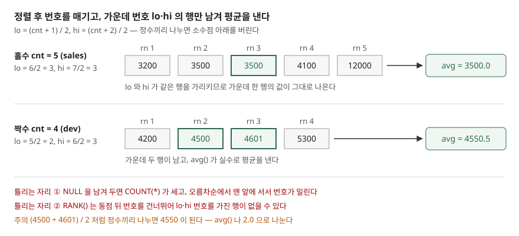

## 들어가며

부서별 연봉 현황을 뽑아 달라는 요청을 받고 `AVG(salary)` 로 평균을 냈다. 그런데 영업 부서 평균이 5,260만 원으로, 다섯 명 중 네 명이 그보다 적게 받는다. 한 사람의 연봉이 1억 2천만 원이라 평균을 끌어올린 것이다. 이럴 때 쓰는 값이 중앙값인데, `MEDIAN(salary)` 라고 써 보면 SQLite 는 그런 함수가 없다고 답한다. 그래서 흔히 데이터를 전부 애플리케이션으로 가져와 정렬한 뒤 가운데를 고르는데, 부서가 30개면 쿼리를 30번 돌리거나 전체 행을 끌어와 코드에서 다시 묶어야 한다. SQL 한 문장으로 끝낼 수 있는 일이다.

## 개념

**중앙값**(median)은 값을 크기순으로 늘어놓았을 때 **한가운데 있는 값**이다. 값이 홀수 개면 가운데 하나, 짝수 개면 가운데 둘의 평균이다. 다섯 개 `3200, 3500, 3500, 4100, 12000` 의 중앙값은 세 번째인 3500 이고, 네 개 `4200, 4500, 4601, 5300` 의 중앙값은 두 번째와 세 번째의 평균인 4550.5 다.

평균은 모든 값을 더해 개수로 나누므로 **큰 값 하나가 결과를 크게 움직인다.** 중앙값은 순서만 보므로 맨 끝 값이 12000 이든 120000 이든 그대로다. 연봉·응답 시간·주문 금액처럼 한쪽으로 긴 꼬리가 있는 값에서 "보통은 얼마인가"를 물을 때 중앙값을 쓴다.

SQL 로 중앙값을 구하려면 두 가지가 필요하다. 각 행이 **정렬했을 때 몇 번째인지**, 그리고 **전체가 몇 개인지**다. 이 둘을 한 행에 함께 놓는 것이 **창 함수**(window function)다. 일반 집계 함수는 여러 행을 한 행으로 합치지만, 창 함수는 행을 그대로 둔 채 옆에 계산 결과를 붙인다.

| 식 | 붙는 값 |
|---|---|
| `ROW_NUMBER() OVER (ORDER BY salary)` | 정렬 순서대로 1, 2, 3, … (동점이어도 번호가 다르다) |
| `COUNT(*) OVER ()` | 모든 행에 같은 값 — 전체 행 수 |
| `... OVER (PARTITION BY dept ...)` | 위 계산을 부서마다 따로 |

SQLite 공식 문서는 내장 집계 함수 전부를 `OVER` 절을 붙여 창 함수로 쓸 수 있다고 적는다. `COUNT(*) OVER ()` 가 그 예다.

## 구조



> **출처**: [SQLite — Window Functions §2 Aggregate Window Functions](https://www.sqlite.org/windowfunctions.html#aggregate_window_functions) · [SQLite — Window Functions §3 Built-in Window Functions](https://www.sqlite.org/windowfunctions.html#built_in_window_functions) · [SQLite — SQL Language Expressions, Operators](https://www.sqlite.org/lang_expr.html#operators_and_parse_affecting_attributes)

## 동작 원리

핵심은 가운데 번호를 홀짝 구분 없이 한 식으로 구하는 것이다. 정수끼리 나누면 SQLite 는 소수점 아래를 버린다. 이것을 이용해 두 번호를 이렇게 정한다.

```text
lo = (cnt + 1) / 2
hi = (cnt + 2) / 2
```

cnt 가 5 면 lo = 6/2 = 3, hi = 7/2 = 3 으로 **같은 행**을 가리킨다. cnt 가 4 면 lo = 5/2 = 2, hi = 6/2 = 3 으로 **이웃한 두 행**을 가리킨다. 번호가 lo 나 hi 인 행만 남기고 `AVG()` 를 씌우면, 한 행이면 그 값이, 두 행이면 둘의 평균이 나온다. 홀수인지 짝수인지 `CASE` 로 나눌 필요가 없다.

예제 표 `employee` 에서 연봉이 있는 11명에게 번호를 붙이면 이렇게 된다. 11은 홀수라 lo 와 hi 가 모두 6이다.

```text
  sql> SELECT salary, ROW_NUMBER() OVER (ORDER BY salary) AS rn, COUNT(*) OVER () AS cnt, (COUNT(*) OVER () + 1) / 2 AS lo, (COUNT(*) OVER () + 2) / 2 AS hi FROM employee WHERE salary IS NOT NULL
  salary | rn | cnt | lo | hi
  3200 | 1 | 11 | 6 | 6
  3500 | 2 | 11 | 6 | 6
  ...
  4200 | 6 | 11 | 6 | 6
  ...
  12000 | 11 | 11 | 6 | 6
```

6번 행의 4200 이 중앙값이고, 파이썬 `statistics.median()` 으로 같은 11개 값을 계산해도 4200 이었다.

## 실습 예제

전체 소스: [`code/`](code/) · 수행 기록: [`code/output.txt`](code/output.txt)

**먼저 함수가 있는지 확인했다.** 결과는 둘 다 없다였다.

```text
  sql> SELECT median(salary) FROM employee
  OperationalError: no such function: median
  sql> SELECT percentile_cont(salary, 0.5) FROM employee
  OperationalError: no such function: percentile_cont
```

SQLite 의 백분위 확장 문서를 보면 `median()`·`percentile()`·`percentile_cont()`·`percentile_disc()` 네 함수가 정의돼 있다. 다만 이 확장은 **3.51.0 부터 본체 소스에 들어갔고**, 그때도 `SQLITE_ENABLE_PERCENTILE` 옵션을 켜고 빌드해야 쓸 수 있다. 3.49.1 에는 들어 있지 않으니 직접 구해야 한다.

**부서별 중앙값.** `PARTITION BY dept` 를 붙이면 번호와 개수를 부서마다 따로 센다.

```sql
WITH ordered AS (
    SELECT dept, salary,
           ROW_NUMBER() OVER (PARTITION BY dept ORDER BY salary) AS rn,
           COUNT(*) OVER (PARTITION BY dept) AS cnt
    FROM employee
    WHERE salary IS NOT NULL
)
SELECT dept, cnt, avg(salary) AS median
FROM ordered
WHERE rn IN ((cnt + 1) / 2, (cnt + 2) / 2)
GROUP BY dept
ORDER BY dept;
```

```text
  dept | cnt | median
  'dev' | 4 | 4550.5
  'ops' | 2 | 4100.0
  'sales' | 5 | 3500.0
```

같은 표의 평균은 sales 5260.0, dev 4650.25 였다. sales 는 12000 하나 때문에 평균이 중앙값보다 1,760 높다. 세 부서 모두 파이썬 `statistics.median()` 결과와 같았다.

**창 함수 없이 구하는 방법.** 오래된 SQLite(3.25.0 미만)처럼 창 함수가 없는 곳에서는 `LIMIT` 과 `OFFSET` 으로 가운데 행만 잘라 낸다. 앞에서 `(cnt − 1) / 2` 개를 건너뛰고, 홀수면 1개, 짝수면 2개를 가져온다.

```sql
SELECT avg(salary) AS median FROM (
    SELECT salary FROM employee
    WHERE salary IS NOT NULL
    ORDER BY salary
    LIMIT 2 - (SELECT count(salary) FROM employee) % 2
    OFFSET (SELECT (count(salary) - 1) / 2 FROM employee)
);
```

11개일 때 4200.0, 한 명을 지워 10개로 만든 뒤에는 4150.0 이 나왔다. 창 함수 방식과 파이썬 결과도 각각 같았다. 다만 이 방식은 한 문장으로 **한 집합**의 중앙값만 구한다. 부서별로 구하려면 부서마다 돌려야 한다.

## 실무에서 주의할 점

**첫째, NULL 을 먼저 걸러 낸다.** `WHERE salary IS NOT NULL` 을 빼고 ops 부서를 돌리면 결과가 4100 이 아니라 3900 이 된다.

```text
  name | salary | rn | cnt
  'oh' | NULL | 1 | 3
  'han' | 3900 | 2 | 3
  'seo' | 4300 | 3 | 3
```

`COUNT(*)` 는 NULL 인 행도 세서 cnt 가 3 이 되고, SQLite 는 오름차순 정렬에서 NULL 을 가장 작은 값으로 보고 맨 앞에 둔다. 그래서 가운데 번호 2 가 3900 을 가리킨다. `COUNT(salary)` 로 바꾸는 것만으로는 부족하다. NULL 이 여전히 1번을 차지하기 때문이다. 행 자체를 빼야 한다.

**둘째, 번호는 `ROW_NUMBER()` 로 매긴다.** `RANK()` 는 동점에 같은 번호를 주고 그다음 번호를 건너뛴다. sales 에서 3200 을 뺀 4개(`3500, 3500, 4100, 12000`)로 돌리면 RANK 는 1, 1, 3, 4 를 매긴다. 가운데 번호 2 를 가진 행이 없어서 3번 행 하나만 남고, 정답 3800 대신 4100 이 나왔다. `ROW_NUMBER()` 는 동점에도 1, 2, 3, 4 를 매기므로 이런 일이 없다. 동점끼리는 값이 같으니 어느 쪽이 먼저 번호를 받아도 결과는 같다.

**셋째, 두 값의 평균을 정수 나눗셈으로 내지 않는다.** dev 의 가운데 두 값을 `(4500 + 4601) / 2` 로 계산하면 4550 이 나온다. 정수끼리 나눴기 때문이다. `/ 2.0` 으로 나누거나 위처럼 `AVG()` 를 쓰면 4550.5 가 나온다. 가운데 번호를 구할 때는 정수 나눗셈의 버림을 일부러 쓰지만, 값의 평균에서는 피해야 한다.

**넷째, 행이 많으면 정렬 비용이 든다.** 이 방법은 집합 전체를 정렬해 번호를 매긴다. 부서별로 자주 뽑아야 하고 행이 많다면, `(dept, salary)` 인덱스가 정렬을 대신할 수 있는지 실행계획으로 확인한다.

## 정리

- 중앙값은 정렬했을 때 가운데 값이고, 큰 값 하나에 흔들리지 않는다
- 파이썬에 내장된 SQLite 3.49.1 에는 `median()` 이 없다. 백분위 함수는 3.51.0 부터 빌드 옵션을 켜야 쓸 수 있다
- `ROW_NUMBER()` 와 `COUNT(*) OVER ()` 로 번호와 개수를 붙이고, `(cnt+1)/2`, `(cnt+2)/2` 번 행만 남겨 `AVG()` 하면 홀짝을 한 식으로 처리한다
- NULL 은 행째 걸러 내고, 번호는 `RANK()` 가 아니라 `ROW_NUMBER()` 로 매긴다

## 참고 자료

- [SQLite — Window Functions §2 Aggregate Window Functions](https://www.sqlite.org/windowfunctions.html#aggregate_window_functions) — 집계 함수를 `OVER` 절로 창 함수로 쓰기
- [SQLite — Window Functions §3 Built-in Window Functions](https://www.sqlite.org/windowfunctions.html#built_in_window_functions) — `row_number()`, `rank()` 의 정의
- [SQLite — The Percentile Extension, Availability](https://www.sqlite.org/percentile.html#availability) — 3.51.0 부터 본체에 포함, `SQLITE_ENABLE_PERCENTILE` 필요
- [SQLite — The Percentile Extension, median(Y)](https://www.sqlite.org/percentile.html#the_median_y_aggregate_function)
- [SQLite — SQL Language Expressions, Operators](https://www.sqlite.org/lang_expr.html#operators_and_parse_affecting_attributes) — 정수 나눗셈
- [SQLite — SELECT, The ORDER BY clause](https://www.sqlite.org/lang_select.html#the_order_by_clause) — NULL 이 다른 값보다 작게 정렬됨
- [Python 3.13 — statistics.median](https://docs.python.org/3.13/library/statistics.html#statistics.median) — 검산에 쓴 기준값
