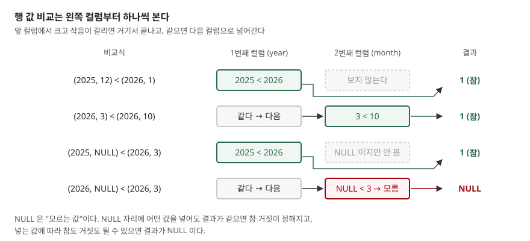

## 들어가며

월별 매출 표가 `year`, `month` 두 컬럼으로 나뉘어 있는데 "작년 11월부터 올해 2월까지"를 뽑아 달라는 요청이 온다. 처음 떠오르는 조건은 `year >= 2025 AND month >= 11 AND year <= 2026 AND month <= 2` 다. 돌려 보면 에러 없이 **0행**이 나온다. 그러면 보통 `(year = 2025 AND month >= 11) OR (year = 2026 AND month <= 2)` 처럼 연도별로 갈라 쓰는데, 기간이 3년에 걸치면 갈래가 셋, 시작과 끝이 같은 해면 또 다른 모양이 된다. 조건을 바꿀 때마다 식을 새로 짜야 하고, 그때마다 경계 달 하나를 빠뜨리기 쉽다.

## 개념

**행 값**(row value)은 값 여러 개를 괄호로 묶어 하나처럼 다루는 것이다. `(year, month)` 는 컬럼 두 개를 묶은 행 값이고, `(2025, 11)` 은 상수 두 개를 묶은 행 값이다. 크기가 같은 두 행 값은 `=`·`<`·`BETWEEN`·`IN` 같은 연산자로 바로 비교할 수 있다.

SQLite 는 3.15.0(2016-10-14)부터 행 값을 지원한다. 그 전 버전에서는 문법 오류가 난다. 행 값은 크기가 늘 2 이상이다. 값이 하나뿐이면 그냥 스칼라 값(값 하나)이고, 빈 괄호는 문법 오류다.

행 값을 쓸 수 있는 자리는 셋이다.

| 자리 | 모양 | 무엇을 하는가 |
|---|---|---|
| 비교 | `(a, b) < (1, 2)` | 왼쪽 컬럼부터 차례로 비교한다 |
| IN | `(a, b) IN (SELECT x, y FROM t)` | 두 컬럼의 **짝**이 목록에 있는지 본다 |
| UPDATE | `SET (a, b) = (SELECT x, y ...)` | 부질의 한 번으로 여러 컬럼을 바꾼다 |

## 구조



> **출처**: [SQLite — Row Values §2.1 Row Value Comparisons](https://www.sqlite.org/rowvalue.html#row_value_comparisons)

## 동작 원리

행 값 비교는 사전에서 단어를 찾는 순서와 같다. 첫 컬럼끼리 먼저 비교해 크고 작음이 갈리면 거기서 끝나고, 같을 때만 다음 컬럼으로 넘어간다. 그래서 `(2025, 12) < (2026, 1)` 은 참이다. 첫 컬럼 2025 와 2026 에서 이미 갈렸으므로 12 와 1 은 보지 않는다.

**NULL** 은 "모르는 값"이다. 공식 문서는 NULL 자리에 어떤 값을 넣느냐에 따라 결과가 참도 거짓도 될 수 있으면 결과를 NULL 로 낸다고 적는다. 반대로 어떤 값을 넣어도 결과가 같으면 참·거짓이 정해진다. 그림의 셋째 줄 `(2025, NULL) < (2026, 3)` 은 첫 컬럼에서 이미 갈려서 NULL 을 볼 필요가 없으니 참이다. 넷째 줄은 첫 컬럼이 같아 둘째 컬럼까지 가야 하는데 거기가 NULL 이라 결과도 NULL 이다.

`WHERE` 는 참인 행만 남긴다. 결과가 NULL 이면 거짓과 똑같이 그 행을 버린다. 이 점이 아래 `NOT IN` 에서 다시 나온다.

## 실습 예제

전체 소스: [`code/`](code/) · 수행 기록: [`code/output.txt`](code/output.txt)

`monthly_sales` 표에 2025년 1월부터 2026년 4월 사이의 월별 매출 10행을, `closed_month` 표에 마감한 달 `(2025, 11)`, `(2026, 1)` 을 넣었다. 표 정의와 전체 행은 `output.txt` 앞부분에 있다.

**비교 — NULL 이 끼면.**

```text
  sql> SELECT (2026, NULL) = (2026, 3) AS eq_null, (2025, NULL) = (2026, 3) AS eq_false
  eq_null | eq_false
  NULL | 0
  sql> SELECT (2025, NULL) < (2026, 3) AS lt_decided, (2026, NULL) < (2026, 3) AS lt_unknown
  lt_decided | lt_unknown
  1 | NULL
```

`(2025, NULL) = (2026, 3)` 은 NULL 이 아니라 0(거짓)이다. 첫 컬럼이 이미 다르므로 둘째 컬럼에 무엇이 오든 같아질 수 없기 때문이다.

**기간 거르기.** 들어가며의 컬럼별 조건은 0행이었다. `month >= 11 AND month <= 2` 를 동시에 만족하는 달이 없으니 당연한 결과다. 행 값으로 쓰면 이렇게 된다.

```sql
SELECT year, month, region, amount FROM monthly_sales
WHERE (year, month) >= (2025, 11) AND (year, month) <= (2026, 2)
ORDER BY year, month, region;
```

```text
  2025 | 11 | 'north' | 130
  2025 | 11 | 'south' | 90
  2025 | 12 | 'north' | 150
  2026 | 1 | 'north' | 110
  2026 | 1 | 'south' | 100
  2026 | 2 | 'north' | 140
```

`(year, month) BETWEEN (2025, 11) AND (2026, 2)` 로 써도 같은 6행이 나왔다. 기간이 몇 해에 걸치든 식의 모양은 그대로다.

**두 컬럼을 함께 IN.** 마감한 달의 매출만 뽑는다.

```sql
SELECT year, month, region, amount FROM monthly_sales
WHERE (year, month) IN (SELECT year, month FROM closed_month);
```

결과는 2025년 11월 2행과 2026년 1월 2행, 모두 4행이었다. 같은 일을 컬럼마다 따로 `IN` 으로 걸면 한 행이 더 나온다.

```text
  sql> ... WHERE year IN (SELECT year FROM closed_month)
             AND month IN (SELECT month FROM closed_month)
  2025 | 1 | 'south' | 80
  2025 | 11 | 'north' | 130
  ...
```

`year` 는 2025 가 목록에 있고 `month` 는 1 이 목록에 있으니 2025년 1월이 통과했다. 마감한 달은 2025년 11월과 2026년 1월이지 2025년 1월이 아니다. 컬럼별 `IN` 은 **짝을 풀어** 연도 목록과 월 목록을 엇갈려 맞춘다.

공식 문서는 `IN` 의 오른쪽이 부질의여야 한다고 적는다. 3.49.1 에서는 `IN (VALUES (2025, 12), (2026, 3))` 도, 괄호 목록 `IN ((2025, 12), (2026, 3))` 도 같은 2행을 냈다. 괄호 목록 쪽은 그 문서에 적힌 형태가 아니므로 다른 버전이나 다른 DB 에 옮길 때는 `VALUES` 나 부질의로 쓰는 편이 안전하다.

**NOT IN 과 NULL — 이번 글에서 가장 예상과 달랐던 결과.** `closed_month` 에 월을 아직 정하지 못한 `(2026, NULL)` 한 행을 넣고 마감하지 않은 달을 찾았다.

```text
  sql> SELECT year, month, region FROM monthly_sales
       WHERE (year, month) NOT IN (SELECT year, month FROM closed_month)
  2025 | 1 | 'south'
  2025 | 10 | 'north'
  2025 | 12 | 'north'
```

컬럼 하나짜리 `NOT IN` 은 목록에 NULL 이 하나만 있어도 전부 사라진다([IN과 EXISTS 글](../2026-09-28-in-exists-not-in-null/index.md)). 행 값에서는 **일부만** 사라졌다. 2025년 행은 첫 컬럼에서 `(2026, NULL)` 과 다르다는 것이 정해지므로 살아남고, 2026년 2·3·4월은 둘째 컬럼까지 가서 NULL 을 만나 결과가 NULL 이 되어 빠졌다. 전부 사라지면 금방 눈에 띄지만, 일부만 빠지면 결과가 그럴듯해 보여서 놓치기 쉽다. `NOT EXISTS` 로 쓰면 6행이 모두 나왔다.

**UPDATE 로 두 컬럼을 한 번에.** `promotion` 표에 있는 사람의 부서와 등급을 바꾼다.

```sql
UPDATE employee
SET (dept, grade) = (SELECT new_dept, new_grade FROM promotion
                     WHERE promotion.emp_id = employee.emp_id)
WHERE emp_id IN (SELECT emp_id FROM promotion);
```

kim 은 `('sales', 4)`, lee 는 `('platform', 3)` 이 되고 park 은 그대로였다. 같은 문장에서 `WHERE` 를 빼고 다시 돌리면 바뀐 행 수가 3이고, promotion 에 없는 park 은 `dept`·`grade` 가 둘 다 NULL 이 됐다. 부질의가 0행을 돌려주면 묶음 전체가 NULL 로 채워진다.

**쓸 수 없는 자리.** 크기가 다른 행 값을 비교할 때, 행 값을 `SELECT` 결과 컬럼에 쓸 때, 컬럼 하나짜리 부질의와 비교할 때 모두 같은 에러가 났다.

```text
  sql> SELECT (1, 2) = (1, 2, 3)
  OperationalError: row value misused
  sql> SELECT (year, month) FROM monthly_sales LIMIT 1
  OperationalError: row value misused
```

**실행계획.** `(year, month)` 인덱스를 만들고 두 기간 조건을 비교했다.

```text
QUERY PLAN
`--SEARCH monthly_sales USING INDEX idx_sales_ym ((year,month)>(?,?) AND (year,month)<(?,?))

QUERY PLAN
`--SEARCH monthly_sales USING INDEX idx_sales_ym (year>? AND year<?)
```

위가 행 값 조건, 아래가 컬럼별 조건이다. 행 값 쪽은 인덱스의 두 컬럼을 모두 범위에 썼고, 컬럼별 조건은 `year` 범위만 인덱스로 좁히고 `month` 는 읽은 뒤에 거른다. 계획의 `>`·`<` 는 SQLite 가 찍는 표기이고, 결과에 경계 달 11월과 2월이 들어간 것은 위 출력에서 확인했다.

## 실무에서 주의할 점

**첫째, 컬럼별 `IN` 은 짝을 지키지 않는다.** `(a, b)` 의 짝이 목록에 있는지 묻고 싶으면 `a IN (...) AND b IN (...)` 이 아니라 `(a, b) IN (...)` 을 쓴다. 데이터가 적을 때는 엇갈린 짝이 우연히 없어서 결과가 맞아 보인다. 이 예제도 2025년 1월 행을 넣기 전에는 두 쓰기의 결과가 같았다.

**둘째, 행 값 `NOT IN` 은 NULL 이 있으면 일부 행만 조용히 빠진다.** 부질의 쪽 컬럼에 NULL 이 들어갈 수 있으면 `NOT EXISTS` 로 쓰거나, 부질의에 `WHERE month IS NOT NULL` 을 붙인다.

**셋째, `UPDATE ... SET (a, b) = (SELECT ...)` 에는 바깥 `WHERE` 를 붙인다.** 부질의에서 짝을 못 찾은 행은 여러 컬럼이 한꺼번에 NULL 로 덮인다. 에러가 나지 않으므로 바뀐 행 수(`rowcount`)가 예상과 같은지 확인한다.

**넷째, 다른 DB 로 옮길 때는 지원 범위를 확인한다.** 이 글은 SQLite 3.49.1 에서만 돌렸다. 괄호 목록 `IN ((1, 2), (3, 4))` 처럼 SQLite 문서에도 없는 형태는 특히 그 엔진에서 먼저 돌려 본다.

## 정리

- `(year, month)` 처럼 컬럼을 괄호로 묶으면 비교·`IN`·`UPDATE` 를 한 번에 쓸 수 있다. SQLite 는 3.15.0 부터 지원한다
- 비교는 왼쪽 컬럼부터 하고, 앞에서 갈리면 뒤는 보지 않는다. 그래서 기간이 해를 넘어도 식 하나로 걸러진다
- `(a, b) IN (부질의)` 는 짝을 지키고, 컬럼별 `IN` 은 짝을 푼다
- NULL 이 끼면 결과를 정할 수 없는 행만 NULL 이 된다. 행 값 `NOT IN` 은 그 행들만 조용히 빠뜨린다
- 크기가 다르거나 결과 컬럼에 쓰면 `row value misused` 에러가 난다

## 참고 자료

- [SQLite — Row Values §2.1 Row Value Comparisons](https://www.sqlite.org/rowvalue.html#row_value_comparisons) — 왼쪽부터 비교하는 규칙과 NULL 판정 예시
- [SQLite — Row Values §2.2 Row Value IN Operators](https://www.sqlite.org/rowvalue.html#row_value_in_operators) — 다중 컬럼 IN, 오른쪽은 부질의
- [SQLite — Row Values §2.3 Row Values In UPDATE Statements](https://www.sqlite.org/rowvalue.html#row_values_in_update_statements) — `SET (a, b) = ...`
- [SQLite — Row Values §3.2 Comparison of dates stored as separate fields](https://www.sqlite.org/rowvalue.html#comparison_of_dates_stored_as_separate_fields) — 연·월·일이 나뉜 표의 비교
- [SQLite — Row Values §1 Definitions](https://www.sqlite.org/rowvalue.html#definitions) — 크기 2 이상, 빈 행 값은 문법 오류
- [SQLite — Row Values §4 Backwards Compatibility](https://www.sqlite.org/rowvalue.html#backwards_compatibility) — 3.15.0 도입
