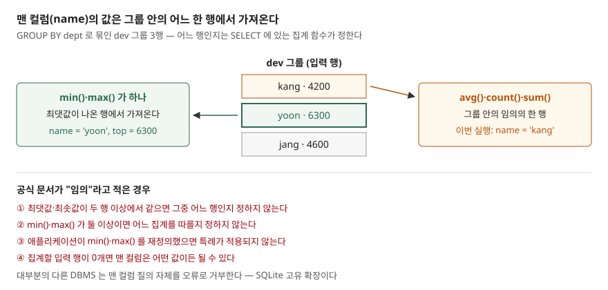

## 들어가며

부서별 최고 연봉을 뽑다가 "그 사람 이름도 같이 보여 달라"는 요청을 받는다. `SELECT dept, max(salary) ... GROUP BY dept` 에 `name` 만 하나 끼워 넣고 돌려 보면 SQLite 에서는 그럴듯한 이름이 나온다. 그래서 같은 식으로 평균 연봉 옆에도 이름을 붙이고, 최저·최고 연봉을 한 줄에 같이 뽑으면서 이름을 붙인다. 그런데 이 질의를 다른 DB 로 옮기면 실행조차 안 되고, SQLite 안에서도 집계 함수를 하나 바꾸거나 **순서만 바꿔도** 이름이 달라진다. 결과가 맞아 보인다고 질의가 맞는 것은 아니다.

## 개념

**집계 질의**는 `GROUP BY` 로 여러 행을 한 묶음(그룹)으로 모으고, 묶음마다 결과 한 행을 낸다. 그래서 `SELECT` 에 쓸 수 있는 것은 보통 둘뿐이다. 묶는 기준인 `GROUP BY` 컬럼, 그리고 `max()`·`avg()` 처럼 여러 행을 값 하나로 줄이는 **집계 함수**다.

둘 중 어디에도 속하지 않는 컬럼을 SQLite 문서는 **맨 컬럼**(bare column)이라 부른다. `dev` 그룹에는 이름이 셋인데 결과는 한 행이니, 맨 컬럼에는 어떤 이름을 넣을지 정할 근거가 없다. 문서는 대부분의 다른 엔진이 이런 질의를 오류로 거부한다고 적고, 맨 컬럼을 받아 주는 것을 **SQLite 고유 확장**이라고 밝힌다.

SQLite 가 정한 규칙은 이렇다. 맨 컬럼의 값은 그 그룹을 이루는 입력 행 **중 하나**에서 온다. 어느 행인지는 보통 알 수 없다. 단, 질의에 `min()` 이나 `max()` 가 **딱 하나** 있으면 맨 컬럼은 그 최솟값·최댓값이 나온 행에서 가져온다.

## 구조



> **출처**: [SQLite — SELECT §2.5 Bare columns in an aggregate query](https://www.sqlite.org/lang_select.html#bare_columns_in_an_aggregate_query) · [SQLite — Quirks §6 Aggregate Queries Can Contain Non-Aggregate Result Columns](https://www.sqlite.org/quirks.html#aggregate_queries_can_contain_non_aggregate_result_columns_that_are_not_in_the_group_by_clause)

## 동작 원리

그림의 아래쪽 네 줄이 문서가 "임의"라고 적은 경우다. 최댓값이 두 행에서 같을 때, `min()`·`max()` 가 둘 이상일 때, 이 함수를 재정의했을 때, 집계할 행이 없을 때다. 이 경우 SQLite 는 어떤 행을 고를지 **약속하지 않는다.** 지금 버전에서 늘 같은 값이 나오더라도 다음 버전이나 실행계획이 바뀌면 달라질 수 있다는 뜻이다.

`GROUP BY` 없이 집계하면 표 전체가 한 그룹이다. 문서는 이때 맨 컬럼을 **임의로 고른 한 행**으로 계산하고, 입력이 0행이면 모든 컬럼이 NULL 인 행으로 계산해 결과 한 행을 낸다고 적는다.

## 실습 예제

전체 소스: [`code/`](code/) · 수행 기록: [`code/output.txt`](code/output.txt)

`employee` 표에 세 부서 8명을 넣었다. dev 는 kang 4200, yoon 6300, jang 4600 순서로 들어 있다.

**max() 하나 — 최고 연봉자의 이름이 나온다.**

```text
  sql> SELECT dept, name, max(salary) AS top FROM employee GROUP BY dept ORDER BY dept
  dept | name | top
  'dev' | 'yoon' | 6300
  'ops' | 'seo' | 4300
  'sales' | 'lee' | 5100
```

`max(salary) + 0` 처럼 식으로 감싸도 같은 이름이 나왔다. 집계 함수가 하나 있다는 사실은 그대로이기 때문이다.

**avg()·count() — 이름은 그룹 안의 아무 행.**

```text
  sql> SELECT dept, name, avg(salary) AS mean FROM employee GROUP BY dept ORDER BY dept
  dept | name | mean
  'dev' | 'kang' | 5033.333333333333
  'ops' | 'han' | 4100.0
  'sales' | 'kim' | 4133.333333333333
```

이번 실행에서는 세 부서 모두 처음 넣은 행의 이름이 나왔다. 하지만 이것은 관찰일 뿐이다. 문서가 보장하지 않으므로 "평균을 받는 사람"으로 읽으면 안 된다. 평균 연봉을 받는 사람은 있을 수도 없을 수도 있다.

**min() 과 max() 를 함께 — 순서를 바꾸면 이름이 바뀐다.** 이번 글에서 가장 예상과 달랐던 결과다.

```text
  sql> SELECT dept, name, min(salary) AS low, max(salary) AS top FROM employee GROUP BY dept ORDER BY dept
  'dev' | 'yoon' | 4200 | 6300
  sql> SELECT dept, name, max(salary) AS top, min(salary) AS low FROM employee GROUP BY dept ORDER BY dept
  'dev' | 'kang' | 6300 | 4200
```

(dev 행만 옮겼다. 세 부서 모두 같은 양상이었다.) 같은 두 집계를 순서만 바꿨는데 이름이 최고 연봉자에서 최저 연봉자로 바뀌었다. SQLite 3.49.1 에서는 SELECT 에 **뒤에 쓴** 집계를 따랐다. 문서는 어느 쪽을 따를지 임의라고만 적으므로 이 순서에 기대면 안 된다.

**동점.** dev 에 6300 인 baek 을 yoon 뒤에 넣자 이름은 여전히 yoon 이었다. 먼저 만난 최댓값 행이 남은 것인데, 이것도 문서상 임의다. 결과에는 동점자가 있다는 흔적조차 없다.

**입력 0행.** 없는 부서 `hr` 로 걸러 보면 두 질의가 다르게 답한다.

```text
  sql> SELECT name, max(salary) AS top FROM employee WHERE dept = 'hr'
  name | top
  NULL | NULL
  sql> SELECT dept, name, max(salary) AS top FROM employee WHERE dept = 'hr' GROUP BY dept
  dept | name | top
```

`GROUP BY` 가 없으면 표 전체가 한 그룹이라 행이 없어도 결과 한 행이 나오고, `GROUP BY` 가 있으면 그룹이 하나도 없으니 0행이다.

**규칙에 기대지 않는 쓰기.** 창 함수 `RANK()` 로 부서 안 순위를 매기고 1등만 남기면 동점자가 둘 다 나온다.

```sql
SELECT dept, name, salary FROM (
    SELECT dept, name, salary,
           RANK() OVER (PARTITION BY dept ORDER BY salary DESC) AS rk
    FROM employee)
WHERE rk = 1 ORDER BY dept, name;
```

```text
  'dev' | 'baek' | 6300
  'dev' | 'yoon' | 6300
  'ops' | 'seo' | 4300
  'sales' | 'lee' | 5100
```

`WHERE salary = (SELECT max(salary) FROM employee WHERE dept = e.dept)` 처럼 상관 부질의로 써도 같은 4행이 나왔다. 두 방식 모두 표준 SQL 이라 다른 DB 에서도 그대로 돈다.

## 실무에서 주의할 점

**첫째, 맨 컬럼은 `max()` 나 `min()` 이 하나일 때만 뜻이 있다.** `avg()`·`sum()`·`count()` 옆의 맨 컬럼은 그룹의 아무 값이다. 리포트에 "대표 이름"처럼 찍혀 나가면 읽는 사람이 근거 없는 값을 믿게 된다.

**둘째, 동점을 숨긴다.** 최고 연봉자가 둘이어도 한 명만 나온다. 동점자를 다 보여야 하면 `RANK()`, 하나만 고르되 기준을 정하려면 `ROW_NUMBER() OVER (... ORDER BY salary DESC, emp_id)` 처럼 순서를 끝까지 정한다.

**셋째, 다른 DB 로 옮기면 깨진다.** 문서 스스로 대부분의 엔진이 오류를 낸다고 적는다. 지금은 SQLite 만 쓰더라도 질의를 다른 엔진에서 다시 쓸 가능성이 있으면 처음부터 창 함수나 부질의로 쓴다.

**넷째, 질의를 고칠 때 결과가 조용히 바뀐다.** `min()` 을 하나 더 넣는 것처럼 무해해 보이는 수정이 맨 컬럼의 출처를 바꿨다. 에러가 나지 않으니 테스트에서 값까지 비교하지 않으면 모른다.

## 정리

- `GROUP BY` 에도 집계 함수에도 없는 컬럼이 맨 컬럼이고, 대부분의 DBMS 는 거부하지만 SQLite 는 받아 준다
- `min()`·`max()` 가 하나면 맨 컬럼은 그 값이 나온 행에서 오고, 그 밖에는 그룹의 아무 행이다
- 동점, 둘 이상의 `min()`·`max()`, 입력 0행에서는 어느 행인지 정해지지 않는다. 3.49.1 에서는 뒤에 쓴 집계를 따랐다
- 동점까지 드러내야 하면 `RANK()` 나 상관 부질의로 쓴다

## 참고 자료

- [SQLite — SELECT §2.5 Bare columns in an aggregate query](https://www.sqlite.org/lang_select.html#bare_columns_in_an_aggregate_query) — 맨 컬럼의 정의, min()·max() 특례와 세 가지 제한, 고유 확장이라는 설명
- [SQLite — SELECT, Generation of the set of result rows](https://www.sqlite.org/lang_select.html#generation_of_the_set_of_result_rows) — GROUP BY 없는 집계와 입력 0행의 처리
- [SQLite — Quirks §6 Aggregate Queries Can Contain Non-Aggregate Result Columns](https://www.sqlite.org/quirks.html#aggregate_queries_can_contain_non_aggregate_result_columns_that_are_not_in_the_group_by_clause) — 다른 SQL 구현과의 차이
- [SQLite — Window Functions §3 Built-in Window Functions](https://www.sqlite.org/windowfunctions.html#built_in_window_functions) — `rank()`, `row_number()`
