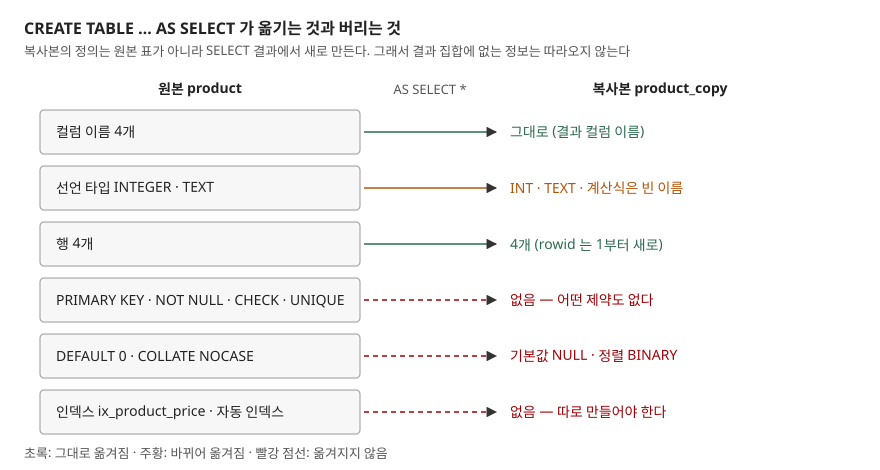

## 들어가며

운영 표의 데이터를 크게 고치기 전에 "혹시 모르니 복사해 두자"며 `CREATE TABLE product_bak AS SELECT * FROM product;` 한 줄을 치는 일은 흔하다. 문장이 짧고 바로 끝나서, 행 수만 맞으면 백업이 된 것으로 여긴다. 그런데 며칠 뒤 그 복사본을 원본 대신 쓰거나 되돌리기용으로 다시 붓다 보면, 중복된 id 가 들어가 있고 대소문자 검색이 안 맞고 조회가 느려진 것을 그제야 발견한다. 행 1만 개를 다시 검사하고 제약과 인덱스를 손으로 다시 붙이는 데 드는 시간은, 처음에 정의를 같이 복사했으면 들지 않았을 비용이다.

## 개념

**CTAS**(CREATE TABLE AS SELECT)는 SELECT 의 결과로 새 표를 만들고 그 행으로 채우는 문장이다. 표를 만드는 일과 데이터를 넣는 일을 한 번에 한다.

핵심은 새 표의 정의가 **원본 표에서 오는 것이 아니라 SELECT 결과에서 온다**는 점이다. SELECT 결과는 "컬럼 이름과 값"만 가진 임시 묶음이다. 원본 표에 걸려 있던 기본키(PRIMARY KEY, 행을 하나로 특정하는 컬럼), NOT NULL(빈 값 금지), CHECK(값 범위 검사), UNIQUE(중복 금지), DEFAULT(값을 안 주면 넣을 기본값), COLLATE(문자 비교 규칙) 같은 정보는 결과 묶음에 실려 있지 않다. 그래서 복사본에도 없다.

SQLite 공식 문서는 이것을 그대로 적는다. CTAS 로 만든 표는 기본키가 없고 어떤 종류의 제약도 없으며, 각 컬럼의 기본값은 NULL, 비교 규칙은 BINARY 다. 이 글은 이 문장을 하나씩 실행해 확인하고, 제약까지 옮기는 방법과 나란히 비교한다.

## 구조



> **출처**: [SQLite — CREATE TABLE §CREATE TABLE ... AS SELECT Statements](https://www.sqlite.org/lang_createtable.html#createtabas)

옮겨지는 것은 컬럼 이름, 컬럼 수, 행 데이터 세 가지다. 선언 타입은 옮겨지지만 원본 글자 그대로가 아니라 **결과 식의 친화도**(affinity, SQLite 가 컬럼에 값을 저장할 때 선호하는 형)를 보고 새로 정한다. 나머지는 전부 빠진다.

## 동작 원리

SQLite 문서가 정한 CTAS 의 규칙은 네 가지다.

1. 컬럼 수와 이름은 SELECT 결과와 같다
2. 각 컬럼의 선언 타입은 결과 식의 **친화도**로 정한다. TEXT → `TEXT`, NUMERIC → `NUM`, INTEGER → `INT`, REAL → `REAL`, 친화도 없음(BLOB) → 빈 문자열
3. 기본키와 제약이 없다. 기본값은 NULL, 비교 규칙은 BINARY 다
4. 행은 SELECT 가 돌려준 순서대로 rowid(SQLite 가 행마다 붙이는 내부 번호) 1 부터 들어간다

2번에서 눈여겨볼 것은 **원본 컬럼을 그대로 가리키는 식만** 친화도를 가진다는 점이다. `price` 는 원본에서 INTEGER 친화도를 가지므로 `INT` 가 된다. 반면 `price * 1.1` 이나 `upper(name)` 같은 계산식은 친화도가 없어서 선언 타입이 비어 버린다. 계산식에 타입을 붙이고 싶으면 `CAST(... AS REAL)` 처럼 형 변환을 써야 한다.

인덱스가 빠지는 이유도 같다. 인덱스는 표 정의와 따로 `sqlite_schema` 에 저장되는 별도 객체다. CTAS 는 표 하나만 만들 뿐 원본에 딸린 인덱스를 찾아 복사하지 않는다. `INTEGER PRIMARY KEY` 가 `INT` 로 바뀌면서 rowid 와의 연결도 끊긴다. 원본에서 `product_id` 로 찾으면 rowid 로 바로 가지만, 복사본의 `product_id` 는 그냥 정수 컬럼이다.

## 실습 예제

전체 소스: [`code/ctas_copy.py`](code/ctas_copy.py) · 수행 기록: [`code/output.txt`](code/output.txt)

원본 표 `product` 는 네 가지 제약과 인덱스 하나를 가진다.

```sql
CREATE TABLE product (
    product_id  INTEGER PRIMARY KEY,
    name        TEXT    NOT NULL COLLATE NOCASE,
    price       INTEGER NOT NULL DEFAULT 0 CHECK (price >= 0),
    sku         TEXT    UNIQUE
);
CREATE INDEX ix_product_price ON product(price);
```

```text
[product]  4행
  product_id | name   | price | sku
  -----------+--------+-------+-----
           1 | Apple  |  1200 | A-01
           2 | banana |   800 | B-01
           3 | Cherry |  3000 | C-01
           4 | melon  |  5000 | M-01
```

**① 정의 비교.** `CREATE TABLE product_copy AS SELECT * FROM product` 를 실행하고 `sqlite_schema` 에 저장된 정의를 꺼냈다.

```text
  CREATE TABLE product_copy(
    product_id INT,
    name TEXT,
    price INT,
    sku TEXT
  )
```

`INTEGER` 가 `INT` 로 바뀌었고 제약 키워드가 한 글자도 없다. 인덱스 목록(`pragma_index_list`)도 원본은 2개(`ix_product_price`, UNIQUE 가 만든 자동 인덱스)였는데 복사본은 0개였다. 행 수는 4개로 맞다. 행 수만 보고 백업이 됐다고 판단하면 여기서 놓친다.

**② 원본이 막던 값이 복사본에는 들어간다.** 같은 INSERT 네 개를 두 표에 넣었다.

| 넣은 값 | `product` | `product_copy` |
|---|---|---|
| 이미 있는 id 1 | `UNIQUE constraint failed: product.product_id` | 들어감 |
| name 이 NULL | `NOT NULL constraint failed: product.name` | 들어감 |
| price 가 -5 | `CHECK constraint failed: price >= 0` | 들어감 |
| 이미 있는 sku `A-01` | `UNIQUE constraint failed: product.sku` | 들어감 |

price 와 id 를 빼고 넣은 행은 이렇게 갈렸다.

```text
  sql> SELECT product_id, name, price FROM product WHERE name = 'kiwi'
  product_id | name | price
  5 | 'kiwi' | 0

  sql> SELECT product_id, name, price FROM product_copy WHERE name = 'kiwi'
  product_id | name | price
  NULL | 'kiwi' | NULL
```

원본은 id 를 자동으로 5 를 매기고 price 에 기본값 0 을 넣었다. 복사본은 둘 다 NULL 이다. **이번 실습에서 가장 예상과 달랐던 자리다.** 제약이 빠진다는 것은 알았어도, id 가 자동으로 매겨지지 않아 NULL 인 행이 생긴다는 것은 실제로 넣어 보기 전에는 잘 떠오르지 않는다. `INTEGER PRIMARY KEY` 가 사라지면서 rowid 의 별칭이 아니게 됐기 때문이다.

**③ 대소문자 검색이 달라진다.** `COLLATE NOCASE` 가 빠지면 같은 WHERE 절이 다른 답을 낸다.

```text
  sql> SELECT product_id, name FROM product WHERE name = 'APPLE'
  product_id | name
  1 | 'Apple'

  sql> SELECT product_id, name FROM product_copy WHERE name = 'APPLE'
  product_id | name
```

복사본 쪽은 머리글만 찍히고 행이 없다.

정렬도 바뀐다. 원본은 `Apple, banana, Cherry, melon` 순이었는데 복사본은 BINARY 비교라 대문자가 먼저 와서 `Apple, Cherry, banana, ...` 순이었다.

**④ 계산식 컬럼의 타입 이름.** 식을 섞어 CTAS 를 만들었다.

```text
  CREATE TABLE price_report(
  product_id INT,
  name TEXT,
  price_vat,
  price_real REAL,
  price_num NUM,
  name_upper,
  total_rows,
  memo
)
```

`price * 1.1`(price_vat), `upper(name)`, 창 함수 `count(*) OVER ()`, `NULL` 은 선언 타입이 비었다. `CAST` 를 쓴 두 컬럼만 `REAL`, `NUM` 을 받았다. 값 자체는 `typeof` 로 보면 `real`, `text`, `integer` 로 제대로 저장됐다. 타입 이름이 비어도 저장은 되지만, 이 표를 다른 도구로 옮기거나 스키마를 읽어 코드를 생성할 때 타입 정보가 없다.

**⑤ 실행계획.** 같은 질의가 원본에서는 인덱스를 타고 복사본에서는 표 전체를 훑는다.

```text
  sql> SELECT name FROM product WHERE price > 2500
  QUERY PLAN
  `--SEARCH product USING INDEX ix_product_price (price>?)

  sql> SELECT name FROM product_copy WHERE price > 2500
  QUERY PLAN
  `--SCAN product_copy

  sql> SELECT name FROM product WHERE product_id = 3
  QUERY PLAN
  `--SEARCH product USING INTEGER PRIMARY KEY (rowid=?)

  sql> SELECT name FROM product_copy WHERE product_id = 3
  QUERY PLAN
  `--SCAN product_copy
```

**⑥ 뼈대 먼저, 데이터는 INSERT INTO ... SELECT.** 원본의 정의 문장을 `sqlite_schema` 에서 꺼내 표 이름만 바꿔 실행하고, 인덱스 정의도 같은 방식으로 다시 만든 뒤 데이터를 부었다.

```python
(src_sql,) = conn.execute(
    "SELECT sql FROM sqlite_schema WHERE name = 'product'"
).fetchone()
conn.execute(src_sql.replace("CREATE TABLE product", "CREATE TABLE product_backup", 1))
# 인덱스 정의도 같은 식으로 꺼내 이름만 바꿔 실행한다
conn.execute("INSERT INTO product_backup SELECT * FROM product")
```

```text
  sql> SELECT name, type, "notnull", dflt_value, pk FROM pragma_table_info('product_backup')
  name | type | notnull | dflt_value | pk
  'product_id' | 'INTEGER' | 0 | NULL | 1
  'name' | 'TEXT' | 1 | NULL | 0
  'price' | 'INTEGER' | 1 | '0' | 0
  'sku' | 'TEXT' | 0 | NULL | 0

  sql> SELECT name, "unique", origin FROM pragma_index_list('product_backup')
  name | unique | origin
  'ix_product_backup_price' | 0 | 'c'
  'sqlite_autoindex_product_backup_1' | 1 | 'u'

  sql> INSERT INTO product_backup(product_id, name, price) VALUES (20, NULL, 1)
  IntegrityError: NOT NULL constraint failed: product_backup.name
```

기본키·NOT NULL·기본값·인덱스가 모두 살아 있고, `name = 'APPLE'` 검색도 원본처럼 `Apple` 을 찾았다.

**⑦ INSERT INTO ... SELECT 중간에 위반이 나면.** 세 행 중 두 번째 행만 price 가 -100 인 `incoming` 표를 원본에 부었다.

```text
  sql> SELECT count(*) AS before_rows FROM product
  before_rows
  5

  sql> INSERT INTO product(name, price, sku) SELECT name, price, sku FROM incoming
  IntegrityError: CHECK constraint failed: price >= 0

  sql> SELECT count(*) AS after_rows FROM product
  after_rows
  5

  sql> INSERT OR IGNORE INTO product(name, price, sku) SELECT name, price, sku FROM incoming
  (바뀐 행 수: 2)
```

첫 행 `grape` 는 위반이 아니었지만 들어가지 않았다. 기본 충돌 처리(ABORT)는 **문장 하나를 통째로 되돌린다.** `OR IGNORE` 를 붙이면 위반한 행만 건너뛰고 나머지 2행이 들어간다.

## 실무에서 주의할 점

1. **CTAS 복사본을 백업으로 믿지 않는다.** 행은 맞아도 정의가 다르다. 되돌릴 때 이 표를 원본 자리에 바꿔 끼우면 그 순간부터 중복·NULL·음수가 막힘 없이 들어온다. 되돌리기용이면 ⑥처럼 정의와 인덱스를 먼저 복사한 뒤 데이터를 붓는다.
2. **`WHERE 0` 으로 구조만 복사하는 습관도 같은 함정이다.** 다른 DB 에서 쓰던 `CREATE TABLE t AS SELECT * FROM src WHERE 0` 은 행만 비울 뿐 제약이 빠지는 것은 똑같다. "구조 복사"라는 이름과 달리 컬럼 이름과 친화도만 복사한다.
3. **INTEGER PRIMARY KEY 가 INT 로 바뀌면 id 자동 부여가 멈춘다.** ②처럼 id 를 안 주고 넣은 행은 NULL id 를 가진다. 이 표를 다른 표가 참조하고 있었다면 조인이 조용히 빠진다.
4. **계산식 컬럼에는 CAST 를 붙인다.** 집계·보고용 표를 CTAS 로 만들 때 `sum(x)`, `x * 1.1` 컬럼은 타입 이름이 빈다. 다음 단계 도구가 스키마를 보고 형을 정한다면 `CAST(sum(x) AS INTEGER)` 처럼 명시한다.
5. **큰 표를 INSERT INTO ... SELECT 로 옮길 때는 한 행의 위반이 전체를 되돌린다.** 몇 시간 걸린 문장이 마지막 행 하나 때문에 0행이 될 수 있다. 미리 `SELECT ... WHERE NOT (price >= 0)` 로 위반 행을 찾아 두거나, 건너뛰어도 되는 데이터면 `OR IGNORE` 를 쓰고 건너뛴 수를 세어 둔다.

## 정리

- CTAS 의 새 표 정의는 원본 표가 아니라 **SELECT 결과**에서 만들어진다
- 따라오는 것은 컬럼 이름·행·친화도 이름(`INT`·`TEXT`·`REAL`·`NUM`·빈 이름) 셋뿐이다
- 기본키·NOT NULL·CHECK·UNIQUE·DEFAULT·COLLATE·인덱스는 전부 빠지고, 그 결과 검색·정렬·실행계획이 달라진다
- 제약까지 옮기려면 정의를 먼저 만들고 `INSERT INTO ... SELECT` 로 채운다. 위반 행이 있으면 기본 동작은 문장 전체를 되돌리는 것이다

## 참고 자료

- [SQLite — CREATE TABLE §CREATE TABLE ... AS SELECT Statements](https://www.sqlite.org/lang_createtable.html#createtabas) — 선언 타입 결정 규칙, 제약 없음, 기본값 NULL, BINARY 비교 규칙
- [SQLite — CREATE TABLE §ROWIDs and the INTEGER PRIMARY KEY](https://www.sqlite.org/lang_createtable.html#rowid) — INTEGER PRIMARY KEY 가 rowid 별칭이 되는 조건
- [SQLite — Datatypes In SQLite §Type Affinity](https://www.sqlite.org/datatype3.html#type_affinity) — 친화도 5가지와 식의 친화도
- [SQLite — INSERT](https://www.sqlite.org/lang_insert.html) — `INSERT INTO ... SELECT` 형식
- [SQLite — The ON CONFLICT Clause](https://www.sqlite.org/lang_conflict.html) — ABORT 가 문장의 변경을 되돌리는 동작, IGNORE
