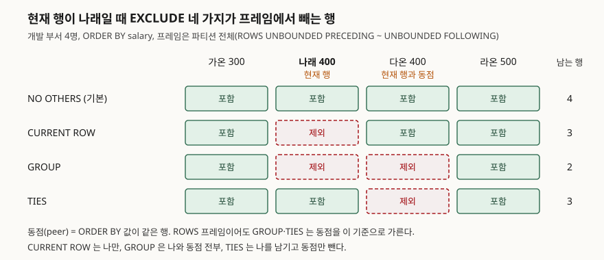

<!-- related:start -->
> **같은 기능을 다른 환경에서 다룬 글** (`window-function`)
> - [윈도우 함수 입문 — ROW_NUMBER로 그룹별 1등 뽑기](../2026-10-03-window-function-row-number-top-per-group/index.md) — SQLite 3.49.1, Python 3.13.5, Windows 11
> - [RANK와 DENSE_RANK — 동점을 어떻게 셀까](../2026-10-06-rank-dense-rank-ties/index.md) — SQLite 3.49.1, Python 3.13.5, Windows 11
> - [누적합과 이동평균 — SUM OVER의 프레임](../2026-10-06-sum-over-frame-rows-range/index.md) — SQLite 3.49.1, Python 3.13.5, Windows 11
> - [LAG와 LEAD — 앞뒤 행의 값을 같은 줄에 놓기](../2026-10-12-lag-lead-previous-next-row/index.md) — SQLite 3.49.1, Python 3.13.5, Windows 11
> - [FIRST_VALUE와 LAST_VALUE — 구간의 처음과 끝](../2026-10-16-first-value-last-value-window-frame/index.md) — SQLite 3.49.1, Python 3.13.5
> - [NTILE — 데이터를 n등분하는 법](../2026-10-16-ntile-quartile-remainder/index.md) — SQLite 3.49.1, Python 3.13.5
> - [PERCENT_RANK와 CUME_DIST — 내 점수가 상위 몇 퍼센트인가](../2026-11-06-percent-rank-cume-dist/index.md) — SQLite 3.49.1, Python 3.13.5
> - [Tibero 7 분석 함수의 윈도우 절 — ROWS와 RANGE는 어디서 갈리는가](../../tibero/2026-09-23-tibero7-window-clause/index.md) — Tibero 7
<!-- related:end -->

## 들어가며

직원 표를 받아 "각자 연봉을 **자기를 뺀** 부서 평균과 비교해 달라"는 부탁을 받는다. 부서 평균에는 본인 연봉이
섞여 있어서, 연봉이 높은 사람일수록 평균을 끌어올려 차이가 작게 보이기 때문이다. 보통은 부서별 합계와 인원을
`SUM() OVER`·`COUNT(*) OVER`로 따로 구한 뒤 `(합계 − 내 연봉) / (인원 − 1)`을 손으로 쓴다. 식이 세 덩어리로
늘어나고, 정수끼리 나누다 소수점이 잘리고, 한 명뿐인 부서는 0으로 나누게 된다.

윈도우 프레임의 `EXCLUDE` 절은 이 일을 "프레임에서 현재 행을 빼라"는 한 줄로 한다. 다만 무엇을 "현재 행"으로,
무엇을 "동점"으로 보는지가 프레임 종류에 따라 갈려서, 같은 `EXCLUDE CURRENT ROW`가 다른 값을 내는 자리가 있다.

## 개념

**윈도우 함수**는 행을 하나로 합치지 않고 각 행 옆에 집계 값을 붙인다. 이때 각 행이 집계에 쓰는 행의 범위를
**프레임**이라 한다. `ROWS BETWEEN 1 PRECEDING AND 1 FOLLOWING`처럼 시작과 끝 경계로 정한다.

`EXCLUDE`는 그렇게 정한 프레임에서 **일부 행을 다시 빼는** 절이다. SQLite 문서가 정한 형태는 네 가지다.

| 형태 | 프레임에서 빼는 행 |
|---|---|
| `EXCLUDE NO OTHERS` | 없음. 아무것도 안 적으면 이것이다 |
| `EXCLUDE CURRENT ROW` | 현재 행 |
| `EXCLUDE GROUP` | 현재 행과 그 **동점** 전부 |
| `EXCLUDE TIES` | 현재 행은 남기고 그 동점만 |

**동점**(문서 표현으로 peer)은 `ORDER BY` 값이 같은 행이다. `ORDER BY`가 없으면 파티션의 모든 행이 서로 동점이다.
SQLite에는 3.28.0(2019-04-16)에서 들어왔다.

## 구조



> **출처**: [SQLite Window Functions §2.2.3 The EXCLUDE Clause](https://www.sqlite.org/windowfunctions.html#the_exclude_clause)

## 동작 원리

SQLite는 프레임을 두 단계로 정한다. 먼저 경계(`UNBOUNDED PRECEDING` 등)로 범위를 잡고, 그다음 `EXCLUDE`가 그
범위에서 행을 덜어 낸다. 그래서 문법상 `EXCLUDE`는 **경계 뒤에만** 올 수 있다.

동점을 가르는 기준은 프레임 종류와 상관없이 `ORDER BY` 값이다. 문서는 `EXCLUDE GROUP`을 설명하며 프레임이
`ROWS`여도 같은 `ORDER BY` 값을 가진 행을 동점으로 본다고 적는다. 그래서 `ROWS` 프레임에서도 `GROUP`과 `TIES`가
동점을 뺀다.

반면 `EXCLUDE CURRENT ROW`에 대해 문서는 `RANGE`·`GROUPS` 프레임에서는 동점이 프레임에 남는다고 적는다.
`RANGE`는 동점을 한 덩어리로 다뤄서, 경계가 `CURRENT ROW`면 동점 전체가 함께 들어오기 때문이다. 현재 행 하나를
빼도 동점은 그대로다.

## 실습 예제

7명짜리 직원 표를 쓴다. 개발 부서에 연봉 400인 두 명(나래·다온)이 동점이다.
전체 소스: [`code/`](code/) · 돌린 기록: [`code/output.txt`](code/output.txt)

```text
  emp_name | dept_name | salary
  ---------+-----------+-------
  가온     | 개발      |    300
  나래     | 개발      |    400
  다온     | 개발      |    400
  라온     | 개발      |    500
  마루     | 영업      |    350
  바름     | 영업      |    450
  사름     | 인사      |    380
```

**1. 네 가지를 나란히.** 프레임을 파티션 전체로 두고 `group_concat`으로 남는 사람을 찍었다.

```text
  emp_name | salary | no_others           | current_row    | grp            | ties
  ---------+--------+---------------------+----------------+----------------+--------------------
  가온     |    300 | 가온,나래,다온,라온 | 나래,다온,라온 | 나래,다온,라온 | 가온,나래,다온,라온
  나래     |    400 | 가온,나래,다온,라온 | 가온,다온,라온 | 가온,라온      | 가온,나래,라온
  다온     |    400 | 가온,나래,다온,라온 | 가온,나래,라온 | 가온,라온      | 가온,다온,라온
  라온     |    500 | 가온,나래,다온,라온 | 가온,나래,다온 | 가온,나래,다온 | 가온,나래,다온,라온
```

동점이 없는 가온·라온은 `GROUP`이 `CURRENT ROW`와 같고 `TIES`가 `NO OTHERS`와 같다. 네 가지가 갈리는 것은
동점이 있는 나래·다온뿐이다.

**2. 나를 뺀 부서 평균.**

```sql
AVG(salary) OVER (PARTITION BY dept_name
                  ROWS BETWEEN UNBOUNDED PRECEDING AND UNBOUNDED FOLLOWING
                  EXCLUDE CURRENT ROW) AS others_avg
```

```text
  dept_name | emp_name | salary | others_avg        | by_formula | by_formula_real
  ----------+----------+--------+-------------------+------------+------------------
  개발      | 가온     |    300 | 433.3333333333333 |        433 | 433.3333333333333
  개발      | 라온     |    500 | 366.6666666666667 |        366 | 366.6666666666667
  인사      | 사름     |    380 |              NULL |       NULL |              NULL
```

`by_formula`는 `(합계 − 연봉) / (인원 − 1)`을 손으로 쓴 것이다. 정수끼리 나눠 433.33이 433이 됐다. 한 명뿐인
인사 부서는 `EXCLUDE` 쪽이 빈 프레임의 `AVG`라서, 공식 쪽은 0으로 나눠서 둘 다 NULL이다. SQLite는 0으로 나누면
에러 대신 NULL을 돌려준다.

**3. 기본 프레임(`RANGE`)에서는 동점이 남는다.** `ORDER BY`만 적은 누적합에 `EXCLUDE CURRENT ROW`를 붙였다.

```text
  emp_name | salary | running | range_excl | rows_excl | range_cnt | rows_cnt
  ---------+--------+---------+------------+-----------+-----------+---------
  가온     |    300 |     300 |       NULL |      NULL |         0 |        0
  나래     |    400 |    1100 |        700 |       300 |         2 |        1
  다온     |    400 |    1100 |        700 |       700 |         2 |        2
  라온     |    500 |    1600 |       1100 |      1100 |         3 |        3
```

`RANGE`에서 나래는 다온을 남겨 700(가온+다온), `ROWS`에서는 300(가온)이다. `ROWS`에서 나래와 다온이 다른 값을
받은 것은 동점끼리의 순서가 정렬에서 우연히 정해졌기 때문이다.

## 실무에서 주의할 점

**1. `ORDER BY` 없이 `EXCLUDE GROUP`을 쓰면 프레임이 빈다.** 파티션 전체가 동점이라 전부 빠진다.

```text
  dept_name | emp_name | excl_cur | excl_grp | excl_ties
  ----------+----------+----------+----------+----------
  개발      | 가온     |        3 |        0 |         1
  인사      | 사름     |        0 |        0 |         1
```

`EXCLUDE TIES`는 반대로 자기 자신 하나만 남긴다. "나를 뺀 부서 평균"에는 `CURRENT ROW`만 맞다.

**2. `EXCLUDE`만 단독으로 쓸 수 없다.** 기본 프레임이 있으니 될 것 같지만 경계를 적어야 한다.

```text
  ORDER BY 뒤에 바로   실패   — ORDER BY salary EXCLUDE TIES
                    OperationalError: near "EXCLUDE": syntax error
  경계 뒤에            OK     — ORDER BY salary ROWS UNBOUNDED PRECEDING EXCLUDE TIES
```

**3. 순위 함수에는 효과가 없다.** `ROW_NUMBER()`·`RANK()`는 프레임을 보지 않으므로 `EXCLUDE`를 붙여도 값이 그대로다.
`FIRST_VALUE()`는 프레임을 쓰므로 영향을 받는다. 가온의 `FIRST_VALUE`는 자기를 뺀 첫 행인 나래였다.

**4. 행이 많으면 느려진다.** 실행계획은 `EXCLUDE` 유무와 상관없이 같았다. 그러나 한 부서에 n명을 넣고 VDBE 명령
수(SQLite 가상 머신이 실행한 명령 개수)를 세면 차이가 크다.

```text
  n    | EXCLUDE 명령 수 | 공식 명령 수 | EXCLUDE ms | 공식 ms
  -----+-----------------+--------------+------------+--------
   500 |         1516041 |        20040 |        7.4 |     0.3
  1000 |         6032041 |        40039 |       27.5 |     0.6
  2000 |        24064041 |        80039 |      209.2 |     2.4
  4000 |        96128041 |       160039 |      820.2 |     4.2
```

n이 두 배가 될 때 공식 쪽은 두 배, `EXCLUDE` 쪽은 네 배씩 늘었다. 행마다 프레임 전체를 다시 훑는 모양이다.
SQLite 소스 `window.c`의 `nth_value` 구현 주석은 기본값이 아닌 `EXCLUDE`가 있을 때를 "slow mode"라고 부른다.
행이 수천 개를 넘는 파티션에서 "나를 뺀 합계·평균"을 구할 때는 공식이 낫다. 그때는 `* 1.0`으로 실수 나눗셈을 만든다.

## 정리

- `EXCLUDE`는 경계로 정한 프레임에서 행을 다시 빼며, 경계 뒤에만 쓸 수 있다.
- `CURRENT ROW`는 나만, `GROUP`은 나와 동점 전부, `TIES`는 동점만 뺀다. 동점은 `ORDER BY` 값으로 가른다.
- 기본 프레임인 `RANGE`에서 `EXCLUDE CURRENT ROW`는 동점을 남긴다.
- `ORDER BY`가 없으면 파티션 전체가 동점이라 `EXCLUDE GROUP`은 빈 프레임을 만든다.
- 이 환경에서 `EXCLUDE`는 행 수의 제곱에 비례해 일이 늘었다. 큰 파티션에서는 `(합계 − 값) / (개수 − 1)`을 쓴다.

## 참고 자료

- [SQLite Window Functions §2.2.3 The EXCLUDE Clause](https://www.sqlite.org/windowfunctions.html#the_exclude_clause)
- [SQLite Window Functions §2.2 Frame Specifications](https://www.sqlite.org/windowfunctions.html#frame_specifications) — 기본 프레임과 동점의 정의
- [SQLite 3.28.0 Release Notes](https://www.sqlite.org/releaselog/3_28_0.html) — `EXCLUDE` 절 추가 (2019-04-16)
- [SQLite 소스 `src/window.c`](https://github.com/sqlite/sqlite/blob/master/src/window.c) — `nth_value` 구현 주석의 "slow mode"
