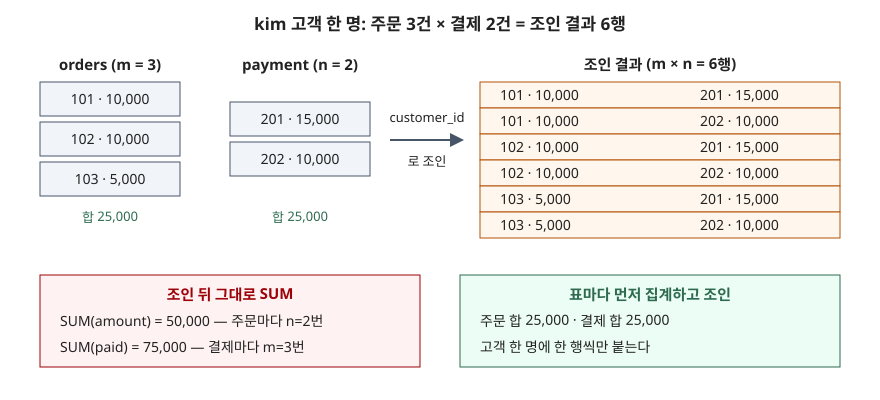

## 들어가며

고객별 화면에 "주문 합계"와 "결제 합계"를 나란히 띄워 달라는 요청은 흔하다. 고객 표에 주문 표와 결제 표를 차례로 `LEFT JOIN` 하고 `GROUP BY` 한 뒤 `SUM` 두 개를 적으면 질의 한 줄로 끝날 것처럼 보인다. 그런데 결과를 장부와 맞춰 보면 어떤 고객은 주문액이 두 배, 결제액이 세 배로 나오고 어떤 고객은 정확히 맞는다. 맞는 고객이 섞여 있어서 질의가 틀렸다는 의심이 늦게 들고, 고객을 하나씩 골라 원장과 대조하다 보면 수십 명을 확인하고 나서야 패턴이 보인다.

## 개념

**조인**(JOIN)은 두 표에서 조건이 맞는 행끼리 짝을 지어 한 행으로 붙이는 연산이다. 고객 한 명에 주문이 여러 건 달리는 관계를 **1:N**(일대다)이라고 부른다.

1:N 표 하나를 조인하는 것은 문제가 없다. 고객 한 명이 주문 3건과 짝지어져 3행이 되고, 주문액을 더하면 그 고객의 주문 합계가 나온다. 문제는 **같은 고객 기준으로 1:N 표 두 개를 한 번에 붙일 때**다. 주문 표와 결제 표는 서로 아무 관계가 없는데, 조인은 고객 id 가 같은 모든 주문과 모든 결제를 짝짓는다. 주문이 m 건, 결제가 n 건이면 그 고객의 행은 m × n 개가 된다.

SQLite 공식 문서는 조인을 "두 표의 모든 행 조합(데카르트 곱)을 만든 뒤 ON 조건으로 거른 것"으로 정의한다. ON 조건이 고객 id 만 보므로, 같은 고객의 주문·결제 조합은 하나도 걸러지지 않는다.

## 구조



> **출처**: [SQLite — SELECT §Determination of input data (FROM clause processing)](https://www.sqlite.org/lang_select.html#fromclause)

## 동작 원리

부풀려지는 배수는 정해져 있다. 6행 안에서 주문 101번은 결제 201·202번과 한 번씩, 즉 **n 번** 나온다. 결제 201번도 주문 101·102·103번과 한 번씩, **m 번** 나온다. 그래서 `SUM(amount)` 는 진짜 주문 합계의 n 배, `SUM(paid)` 는 진짜 결제 합계의 m 배가 된다.

이 배수는 고객마다 다르다. 결제가 한 건뿐이거나 주문이 한 건뿐이면 한쪽 합계는 1배라서 맞게 나온다. 결제가 아예 없는 고객은 `LEFT JOIN` 이 NULL 한 행만 붙이므로 주문 합계가 그대로다. 결과의 일부가 맞기 때문에 틀린 질의가 오래 살아남는다.

고치는 방법은 **표마다 먼저 고객 하나에 한 행으로 줄인 뒤 조인**하는 것이다. 이미 한 행씩이 된 결과끼리 조인하면 1:1 이 되어 곱이 생기지 않는다.

## 실습 예제

전체 소스: [`code/join_fan_out.py`](code/join_fan_out.py) · 수행 기록: [`code/output.txt`](code/output.txt)

고객 3명, 주문 6건, 결제 4건을 넣었다. kim 은 주문 3건(그중 두 건은 금액이 같다)과 결제 2건, lee 는 주문 2건에 결제가 없고, park 은 주문 1건에 결제 2건이다.

```text
[orders]  6행
  order_id | customer_id | amount
  ---------+-------------+-------
       101 |           1 |  10000
       102 |           1 |  10000
       103 |           1 |   5000
       104 |           2 |   7000
       105 |           2 |   3000
       106 |           3 |  20000

[payment]  4행
  payment_id | customer_id | paid
  -----------+-------------+------
         201 |           1 | 15000
         202 |           1 | 10000
         203 |           3 | 12000
         204 |           3 |  8000
```

**① 행 수부터 센다.** 고객마다 주문 수 m, 결제 수 n 과 조인 뒤 행 수를 나란히 놓았다.

```text
  name | m | n | joined_rows
  kim | 3 | 2 | 6
  lee | 2 | 0 | 2
  park | 1 | 2 | 2
```

kim 은 3 × 2 = 6 행이다. lee 는 결제가 0건이지만 `LEFT JOIN` 이 NULL 한 행을 붙여 2 × 1 = 2 행이 됐다.

**② 그대로 집계하면 이렇게 나온다.**

```sql
SELECT c.name, COUNT(o.order_id) AS order_count,
       SUM(o.amount) AS order_total, SUM(p.paid) AS paid_total
FROM customer c
LEFT JOIN orders  o ON o.customer_id = c.customer_id
LEFT JOIN payment p ON p.customer_id = c.customer_id
GROUP BY c.customer_id;
```

| 고객 | order_count | order_total | paid_total | 진짜 주문 합계 | 진짜 결제 합계 |
|---|---|---|---|---|---|
| kim | 6 | 50000 | 75000 | 25000 | 25000 |
| lee | 2 | 10000 | NULL | 10000 | NULL |
| park | 2 | 40000 | 20000 | 20000 | 20000 |

kim 의 주문 합계는 2배(n=2), 결제 합계는 3배(m=3)다. park 은 주문 합계가 2배인데 결제 합계는 맞았다. 주문이 1건이라 결제가 한 번씩만 나왔기 때문이다. lee 는 둘 다 맞다. 세 고객 중 정답과 같은 칸이 4개, 틀린 칸이 4개다.

**③ DISTINCT 로 막으려 하면.** 중복을 지우면 될 것 같아 `COUNT(DISTINCT o.order_id)`, `SUM(DISTINCT o.amount)` 로 바꿨다.

```text
  name | order_count | order_total | paid_total
  kim | 3 | 15000 | 25000
  lee | 2 | 10000 | NULL
  park | 1 | 20000 | 20000
```

건수는 맞았다. 그런데 kim 의 주문 합계가 25000 이 아니라 15000 이다. `SUM(DISTINCT x)` 는 **같은 행을 지우는 것이 아니라 같은 값을 지운다.** 주문 101번과 102번은 서로 다른 주문인데 금액이 둘 다 10000 이라 하나만 더해졌다. 결제 합계 25000 은 맞았지만 그건 두 결제 금액이 우연히 달랐기 때문이다. **이번 실습에서 가장 위험해 보인 자리다.** 건수가 맞으니 고친 것처럼 보이고, 금액이 겹치는 고객이 나타날 때만 틀린다.

**④ 먼저 집계하고 조인한다.** 주문과 결제를 각각 고객별로 합친 부질의를 만들고 그 결과를 조인했다.

```sql
SELECT c.name, o.order_total, p.paid_total
FROM customer c
LEFT JOIN (SELECT customer_id, SUM(amount) AS order_total
           FROM orders GROUP BY customer_id) o
       ON o.customer_id = c.customer_id
LEFT JOIN (SELECT customer_id, SUM(paid) AS paid_total
           FROM payment GROUP BY customer_id) p
       ON p.customer_id = c.customer_id;
```

```text
  name | order_total | paid_total
  kim | 25000 | 25000
  lee | 10000 | NULL
  park | 20000 | 20000
```

표마다 따로 `GROUP BY` 한 기준값과 세 고객 모두 같았다. 고객마다 `(SELECT SUM(amount) FROM orders o WHERE o.customer_id = c.customer_id)` 처럼 **상관 부질의**(바깥 행의 값을 받아 도는 부질의)를 두 개 쓰는 방법도 같은 답을 냈다.

**⑤ 두 방법의 실행계획.**

```text
  QUERY PLAN
  |--MATERIALIZE o
  |  |--SCAN orders
  |  `--USE TEMP B-TREE FOR GROUP BY
  |--MATERIALIZE p
  |  |--SCAN payment
  |  `--USE TEMP B-TREE FOR GROUP BY
  |--SCAN c
  |--BLOOM FILTER ON o (customer_id=?)
  |--SEARCH o USING AUTOMATIC COVERING INDEX (customer_id=?) LEFT-JOIN
  |--BLOOM FILTER ON p (customer_id=?)
  `--SEARCH p USING AUTOMATIC COVERING INDEX (customer_id=?) LEFT-JOIN
```

```text
  QUERY PLAN
  |--SCAN c
  |--CORRELATED SCALAR SUBQUERY 1
  |  `--SCAN o
  `--CORRELATED SCALAR SUBQUERY 2
     `--SCAN p
```

먼저 집계하는 쪽은 부질의 결과를 임시 표로 만들고(`MATERIALIZE`), 거기에 SQLite 가 스스로 인덱스를 붙여 찾는다. 상관 부질의 쪽은 `customer_id` 에 인덱스가 없어서 고객 한 명마다 `orders` 와 `payment` 를 처음부터 끝까지 훑는다(`SCAN o`). 고객이 많아지면 이 차이가 커지므로, 상관 부질의를 쓸 거면 `orders(customer_id)` 같은 인덱스를 먼저 만든다.

## 실무에서 주의할 점

1. **조인 뒤 행 수를 먼저 확인한다.** 주문 6행이 결제와 조인되자 10행이 됐다(`order_rows 6 · after_join 10`). 집계 전에 `COUNT(*)` 를 한 번 찍어 기준 표의 행 수와 비교하면 곱이 생겼는지 바로 보인다.
2. **조인 키가 상대 표에서 유일한지 본다.** `SELECT customer_id, COUNT(*) FROM payment GROUP BY customer_id HAVING COUNT(*) > 1` 이 행을 돌려주면 그 표는 고객당 여러 행이다. 그런 표를 두 개 이상 붙이는 순간 곱이 생긴다.
3. **`SUM(DISTINCT ...)` 로 덮지 않는다.** 값이 같은 서로 다른 행을 하나로 친다. 건수(`COUNT(DISTINCT id)`)는 id 가 유일하니 맞지만 금액 합계는 맞지 않는다.
4. **일부 결과가 맞는다고 질의가 맞는 것은 아니다.** 결제가 없거나 한 건인 고객은 배수가 1이라 정답이 나온다. 검증용 표본에 그런 고객만 있으면 틀린 질의가 그대로 통과한다. 1:N 이 둘 이상인 고객을 일부러 넣어 확인한다.

## 정리

- 같은 키로 1:N 표 두 개를 조인하면 행이 m × n 으로 늘어난다
- 그 상태로 SUM 하면 한쪽 합계는 n 배, 다른 쪽 합계는 m 배가 된다. 배수가 1인 고객은 맞게 나와서 틀린 줄 모르기 쉽다
- `SUM(DISTINCT)` 는 같은 값을 지우므로 고칠 수 없다
- 표마다 먼저 키 하나에 한 행으로 집계한 뒤 조인하거나, 상관 부질의로 따로 집계한다

## 참고 자료

- [SQLite — SELECT §Determination of input data (FROM clause processing)](https://www.sqlite.org/lang_select.html#fromclause) — 조인을 데카르트 곱과 ON 조건 거르기로 정의한 부분, LEFT JOIN 이 짝 없는 행에 NULL 을 채우는 규칙
- [SQLite — Built-in Aggregate Functions](https://www.sqlite.org/lang_aggfunc.html) — DISTINCT 를 붙인 집계가 중복 값을 걸러 낸 뒤 계산한다는 규칙
- [SQLite — EXPLAIN QUERY PLAN](https://www.sqlite.org/eqp.html) — 부질의 절의 `MATERIALIZE`, `CORRELATED SCALAR SUBQUERY` 표기 (`AUTOMATIC COVERING INDEX` 는 이 문서 예시에 없고 위 출력에서 관찰한 것이다)
